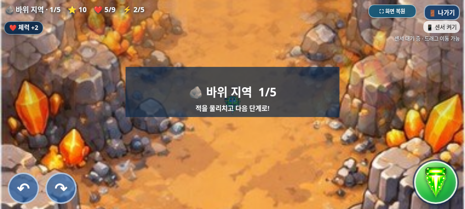
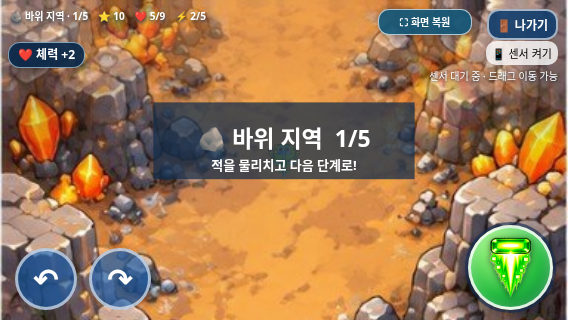

# 보스 보상 즉시 지급과 N2 수정

2026-11-01(KST) · `feature/selection-screen-integration` · 시작 HEAD `501b1a0a80e77e47068450bd263993a28eab1b3e`

## 기존 규칙과 보상 소실 원인

보스는 처치 시 `dropItem(boss.x,boss.y,true)`를 한 번 호출했다. 함수의 `isBoss` 인자는 사용되지 않아 일반 아이템과 동일한 규칙이었다.

| 항목 | 기존 규칙과 유지한 값 |
| --- | --- |
| 보상 개수 | 보스당 1개, 보상 없음 분기 없음 |
| 체력 보상 | `Math.random()<.5`: 50%, 체력 +2 |
| 강화 보상 | 나머지 50%, 무기 강화 +1 |
| 최대치 | 캐릭터별 체력 4/6/9, 강화 5단계 |
| 일반 아이템 | 특수 적 처치 시 드롭, 접근/접촉해야 획득 |
| 지역 회복 | 숲→바위, 바위→바다, 바다→사막 이동 시 체력 +2, 최대치 제한 |
| 최종 사막 | 다음 지역이 없어 기존 지역 회복 없음 |

기존 보스 처리에서는 드롭 직후 `nextPhase()`가 `items=[]`를 실행해 획득 전에 아이템이 사라졌다. 수정 전 네 보스 × 두 보상, 총 8가지 사례에서 아이템 잔존 0개·강화 미적용을 재현했다. 체력도 지역 이동 회복 +2만 적용됐다. [수정 전 재현 결과](before-fix-reproduction.json).

## 구현과 지급 순서

`index.html`에 `grantBossReward(defeatedBoss)`를 추가하고 보스 사망 경로의 드롭 한 곳을 호출로 교체했다.

1. 사망한 보스의 `rewardGranted`를 먼저 표시한다. 같은 객체는 다시 지급하지 않는다.
2. 기존 `Math.random()<.5`로 종류를 한 번 추첨한다. 최대치여도 재추첨하지 않는다.
3. 기존 효과와 동일하게 체력 +2 또는 강화 +1을 최대치 안에서 즉시 적용한다. 강화 효과음은 기존 `gameAudio.fx('upgrade')`를 재사용한다.
4. 실제 증가량을 알림으로 보낸다.
5. 기존 `boss=null`, 점수 +10, `nextPhase()`를 실행한다. 첫 세 지역은 이때 기존 체력 +2를 다시 최대치 안에서 적용한다.

예를 들어 체력 1인 탱코가 체력 보상을 받으면 **1 → 보스 보상 3 → 지역 회복 5**다. 트리오는 같은 상황에서 **1 → 3 → 최대 4**가 된다. 강화 보상이면 체력 1은 그대로 두고 강화를 먼저 적용한 뒤 지역 이동에서 체력 3이 된다. 사막에서는 보상 효과만 적용하고 최종 클리어로 돌아간다. 새 게임의 능력치 초기화 규칙은 유지한다.

일반 `dropItem()`, 일반 아이템 적의 드롭 호출, 접촉 획득 코드, `nextPhase()`는 바이트 그대로 유지했다. 보스 패턴·공격·이동·이미지·음원·BGM 전환·전체화면·종료창 코드도 유지했다. 이전 게임 오버 음악 N1 수정은 계속 동작한다. 최근 별도 트리오 이미지 시안은 이번에도 적용하지 않았다.

## 짧은 보상 알림

선택화면 JS/CSS 끝에 알림 전용 코드만 추가했다. HUD 아래 왼쪽에 **1.8초** 동안 표시하고 터치·클릭·포커스를 가로채지 않는다. 실제 증가량이 1이면 +1, 최대치면 ‘체력 최대’ 또는 ‘무기 강화 최대’를 표시한다. 최종 클리어 화면에서도 보이고, 새 게임 시작 시 이전 문구를 지운다.






## 실제 브라우저 검증

Chromium/Playwright에서 실제 shoot·탄환 충돌·update·단계 전환 경로를 검사했다. 난수·체력·조준을 제어한 검사이며 사람이 실제 난도를 연속 완주한 것은 아니다.

| 검사 | 결과 |
| --- | --- |
| 3캐릭터 × 4보스 × 2보상 | 24가지 모두 즉시 지급, 점수 +10·지역 진행·보스 드롭 0개 |
| 지급 순서 | 알림 이벤트 시점의 체력/강화를 기록해 보상→지역 회복 순서 확인 |
| 확률 | 0, 0.499999999는 체력, 0.5, 0.999999999는 강화; 보상당 추첨 1회 |
| 최대치 | 3캐릭터 × 최대/최대 직전 × 2보상, 12가지 제한·실제 증가량·재추첨 없음 |
| 중복 | 같은 보스에 10회 호출해 1회 지급·알림·추첨; 다중 탄환 사망도 1회 |
| 잘못된 지급 | 살아 있는 보스·종료한 게임은 지급 안 함 |
| 일반 적 드롭 | 체력/강화 모두 실제 적 처치 후 드롭, 접촉 때만 적용, 재획득 없음 |
| 알림 | 915×412, 800×360, 568×320에서 HUD·터치·전체화면·나가기 버튼과 비겹침 |
| 수명 | 빠른 새 알림이 이전 타이머에 지워지지 않음; 최종 클리어 표시·새 게임 정리 |
| 진행 회귀 | 20개 웨이브·보스 4종·점수 160·다음 지역/최종 클리어 정상 |

| 실행한 검사 | 통과 그룹 |
| --- | --- |
| `tests/boss_reward.py` | 8 |
| `tests/selection_smoke.py` | 15 |
| `tests/game_audit.py` | 11 |
| `tests/trio_body.py` | 8 |
| `tests/bgm_smoke.py` | 9 |
| `tests/exit_dialog.py` | 10 |
| `tests/galaxy_standalone.py` | 16 |

총 **77개 그룹 통과**. JavaScript 문법, 이미지·음원 보존, 기존 BGM·전체화면·종료 모달·터치 조작도 다시 검사했다. 기존 소스 보호 검사는 보상 함수와 호출·알림 추가만 분리해 허용하고 나머지 바이트를 계속 대조한다. 새 보호 도우미는 `tests/reward_preservation.py`다.

결과: [보스 보상](test-results.json), [전체 기능](game-audit.json), [선택](selection-regression.json), [기존 트리오](trio-regression.json), [BGM](bgm-regression.json), [종료창·전체화면](exit-regression.json), [단일 HTML](../galaxy-test/test-results.json).

```sh
python tests/boss_reward.py --artifacts /absolute/path/to/reward-review
```

## 최신 갤럭시 파일과 한계

- HTML: **28,100,881바이트**, SHA-256 `bb084fe8580e4d3cda50cc373fce6cca15d14ed19804455e6d62d429f9698f02`.
- ZIP: **20,315,626바이트**, SHA-256 `52777e5659b91d9abfb9398e8b64cbe5adceb9193e3a21ed2586d49154e9326c`.
- ZIP에는 최신 HTML 1개만 있다. CRC·`unzip -t`·실제 압축 해제 후 바이트 일치, 보상 함수·호출·알림 포함과 이전 보스 드롭 호출 부재를 검사했다.
- 새 독립 HTML에서도 체력·강화 보상과 지역 회복·알림이 작동했다. [다운로드 안내](../galaxy-test/README.md) · [패키지 검증](package-verification.json).

실제 Galaxy Samsung Internet/Chrome·스피커·센서·Android UI·성능은 미검증이다. 로컬 `file://` 실행은 이 환경의 관리자 정책으로 차단되어 동일 HTML을 새 문서에 주입하고 오프라인으로 검사했다. 정책 우회는 하지 않았다. 새 문제나 진행 차단은 검사에서 발견하지 못했다. N2 보상 소실은 해결됐으며 다른 미대응 사항은 개발 기록을 따른다.

작업 브랜치에만 커밋·푸시한다. `main` 병합·GitHub Pages 배포는 하지 않는다.
