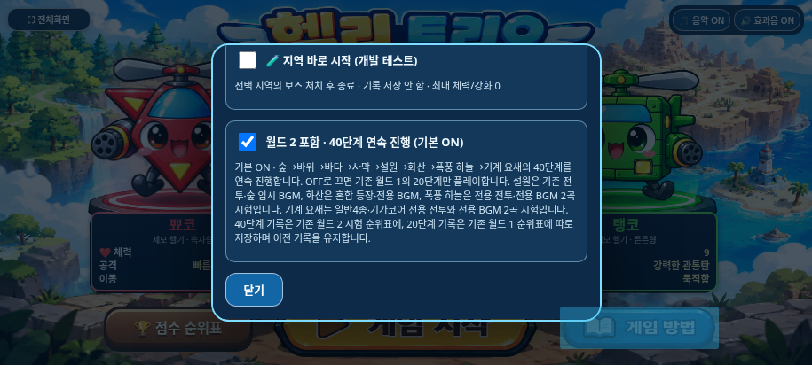

# 기본 월드1→월드2 40단계 진행 — Issue #38

[Issue #38](https://github.com/26aiera11-cpu/helicopter-game/issues/38)의 전체 지시를 적용했다. 기준은 승인된 기계 요새 음악 `54d892cbd074804741892ab800c293cb3b4fd5cc`, 브랜치는 `fix/default-world1-to-world2-route`다. main 병합과 Pages 배포는 하지 않는다.

[최신 갤럭시 테스트 ZIP](https://raw.githubusercontent.com/26aiera11-cpu/helicopter-game/refs/heads/fix/default-world1-to-world2-route/dist/heli_trio_galaxy_test.zip)

## 원인과 수정 범위

기존 시작 설정이 `?world2=1`일 때만40단계 ON이었다. 일반 접속은 월드1의 `[0,1,2,3]`만 경로로 잡아 사막 보스 이후 `nextRegion(3)===null`이 됐고, 원래 클리어 처리가 정상 실행되면서 선택화면으로 돌아갔다. 개발자 지역 바로 시작은 원래 지정한 지역만 시험하는 기능이므로 사막 직접 테스트 후 종료되는 동작은 그대로다.

**실제 게임 수정은 `assets/worlds/worlds.js` 한 파일의4개 차분**이다. 초기 설정을 기본ON/명시0일 때OFF로 바꾸고, 시작 전 경로 미리보기도 이 값으로 초기화했다. 도움말에 기본ON·40단계와 OFF·20단계 및 기록 분리를 명시했다. 파일 설명 주석을 갱신했다. 기존 beginRun/nextRegion, index의 진행·피해·보상·게임오버·음악, score.js는 수정하지 않았다.

| 시작 방식 | 경로 | 종료 | 저장 |
|---|---|---|---|
|일반 URL·도움말 기본ON|숲→바위→바다→사막→설원→화산→폭풍 하늘→기계 요새,40단계|기가코어 처치 후|기존 월드2 시험 저장소|
|도움말에서40단계 옵션OFF / `?world2=0`|월드1 네 지역,20단계|사막 전갈왕 처치 후|기존 월드1 저장소|
|`?world2=1`|명시적40단계|기가코어 처치 후|기존 월드2 시험 저장소|
|개발자 지역 바로 시작|선택한 지역의 선택 단계부터|해당 지역 보스 처치 후|순위표·분석 기록 모두 저장 안 함|

없는 값이나 알 수 없는 world2 값은 기본ON이다. 체크박스 변경은 현재 문서에서 유지하며 새로고침/재접속하면 URL 규칙으로 다시 초기화한다. 예를 들어 일반 URL에서 수동OFF 후 새로고침하면ON, `?world2=0`에서는 재접속해도OFF다. 설정용 localStorage 키 추가·마이그레이션·기록 삭제를 하지 않았다. 플레이/결과 처리 중 기존 모드 잠금을 유지한다. 개발자 테스트를 끈 후 현재 페이지에서 전체 진행을 원하면40단계 체크박스를 다시 켜면 된다.

## 캐릭터·체력·아이템·점수 유지

사막 보스의 실제 HP0·보상 처리 후 `stage4/phase1`, `started=true`, `menu hidden`을 확인했다. 같은 플레이어 객체·캐릭터 ID·강화 단계·점수·같은 아이템 객체/위치/종류와 수명이 이어진다.

**기존 체력 회복도 그대로다.** 캐릭터 최대 체력으로 초기화하지 않는다. 보스 보상(HP면+2 또는 무기+1)이 먼저 적용되고 원래 지역 전환+2HP가 최대치 내에서 뒤에 적용된다. 체력1·강화3·HP 보상으로 통제한 검사에서 뾰코는1→3→4, 빙글/탱코는1→3→5였다. 전환 시 점수28,000/강화3, 아이템7.25초 유지 후0.2초 진행하면7.05초가 됐다. 게임 규칙을 새로 바꾼 결과가 아니다.

3캐릭터 각각 실제 경고/적 생성·플레이어 발사/충돌·보스 HP0를 통해40단계/일반240마리/보스8마리/일반 단계 보너스32회, 아이템몹 없는 통제 조건에서56,000점을 확인했다. 사막에서는 중간 기록을 저장하지 않고 최종 기가코어에서만 결과를1회 저장한다.20단계 옵션은 기존28,000점/일반120마리/보스4마리/보너스16회다. 무적·생성 대기·상태를 조절한 자동 검사이며 사람의 실전 난이도 승인은 아니다.

## 기존 기록과 승인 기능 보호

40단계는 원래의 `activeTrial=true` 경로와 아래 키를 계속 쓴다.

- `heliTrio.world2Trial.top10.v1`
- `heliTrio.world2Trial.playHistory.v1`

20단계는 그대로 `heliTrio.top10.v1`, `heliTrio.playHistory.v1`다. **정식 순위표 통합/네임스페이스 병합은 하지 않는다.** 따라서 기본 메뉴의 순위표는 월드2 시험 기록을 보여 주며, 예전 월드1 기록을 보려면 도움말에서40단계를OFF로 선택한다. 기존 기록을 잃은 것이 아니다. 시작/새로고침/단순 보기에서4개 저장값은 바이트 단위로 같고,40단계 완료 중 월드1 저장값은 그대로이며 이전 시험 기록도 모든 필드를 유지한다. 새 결과 저장 시 기존 정렬·TOP10/분석 기록 상한·동점 규칙을 재사용한다. 중복 finish는 추가 저장하지 않는다.

기존131자산 중 월드 설정 외130개와 index.html 전체가 기준과 바이트 단위로 같다. 승인된 기어 시티/기가코어 경보 WAV, 모든 기존 음악/SFX, PNG11개/Cover, 플레이어·일반40px/보스132px, 나사봇H×.4·톱니벌H×.7, 장벽75/25·레이저·미사일·폭주, 자이로/조이스틱/터치·아이템·점수/저장 코드를 유지했다. [정확한 보존 명세](../../../tests/default_world_route_preservation.py)를 검사했다.

## 검사 결과와 실패 기록

**등록80모음 중 관련20개 실행, 19개 통과·1개 실패, 완료263그룹**이다. 전체 모음을 모두 실행한 결과로 표현하지 않는다. 신규 일반10/오프라인10그룹은 모두 통과했다. [최종 집계·모든 시도](test-summary.json)와 tests/, attempts/에 결과·실패 로그를 보존한다.

새 검사는 실제 신뢰 터치로 일반 시작, 세 캐릭터 전체40단계·사막 경계, 명시20, 기존 기록/동일 결과1회 저장, URL/새로고침, 개발자 사막/설원/기가코어 직접5와 무저장, 전체화면/내부 나가기, 각 지역 일반·보스 BGM 재생 시간을 확인했다.915×412/800×360/568×320과 독립HTML에서 수행했다. 승인 음원과 전투 모듈은 기존 관련 검사로도 확인했다.

이전 검사의 '사막에서 최종 클리어' 항목은 삭제하지 않고20단계 옵션을 명시적으로 선택하게 했다. 별도 기본40 검사와 기존20·40 양쪽 진행 검사를 유지한다. 기존 화산 그래픽 검사에 빠져 있던 기계 요새 ID7도 현재8지역 목록에 반영했다. 게임 규칙을 검사에 맞추어 바꾸지 않았다.

초기 신규 검사 두 번은 탱코의 이전 관통탄이 다음 적을 먼저 처치해 대상을 찾지 못했다. 기존 worlds 검사와 같은 방식으로 테스트의 매 적 생성 전 탄환 정리를 보강했다. 게임 탄환/공격은 수정하지 않았으며 초기 로그·그때의 검사 소스를 남겼다. 기가코어 검사는 첫 실행에서25개 그룹 후 미사용 `volcano_boss.wav` 요청 `net::ERR_ABORTED`로 실패했다. 음원/재생 코드를 고치거나 실패 요청을 무시하지 않고, 테스트 시작 전에 원본 음원 preload 완료를 기다리도록 보강한 뒤 재검증했다. 최초 실패와 재검증 결과 모두 집계한다. 아이템 유지 검사의 기존 사막 최종 종료 기대도 새 기본40과 달라 실패했으며, 해당 검사는 보존된20단계를 명시적으로 선택하도록 수정해 원래 아이템/수명/회복 단언을 유지하고 재검증했다.

기존 **Issue #30 설원 긴 멀티터치 후 나가기 click 누락**이 이번 worlds에서 재현되어16개 부분 그룹 후 실패했다. `started=true`, `dialog=false`, `hit=exitGame`, 버튼 비활성 아님이 기록됐다. [실패 화면](tests/worlds/exit-touch-failure.png)·[상태/입력 추적](tests/worlds/exit-touch-failure.json)·로그를 보존하고 조작 코드는 변경하지 않았다. 이16개 부분 통과와 실패한 초기 검사는 완료 그룹 합계에 넣지 않았다.

## 실제 화면



| 캐릭터/화면 | 사막→설원 | 최종 기가코어 클리어 |
|---|---|---|
|뾰코915×412|[설원 진입](screenshots/desert-to-snow-0-915x412.png)|[40단계 완료](screenshots/full40-clear-0.png)|
|빙글800×360|[설원 진입](screenshots/desert-to-snow-1-800x360.png)|[40단계 완료](screenshots/full40-clear-1.png)|
|탱코568×320|[설원 진입](screenshots/desert-to-snow-2-568x320.png)|[40단계 완료](screenshots/full40-clear-2.png)|

## 갤럭시 파일과 한계

HTML 80,010,481바이트(SHA `9790b920643d82fc3b3897b5f565656098f51e88001fd83868e8cecce9a8b2d7`), ZIP 58,468,722바이트/55.76MiB(SHA `7091b0a64935a241a03f64284a4f92ab4db3d13be1f3ef915c47c0aab85aa997`). ZIP은 HTML 한 개만 포함한다. CRC·별도 폴더 압축해제/HTML 전체 바이트 일치,27스크립트, 승인 PNG11개/음원7개·변경된 월드 코드의 정확한 내장을 확인했다. 외부 요청0의 동일 HTML에서 새 기본40/20/기록/음악을 실제 실행했다. 관리 환경 file:// 제한은 우회하지 않았다. [빌드](build.json), [패키지](package.json), [무결성](standalone-integrity.json).

```sh
PYTHONDONTWRITEBYTECODE=1 TMPDIR=/tmp python tests/run_volcano_checks.py --workers 1 --only default_world_route-native default_world_route-offline --artifacts /tmp/default-route-checks
```

실제 Galaxy Samsung Internet/Chrome의 긴 터치·자이로·장시간 성능·로컬 파일 연결/스피커 청취는 미검증이다. 사용한도 때문에 테스트 생성 명령이 실행되지 않은 채 한 차례 중단됐으며, 사용자 재설정 후 파일/브랜치 상태를 확인하고 미실행 부분부터 이어갔다. 기존 파일/진행 결과를 초기화하지 않았다. 변경은 지정 브랜치에만 커밋·푸시하고 최종 원격 ZIP을 다시 내려받아 검증한다. main 병합·Pages 배포는 하지 않는다.
