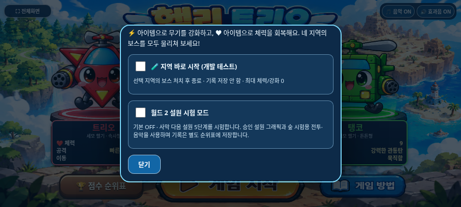
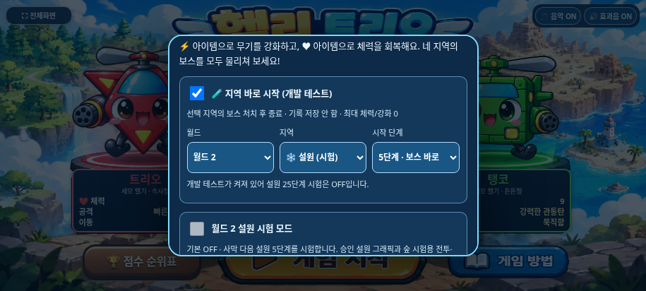
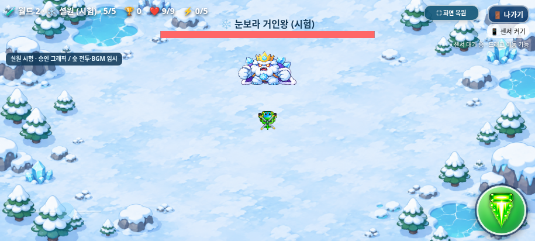
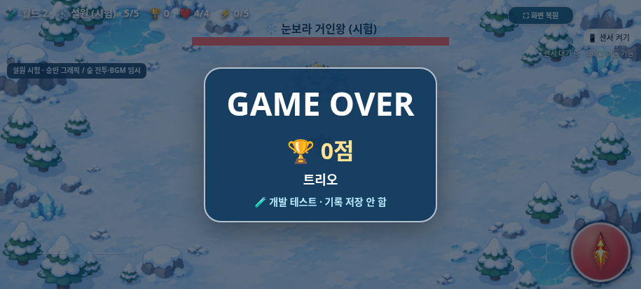

# 개발자 지역 바로 시작 — Issue #7

2026-11-03(KST) · 작업 브랜치 `feature/developer-region-start`

[Issue #7](https://github.com/26aiera11-cpu/helicopter-game/issues/7)의 요구사항을 확인하고 최신 원격 `feature/snowfield-art-integration`의 `c5e8fa2a27a6c8d8f360c7680345a55589ae6a09`에서 새 브랜치를 만들었다. 시작 작업 트리는 깨끗했다. 원격 main은 `17da293570f422035d455add578dbc8412e4f24b`이며 main·기준 기능 브랜치를 변경하거나 Pages에 배포하지 않는다. `HELI_TRIO_SPEC.md`는 없으므로 이번 요청·Issue와 이전 확정 규칙을 따른다.

## 사용 방법과 동작

1. 선택화면에서 **게임 방법**을 연다. 아래로 스크롤하면 **🧪 지역 바로 시작 (개발 테스트)**가 있다. 기본값은 OFF다.
2. 체크한 뒤 **월드 → 지역 → 시작 단계**를 고른다. 현재 월드1에는 숲·바위·바다·사막, 월드2에는 설원(시험)만 나온다. 5단계는 보스 바로 시작이다.
3. **닫기 → 캐릭터 선택 → 게임 시작**을 누른다. 기존에 선택한 캐릭터의 최대 체력, 강화0, 점수0으로 시작한다. 기존 아이템·탄환·아이템 몬스터·이전 지역 생성 계획을 이어받지 않는다.
4. 선택 지역의 보스를 처치하면 **지역 테스트 완료!**로 끝나고 선택화면으로 돌아온다. 다른 지역으로 넘어가지 않는다. 게임 오버의 기존 3초 대기와 내부 나가기 창도 그대로다.
5. 개발 테스트를 끄면 기존 월드1의 20단계 진행으로 돌아간다. 기존 **월드2 설원 시험 모드**를 별도로 켜면 원래 25단계 경로가 된다. 두 시험 모드는 동시에 켜지지 않는다. 개발 테스트가 켜진 동안 설원25 체크박스는 OFF·비활성이다.

개발 설정은 저장하지 않으며 새로고침/재접속하면 OFF·숲1단계로 돌아간다. 한 번 시작한 실행의 설정은 복사해 고정하고, 플레이·게임 오버 대기·설원 보스 소멸 연출 중 변경은 거부한다. 복귀하면 다시 선택할 수 있다. 잘못된 지역ID·단계·설정값은 적용하지 않는다.

## 구현과 보호

- `assets/worlds/worlds.js`의 기존 월드/지역 레지스트리로 옵션을 만든다. 지역 이름이나 목록 인덱스로 분기하지 않는다. 등록 지역을 추가하면 목록에 자동 반영되며 미등록 지역은 표시하지 않는다. 새 지역의 실제 그래픽/전투 프로필을 구현하는 일은 별도다.
- 개발 경로는 선택 지역 하나뿐이다. `runStart()`의 복사본과 실행 시작 시 고정한 모드로 입장 위치·종료 지점을 정한다. 정상/설원25 경로는 그대로다.
- `index.html`의 기존 보스 생성 본문을 공용 `spawnBossEncounter()`로 옮겨 정상 등장과 직접 입장이 같이 호출한다. HP 보정·좌표·패턴·탄속·보상·등장 대기/효과음은 바꾸지 않았다. 부팅을 위해 전체 전투 `update(0)`를 실행하지 않는다.
- 직접 5단계 시작만 기존 등장 조건의 `phaseKills=requiredKills`를 사용한다. 실제 일반 처치/분석 카운터와 점수는0이다. 1~4단계부터 진행해 5단계에 도달하는 경우에는 원래 5단계의 일반 적6마리 후 보스 등장 규칙을 유지한다. 일반 단계 목표6마리를 바꾸지 않았다.
- 기존 `gameAudio.resume()`에 기본값을 가진 지역/보스 인수만 추가했다. 바위·바다·사막 또는 직접 보스 입장 시 해당 곡을 처음부터 선택한다. 임시로 숲 곡을 틀었다가 바꾸지 않는다. 설원은 기존 숲 시험 음악 프로필이다. 음악 OFF/효과음·곡 데이터는 그대로다.
- 점수 모듈은 실행 시작 시 개발 여부를 고정한다. 개발 실행의 `finish()`는 화면 결과용 일시 객체만 반환하고 TOP10·분석 배열 추가, 저장 호출, 마지막 정식 순위 강조 정보 갱신 전에 반환한다. 게임 오버·클리어·나가기·강제 재시작·중복 종료 모두 같은 방어를 쓴다. 개발 게임 오버에는 **개발 테스트 · 기록 저장 안 함**을 표시한다.
- 기존 정상/설원25의 네 localStorage 키·형식·정렬·점수 계산·최근100회 분석은 유지한다. 개발 전용 저장소를 만들지 않는다. 기존 순위표를 조회할 수 있지만 개발 점수는 메모리 순위/분석에도 넣지 않는다.
- 캐릭터/보스/배경 PNG, 아틀라스, 매니페스트, 음원, 조작 JS/CSS, 아이템 몬스터 JS, 설원 렌더러는 기준과 바이트가 같다. 새 시작/UI/일시 점수 변경을 정확하게 되돌리면 index와 변경한 네 자산도 기준과 같다. 보호 검사는 이전 해시를 완화하지 않고 정확한 허용 변경만 역변환한다.

## 브라우저 검증

**30개 검사 모음·427개 검사 그룹**을 통과했다. 기존 28개 모음391그룹과 새 일반/오프라인 각18그룹이다. [집계 및 재검사 이력](test-summary.json), [일반 상세](native/test-results.json), [오프라인 상세](offline/test-results.json), [소스/패키지 일치](package-source-verification.json)를 제공한다.

| 검사 | 결과 |
| --- | --- |
| 5지역 × 시작1~5단계 × 세 캐릭터 | 일반/오프라인 각각75조건 모두 실제 경고·적 생성·발사·충돌·보스 처치·선택 복귀 |
| 직접 5단계 | 일반 적/예고/탄환0, 즉시 보스, 최대HP4/6/9·강화0·점수0·일반 처치0 |
| 선택 지역 보스 후 종료 | 다음 지역 이동 없음, 보스1회·보상/2,000점 유지; 설원 소멸 연출도 유지 |
| 기록 금지 | 75회 클리어 후 기존 네 저장 문자열 동일·쓰기0회; 게임 오버/나가기/반복/중복 종료도 저장·메모리 기록 없음 |
| 지역별 초기화 | 선택 지역의 새3기회 계획만 존재; HP5/아이템 처치200점/드롭은 유지하고 일반 목표에는 미반영 |
| 초기 BGM | 5지역 × 일반/직접 보스의10조건에서 올바른 실제 Audio 대상·시간 증가·반복1개, 선택 곡 정지 |
| OFF/ON·전체화면 | 음악 OFF 무음, 복귀/ON 때 선택 곡 재생, 시작/나가기/사망/클리어 전체화면 유지 |
| 정상 모드 복구 | 개발OFF 후 월드1 20단계/설원25단계 완료·정식 저장 정상, 이전 기록 유지 |
| 향후 레지스트리 확장 | 격리된 브라우저 문서에만 worldID7/regionID42를 추가해 옵션 자동 생성·그 지역 보스 입장 확인 |
| 가로 UI | 915×412·800×360·568×320의 내부 스크롤, select 높이44px, 실제 닫기/시작/나가기, HUD/기존 조작 겹침 없음 |
| 회귀 | 선택/점수/3초 게임 오버·보스HP/보상·탱코/연사·일반 아이템/독립 몬스터·BGM·전체화면·조작/센서 이벤트·설원115프레임 유지 |

아이템 처치를 제외하고 각 선택 단계에서 지역 보스까지 진행한 통제 검사 점수는 아래와 같다. 원래 보스 단계에도 일반 적6마리를 먼저 잡는 경로는 유지하고, 직접5단계만 이를 건너뛴다.

| 시작 단계 | 일반 처치 | 일반 단계 완료 | 보스 처치 | 최종 점수 |
| --- | --- | --- | --- | --- |
| 1 | 30 | 4 | 1 | 7,000 |
| 2 | 24 | 3 | 1 | 5,900 |
| 3 | 18 | 2 | 1 | 4,800 |
| 4 | 12 | 1 | 1 | 3,700 |
| 5 직접 | 0 | 0 | 1 | 2,000 |

검사에서는 조준·생성 대기·무적/시간을 통제했다. 수동 연속 완주나 난이도/처치 시간 측정이 아니다. 미래 지역 검사는 테스트 응답/문서만 바꾸며 제품/배포 파일에는 가상 지역을 추가하지 않았다.

병렬 회귀의 `scoring-offline`에서 0점 사망 후 선택 복귀를 기다리는 기존4초 검사1회가 시간 초과했다. 다른 검사 종료 후 같은 모음을 단독 재실행하여 전체17그룹을 통과했다. 원래 실패 로그와 재실행 결과를 함께 보존한다. 제품의3초 타이머나 해당 테스트의 제한시간을 바꾸지 않았으며 자원 경합이 원인인지는 확정하지 않았다. 다른 게임 오버 모음 및 신규 두 모음의 실제3초 복귀도 통과했다.

## 화면

실제 Chromium 렌더링을 저장했으며 이미지 편집·합성 또는 물리 갤럭시 촬영이 아니다. 도움말은 스크롤 가능한 창이므로 작은 화면에서는 목록/닫기 버튼을 스크롤해 사용한다.

| 화면 | 도움말 | 직접 보스 입장 |
| --- | --- | --- |
| 915×412 | [일반](native/help-915x412.png) / [오프라인](offline/help-915x412.png) | [일반](native/direct-snow-boss-915x412.png) / [오프라인](offline/direct-snow-boss-915x412.png) |
| 800×360 | [일반](native/help-800x360.png) / [오프라인](offline/help-800x360.png) | [일반](native/direct-snow-boss-800x360.png) / [오프라인](offline/direct-snow-boss-800x360.png) |
| 568×320 | [일반](native/help-568x320.png) / [오프라인](offline/help-568x320.png) | [일반](native/direct-snow-boss-568x320.png) / [오프라인](offline/direct-snow-boss-568x320.png) |

## 파일과 패키지

제품 변경 파일은 `index.html`, `assets/worlds/worlds.js`/`worlds.css`, `assets/score/score.js`, `assets/selection/selection.js`다. 패키지 확인 조건, 개발 테스트·정확한 차분 보호 도구, `dist`2개, 보고서·누적 기록도 갱신했다.

[최신 갤럭시 ZIP](https://github.com/26aiera11-cpu/helicopter-game/raw/refs/heads/feature/developer-region-start/dist/heli_trio_galaxy_test.zip?download=1) · [실행 안내](../galaxy-test/README.md) · [빌드](build-results.json) · [압축 검증](zip-results.json).

HTML은 **43,578,495바이트**, SHA-256 `fadee08104fef3fe8cf82c91375ae7e8d2c15fa21d98043ae46d57014ea814c6`다. ZIP은 **31,831,669바이트**, SHA-256 `a04d7f00c0df8c909b49592959f375e65b4ff0e5a784eb5a4fe99a6223f3ee04`다. 현재 실행 스크립트9개·CSS·참조 PNG/MP3·기존 WAV·설원 매니페스트를 담고 외부 의존성이 없다. 최종 재생성한 HTML은 브라우저 검사본과 바이트가 같고 ZIP의 HTML1개·CRC·unzip-t·실제 압축 해제 후 원본 일치를 확인했다.

## 남은 확인

실제 Galaxy Samsung Internet/Chrome의 네이티브 select 팝업/스크롤·파일 다운로드/열기/localStorage·물리 자이로 권한과 감각·멀티터치 체감·길게 누르기 메뉴·전체화면/주소창·성능·스피커 청취는 미검증이다. 오디오는 재생 상태와 시간 증가를 검사했으며 소리를 직접 듣지 않았다. 이 환경의 관리 정책상 직접 file:// 실행 성공을 주장하지 않는다. 정책을 우회하지 않고 저장 가능한 빈 localhost origin을 준비한 뒤 네트워크를 차단해 동일 독립HTML을 검사했다.

재현되는 제품 결함은 발견하지 않았다. main 병합/Pages 배포, 추가 지역/설원 전투 난이도 확정, 온라인 순위표 및 보류 중인 밸런스 조정은 수행하지 않는다.
