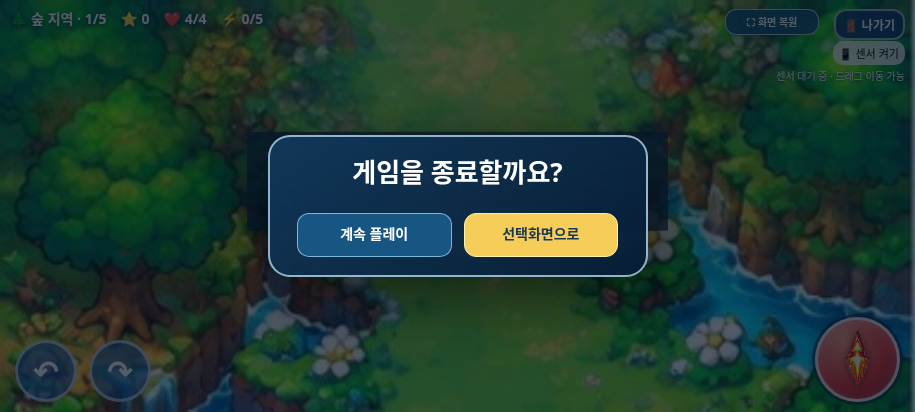
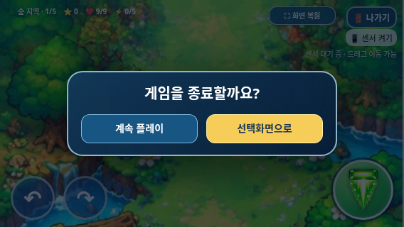

# 종료 확인창과 전체화면 유지 검증

2026-11-01(KST) · `feature/selection-screen-integration` · 시작 커밋 `f36ab92076636a7bec3ccc9ef084ccdaf3455007`

## 원인

기존 ‘나가기’ 처리에는 `confirm('게임을 종료하고 캐릭터 선택 화면으로 돌아갈까요?')`가 있었다. 사용자가 실제 갤럭시 Samsung Internet에서 이 기본 대화상자가 열리면 주소창이 돌아오고 전체화면이 복구되지 않는 현상을 보고했다.

기존 종료 정리·게임 오버·최종 클리어 처리에는 전체화면 해제 호출이 없었다. 명시적인 `exitFullscreen()` 호출은 기존 공유 전체화면 버튼에만 있다. 이전 Chromium 자동 검사는 기본 confirm을 자동 승인했으므로 Samsung Internet의 시스템 UI 동작까지 검증한 것은 아니었다.

## 변경 내용

- 브라우저 기본 confirm을 게임 문서 안의 `<dialog>` / `showModal()`로 교체했다. 이는 페이지 DOM 패널이며 브라우저 기본 확인창을 호출하지 않는다.
- 화면 중앙의 둥근 남색 패널과 어두운 반투명 배경에 ‘게임을 종료할까요?’, ‘계속 플레이’, ‘선택화면으로’를 표시한다.
- 패널이 열려 있는 동안 `update()`의 진입만 막아 적·탄환·피격·진행 시간을 일시정지한다. 취소하면 같은 상태에서 다시 진행한다. BGM·효과음 시스템을 바꾸지 않았다.
- 모달의 배경 비활성화로 뒤쪽 터치를 차단하고, 열고 닫을 때 회전·발사·드래그 입력을 비워 눌림이 남지 않게 했다. 기본 포커스는 ‘계속 플레이’다.
- 확인하면 기존 종료 정리를 그대로 실행한다. 확인창·취소·확인·선택화면 복귀에는 전체화면 진입/해제 요청이 없다.
- 브라우저가 전체화면을 해제하면 기존 상태 동기화와 수동 전체화면 버튼을 이용한다. 자동 재진입을 추가하지 않았다.
- 빠르게 닫고 다시 여는 경우 이전 비동기 close 이벤트가 새 창을 취소하지 않도록 현재 `open` 상태를 확인한다.

`index.html`의 수정은 기본 confirm을 콜백으로 감싼 부분과 일시정지 조건 1곳이다. 회귀 검사는 통합 전 백업에 이 **세 문자열 변경만** 허용한 결과와 현재 인라인 스크립트 전체를 대조한다. 선택화면 JS/CSS는 이전 커밋 내용을 그대로 두고 모달 코드·스타일만 끝에 추가했다. 캐릭터·PNG·능력치·전투·스테이지·보스·사운드·기존 전체화면 버튼은 유지했다.

## 실제 브라우저 결과

Playwright로 실제 Chromium을 실행했고, 모바일 터치 에뮬레이션과 **네이티브 표준 Fullscreen API**를 사용했다. 전체화면을 가짜 상태로 바꿔 성공 처리하지 않았다.

| 검사 | 결과 |
| --- | --- |
| 새 모달·전체화면·입력: `tests/exit_dialog.py` | 10개 그룹 통과 |
| 기존 선택·이미지·게임 회귀: `tests/selection_smoke.py` | 15개 그룹 통과, JavaScript 문법 검사 포함 |
| 기존 선택 강조: `tests/selection_highlight.py` | 8개 그룹 통과 |
| 기존 전체화면·미지원/거부: `tests/fullscreen_smoke.py` | 7개 그룹 통과 |
| 무기·아이템·20개 웨이브·보스: `tests/game_audit.py` | 11개 그룹 통과 |
| 최신 독립 HTML 오프라인: `tests/galaxy_standalone.py` | 14개 그룹 통과 |

- 전체화면 중 확인창 열기, 취소 후 같은 게임 재개, 확인 후 선택화면 복귀에서 전체화면을 유지했다.
- 세 캐릭터로 시작→취소→종료를 각각 2회 반복했고 즉시 재열기도 확인했다.
- 확인창을 열어 300ms 동안 게임 상태가 그대로인지, 배경 발사 버튼 위치를 터치해도 입력이 전달되지 않는지 확인했다. 취소 뒤 길게 누르는 회전·발사를 다시 검사했다.
- 915×412, 800×360, 568×320 가로 화면에서 패널 중앙 정렬·잘림 없음·버튼 크기를 확인했다.
- 확인창 중 표준 API로 전체화면을 해제한 뒤 양쪽 버튼을 각각 검사했다. 전체화면 요청 횟수가 늘지 않았고 수동 버튼으로 다시 진입할 수 있었다.
- 게임 오버와 최종 클리어 후 선택화면에서도 전체화면이 유지됐다. 이 두 경로는 게임 상태를 설정한 회귀 검사다.
- 일반 화면에서 Escape 취소도 확인했다. 브라우저 기본 대화상자 관찰 결과 **0건**, 잡히지 않은 JavaScript 오류 **0건**이었다.
- 초기 테스트의 포커스 순서 가정은 배경 터치 시 포커스 이동과 브라우저 UI로의 Tab 이동을 고려하도록 고쳤다. 제품에 별도 키보드 제어를 추가해 테스트를 맞추지는 않았다.

결과: [종료창 검사](test-results.json), [선택 회귀](selection-regression.json), [선택 강조](highlight-regression.json), [전체화면 회귀](fullscreen-regression.json), [전체 기능 회귀](game-audit.json).

```sh
python tests/exit_dialog.py --artifacts /absolute/path/to/exit-review
```

## 갤럭시 패키지와 한계

[최신 HTML·ZIP 다운로드와 검증 안내](../galaxy-test/README.md). 새 ZIP에는 HTML 하나만 들어 있으며 HTML에 새 모달 코드가 포함되고 기존 native confirm이 없는지, CRC·압축 해제 바이트 일치도 확인했다.

실제 갤럭시 Samsung Internet·Chrome 실기기는 이 환경에서 사용할 수 없다. 주소창·Android 뒤로가기/홈·앱 전환·권한·센서·스피커·성능 검증은 남아 있다. 사용자 제보의 실기기 재현을 이 환경에서 직접 성공적으로 재검사했다고 주장하지 않는다. 새 ZIP으로 **전체화면→나가기→계속 플레이/선택화면으로**를 Samsung Internet에서 다시 확인해야 한다.

독립 HTML의 `file://` 열기는 관리자 정책으로 차단되어 동일 문서를 새 빈 페이지에 주입하고 오프라인으로 검사했다. 정책을 변경하거나 우회하지 않았다. 기존 비차단 문제 N1(게임 오버 음악 정지 누락), N2(단계 전환 시 보스 보상 소실)는 회귀 검사에서도 유지되며 이번 요청 범위에서 수정하지 않았다.

작업 브랜치에만 커밋·푸시한다. `main` 병합과 GitHub Pages 배포는 하지 않는다.

## 스크린샷

실제 Chromium 화면이며 갤럭시 실기기 사진은 아니다.






