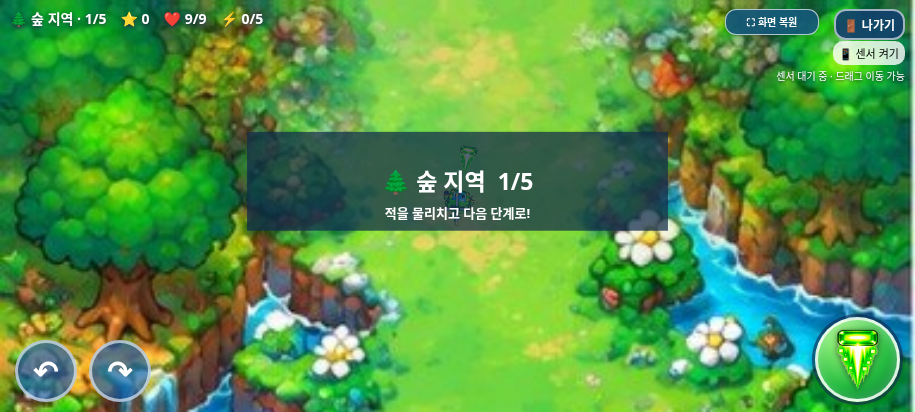

# 선택화면 전체화면 개선

2026-11-01(KST) · 작업 브랜치 `feature/selection-screen-integration`

먼저 [전체 기능 점검](../game-audit/README.md)을 `794b157`로 별도 커밋·푸시했다. 진행 차단 문제는 없었으며 기존 음악 정지 누락·보스 보상 소실은 수정하지 않았다. 이 변경은 전체화면 UI와 최신 테스트 패키지를 별도 커밋으로 관리한다.

## 사용 방법

1. 휴대폰을 가로로 돌리고 선택화면 **왼쪽 위 ‘⛶ 전체화면’**을 누른다.
2. 캐릭터를 선택하고 게임을 시작한다. 전체화면 상태를 유지한다.
3. 플레이 중에는 HUD 오른쪽의 ‘⛶ 화면 복원’으로 해제할 수 있고, 다시 전체화면으로 전환할 수도 있다.
4. ‘나가기’로 선택화면에 돌아와도 전체화면을 유지한다. 선택화면 왼쪽 위 ‘화면 복원’으로 해제한다.
5. 미지원·요청 거부 시 일반 화면에서 계속 게임을 시작할 수 있다.

브라우저 정책에 맞춰 사용자 클릭·터치에서 요청한다. 로드 시 자동 전체화면이나 보안 우회는 사용하지 않는다. 성공 시 주소창 표시는 브라우저가 관리하며, 실제 갤럭시 브라우저 UI 동작은 기기 확인이 필요하다.

## 구현과 보호 범위

- 기존 `index.html`의 `enterGameFullscreen()`을 재사용했다. 기존 게임 시작 버튼의 전체화면 동작도 유지했다.
- 표준 `requestFullscreen`·`exitFullscreen`과 `fullscreenchange`·`fullscreenerror`를 사용하고 기존 WebKit 접두사 경로도 유지한다.
- 메뉴·게임이 공유하는 작은 버튼을 추가했다. 선택화면에서는 왼쪽 위, 플레이에서는 기존 HUD의 여유 공간에 배치했다. 현재 상태는 버튼 문구와 `aria-pressed`에 반영한다.
- 요청 실패·미지원·조용한 Promise 거절에 대한 안내와 일반 화면 복귀 경로를 둔다. 자동 반복 요청은 하지 않는다.
- `index.html`, 전투·단계·아이템·보스·음원, 모든 캐릭터 PNG와 기존 부유·날개·착지 코드는 변경하지 않았다. 플레이 중 트리오 외형도 변경하지 않았다.
- 변경 소스는 `assets/selection/selection.js`와 `selection.css`의 추가 UI 코드다.

## 실제 브라우저 결과

```sh
python tests/fullscreen_smoke.py --artifacts /absolute/path/to/review
python tests/selection_smoke.py --artifacts /absolute/path/to/regression
python tests/selection_highlight.py --artifacts /absolute/path/to/highlight
python scripts/build_galaxy_test.py
python tests/galaxy_standalone.py --artifacts /absolute/path/to/galaxy
python scripts/package_galaxy_test.py
```

- **전체화면 7개 그룹**: 실제 Chromium 표준 API 진입·해제, 선택·시작·플레이·복귀 중 유지, 터치 회전·발사, 버튼/HUD 비겹침, 일반 화면 전환, 미지원·거부 시뮬레이션 통과.
- **기존 회귀 15개 그룹**, **선택 강조 8개 그룹** 재검사 통과.
- **단일 HTML 오프라인 13개 그룹**: 새 전체화면 버튼이 포함된 독립 HTML에서 실제 API 진입·세 캐릭터 시작·복귀·해제까지 통과.
- 전체화면 배치는 915×412, 800×360, 568×320, 1024×768 및 세로 회전 안내를 확인했다.
- 기존 `index.html`의 인라인 스크립트 전체와 원본 PNG가 기준 `f14abc5`와 바이트 단위로 동일함을 확인했다.
- 새 ZIP에는 HTML 하나만 있으며 CRC 검사·`unzip -t`·압축 내용과 최신 HTML의 바이트 대조를 통과했다. 패키징 스크립트는 새 전체화면 컨트롤 포함도 확인한다.

결과: [전체화면](test-results.json), [기존 기능](regression-results.json), [선택 강조](highlight-results.json), [단일 HTML](../galaxy-test/test-results.json), [ZIP](../galaxy-test/zip-results.json).

미지원·거부 경로는 테스트에서 API 유무·거절을 시뮬레이션했다. 주 검사의 전체화면 상태 변화는 실제 네이티브 API로 확인했다. 관리자 정책·보안 플래그·권한을 변경하지 않았다.

## 스크린샷





## PWA 검토 — 구현·배포하지 않음

향후 PWA 설치로 주소창 없는 독립 실행을 제공하는 것은 가능하다. 다음 사항을 별도 작업으로 검토해야 한다.

- HTTPS 배포처와 앱의 시작 URL·범위 선정.
- Web App Manifest의 이름·아이콘·`display: standalone` 또는 지원되는 전체화면 모드, 가로 방향 설정.
- 사용자 설치 절차 및 Galaxy Chrome/Samsung Internet별 지원·권한 차이.
- 필요하면 Service Worker의 오프라인 캐시·대형 이미지/음원·업데이트 전략.

로컬 다운로드 HTML과 PWA 설치는 실행·배포 방식이 다르다. 이번에는 manifest·Service Worker·설치 프롬프트·호스팅을 추가하지 않았고 GitHub Pages에도 배포하지 않았다.

## 남은 한계

실제 Galaxy Chrome/Samsung Internet의 주소창 제거·시스템 UI·가로 잠금·권한은 미검증이다. 현재 환경의 `file://` 접근 제한 때문에 단일 파일은 동일 HTML을 새 빈 문서에 주입하고 네트워크·서버 없이 검사했다. iOS/Safari, 물리 센서·스피커, 실제 난도에 따른 전 스테이지 수동 완주는 별도다.
