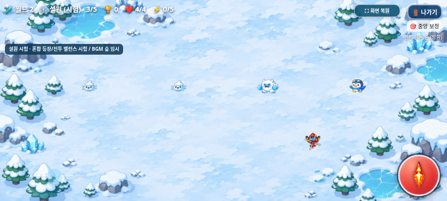
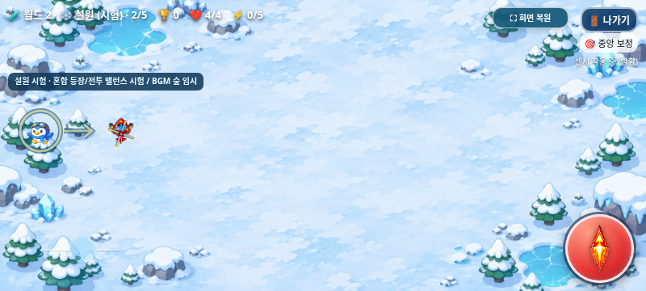
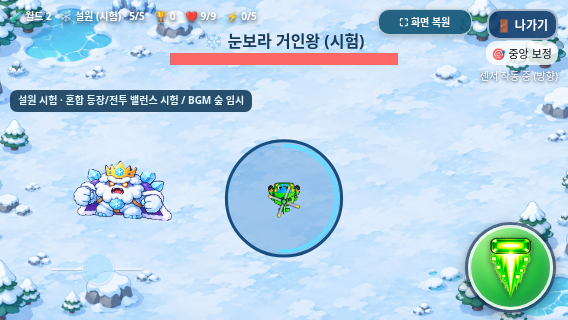
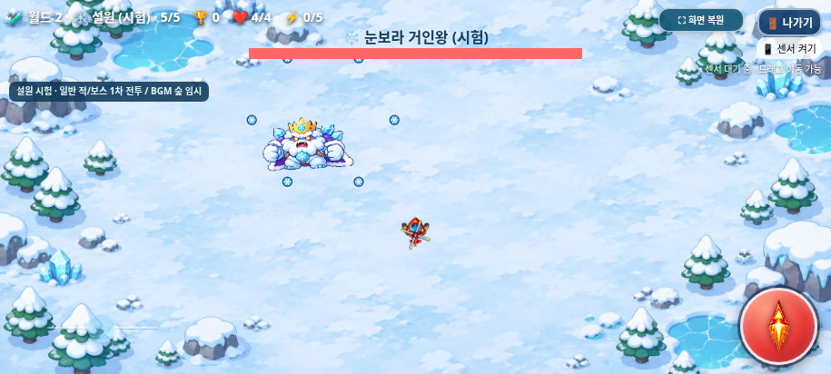
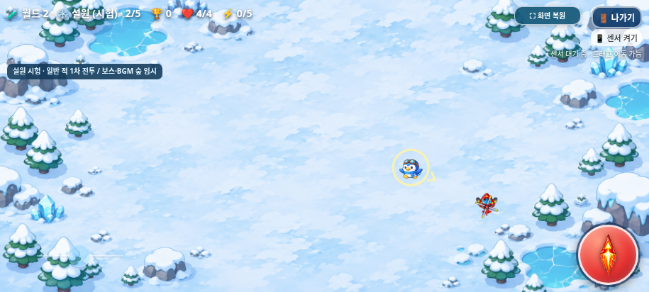
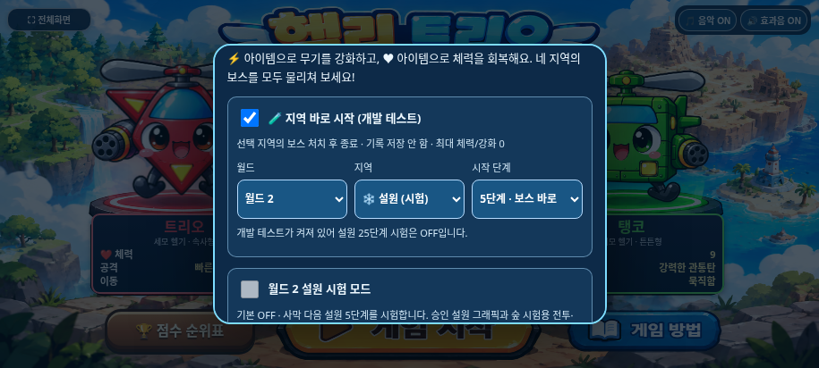
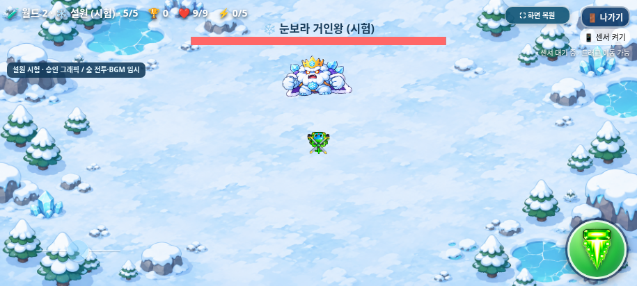
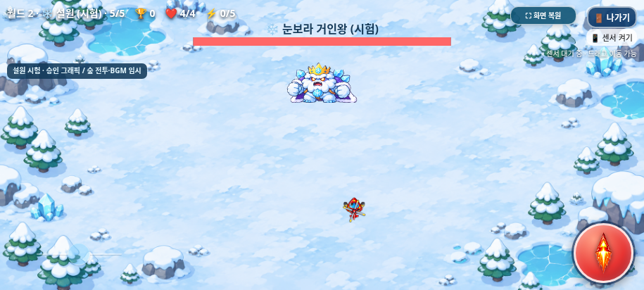
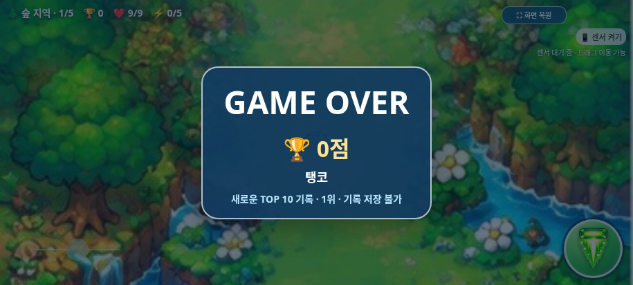

# 갤럭시 테스트 빌드 — ZIP 다운로드

2026-11-03(KST) · `feature/snowfield-mixed-spawns-balance` · 설원 혼합 등장·펭귄 장거리 돌진·확대 폭발 시험 빌드

## 다운로드와 실행

**[heli_trio_galaxy_test.zip 다운로드 — 약 31.8MB](https://github.com/26aiera11-cpu/helicopter-game/raw/refs/heads/feature/snowfield-mixed-spawns-balance/dist/heli_trio_galaxy_test.zip?download=1)**

[ZIP 파일 페이지](../../../dist/heli_trio_galaxy_test.zip)에서도 Download raw file 메뉴를 사용할 수 있다. ZIP에는 최신 [단일 HTML](../../../dist/heli_trio_galaxy_test.html) 하나만 들어 있다.

1. 갤럭시에서 위 ZIP 다운로드 링크를 연다. ZIP 크기는 **31,835,350바이트, 약 31.8MB**다.
2. ‘내 파일 → 다운로드’에서 `heli_trio_galaxy_test.zip`을 선택해 **압축 풀기**를 누른다. 안의 HTML은 **43,593,134바이트, 약 43.6MB**다.
3. 로컬 HTML 실행을 지원하는 브라우저로 파일을 연다. Chrome 또는 Samsung Internet의 지원 여부는 기기의 파일 열기 방식에 따라 직접 확인해야 한다.
4. 휴대폰을 가로로 돌리고 왼쪽 위 **⛶ 전체화면**을 누른 뒤 캐릭터를 선택해 **게임 시작**을 누른다. 선택·게임·선택화면 복귀 중 전체화면이 유지되며 **⛶ 화면 복원**으로 해제할 수 있다. 미지원·거부 시 일반 화면에서 시작한다.
5. **센서 켜기**로 자이로센서 이동을 사용한다. 화면 드래그는 보조 이동이다. 왼쪽 아래 가로 조이스틱을 좌우로 밀어 회전하고 발사 버튼을 길게 눌러 공격한다. 멀리 밀수록 빨라지며 중앙8%는 회전하지 않는다. 끝에서 기존 최대 회전 속도이고 손을 떼면 방향은 그대로다. 센서 또는 드래그 이동·회전·발사를 함께 사용할 수 있다. 음악·효과음은 선택화면에서 각각 켜고 끌 수 있다. 첫 터치 후 선택 음악을 재생하고, 캐릭터를 변경해도 계속 이어진다. 게임 시작 시 선택 곡을 멈추고 스테이지 곡으로 전환한다.
6. ‘나가기’를 누르면 게임 내부에서 ‘게임을 종료할까요?’ 패널이 열린다. ‘계속 플레이’는 게임을 재개하고 ‘선택화면으로’는 전체화면을 유지한 채 복귀한다. 브라우저가 자체적으로 전체화면을 해제했다면 수동 전체화면 버튼을 다시 누른다.
7. 체력이 0이면 음악이 멈추고 마지막 게임 화면 위에 GAME OVER와 최종 점수·캐릭터·TOP 10 진입 여부가 3초간 표시된 뒤 선택화면으로 돌아온다. 선택화면에는 결과가 남지 않으며 음악 ON이면 선택 곡이 다시 재생된다.
8. **🏆 점수 순위표**를 누르면 세 캐릭터 통합 TOP 10을 볼 수 있다. 닫기 또는 Escape로 복귀하며 목록을 내부 스크롤할 수 있다. 점수·날짜·도달 지역과 단계는 이 브라우저에 저장된다. 중도 종료는 순위에 넣지 않고 분석에만 기록한다.
9. 센서 사용은 별도로 테스트한다. 로컬 파일에서의 센서 허용 여부는 브라우저·파일 열기 경로에 따라 확인이 필요하며, 드래그 이동으로도 플레이할 수 있다.

파일 하나에 필요한 이미지·CSS·JavaScript·음원을 담았다. 다운로드 후에는 별도 폴더·설치·서버·네트워크 연결이 필요하지 않도록 구성했다. 실제 갤럭시에서 로컬 파일을 여는 절차는 아직 검증하지 않았다. GitHub Pages에는 배포하지 않는다.

순위는 동일 브라우저/실행 주소별 로컬 기록이다. 다른 기기·브라우저·Pages/로컬 파일 사이에서 자동 공유되지 않고 브라우저 데이터 삭제 시 없어질 수 있다. 실제 Android 로컬 파일의 저장 허용·파일 경로 이동 후 유지 여부는 실기기에서 확인해야 한다. 저장 불가일 때도 게임은 계속 실행된다.

HTML의 GitHub raw 응답은 브라우저에서 소스 텍스트로 표시될 수 있어 ZIP 다운로드를 추가했다. 압축을 푼 뒤 HTML을 실행한다.

## ZIP 무결성 검증

- 일반 ZIP DEFLATE 방식이며 암호는 없다.
- 압축 목록은 루트의 `heli_trio_galaxy_test.html` **1개뿐**이다. 별도 폴더나 리소스 파일을 넣지 않았다.
- Python ZIP CRC 검사와 시스템 `unzip -t`를 통과했다.
- 실제 압축 해제한 HTML을 원본과 바이트 단위로 비교했고 SHA-256도 동일했다.
- 제공된 탱코 기관포 복원 PNG를 원본 바이트로 내장하고 기존 최종 트리오·보스 보상·BGM·종료창을 유지해 ZIP을 재생성했다. ZIP 내부 PNG 해시와 현재 HTML 바이트 일치를 확인했다.

상세 결과·ZIP/HTML 크기 및 해시: [zip-results.json](zip-results.json).

현재 ZIP은 실행 스크립트12개/모든 리소스와 설원 혼합 등장/확대 돌진·폭발·전용 보스·일반 전투·개발자 지역 시작·승인 설원 아트·월드2 시험 기능을 포함하며 HTML1개·CRC·실제 압축 해제 바이트 일치를 검증했다. [현재 소스·패키지 일치](../snowfield-mixed-spawns-balance/package-source-verification.json).

최초 ZIP 추가 때는 포장만 검사했다. 이번에는 조이스틱·터치 보호와 기존 아이템 개선을 포함한 브라우저 검사를 실행하고 HTML·ZIP을 함께 재생성했다. HTML을 재생성할 때는 ZIP도 같은 HTML로 다시 만들고 검증해야 한다.

## 포함한 기능과 보호 범위

- **최신 눈보라 거인왕:** 지역 바로 시작에서 월드2→설원→5단계로 진입한다. 기존 부채꼴3발/회전6발을 유지하며 얼음 폭발만반경clamp(0.18H,56,74)px·예고1.4초로 확대했다.915×412/800×360/568×320의반경은74/64.8/57.6px다. 고정 원·피해1/무적·안전UI/경계·HP/강화/보상/애니메이션은 유지한다. 탱코의원래가속/감쇠를사용한0.2초반응회피/0.7초지연피해를세화면60/120Hz에서확인했다. **[36모음 중35모음510그룹·수치/화면/한계](../snowfield-mixed-spawns-balance/README.md)**.

- **최신 설원 일반 전투:** 개체별 독립확률로4종을혼합한다. 단계1~5의 눈슬라임/펭귄/예티/거북이가중치는80/20/0/0,50/40/10/0,25/30/35/10,10/25/35/30,0/20/30/50이다. HP1/2/2/3·기본이동32.3/36.1/28.5/20.9와원래공격을유지한다. 펭귄은0.8초예고·최대1.2초/계획1.05H돌진·첫경계정지·도착4.5초뒤재예고다. 생성간격/상한4/목표6은같다. 직접5는즉시보스이며정상5는일반6처치후보스다. **[현재혼합/수치/24화면](../snowfield-mixed-spawns-balance/README.md)**. 실제체감난이도는추가확인한다.

- **최신 개발 테스트:** 게임 방법을 열고 아래로 스크롤해 **🧪 지역 바로 시작 (개발 테스트)**를 켠다. **월드 → 지역 → 시작 단계(1~5) → 닫기 → 캐릭터 선택 → 게임 시작**으로 바로 입장한다. 직접5단계는 일반 몬스터 없이 보스전이다. 최대체력·강화0·점수0으로 시작하고 선택 지역 보스 후 종료한다. **TOP10·분석은 정상/설원 시험 어느 저장소에도 기록하지 않는다.** 게임 오버에도 기록 저장 안 함을 안내한다. 기본OFF이며 새로고침하면 잊는다. 개발ON 동안 설원25 시험은OFF/비활성이다. 정상20단계는 개발OFF로, 기존 설원25단계는 개발OFF 뒤 별도 설원 시험을 켜 사용한다. **[30개 모음427개 검사·75조건×일반/오프라인·실제 화면](../developer-region-start/README.md)**. 실제 휴대폰 검증은 남아 있다.

- **최신 월드 확장:** 기본은 월드1의 기존20단계 클리어다. 선택화면의 **게임 방법 → 월드2 설원 시험 모드 체크 → 닫기 → 게임 시작**으로만25단계 경로를 켠다. 사막 다음 설원 일반4+보스1을 시험하고 안전 종료한다. 다시 접속하면 기본OFF이며 진행 중에는 전환할 수 없다. 시험 TOP10/분석은 기존 저장소와 분리한다. 설원은 승인 배경과 눈슬라임/펭귄 돌격병/아이스 예티/빙결 거북이/눈보라 거인왕·제공 아틀라스115프레임을 사용한다. 일반 적/보스 공격은1차 고유 전투를 적용하고 보스 HP/이동·BGM만 숲 시험 기반을 유지한다. 최종 전투 난이도는 확정하지 않았다. 체력/강화·일반 아이템·생존 아이템 몬스터/예고의 남은 수명을 넘긴다. **[이전391개 검사·승인 아트·전후 화면](../snowfield-art/README.md)**. [이전 월드 확장 기반](../world2-snowfield/README.md).

- 조이스틱은 왼쪽30px·아래22px에 배치했다. 이 위치는 이전 작업에서 확정했으며 이번 월드 확장에서도 조작 CSS/JS와 발사 등 다른 UI는 그대로다. 크기135~165×58px·손잡이32px/터치44px·40/70% 불투명도·디자인·8% 데드존/최대 회전·센서 주 이동/75px 보조 드래그·멀티터치/취소 처리를 유지한다. [최신114개 검사·세 크기 위치 전후](../joystick-position/README.md), [이전 디자인175개 검사](../joystick-design/README.md).
- 게임/조작/게임 오버 텍스트의 선택·길게 누르기 메뉴를 제한한다. 실제 입력 필드·순위표 스크롤은 제외하며 메뉴 복귀 시 게임 터치의 마지막 클릭 전달도 차단했다. 삼성 인터넷 고유 메뉴는 실기기에서 확인해야 한다. [기존 입력 구현/304개 검사 이력](../mobile-controls/README.md).

- 아이템 몬스터는 별도 생성·배열·회피·HP5·10초 수명·피격·드롭으로 관리한다. 원본 PNG는 바꾸지 않고 본체80×64/피격 반경20으로25% 확대했다. 실제 첨부 원본 아틀라스로 대기/이동/방향/피격/파괴를 표시한다. 처치200점/itemKills는 유지하고 일반 단계 목표에는 포함하지 않는다. 일반 목표는6마리 그대로다.
- 지역 진입 시1~4단계 중 서로 다른3개와 일반 처치 기준1~4를 미리 뽑는다. 선정 단계마다1회만 예고/등장하며 놓침·만료에도 재등장하지 않는다. 이전 시간/22% 아이템 생성은 제거하고 일반78% 생성 기회는 유지했다. 보스전에서는 새 예약을 만들지 않으며 이전 예고와 살아 있는 개체는 단계/지역/보스 전환에도 남은 시간 그대로 유지한다. 지역당3회는1차 시험값이다. [최신251개 검사·전후 크기·3가로 화면](../item-spawn-rules/README.md), [이전 독립화 이력](../item-monsters/README.md).

- 별 대신 일반/아이템몹 100/200점, 일반 1~4단계 완료 500점, 보스 2,000점의 점수 HUD를 사용한다. 지역 추가 보너스는 없다. 3초 게임 오버와 최종 클리어 결과에 점수·캐릭터를 표시한다. 기존 설정 버튼은 실제 보이는 점수 순위표 버튼으로 바꾸고 배경의 설정 글자만 가렸다. 오른쪽 위 음악·효과음 버튼은 유지한다.
- 세 캐릭터의 통합 TOP 10과 최근 분석 100회를 별도 버전 localStorage에 저장한다. 동점은 먼저 달성한 기록이 우선이며 같은 캐릭터의 여러 순위도 허용한다. 저장 오류는 게임을 중단하지 않고 이번 실행의 기록으로 계속한다. [185개 검사·전후 화면·로컬 저장 규칙](../scoring/README.md).

- 첨부 `heli_trio_selection_bgm_track2.mp3`를 편집 없이 반복 재생한다. 기본 볼륨은 0.34로 스테이지의 0.42보다 낮다. 최초 터치/키보드 동작 전에는 재생하지 않으며 거부 후 다음 동작에서 다시 시도한다. 기존 음악 OFF는 두 화면을 모두 정지하고 효과음 설정은 독립적이다. 시작·3초 게임 오버·종료·최종 클리어 복귀에서 겹침 없이 곡을 전환한다. [실제 재생 시간·반복·147개 회귀 그룹·청취 한계](../selection-bgm/README.md).

- 세 헬기와 투명 PNG 레이어, 노란 선택 사각형 제거, 빨강·파랑·초록 발판 조명, 패널 테두리 강조를 포함한다.
- 기존 부유·확대·정면 프로펠러·회전 정지·220ms 착지를 유지한다.
- 기존 전투·적·탄환·일반 아이템·지역 회복·보스 패턴·음악 전환·효과음을 유지한다. 보스는 50:50 체력/강화 보상을 즉시 받고 1.8초 알림을 표시한다.
- 현재 `index.html`의 인라인 스크립트3개와 조작/독립 아이템/점수/선택화면 JavaScript에 월드 관리·설원 아트·일반 전투·전용 보스·혼합 추첨 모듈을 더해 내장한다(총12개). 월드/아트 연결과 시험 기록 분리 외 기존 캐릭터·전투·아이템·선택 이미지·음원을 유지한다.
- 외부 조작/아이템/점수/선택화면 CSS·JS와 PNG 참조를 내장 스타일·스크립트·데이터 URL로 치환했다. 원래 내장돼 있던 게임 이미지와 WAV12개도 유지했다. 첨부 선택 MP3를 원본 그대로 데이터 URL로 내장해 미디어는 총13개다.
- 갤럭시 테스트 파일에만 선택 버튼의 브라우저 기본 파란 터치 잔상을 억제하는 CSS를 추가한다. 빌드 과정은 원본 파일을 수정하지 않는다.
- 브라우저 기본 confirm 대신 DOM 모달을 사용하고 게임 진행을 잠시 멈춘다. 취소·선택화면 복귀 과정에서 전체화면 요청·해제는 하지 않는다. [원인·수정·검증 상세](../exit-dialog/README.md).
- 마지막 얼굴 방향·가로 폭 조정 결과를 사용자의 명시 지정에 따라 `trio_gameplay_final.png`로 적용했다. 1402×1122 PNG를 편집 없이 내장하며 원본 비율·투명도를 유지한다. 이번에는 이 트리오와 선택화면·빙글을 변경하지 않았다. [최종 트리오 검증](../trio-final/README.md).
- 플레이용 탱코는 제공된 `tanko_gameplay_cannon_restored.png`(503×490)를 그대로 사용한다. 기존 그리기 크기·회전·프로펠러·공격·이동·충돌은 그대로다. [기관포 8방향·전후 비교·검증](../tanko-cannon/README.md).
- 게임 오버 시 기존 정지 함수를 호출해 이전 게임 음악이 선택화면에 남지 않게 했다. ON/OFF 설정과 재시작·보스·단계 전환을 검사했다. [BGM 상세 결과](../bgm/README.md).
- 보스 보상을 먼저 적용하고 기존 지역 이동 체력 +2를 나중에 적용한다. 기본 모드의 마지막 사막은 지역 회복이 없고 설원 시험 모드의 사막→설원에는 기존 지역 회복+2를 적용한다. 최대치·중복 방지를 검사했고 일반 아이템은 여전히 떨어진 뒤 접촉해 획득한다. [보상 규칙·스크린샷·검증](../boss-reward/README.md).

- 게임 오버 즉시 진행/음악을 정지하고 마지막 화면에서 3초 뒤 결과가 없는 선택화면으로 복귀한다. 선택화면에서는 음악 ON일 때 선택 곡을 재생하며 전체화면은 유지한다.
- 보스 HP는 등장 시 강화 단계별 1.0/1.1/1.4/1.6/1.9/2.2배를 한 번 적용한다. 공격/패턴/보상은 유지한다.
- 일반 아이템은 단계·지역 이동 시 좌표/종류/남은 수명을 보존하고 자연 소멸·접촉 획득·새 게임 초기화를 유지한다.
- [이전 진행 변경·처치 시간 비교](../progression/README.md). 이후 점수 개편은 구현 완료했으며 현재 점수/TOP10 규칙은 위 설명과 같다.

- 탱코는 피해1.5, 높이29px, 0강 폭17.5px/1~5강 폭45.5~68.25px, 몬스터 관통[2,3,3,4,4,5] 및 적 탄환과 양쪽 소멸을 포함한다. 다른 캐릭터 공격/선택 이미지는 유지한다.
- 한 탱코 탄환은 적 탄환1개와 만나면 서로 소멸하지만 정확한 정면 연사는 방어가 강하다. 12초 중앙 조준 검사에서 피격 접촉0회였으며 뒤/측면 피격은 정상이다. [탱코 수치·8방향·실제 코드 전후 비교·한계](../tanko-annihilation/README.md).
- 일반 독립 HTML 19개 그룹에 더해 최신 탱코 전용 오프라인 14개, 선택 BGM 전용 오프라인 14개와 새 점수/순위표 오프라인 17개와 독립 아이템 몬스터 오프라인 17개 그룹을 검사했다.

- 탱코 발사 간격은 직전 버전의 ×1.25(0강0.35초,1~5강0.287초)로 변경했다. 첫 발사/강화 특성·탄속410·피해/폭/관통/양쪽 소멸은 유지했다.
- 정확한 정면 연사에서는 도달0회가 유지돼 방어벽의 피격 틈은 미확인이다. 추가 수치 조정은 하지 않았다. [120/60Hz 전체 발사/방어/통과/비행 중/보스 처치 비교](../tanko-cadence/README.md).

## 재생성

```sh
python scripts/build_galaxy_test.py
python scripts/package_galaxy_test.py
```

출력은 `dist/heli_trio_galaxy_test.html`이다. 원본 파일을 수정하지 않으며, 같은 입력으로 다시 생성하면 바이트 단위로 같은 결과가 나온다.

SHA-256:

```text
754c5e98a221897714f05896ccffe48434c4ba3a79156969b11b7028025f1111
```

빌드 상세: [build-results.json](build-results.json).

## 실제 브라우저 검사

최신 전체 검사는 **36개 모음 중35개 모음·510그룹 통과**다. 기존33모음478그룹과 새 일반/오프라인 각16그룹을 포함한다. 기존 worlds-offline의 긴 멀티터치→나가기 모음1개는 미완료이며 실패 전 관측한16그룹은510에 포함하지 않았다. 수정하지 않은 기준922c271에서도 동일 실패를 재현했다. 실험한 테스트 입력 변경은 되돌렸고 제품 조작 코드는 바꾸지 않았다. [현재 수치·24화면](../snowfield-mixed-spawns-balance/README.md), [집계와 실패/진단 이력](../snowfield-mixed-spawns-balance/test-summary.json)을 따른다. 아래는 개별 모음 또는 이전 작업 이력이다.

```sh
python tests/galaxy_standalone.py --artifacts /absolute/path/to/galaxy-review
```

Chromium·Playwright·Pillow·Node.js 환경에서 **19개 검사 그룹**을 통과했다.

- HTML·CSS의 모든 자산 참조가 내장 데이터 URL이고 외부 파일·폰트·스타일·스크립트 의존성이 없는지 확인했다.
- 게임·사운드 원문과 아이템/점수/선택화면 JavaScript 보존, JavaScript 문법 검사, PNG 바이트 일치를 확인했다.
- 생성 파일 하나만 둔 독립 디렉터리에서 로컬 파일 직접 열기를 시도했다. **이 환경의 Chromium 관리자 정책이 `file://` 접근을 차단했다.** 이를 성공으로 기록하지 않았다.
- 정책을 변경하지 않고 새 빈 페이지에 동일한 HTML을 주입했다. 브라우저 네트워크를 끄고 서버도 사용하지 않은 상태에서 캐릭터·배경·적·보스·탄환 이미지를 모두 디코딩했다.
- 기존 WAV 12개와 제공 MP3의 네이티브 재생 가능 메타데이터 및 첫 터치 후 선택 음악의 재생 시간 증가를 확인했다. 스피커 청취 검사는 아니다.
- 최종 트리오 1402×1122 이미지와 실제 draw의 같은 X/Y 배율을 검사했다. 정사각형으로 변형하거나 잘라 그리지 않는다.
- 제공 탱코 PNG의 내장 바이트·실제 활성 sprite와 기존 32.67×32.67 그리기가 동일한지 확인했다.
- 세 캐릭터 선택·발판 조명·패널 강조·부유·날개 회전/정지와 음악·효과음 토글을 확인했다.
- 독립 HTML의 새 전체화면 버튼으로 진입하고 세 캐릭터 모두 시작·복귀 중 상태 유지 및 해제를 확인했다. [전체화면 상세 검증](../fullscreen/README.md)도 함께 제공한다.
- 각 캐릭터를 실제 터치 입력으로 시작해 체력4/6/9, 새 조이스틱 회전, 보조 드래그 이동, 길게 눌러 발사, 나가기와 적 생성을 검사했다.
- 새 종료 확인창의 일시정지·취소 재개·확인 복귀와 전체화면 유지를 단일 HTML에서도 검사했다. 브라우저 기본 대화상자가 나오면 테스트가 실패하도록 했다.
- 게임 오버 즉시 모든 반복 음악의 paused 상태와 마지막 화면 3초 무음, 이전 게임 곡의 재생 시간 정지를 확인했다. 이후 선택 곡 복귀와 다른 캐릭터 재시작 시 스테이지 곡 1개 재생도 오프라인 HTML에서 확인했다.
- 보스를 실제 탄환 충돌로 처치해 두 보상이 지역 회복보다 먼저 적용되고 보스 드롭이 없으며 작은 알림이 표시되는지 검사했다.
- 4개 지역의 보스 구성·최종 클리어 복귀, 강화 보스의 등장 HP 고정 및 아이템/수명 전환 보존·새 게임 초기화를 검사했다.
- 915×412, 800×360 가로 화면과 412×915 세로 회전 안내를 확인했다.
- 외부 HTTP 요청 0건, 실패한 자산 요청 0건, 잡히지 않은 JavaScript 오류 0건이었다.

최초 테스트 과정에서 차단 오류 페이지의 이동 경합과 테스트용 오디오 관찰기의 중복 설치가 발견됐다. 테스트 도구를 수정한 후 위 검사를 통과했으며 게임 코드를 변경해 해결하지 않았다.

상세 결과와 제한: [test-results.json](test-results.json).

선택 BGM 전용 오프라인 14개 그룹에서는 추가 12회 시작·복귀 중 미디어 13개 고정, BGM 동시 최대 1개·중복 0건을 확인했다. 본문과 별도로 [선택 BGM 오프라인 결과](../selection-bgm/offline/test-results.json)를 제공한다. GitHub Pages 프로젝트 경로는 로컬 HTTP에서 검사했으며 신규 버전 Pages 배포·실서버 재생은 수행하지 않았다.

최신 점수 전용 일반/오프라인 검사는 각각 17개 그룹을 통과했다. 새로고침 저장 유지·동점 순서·100회 상한·손상/저장 거부·중복 방지·세 가로 화면·순위표 배경 터치 차단을 확인했다. 오프라인 점수 검사는 저장 가능한 빈 HTTP origin만 먼저 정한 뒤 네트워크를 차단해 동일 HTML을 주입한 검사이며, 직접 file:// 실행 성공은 아니다.

새 아이템 등장/크기 규칙 일반·오프라인 각19개, 기존 독립 몬스터 기능 일반·오프라인 각16개 그룹을 통과했다. 256개 새 게임 계획, 단계당1회/지역3회, 같은 프레임6처치 후 전환, 보스/지역 이동 중 예고와 수명 보존, 보스전 처치/기존 드롭,80×64/반경20을 확인했다. 일반 적/보스/플레이어 이미지와 기존 음원은 수정하지 않았다. 전체 회귀 포함251개 그룹과 원본/패키지 해시는 [최신 결과](../item-spawn-rules/README.md)에 있다.

최신 위치/디자인/터치 일반·오프라인 각5개, 조작 일반·오프라인 각23개와 선택15/나가기10/게임 오버7/전체화면7/HTML19로114개 그룹을 통과했다. 세 크기에서 정확한30/22px 여백과 다른 UI 전후 좌표 일치·비겹침, 양끝/중앙/44px·불투명도·3중 터치·기존 센서36개 수치/비례/최대/해제·순위표를 확인했다. 기존251/304/175개는 이전 작업 이력이며 현재 결과/해시는 [위치 검증 보고서](../joystick-position/README.md)를 따른다. 오프라인 조작 검사는 센서 인터페이스가 노출되는 정상 빈 localhost origin을 먼저 마련한 뒤 네트워크를 끊고 동일 단일 HTML을 주입했다. 직접 로컬 파일/실제 센서 권한 검증은 아니다. 월드 확장은 포함하지 않았다.

## 실기기에서 확인해야 하는 항목

- 보스3종 패턴의 휴식/탄막·고정 원 예고 시인성/회피·실제 난이도. 자동 검사에서60/120Hz 순서/각도/탄속/고정 원/피해/중단과 세 가로 화면을 확인했으나 실제 갤럭시·수동 플레이는 미검증이다. 보스 HP/캐릭터 성능은 바꾸지 않았다.

- 설원1차 수치의 난이도/몬스터 구별·펭귄0.8초 예고 가시성/장거리 돌진 회피·예티 얼음탄 가시성. 자동 Chromium에서60/120Hz 계산/피격/세 캐릭터·원본115프레임·세 화면을 검사했지만 실제 폰 터치/감각/최종 밸런스는 미검증이다.

- 새 개발 설정의 삼성 인터넷/Chrome 네이티브 select 팝업·도움말 스크롤·닫기, 선택한 지역/단계 진입과 테스트 결과의 기록 제외. 자동 Chromium에서 세 가로 크기·실제 UI·저장0회는 확인했다.

- 새40%/70% 조이스틱의 실기기 밝기·야외 가시성·32px 표시/44px 터치 감각. 자동 검사는 숲·바위·바다·사막과 세 가로 크기의 실제 브라우저 렌더링을 확인했다.

- **삼성 인터넷 길게 누르기:** 캔버스/조이스틱/발사/게임 오버에서 복사·번역·모두 선택 메뉴가 나타나지 않는지, 이동/회전/발사3중 조작·영역 이탈/취소가 자연스러운지. 자동 Chromium에서는 이벤트 취소/선택 방지와 조작을 검사했고 물리 갤럭시에서는 아직 확인하지 못했다.

- 아이템몹 확대 크기의 선명도·피격 체감, 지역당3회 시험값의 실제 등장 빈도·혼잡도·회복/강화량·난이도. 단계 지연으로 동일 기회를 반복 사용할 수는 없으며 추가 수치 조정은 하지 않았다.

- 동일 로컬 HTML을 다시 열었을 때 순위표 유지, 브라우저 저장 권한/용량·파일 경로 및 앱 전환 후 상태.

- 선택 MP3의 반복 연결이 자연스럽게 들리는지, 기존 곡 대비 체감 음량이 적절한지. 원본 끝부분의 페이드는 유지했고 실제 스피커 청취는 수행하지 않았다.

- 실제 갤럭시·Samsung Internet·모바일 Chrome에서 다운로드 파일을 직접 여는 동작과 파일 연결 방식.
- 로컬 파일의 센서 권한·센서 방향·중앙 보정.
- 스피커의 실제 소리·음량·지연, 앱 전환 후 소리 복귀.
- 전체화면 진입·가로 방향 잠금 허용 여부.
- 새 트리오 앞끝의 실기기 표시 선명도와 회전 중 외형.
- Samsung Internet에서 전체화면 중 새 종료창의 표시·취소·복귀, Android 뒤로가기·앱 전환 후 상태. 이번 수정의 실기기 재검사는 아직 수행하지 못했다.
- 실제 기기 성능·배터리·발열, 브라우저 주소창·제스처 영역에 따른 가용 화면.

전 스테이지 수동 연속 완주는 수행하지 않았다. N1(BGM 게임 오버 정지 누락)에 이어 N2(보스 보상 소실)도 수정했다. 다른 미대응 사항은 `DEVELOPMENT_LOG.md`를 따른다. 오디오 상태 검사는 실제 스피커 청취와 구분한다.

## 스크린샷

최신 설원 혼합/밸런스의 동일 단일HTML 오프라인 실행 화면:







[현재24장·510그룹·실기기 한계](../snowfield-mixed-spawns-balance/README.md). 아래는 이전기능구현때저장한검증자료다.


이전 구현 당시 눈보라 거인왕 전용 공격의 동일 단일HTML 오프라인 실행 화면:





[진입/세 패턴/클리어·세 가로 크기36캡처·497그룹](../snowfield-boss-patterns/README.md). 아래 일반 전투·개발 진입·아트 화면은 이전 단계의 검증 자료다.

이전 구현 당시 설원 고유 전투의 동일 단일HTML 오프라인 실행 화면:




[네 종·915×412/800×360/568×320·실제 전투 결과](../snowfield-monster-combat/README.md). 아래 개발자 진입과 승인 아트 화면은 이전 단계의 검증 자료다.

최신 개발자 지역 바로 시작의 동일 단일HTML 오프라인 실행 화면:





[세 가로 화면·기본OFF·테스트 완료·기록 금지 결과](../developer-region-start/README.md).

최신 승인 설원 그래픽의 오프라인 실행 화면:




[모든 몬스터·115프레임 검사·3해상도·전후/이벤트 캡처](../snowfield-art/README.md). 마지막 설원 보스는 충돌/점수/보상 처리를 즉시 끝낸 뒤 피격0.33초+소멸0.72초의 그림만 보여주고 원래 시험 클리어 선택화면으로 돌아온다. 월드1 마지막 사막에는 이 연출을 적용하지 않는다.

이전1차 임시 설원 시험 화면(아래 기존 화면은 이전 기능의 검증 자료다):


[915×412/800×360/568×320·보스·도움말·기본/시험 클리어 화면](../world2-snowfield/README.md).

동일한 단일 HTML의 오프라인 Chromium 실행 화면이다. 실제 갤럭시에서 촬영한 화면은 아니다.



