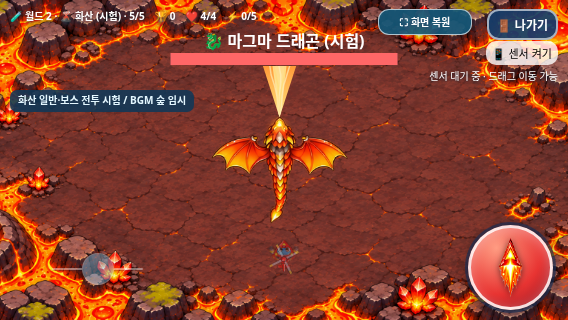

# 갤럭시 테스트 — 마그마 드래곤 보스 전투 시험 버전

2026-11-05 KST · `feature/volcano-boss-combat` · [Issue #19](https://github.com/26aiera11-cpu/helicopter-game/issues/19).

**[최신 heli_trio_galaxy_test.zip 다운로드 — 약 43.7MB](https://github.com/26aiera11-cpu/helicopter-game/raw/refs/heads/feature/volcano-boss-combat/dist/heli_trio_galaxy_test.zip?download=1)**

ZIP에는 `heli_trio_galaxy_test.html` 하나만 있다. GitHub에서HTML을 바로 열면 소스가 보일 수 있으므로 ZIP을 다운로드해 압축을 푼다.

## 실행과 화산 직접 시험

1. 갤럭시에서 ZIP을 다운로드한다. 크기는 **43,718,282바이트**다.
2. ‘내 파일→다운로드’에서 압축을 풀고 안의HTML을 로컬파일 실행이 가능한 브라우저로 연다. HTML은 **60,079,227바이트, 약60.1MB**다. 실제Android 파일 연결/로컬 실행 지원 여부는 기기에서 확인해야 한다.
3. 가로 화면에서 캐릭터를 고른다. 상단 **⛶ 전체화면**을 사용하면 선택→플레이→메뉴 복귀까지 표준 전체화면을 사용할 수 있다. 브라우저가 거부하면 일반 화면에서 실행된다.
4. **게임 방법→🧪 지역 바로 시작→월드2→화산→시작 단계1~5**를 고른다. 도움말을 닫고 게임 시작을 누른다. 1불씨콩·2도마뱀·3박쥐·4갑충·5마그마 드래곤을 확인한다. 직접5단계는 일반전 없이 보스가 바로 나온다.
5. 개발 테스트는 선택한 지역의 보스 처치 후 끝나며 TOP10/분석 기록에 저장하지 않는다. 새로 열면 개발/시험 모드는 기본OFF다.
6. **월드2 시험 모드(설원→화산)**를 따로 켜면 숲→바위→바다→사막→설원→화산의30단계를 플레이한다. 시험 기록은 기존world2Trial 키에 일반과 분리해서 저장한다. 기본OFF는 원래 월드1의20단계다.

이번 버전은 화산5단계 마그마 드래곤의 **화염구 연사 → 용암 분출 → 회전 브레스**를 연결했다. 개발자 바로 시작5단계에서 즉시 보스가 등장한다. 승인된 드래곤/도마뱀/모든63PNG와 화산69프레임, 기존 화산 일반4종 전투는 그대로다. [실제 화면/수치/검사 보고서](../volcano-boss-combat/README.md)

브레스는 안전한 위치로 이동한 뒤1초 예고하고,3.8초 동안 몸·날개·머리·꼬리와 입 화염이 한 바퀴 돈다. 화염 길이는 화면 높이에 따라85~115px이며 UI 영역을 표시/판정에서 함께 제외한다. 용암 경고1.25초에는 피해가 없고 분출 순간 한 번만 판정한다. 화염구는3발×3연사이며 유한 수명/상한을 둔다.

보스HP/강화 보정·보상/점수·0.94초 소멸은 기존 규칙이다. 화산 **BGM은 숲 임시 프로필**이며 최종 월드 난이도·혼합 등장·전용 음악은 이번 작업에서 확정하지 않았다. 배경 용암에는 피해/장애물 판정이 없다.

## 조작과 기존 기능

- 이동의 주 조작은 **센서 켜기**를 통한 자이로센서이며 화면 드래그는 보조다. 기존 감도/속도/방향 계산을 유지한다. 센서가 지원되지 않거나 권한이 거부돼도 드래그를 사용할 수 있다.
- 왼쪽 아래 조이스틱으로 좌우 회전한다. 중앙8% 데드존, 밀기에 비례한 속도, 기존 최대 회전 속도와 손을 떼면 중앙으로 복귀하는 동작을 유지했다. 이동·회전·발사를 함께 조작할 수 있다.
- 음악/효과음 버튼은 기존 위치/기능 그대로다. 첫 사용자 동작 후 선택 BGM을 시도하며, 게임/보스/선택 화면 전환 시 한 BGM만 재생한다.
- 나가기는 게임 내부 확인창을 사용한다. 계속 플레이/선택화면으로 복귀 중 전체화면을 유지하며 브라우저가 스스로 해제한 경우에는 전체화면 버튼으로 다시 진입한다.
- 체력0에서는 즉시 전투/BGM을 멈추고 GAME OVER를3초 보여준 뒤 깨끗한 선택화면으로 돌아온다. 일반 플레이 기록·로컬TOP10은 기존 규칙을 유지한다.
- 뾰코·빙글·탱코의 이미지/능력, 탱코의 최신 전투 밸런스, 설원4종/보스3패턴, 아이템 생성/유지/점수 규칙을 보호했다.

## 확인한 내용과 한계

현재16개 스크립트, 화산PNG11개·갱신된69프레임 매니페스트, 기존 설원/캐릭터/선택화면/아이템 이미지와CSS·음원을 HTML에 포함했다. HTML/CSS 외부 의존성0, 원본 소스/자산 바이트 일치, ZIP의HTML1개·CRC·실제 별도 압축 해제 일치를 검사했다.

- [최종 검사·한계·스크린샷 보고서](../volcano-boss-combat/README.md)
- [빌드 정보](build-results.json), [ZIP 정보](zip-results.json), [최신 파일/소스 검증](../volcano-boss-combat/package-source-verification.json)
- ZIP SHA-256: `3dd0242a10aef7f7dd760ebecfc8077bd6b8f962f1af0954d3b4c4c677505986`
- HTML SHA-256: `7e37d917af13eb1331016964b2d739a28ab1ba452283b9770456ea673daa13e7`

[화산1단계](../volcano-boss-combat/offline/volcano-phase1-568x320.png) · [2단계](../volcano-boss-combat/offline/volcano-phase2-568x320.png) · [3단계](../volcano-boss-combat/offline/volcano-phase3-568x320.png) · [4단계](../volcano-boss-combat/offline/volcano-phase4-568x320.png) · [개발자 경로](../volcano-boss-combat/offline/developer-volcano-help.png)

위 화면은 실제Chromium의 동일 게임 렌더러를 모바일/터치 환경에서 검사한 캡처이며 실제 갤럭시 촬영본은 아니다. 관리 환경의file:// 보안 정책을 우회하지 않고 빈localhost origin에서 네트워크를 차단한 HTML을 검사했다. 물리Galaxy Samsung Internet/Chrome의 파일 다운로드/열기·로컬 저장 정책·센서 권한/감도·손가락 조작·음향 청취·성능/발열은 아직 확인하지 않았다.

순위는 브라우저/실행 주소별 로컬 기록이다. 다른 기기나 Pages/로컬 파일 사이에 자동 공유되지 않으며 브라우저 데이터 삭제 시 없어질 수 있다. 기존35000점 설원 기록을 삭제하거나 새 점수로 환산하지 않았다.

기존 긴멀티터치 후 나가기의 간헐 검사 증상은 이번 일반/오프라인 종합 모음에서는 통과했다. 입력 코드를 바꾸지 않았으며 근본 해결됐다고 단정하지 않는다. 실제 갤럭시에서 반복 확인이 필요하다. **main 병합과 GitHub Pages 배포는 하지 않는다.**
