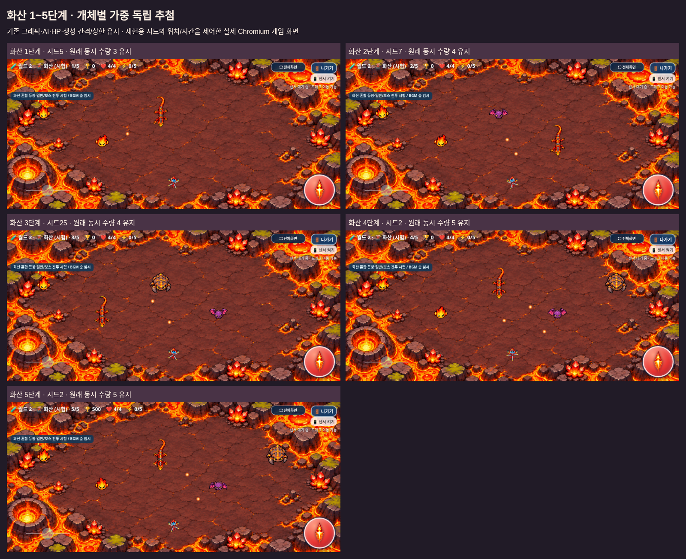

# 갤럭시 테스트 — 화산 일반 몬스터 혼합 등장 시험 버전

2026-11-05 KST · `feature/volcano-mixed-spawns` · [Issue #22](https://github.com/26aiera11-cpu/helicopter-game/issues/22).

**[최신 heli_trio_galaxy_test.zip 다운로드 — 약 43.9MB](https://github.com/26aiera11-cpu/helicopter-game/raw/refs/heads/feature/volcano-mixed-spawns/dist/heli_trio_galaxy_test.zip?download=1)**

ZIP에는 `heli_trio_galaxy_test.html` 하나만 있다. GitHub에서HTML을 바로 열면 소스가 보일 수 있으므로 ZIP을 다운로드해 압축을 푼다.

## 실행과 화산 직접 시험

1. 갤럭시에서 ZIP을 다운로드한다. 크기는 **43,892,237바이트**다.
2. ‘내 파일→다운로드’에서 압축을 풀고 안의HTML을 로컬파일 실행이 가능한 브라우저로 연다. HTML은 **60,310,334바이트, 약60.3MB**다. 실제Android 파일 연결/로컬 실행 지원 여부는 기기에서 확인해야 한다.
3. 가로 화면에서 캐릭터를 고른다. 상단 **⛶ 전체화면**을 사용하면 선택→플레이→메뉴 복귀까지 표준 전체화면을 사용할 수 있다. 브라우저가 거부하면 일반 화면에서 실행된다.
4. **게임 방법→🧪 지역 바로 시작→월드2→화산→시작 단계1~5**를 고른다. 도움말을 닫고 게임 시작을 누른다. 1~4단계에서는 단계별 확률에 따라 몬스터 종류가 섞인다. 같은 종류의 연속 등장도 정상이다. 직접5단계는 일반전 없이 마그마 드래곤이 바로 나온다.
5. 개발 테스트는 선택한 지역의 보스 처치 후 끝나며 TOP10/분석 기록에 저장하지 않는다. 새로 열면 개발/시험 모드는 기본OFF다.
6. **월드2 시험 모드(설원→화산)**를 따로 켜면 숲→바위→바다→사막→설원→화산의30단계를 플레이한다. 시험 기록은 기존world2Trial 키에 일반과 분리해서 저장한다. 기본OFF는 원래 월드1의20단계다.

이번 버전은 화산 일반 몬스터를 개체별 독립 확률로 섞어 생성한다. 각 종의HP/이동/공격/방어·이미지는 유지한다. 단계별 불씨콩/도마뱀/박쥐/갑충 비율은1단계80/20/0/0,2단계45/40/15/0,3단계20/35/35/10,4단계10/25/35/30,5단계5/15/35/45%다. 같은 종이 연속 나와도 정상이다. 생성 간격·동시 상한·6킬 목표는 바꾸지 않았다.

정상4→5단계에서는5단계 혼합 몬스터6마리를 처치한 뒤 보스가 나온다. 개발자 화산5 바로 시작은 기존처럼 즉시 보스다. 승인된 드래곤의 아래1초 예고→아래0.2초 선분사→방향을 한 번 결정해3.8초360°→아래에서 종료하는 브레스는 그대로다. [실제 화면/확률/검사 보고서](../volcano-mixed-spawns/README.md)

보스HP/강화 보정·보상/점수·0.94초 소멸은 기존 규칙이다. 화산 **BGM은 숲 임시 프로필**이다. 혼합 등장은 Issue #22의 1차 시험표이며 전 지역 최종 난이도와 전용 음악은 후속 작업이다. 배경 용암에는 피해/장애물 판정이 없다.

## 혼합 등장 실기기 확인

1. 화산1~4단계를 각각 직접 시작해 여러 번 등장시킨다. 1단계는 불씨콩/도마뱀만, 2단계는 박쥐가 추가되며 3단계부터 갑충도 나올 수 있다. 낮은 확률의 종이 짧은 실행에서 안 나오거나 같은 종이 연속 나오는 것도 정상이다.
2. 불씨콩의 빠른 추적, 도마뱀의 좌우 이동, 박쥐의 지그재그, 갑충의 느린 이동과 한 번 방어가 그래픽과 맞는지 확인한다.
3. 정상 진행으로4→5단계에 가면 혼합 몬스터6마리 처치 후 보스가 나오는지 확인한다. 개발자5 직접 시작은 즉시 보스다.
4. 915×412·800×360·568×320에 가까운 가로 화면에서 세 캐릭터의 이동/회전/발사·센서·전체화면을 확인한다.

## 유지된 아래 분사·회전 순서 실기기 확인

1. 게임 방법에서 월드2 → 화산 → 5단계로 시작한다. 처음에는 발사하지 않고 화염구·용암·브레스 순서를 기다린다.
2. 주황색 예고 실루엣이 보이면 거리를 확보하며 좌우로 이동한다. 드래곤이 아래로 먼저 불을 뿜고 약0.2초 뒤 회전하는지 확인한다. 회전 도중 반대편으로 이동해도 방향이 바뀌면 안 된다.
3. 화면 끝·발사 버튼·조이스틱 부근에서 보이지 않는 불에 피해가 발생하지 않는지 확인한다. 가까운 정면에서 후퇴하는 경우는 피해를 받을 수 있다.
4. 뾰코·빙글·탱코와 삼성 인터넷/Chrome을 나누어 검사한다. 자이로 권한·실제 손가락 조작·가독성·성능은 실기기 확인 대상으로 남아 있다.

## 조작과 기존 기능

- 이동의 주 조작은 **센서 켜기**를 통한 자이로센서이며 화면 드래그는 보조다. 기존 감도/속도/방향 계산을 유지한다. 센서가 지원되지 않거나 권한이 거부돼도 드래그를 사용할 수 있다.
- 왼쪽 아래 조이스틱으로 좌우 회전한다. 중앙8% 데드존, 밀기에 비례한 속도, 기존 최대 회전 속도와 손을 떼면 중앙으로 복귀하는 동작을 유지했다. 이동·회전·발사를 함께 조작할 수 있다.
- 음악/효과음 버튼은 기존 위치/기능 그대로다. 첫 사용자 동작 후 선택 BGM을 시도하며, 게임/보스/선택 화면 전환 시 한 BGM만 재생한다.
- 나가기는 게임 내부 확인창을 사용한다. 계속 플레이/선택화면으로 복귀 중 전체화면을 유지하며 브라우저가 스스로 해제한 경우에는 전체화면 버튼으로 다시 진입한다.
- 체력0에서는 즉시 전투/BGM을 멈추고 GAME OVER를3초 보여준 뒤 깨끗한 선택화면으로 돌아온다. 일반 플레이 기록·로컬TOP10은 기존 규칙을 유지한다.
- 뾰코·빙글·탱코의 이미지/능력, 탱코의 최신 전투 밸런스, 설원4종/보스3패턴, 아이템 생성/유지/점수 규칙을 보호했다.

## 확인한 내용과 한계

현재17개 스크립트, 화산PNG12개(브레스1개 포함)·승인된69프레임 매니페스트, 기존 설원/캐릭터/선택화면/아이템 이미지와CSS·음원을 HTML에 포함했다. HTML/CSS 외부 의존성0, 원본 소스/자산 바이트 일치, ZIP의HTML1개·CRC·실제 별도 압축 해제 일치를 검사했다.

- [최종 검사·한계·스크린샷 보고서](../volcano-mixed-spawns/README.md)
- [빌드 정보](build-results.json), [ZIP 정보](zip-results.json), [최신 파일/소스 검증](../volcano-mixed-spawns/regression/volcano_package/test-results.json)
- ZIP SHA-256: `8ee214b6306a3659679deccd2a87fba6a6b172b1660eb2087cd51fd3f0931674`
- HTML SHA-256: `8dec17be11d2525fd5a9074830d22f28aa080a152891a371faeb2b0de77a18a6`

[화산1단계](../volcano-mixed-spawns/phase-1-915x412.png) · [2단계](../volcano-mixed-spawns/phase-2-915x412.png) · [3단계](../volcano-mixed-spawns/phase-3-915x412.png) · [4단계](../volcano-mixed-spawns/phase-4-915x412.png) · [5단계 일반전](../volcano-mixed-spawns/phase-5-915x412.png) · [세 캐릭터와 세 화면](../volcano-mixed-spawns/volcano-mixed-characters.png)

위 화면은 실제Chromium의 동일 게임 렌더러를 모바일/터치 환경에서 검사한 캡처이며 실제 갤럭시 촬영본은 아니다. 관리 환경의file:// 보안 정책을 우회하지 않고 빈localhost origin에서 네트워크를 차단한 HTML을 검사했다. 물리Galaxy Samsung Internet/Chrome의 파일 다운로드/열기·로컬 저장 정책·센서 권한/감도·손가락 조작·음향 청취·성능/발열은 아직 확인하지 않았다.

순위는 브라우저/실행 주소별 로컬 기록이다. 다른 기기나 Pages/로컬 파일 사이에 자동 공유되지 않으며 브라우저 데이터 삭제 시 없어질 수 있다. 기존35000점 설원 기록을 삭제하거나 새 점수로 환산하지 않았다.

과거 Issue #21 검사에서 긴 멀티터치 후 나가기의 간헐 현상이 한 번 기록됐다. 이번 Issue #22의 오프라인 월드 검사는 해당 동작까지 통과했지만 원인이 해결됐다고 단정하지 않는다. [당시 진단](../volcano-breath-aimed-sweep/README.md)을 보존하며 입력 코드는 바꾸지 않았다. 실제 갤럭시에서 반복 확인이 필요하다. **main 병합과 GitHub Pages 배포는 하지 않는다.**
