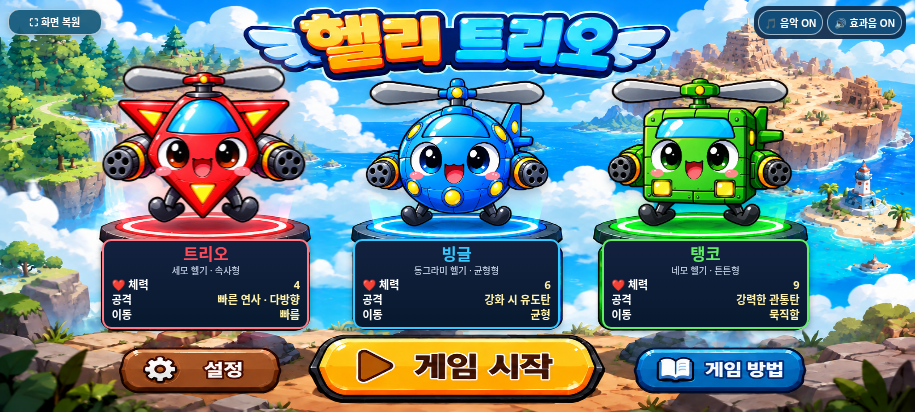
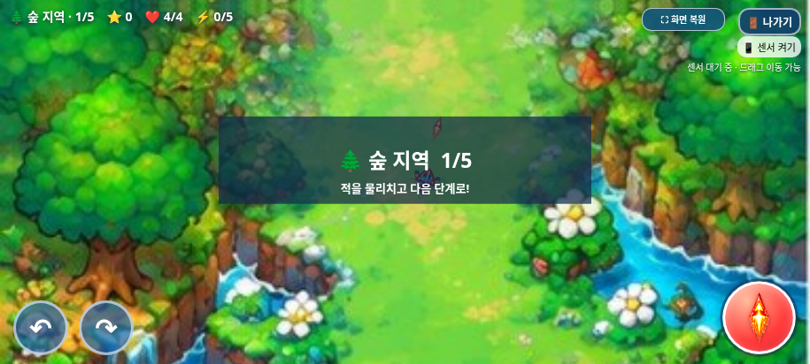
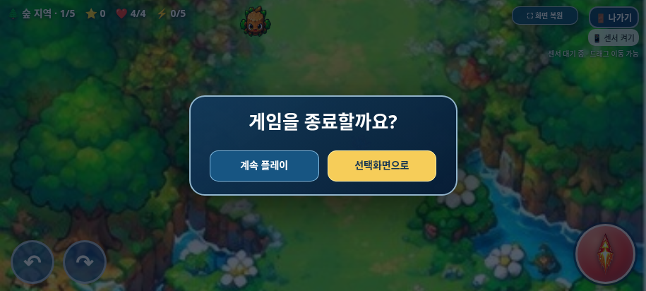
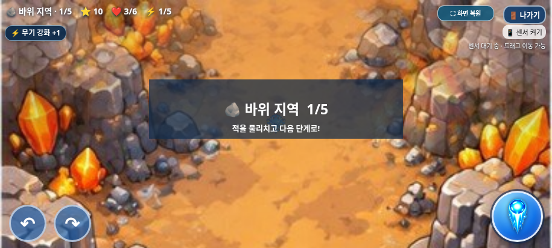
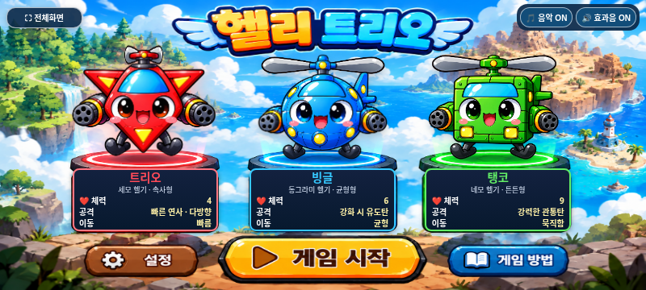

# 갤럭시 테스트 빌드 — ZIP 다운로드

2026-11-01(KST) · `feature/selection-screen-integration` · 탱코 기관포 복원 PNG 적용 최신 빌드

## 다운로드와 실행

**[heli_trio_galaxy_test.zip 다운로드 — 약 20.8MB](https://github.com/26aiera11-cpu/helicopter-game/raw/refs/heads/feature/selection-screen-integration/dist/heli_trio_galaxy_test.zip?download=1)**

[ZIP 파일 페이지](../../../dist/heli_trio_galaxy_test.zip)에서도 Download raw file 메뉴를 사용할 수 있다. ZIP에는 최신 [단일 HTML](../../../dist/heli_trio_galaxy_test.html) 하나만 들어 있다.

1. 갤럭시에서 위 ZIP 다운로드 링크를 연다. ZIP 크기는 **20,758,716바이트, 약 20.8MB**다.
2. ‘내 파일 → 다운로드’에서 `heli_trio_galaxy_test.zip`을 선택해 **압축 풀기**를 누른다. 안의 HTML은 **28,736,448바이트, 약 28.7MB**다.
3. 로컬 HTML 실행을 지원하는 브라우저로 파일을 연다. Chrome 또는 Samsung Internet의 지원 여부는 기기의 파일 열기 방식에 따라 직접 확인해야 한다.
4. 휴대폰을 가로로 돌리고 왼쪽 위 **⛶ 전체화면**을 누른 뒤 캐릭터를 선택해 **게임 시작**을 누른다. 선택·게임·선택화면 복귀 중 전체화면이 유지되며 **⛶ 화면 복원**으로 해제할 수 있다. 미지원·거부 시 일반 화면에서 시작한다.
5. 화면을 드래그해 이동하고, ↶ ↷ 버튼을 길게 눌러 방향을 바꾸고, 발사 버튼을 길게 눌러 공격한다. 음악·효과음은 선택화면에서 각각 켜고 끌 수 있다.
6. ‘나가기’를 누르면 게임 내부에서 ‘게임을 종료할까요?’ 패널이 열린다. ‘계속 플레이’는 게임을 재개하고 ‘선택화면으로’는 전체화면을 유지한 채 복귀한다. 브라우저가 자체적으로 전체화면을 해제했다면 수동 전체화면 버튼을 다시 누른다.
7. 센서 사용은 별도로 테스트한다. 로컬 파일에서의 센서 허용 여부는 브라우저·파일 열기 경로에 따라 확인이 필요하며, 드래그 이동으로도 플레이할 수 있다.

파일 하나에 필요한 이미지·CSS·JavaScript·음원을 담았다. 다운로드 후에는 별도 폴더·설치·서버·네트워크 연결이 필요하지 않도록 구성했다. 실제 갤럭시에서 로컬 파일을 여는 절차는 아직 검증하지 않았다. GitHub Pages에는 배포하지 않는다.

HTML의 GitHub raw 응답은 브라우저에서 소스 텍스트로 표시될 수 있어 ZIP 다운로드를 추가했다. 압축을 푼 뒤 HTML을 실행한다.

## ZIP 무결성 검증

- 일반 ZIP DEFLATE 방식이며 암호는 없다.
- 압축 목록은 루트의 `heli_trio_galaxy_test.html` **1개뿐**이다. 별도 폴더나 리소스 파일을 넣지 않았다.
- Python ZIP CRC 검사와 시스템 `unzip -t`를 통과했다.
- 실제 압축 해제한 HTML을 원본과 바이트 단위로 비교했고 SHA-256도 동일했다.
- 제공된 탱코 기관포 복원 PNG를 원본 바이트로 내장하고 기존 최종 트리오·보스 보상·BGM·종료창을 유지해 ZIP을 재생성했다. ZIP 내부 PNG 해시와 현재 HTML 바이트 일치를 확인했다.

상세 결과·ZIP/HTML 크기 및 해시: [zip-results.json](zip-results.json).

최초 ZIP 추가 때는 포장만 검사했다. 이번에는 탱코 복원 PNG 적용 후 브라우저 검사를 다시 실행하고 HTML·ZIP을 함께 재생성했다. HTML을 재생성할 때는 ZIP도 같은 HTML로 다시 만들고 검증해야 한다.

## 포함한 기능과 보호 범위

- 세 헬기와 투명 PNG 레이어, 노란 선택 사각형 제거, 빨강·파랑·초록 발판 조명, 패널 테두리 강조를 포함한다.
- 기존 부유·확대·정면 프로펠러·회전 정지·220ms 착지를 유지한다.
- 기존 전투·적·탄환·일반 아이템·지역 회복·보스 패턴·음악 전환·효과음을 유지한다. 보스는 50:50 체력/강화 보상을 즉시 받고 1.8초 알림을 표시한다.
- 현재 `index.html`의 인라인 스크립트 3개와 최신 선택화면 JavaScript를 그대로 내장한다. 승인된 선택/종료, 트리오·탱코 PNG, 트리오 비율 렌더링, BGM 정지·보스 보상 외에 다른 코드·선택 PNG는 유지한다.
- 외부 선택화면 CSS·JS와 PNG 참조를 내장 스타일·스크립트·데이터 URL로 치환했다. 원래 내장돼 있던 게임 이미지와 WAV 12개도 유지했다.
- 갤럭시 테스트 파일에만 선택 버튼의 브라우저 기본 파란 터치 잔상을 억제하는 CSS를 추가한다. 빌드 과정은 원본 파일을 수정하지 않는다.
- 브라우저 기본 confirm 대신 DOM 모달을 사용하고 게임 진행을 잠시 멈춘다. 취소·선택화면 복귀 과정에서 전체화면 요청·해제는 하지 않는다. [원인·수정·검증 상세](../exit-dialog/README.md).
- 마지막 얼굴 방향·가로 폭 조정 결과를 사용자의 명시 지정에 따라 `trio_gameplay_final.png`로 적용했다. 1402×1122 PNG를 편집 없이 내장하며 원본 비율·투명도를 유지한다. 이번에는 이 트리오와 선택화면·빙글을 변경하지 않았다. [최종 트리오 검증](../trio-final/README.md).
- 플레이용 탱코는 제공된 `tanko_gameplay_cannon_restored.png`(503×490)를 그대로 사용한다. 기존 그리기 크기·회전·프로펠러·공격·이동·충돌은 그대로다. [기관포 8방향·전후 비교·검증](../tanko-cannon/README.md).
- 게임 오버 시 기존 정지 함수를 호출해 이전 게임 음악이 선택화면에 남지 않게 했다. ON/OFF 설정과 재시작·보스·단계 전환을 검사했다. [BGM 상세 결과](../bgm/README.md).
- 보스 보상을 먼저 적용하고 기존 지역 이동 체력 +2를 나중에 적용한다. 마지막 사막은 지역 회복이 없다. 최대치·중복 방지를 검사했고 일반 아이템은 여전히 떨어진 뒤 접촉해 획득한다. [보상 규칙·스크린샷·검증](../boss-reward/README.md).

## 재생성

```sh
python scripts/build_galaxy_test.py
python scripts/package_galaxy_test.py
```

출력은 `dist/heli_trio_galaxy_test.html`이다. 원본 파일을 수정하지 않으며, 같은 입력으로 다시 생성하면 바이트 단위로 같은 결과가 나온다.

SHA-256:

```text
d304864b844fbd133e6e6325a1e87a5c8c640b528be1c2370f807841f32b78e1
```

빌드 상세: [build-results.json](build-results.json).

## 실제 브라우저 검사

```sh
python tests/galaxy_standalone.py --artifacts /absolute/path/to/galaxy-review
```

Chromium·Playwright·Pillow·Node.js 환경에서 **18개 검사 그룹**을 통과했다.

- HTML·CSS의 모든 자산 참조가 내장 데이터 URL이고 외부 파일·폰트·스타일·스크립트 의존성이 없는지 확인했다.
- 게임·사운드 원문과 선택화면 JavaScript 보존, JavaScript 문법 검사, PNG 바이트 일치를 확인했다.
- 생성 파일 하나만 둔 독립 디렉터리에서 로컬 파일 직접 열기를 시도했다. **이 환경의 Chromium 관리자 정책이 `file://` 접근을 차단했다.** 이를 성공으로 기록하지 않았다.
- 정책을 변경하지 않고 새 빈 페이지에 동일한 HTML을 주입했다. 브라우저 네트워크를 끄고 서버도 사용하지 않은 상태에서 캐릭터·배경·적·보스·탄환 이미지를 모두 디코딩했다.
- WAV 12개의 재생 가능 메타데이터와 사용자 터치 후 배경음 재생 시작을 확인했다. 스피커 청취 검사는 아니다.
- 최종 트리오 1402×1122 이미지와 실제 draw의 같은 X/Y 배율을 검사했다. 정사각형으로 변형하거나 잘라 그리지 않는다.
- 제공 탱코 PNG의 내장 바이트·실제 활성 sprite와 기존 32.67×32.67 그리기가 동일한지 확인했다.
- 세 캐릭터 선택·발판 조명·패널 강조·부유·날개 회전/정지와 음악·효과음 토글을 확인했다.
- 독립 HTML의 새 전체화면 버튼으로 진입하고 세 캐릭터 모두 시작·복귀 중 상태 유지 및 해제를 확인했다. [전체화면 상세 검증](../fullscreen/README.md)도 함께 제공한다.
- 각 캐릭터를 실제 터치 입력으로 시작해 체력 4/6/9, 길게 눌러 회전, 드래그 이동, 길게 눌러 발사, 나가기와 적 생성을 검사했다.
- 새 종료 확인창의 일시정지·취소 재개·확인 복귀와 전체화면 유지를 단일 HTML에서도 검사했다. 브라우저 기본 대화상자가 나오면 테스트가 실패하도록 했다.
- 게임 오버 시 반복 음악 8개의 paused 상태와 재생 시간 정지, 다른 캐릭터 재시작 후 BGM 1개 재생을 오프라인 HTML에서도 확인했다.
- 보스를 실제 탄환 충돌로 처치해 두 보상이 지역 회복보다 먼저 적용되고 보스 드롭이 없으며 작은 알림이 표시되는지 검사했다.
- 4개 지역의 보스 구성·최종 클리어 복귀를 테스트 상태 설정으로 검사했다.
- 915×412, 800×360 가로 화면과 412×915 세로 회전 안내를 확인했다.
- 외부 HTTP 요청 0건, 실패한 자산 요청 0건, 잡히지 않은 JavaScript 오류 0건이었다.

최초 테스트 과정에서 차단 오류 페이지의 이동 경합과 테스트용 오디오 관찰기의 중복 설치가 발견됐다. 테스트 도구를 수정한 후 위 검사를 통과했으며 게임 코드를 변경해 해결하지 않았다.

상세 결과와 제한: [test-results.json](test-results.json).

## 실기기에서 확인해야 하는 항목

- 실제 갤럭시·Samsung Internet·모바일 Chrome에서 다운로드 파일을 직접 여는 동작과 파일 연결 방식.
- 로컬 파일의 센서 권한·센서 방향·중앙 보정.
- 스피커의 실제 소리·음량·지연, 앱 전환 후 소리 복귀.
- 전체화면 진입·가로 방향 잠금 허용 여부.
- 새 트리오 앞끝의 실기기 표시 선명도와 회전 중 외형.
- Samsung Internet에서 전체화면 중 새 종료창의 표시·취소·복귀, Android 뒤로가기·앱 전환 후 상태. 이번 수정의 실기기 재검사는 아직 수행하지 못했다.
- 실제 기기 성능·배터리·발열, 브라우저 주소창·제스처 영역에 따른 가용 화면.

전 스테이지 수동 연속 완주는 수행하지 않았다. N1(BGM 게임 오버 정지 누락)에 이어 N2(보스 보상 소실)도 수정했다. 다른 미대응 사항은 `DEVELOPMENT_LOG.md`를 따른다. 오디오 상태 검사는 실제 스피커 청취와 구분한다.

## 스크린샷

동일한 단일 HTML의 오프라인 Chromium 실행 화면이다. 실제 갤럭시에서 촬영한 화면은 아니다.












