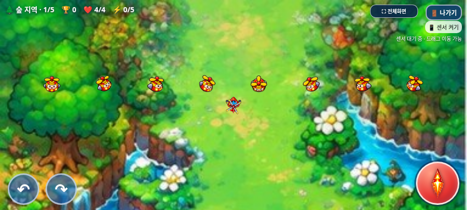
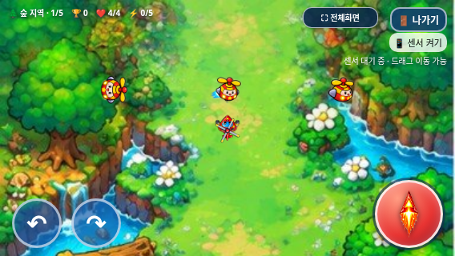

# 아이템 몬스터 독립 시스템 검증

2026-11-02(KST) · `feature/independent-item-monsters`

작업 전 원격 main은 `17da293570f422035d455add578dbc8412e4f24b`, 이미 있던 시험 브랜치는 `6d4e4e969e38cbab7e4c499f73fda68f2be1b09c`였다. 시험 브랜치의 기존 이력을 보존해 이어서 수정했다. main·Pages는 변경하지 않는다.

`HELI_TRIO_SPEC.md`는 로컬·main·시험 브랜치와 첨부 ZIP에 없었다. 사용자가 후속 답변으로 제공한 개발 규칙을 기준으로 적용했다. 기존 기능 보존, 불필요한 재작성/리팩터링 금지, 기능 브랜치, 미승인 병합/배포 금지, 원본 ZIP 사용, 개발 기록/테스트 보고를 준수한다. 없는 명세 파일을 읽었다고 기록하지 않는다.

## 기존 코드 분석

main에서는 `warnEnemy()`의 `special: Math.random() < .22`로 일반 생성 슬롯 중 22%를 아이템몹으로 대체했다. 특수몹도 `warnings`→`enemies`를 사용해 일반 적 정원·단계 진행에 영향을 줬다. 체력 5, 무작위 이동, 10초 수명, 처치 시 기존 `dropItem()`의 체력/강화 50:50 규칙을 사용했지만 처치 때 **phaseKills도 증가**했다. 아이템몹 또한 일반 적의 접촉 피격 경로에 포함됐다. 점수는 이미 `special:true`를 구분해 200점이었다.

기존 시험 브랜치는 별도 모듈로 일부 분리했으나 다음 사항이 미완료였다.

- 새 플레이 8초·단계 뒤 7초·이후 11~16초, 동시 1개라는 미확정 임시 설정이 들어갔다.
- idle/move 파일 12개는 모두 같은 작은 이미지였고, hit/explosion은 없었다. 대체 도형을 그렸다.
- 점수 모듈에서 실행 중 script 태그를 추가해 독립 모듈을 불러왔다. 기존 오프라인 빌더가 이 의존성과 PNG들을 포함하지 못했다.
- update/draw/warnEnemy를 감싼 후처리 구조였으며 실제 브라우저와 전체 회귀 검증이 없었다.

## 구현과 보호 범위

`assets/item_monster/item_monster.js`가 자신의 몬스터·등장 대기·파괴 효과·생성 타이머를 관리한다. `index.html`은 시작 초기화, 업데이트/피격/그리기와 유도탄 대상 수집에 필요한 호출만 추가했다. 일반 생성 객체는 항상 normal이며, 일반 루프에서 특수 이동/수명/드롭/붉은 발광 분기를 제거했다. 일반 적에 대한 기존 이동식·공격식·체력·스폰 간격·정원·6마리 목표는 유지했다.

- 체력 **5**, 발사/접촉 공격 없음, 무작위 이동과 125px 이내 회피. 기존 이동 속도 **45/53/61/69px/s**를 상한으로 쓰고 새 가속 배율을 추가하지 않았다. 플레이어 최저 속도 204px/s보다 느리다.
- 수명 **10초**. 시간 만료는 점수/처치/드롭/파괴 보상이 없다. 보스 정책으로 정리되지 않은 개체는 일반 단계·지역 이동으로 생존 시간이나 위치를 초기화하지 않는다. 기본 보스 정책에서는 등장 대기와 생존 몬스터를 보상 없이 정리한다.
- 실제 탄환은 기존 `bulletHitsCircle`, 탱코 `consumeTankoPierce`와 같은 hit 목록/관통 자원을 사용한다. 동일 탄환의 동일 몬스터 중복 피해, 중복 점수/드롭을 방지한다. 트리오/빙글/탱코 피해는 1/1/1.5 그대로다.
- 빙글은 보스 우선 경로 및 260px 범위/3.3rad/s 회전식을 유지한다. 보스가 없을 때 일반/아이템 몬스터 중 가까운 표적을 기존 방식으로 고른다. 이동·발사·강화 수치를 변경하지 않는다.
- 처치 시 기존 `gameScoring.enemyDefeated()`로 **200점과 itemKills만 증가**한다. `phaseKills`는 증가하지 않는다. 일반 처치 100점, 일반 단계 500점, 보스 2,000점과 TOP 10 저장 코드·키·버전은 그대로다.
- 드롭은 기존 50:50 함수·16초 수명·13px 반경·체력 +2/무기 +1·최대치 제한·접촉 획득/제거·스테이지 간 잔여 수명 보존을 그대로 사용한다. 최대 상태에서의 보상 개선은 구현하지 않는다.
- 새 게임/나가기 확정 때 독립 상태를 초기화한다. 종료 확인과 게임 오버 3초 동안 타이머·이동·애니메이션을 멈춘다. 게임 오버 마지막 화면에 아이템몹도 그대로 남는다.

이전 `update/draw/warnEnemy` 재정의와 점수 파일의 동적 로더를 제거했다. 점수 모듈은 main 원문으로 복원했다. 독립 모듈을 게임 루프보다 먼저 정적으로 읽어 초기 RAF의 미등록 참조를 방지한다. 게임 코드 전체를 재작성하지 않았다. 정확히 승인한 변경만 역변환하면 `index.html`은 기준 main과 같다. 기존 플레이어/적/보스/배경/탄환 이미지, 선택 CSS/JS, 음악·효과음, 전체화면/종료 모달은 원본 그대로다.

## 생성 정책 — 신규 주기는 미확정

임시 8/7/11~16초 설정을 제거했다. 기본 모드는 **provisional-legacy-compatible**이며 새 간격/정원 값을 확정하지 않았다.

| 설정 | 현재 호환 기본값 |
| --- | --- |
| 독립 등장 판정 간격 | `null` → 기존 지역·단계 간격 `max(.72, tactics[stage].spawn - (phase-1)*.09)` 상속 |
| 아이템 등장 확률 | 기존 22% |
| 최대 동시 등장 | `null` → 기존 정원 식 `min(7,3+stage+floor(phase/2))` 상속; 대기 중 경고도 포함 |
| 지역별 규칙 | 별도 override 가능, 현재는 기존 네 지역 공통 정책 |
| 보스전 | 기본 허용하지 않음; 설정으로 별도 허용 가능 |
| 일반 몬스터 생성 | 기존 슬롯에서 78% 출현 기회를 보존; 일반 간격/정원 식은 변경하지 않음 |

아이템이 빠진 모든 슬롯에 일반 몬스터를 생성하면 일반 등장률이 기존 대비 약 28% 증가할 수 있으므로 그렇게 하지 않았다. 통제된 빈 전장 1,000회 기회에서 일반 780회를 확인했다. 독립 타이머는 일반 스폰을 꺼도 동작하며 일반 생성은 아이템 확률을 0으로 해도 동작한다.

**혼잡 상황까지 완전히 동일한 발생량을 약속하지 않는다.** 두 배열과 정원이 분리되어 기존 공유 정원에서 생기던 상호 억제가 달라지고, 아이템 처치가 목표에 포함되지 않아 플레이 시간이 달라진다. 다음 기대 간격은 정원·전환·보스 대기를 제외한 계산값이지 실기기 실측이나 확정 주기가 아니다.

| 지역 | 1단계 슬롯 간격 / 아이템 기대 간격 | 5단계 보스 전 슬롯 / 아이템 기대 간격 |
| --- | --- | --- |
| 숲 | 2.00s / 9.09s | 1.64s / 7.45s |
| 바위 | 1.80s / 8.18s | 1.44s / 6.55s |
| 바다 | 1.62s / 7.36s | 1.26s / 5.73s |
| 사막 | 1.46s / 6.64s | 1.10s / 5.00s |

개선안은 **별도 독립 주기 + 작은 동시 정원**으로 지역 후반의 과도한 보상량을 제한하는 것이다. 위 기대 간격을 비교 기준으로 실기기에서 분당 출현/처치/회복/강화 횟수를 먼저 측정하고, 최대 동시 1개 또는 2개를 비교한 뒤 주기를 결정하는 것을 권한다. 필요하면 판정 주기와 확률 대신 일정 간격에 확실히 등장하는 방식도 비교할 수 있다. 아이템몹 6개 처치 후에도 일반 목표 0·1단계를 유지하면서 1,200점을 얻는 것을 확인했다. 이는 목표 제외·기존 200점 유지의 결과로, 의도적으로 단계를 지연해 점수를 반복 획득할 수 있다. 단계별 출현 횟수 제한 같은 파밍 대응은 별도 승인할 생성 정책 후보이며 이번에 추가하지 않았다. 이 후보 수치를 현재 기본값으로 적용하지 않았다. 체력/강화 최대 상태의 보상 규칙과 상태별 출현 조절도 보류한다.

개발 설정 예(호출 전까지 게임 기본값을 바꾸지 않는 예시):

```js
itemMonsters.configure({
  intervalSeconds: null, probability: .22, maxActive: null,
  allowDuringBoss: false,
  stageRules: { 0: { enabled: true } }
});
```

지역 키는 기존 순서대로 0=숲, 1=바위, 2=바다, 3=사막이다. null은 기존 간격/정원을 상속한다. 잘못된 간격·확률·정원·지역 키는 적용 전에 거부한다. 테스트에서 사용하는 0.5초/확률 1/정원 8 같은 fixture는 제품 기본 설정이 아니다.

## 첨부 이미지 원본

입력은 실제 `heli_trio_item_monster_codex.zip`, SHA-256 `a290f4618eb41d0e8c13b1ce120a5d217eec41b53774e037e921b3598c23af61`이다. 안의 `item_monster_assets/`에서 PNG 29프레임·아틀라스·manifest·원본 README를 **바이트 그대로** 가져왔다. 12개 정적 플레이스홀더는 원본 프레임으로 교체했다. 이미지 편집·생성·재인코딩이나 대체 도형을 쓰지 않는다.

실행 시 아틀라스 2560×1280 한 개만 불러온다. 각 셀 320×256, 중심 (160,127), 원본 비율 1.25를 유지한다. 대기 6×115ms, 이동 6×105ms, 방향 전환 8방향, 피격 3×95ms, 파괴 4×95ms를 manifest에 맞춰 사용한다. 본체는 캔버스 셀 기준 64×51.2로 그려 실제 몸체가 기존 적과 비슷한 크기가 되게 했다. 드롭 PNG 2장은 원본 자료로 보존하되 기존 아이템 UI를 보호하기 위해 적용하지 않는다. 제공 이미지의 잔여 빛 번짐은 원본 상태로 남는다.

## 실제 테스트와 화면

새 독립 시스템 검사는 일반 브라우저와 오프라인 각각 **17개 그룹**이다. 통제된 실제 생성·탄환 충돌·픽업·게임 오버·터치를 사용하며 사용자 플레이나 실기기 난도 완주로 표현하지 않는다. 기존 기능 회귀와 합쳐 **215개 그룹**을 통과했다. 전체 회귀 집계는 [test-summary.json](test-summary.json), [원본/패키지 검증](package-verification.json)에 저장한다.

- 생성 독립성, 일반 78% 기회·기존 지역별 간격, 활성+대기 정원, 지역/보스 설정과 잘못된 설정 거부.
- HP5 실탄 5/5/4회 처치, 200점·itemKills·드롭 1회, 일반 목표 0 증가, 같은 탄환의 중복 피해 방지와 탱코 관통 공유.
- 무공격·무접촉 피해, 10초 퇴장 무보상, 모든 지역에서 접근 회피·기존 속도 상한.
- 체력/강화 드롭과 기존 효과·수명·단계/지역 유지, 보스 정책, 종료 확인/사망 정지·새 게임 초기화.
- 실제 대기/이동/방향/피격 셀, 파괴 4프레임의 네이티브 drawImage 호출, 투명도·크기·비율·원본 바이트.
- 915×412, 800×360, 568×320, 8방향 표시, 네트워크 차단 HTML의 자산 디코딩, JS 오류/누락 요청/기본 대화상자 없음.





위 다중 배치는 이미지 검사용 설정이며 기본 게임의 동시 생성량을 의미하지 않는다. 회피/난이도·주기 최종 승인, 실제 Galaxy Samsung Internet/Chrome·센서·파일 연결/저장·스피커·성능은 미검증이다. 직접 file://는 이 환경 정책상 차단되어 같은 HTML을 오프라인 빈 문서에 주입했으며 보안 정책을 변경하지 않았다.

## 파일·재현

제품 변경은 `index.html`, `assets/item_monster/`, 동적 로더만 제거한 `assets/score/score.js`다. 새/기존 테스트의 정확한 소스 보호 및 특수몹 fixture를 새 독립 대상으로 갱신했다. 빌더는 정적 모듈과 원본 아틀라스를 독립 HTML에 포함한다. 최신 갤럭시 HTML/ZIP, 개발 기록·검증 자료도 갱신한다. main 병합·Pages 배포는 하지 않는다.

```sh
python scripts/build_galaxy_test.py
python scripts/package_galaxy_test.py
python tests/item_monsters.py --artifacts /tmp/heli-items-web
python tests/item_monsters.py --standalone --artifacts /tmp/heli-items-offline
```

최신 갤럭시 HTML은 **32,380,731바이트**, ZIP은 **23,459,154바이트**다. HTML 하나만 담은 ZIP의 CRC·실제 압축 해제·원본 아틀라스/음원·스크립트 순서를 확인했다. [다운로드·실행 안내](../galaxy-test/README.md).
