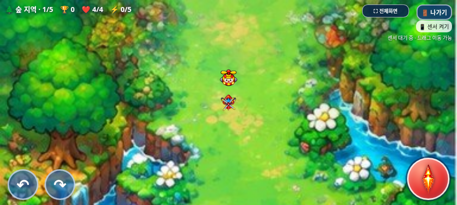
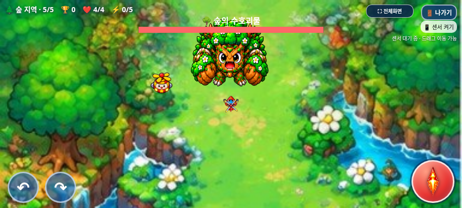
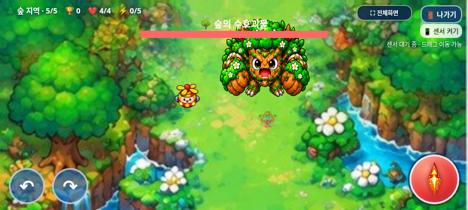
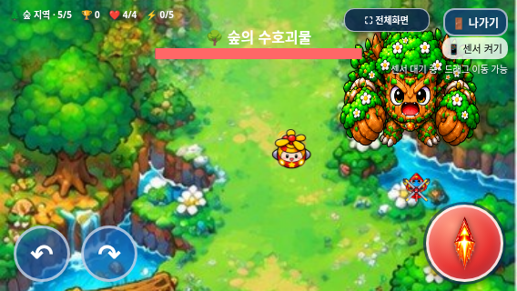

# 아이템 몬스터 크기·지역별 등장 규칙 검증

2026-11-02(KST) · `feature/independent-item-monsters` · 시작 커밋 `dc9d5594650cfb700dd0a96f28dd10fc0fde5d87`

작업 전 원격 main `17da293570f422035d455add578dbc8412e4f24b`와 기능 브랜치·개발 기록을 확인했다. `HELI_TRIO_SPEC.md`는 저장소에 없어 이번 사용자 확정 규칙을 적용했다. 기존 독립 시스템과 원본 PNG를 보존하면서 크기, 처치 기반 예약, 보스전 유지 부분만 수정했다. main 병합과 Pages 배포는 하지 않는다.

## 변경 전후

| 항목 | 기존 `dc9d559` | 이번 구현 |
| --- | --- | --- |
| 살아 있는 몬스터의 셀 표시 | 64×51.2px | **80×64px**, 두 축 모두 1.25배 |
| 피격 원 반경 | 16px | **20px**, 1.25배 |
| 자동 등장 | 시간 간격 + 22% 확률 | 지역별 무작위 단계·일반 처치 기준 |
| 지역 내 기회 | 반복 가능 | **최대 3회**, 선정 단계마다 1회 |
| 보스 진입 | 생존 개체·등장 예고 정리 | 생존 개체·예고·남은 시간 보존 |
| 보스전 신규 예약 | 기본 금지 | 금지 유지; 이전 단계 예약은 완료 |

PNG29장·아틀라스·manifest·SOURCE_README.md는 첨부 원본 바이트 그대로다. 셀320×256의 비율과 anchor(160,127)를 유지해 drawImage 목적 크기만 바꿨다. 등장 예고48px와 파괴 효과80px는 기존 크기를 유지한다. HP5·10초 수명·무공격·이동/회피 속도·애니메이션은 그대로다.

## 확정된 등장 규칙

1. 새 게임의 숲 진입과 이후 지역 진입 시 1~4단계를 섞어 서로 다른 3개를 고른다. 각 선정 단계의 일반 몬스터 처치 기준도 1~4 중에서 미리 정한다. 해당 지역에 다시 접근해도 재추첨하지 않는다.
2. 실제 일반 적 처치 경로에서 별도 관리자에 통지한다. 선정 단계의 기준에 도달하면 즉시 `waiting → reserved`로 바꾸고 기존 1.4초 예고를 예약한다. 일반 목표6, 일반 적 생성·공격식은 변경하지 않는다.
3. 실제로 등장하면 `spawned`로 바꾸고 원래 지역의 기회를 사용한다. 같은 단계에서 추가 처치·시간 경과·놓침·수명 만료가 있어도 재예약하지 않는다. 아이템몹과 보스 처치는 이 카운터를 올리지 않는다.
4. 예고와 살아 있는 개체는 단계·지역·보스 전환 때 초기화하지 않는다. 예고가 끝나 실제 등장하는 순간부터 수명10초를 부여한다. 아틀라스 준비가 늦어도 예약은 유지한다. 보스전에서 완료되는 이전 예약은 보스전의 신규 예약과 구분한다.
5. 게임 종료 확인/게임 오버 중에는 멈추며, 새 게임에서 지역 계획·예고·개체를 모두 초기화한다. 사망/최종 클리어 뒤 새 개체를 뒤늦게 생성하는 비동기 타이머는 없다.

기본 설정은 `itemMonsters.configure({opportunitiesPerRegion:3})`다. 지역당3회는 사용자가 지정한 1차 시험값이며 0~4로 쉽게 바꿀 수 있다. 이미 정해진 계획에는 소급 적용하지 않고 다음 지역/새 게임부터 적용한다. 0은 회귀 검사의 생성 제외 조건에 사용한다. 기존 `spawn(position)`은 수동 검사 장면용 도우미이고 실제 게임 자동 생성은 처치 예약으로만 동작한다. 이 도우미도 보스 단계의 직접 생성을 거부한다.

**아이템용 시간/22% 자동 생성은 제거했다.** `legacyProbability=.22`는 `index.html`의 기존 일반 몬스터78% 생성 기회 보존에만 남겼다. 이를 없애 일반 적 생성 빈도를 바꾸지 않았다. 아이템 생성 계획·카운터·난수는 일반 적 배열·생성기와 독립이다. 난수는 기존 독립 관리자 내부 생성기를 재사용한다.

## 보호한 기능과 변경 파일

- 제품: `assets/item_monster/item_monster.js`와 해당 README. `index.html`에는 일반 적 처치 통지와 지역 진입 계획 생성 **두 호출만** 추가했다.
- 검사: `tests/item_spawn_rules.py`, 정확한 두 치환 목록/역변환 도우미, 기존 아이템 관리자 해시와 회귀 fixture를 갱신했다. 과거 허용 변경 및 보호 목록은 유지했다.
- 결과물: 단일 HTML/ZIP, 최신 갤럭시 안내·검사·캡처, 이 보고서·JSON·스크린샷, DEVELOPMENT_LOG.md.

두 호출을 역변환하면 `index.html`은 시작 커밋과 일치한다. 기존 독립 시스템의 허용 변경까지 역변환하면 main 원문과 일치한다. 플레이어·적·보스·선택 이미지, 점수/TOP10 코드, CSS/선택 JS, 음원, 공격/이동/회전·탱코 수치·보스 패턴/HP/보상·음악·전체화면/종료창은 변경하지 않았다.

처치는 기존 API로200점과 itemKills만 올린다. 드롭50:50·체력+2/무기+1·최대치·16초 지속/13px·접촉 획득·일반 아이템의 단계/지역 보존도 유지한다. 최대 체력/강화 상태의 새 보상, 추가 탱코 조정, 온라인 순위표는 구현하지 않았다.

## 실제 브라우저 결과

**총251개 검사 그룹 통과.** [전체 집계](test-summary.json), [패키지·원본 보호](package-verification.json).

| 검사 | 그룹 | 결과 자료 |
| --- | ---: | --- |
| 새 등장·크기 규칙 / 동일 오프라인 HTML | 19 + 19 | [일반](browser/test-results.json), [오프라인](offline/test-results.json) |
| 독립 몬스터 피격·도주·수명·드롭 / 오프라인 | 16 + 16 | [일반](regression/item-components.json), [오프라인](regression/item-components-offline.json) |
| 점수·TOP10 / 오프라인 | 17 + 17 | [일반](regression/scoring.json), [오프라인](regression/scoring-offline.json) |
| 선택 BGM / 오프라인, 스테이지 BGM | 14 + 14 + 9 | [선택](regression/selection-bgm.json), [오프라인](regression/selection-bgm-offline.json), [게임](regression/game-bgm.json) |
| 단일 HTML, 전체 진행, 선택화면 | 19 + 11 + 15 | [HTML](../galaxy-test/test-results.json), [진행](regression/game-audit.json), [선택](regression/selection.json) |
| 나가기, 게임 오버, 일반 아이템, 보스 보상 | 10 + 7 + 7 + 8 | [나가기](regression/exit-dialog.json), [사망](regression/game-over.json), [아이템](regression/items.json), [보상](regression/boss-reward.json) |
| 탱코 전투 / 오프라인, 연사 | 14 + 14 + 5 | [전투](regression/tanko.json), [오프라인](regression/tanko-offline.json), [연사](regression/cadence.json) |

- 실제 drawImage 호출80×64와 피격 반경20을 확인했다. 세 캐릭터 탄환의 기존 원/회전 직사각형 충돌 도우미와 확대된 경계의 명중/빗나감을 검사했다.
- 새 게임256회씩 일반/오프라인에서 뽑은 계획 모두 서로 다른3단계·기준1~4였고, 빠지는 단계4가지와 기준4가지가 모두 나왔다. 시간만200초 흘려도 생성되지 않았다.
- 실제 일반 적 탄환 처치로 기준 도달과 미선정 단계 제외를 확인했다. 한 프레임에6마리를 죽여 다음 단계로 이동해도 예약이 남고 한 번만 등장했다.
- 실제 보스 진입 때 같은 개체와 잔여6.75초가 유지됐다. 보스전에서 처치하면 드롭1개, 보스HP20·일반 처치 수는 그대로였다. 기존 예고의 보스/지역 이동·아틀라스 지연 후 등장과 만료 후 재등장 없음도 통과했다. 새 보스 단계에서20초 기다려도 신규 예약은 없었다.
- 20단계 통제 검사에서 지역마다3마리, 총12마리를 처치했다. 일반120마리·아이템12마리·보스4·일반 클리어16으로 **30,400점 = 12,000+2,400+8,000+8,000**이 최종/저장 기록과 일치했다. 아이템을 제외한 기존 전체 진행 검사는28,000점 그대로다. 정상 적 fixture HP1·조준·무적·시간을 제어한 실제 충돌 검사이며 사람이 난도 그대로 완주한 검사는 아니다.
- 아이템몹을 죽여도 phaseKills/예약용 일반 카운터는 오르지 않는다. 놓치거나10초가 끝나도 점수/드롭/기회 환불은 없다. 이전 무제한 시간 반복 생성은 없으며 정상 자동 생성은 전체 플레이 최대12마리다. 점수나 보상에 별도 상한을 추가하지 않았다.
- 종료 확인·게임 오버3초·재시작 초기화, 음악 상태·실제 재생 시간·토글, 전체화면·모바일 터치를 검사했다. 새 규칙 검사에서 미처리 JS 오류·기본 대화상자·실패한 자산 요청은0건이었다.

## 실제 게임 화면

같은 브라우저915×412, 동일 좌표·대기 자세를 정지시켜 각각 Git 기준/수정 게임을 캡처했다. PNG를 편집해 비교 이미지를 만들지 않았다. 표시 치수는 투명 여백을 포함한 셀 기준이며 실제 캐릭터 픽셀은 그 안에 들어간다.

| 변경 전64×51.2 | 변경 후80×64 |
| --- | --- |
|  |  |

다음 장면은 실제 예약으로 등장한 개체를 보스전까지 유지하고 위치·수명을 통제해 배치 검사를 한 Chromium 화면이다. 물리 갤럭시 사진이나 사용자 플레이 기록은 아니다.

## 갤럭시 패키지와 남은 확인

[최신 ZIP 다운로드·실행 안내](../galaxy-test/README.md). HTML **32,381,349바이트**, SHA-256 `04d743f01c76821376391f43067416c9ec50d5a24441fadebf56f9dbc7162b61`. ZIP **23,459,458바이트**, SHA-256 `d6df93ba9834bac4ec5848cbf91cafa6131c702723aba6eed945956512ef6a7e`.

ZIP에는 최신 HTML1개만 있다. CRC·unzip-t·별도 압축 해제 후 바이트 동일성, 원본 아틀라스/MP3, 기존 내장 이미지71개/WAV12개, 최신6개 스크립트 내용과 순서를 확인했다. 외부 리소스 없이 오프라인 문서에서 실행했다.

직접 file:// 열기는 환경의 Chromium 관리 정책이 차단해 우회하지 않았다. 동일 단일 HTML을 네트워크 차단 문서에 주입해 검사했으며, 점수 오프라인 검사는 저장 가능한 빈 origin을 먼저 마련했다. 실제 Galaxy Samsung Internet/Chrome의 파일 연결·저장 지속·주소창/전체화면·센서·스피커·프레임 성능은 미검증이다. 이번 지역당3회 시험값의 체감 빈도·혼잡·난이도와 원본 이미지 선명도는 실기기에서 확인해야 한다. 수치의 추가 임의 조정은 하지 않았다.
