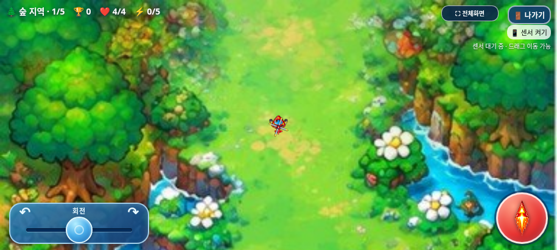
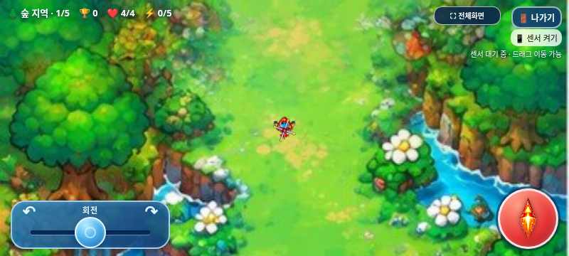
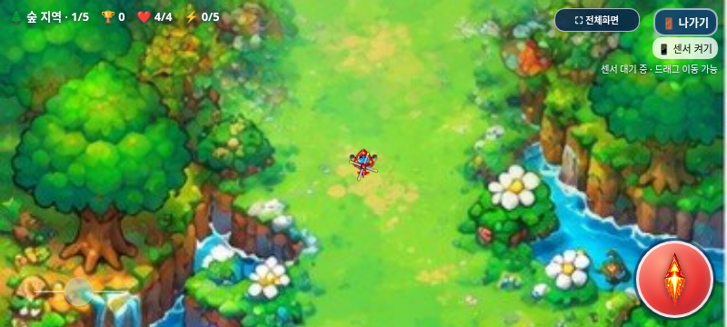
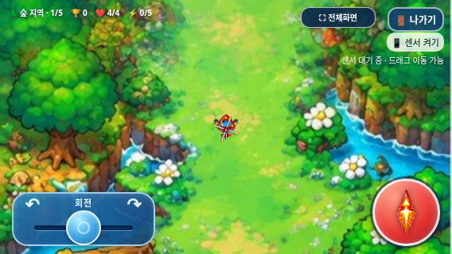
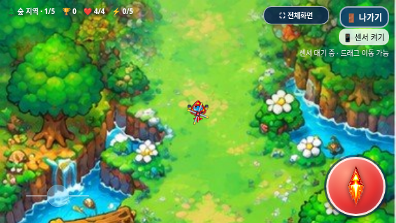
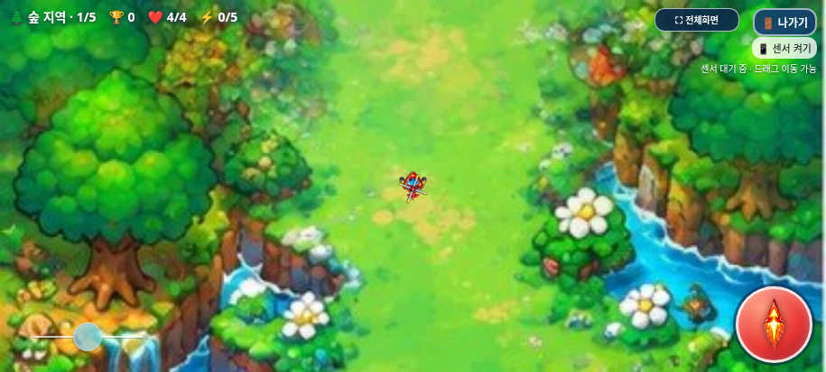
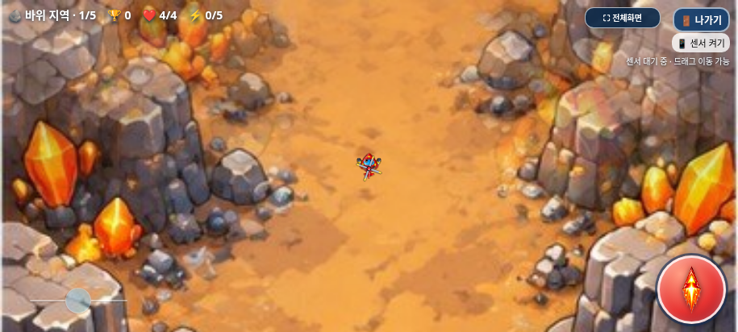
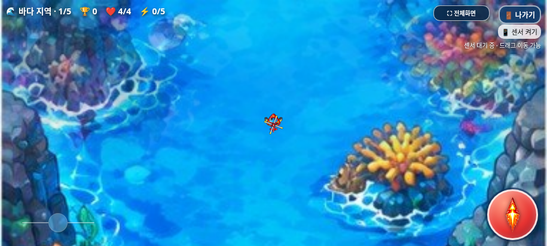
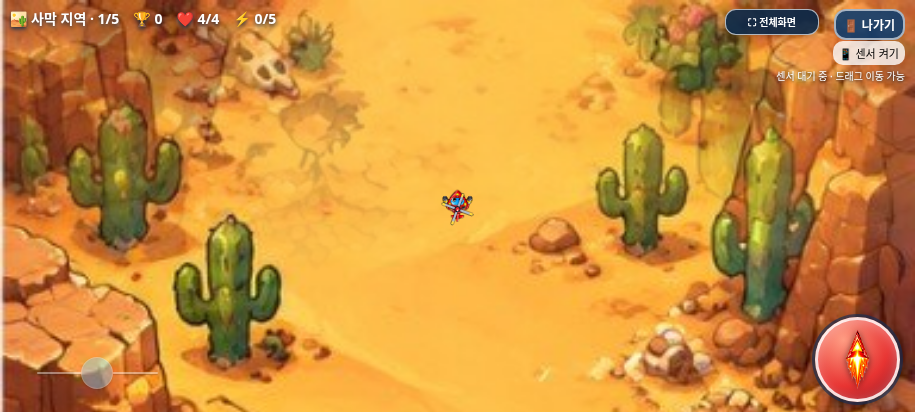

# 작고 투명한 회전 조이스틱 디자인 검증

2026-11-02(KST) · `feature/minimal-rotation-joystick`

원격 최신 `feature/mobile-rotation-joystick`의 `22191f996908195937ebef7c220e871e487d7712`를 확인하고 새 작업 브랜치를 만들었다. 시작 작업 트리는 깨끗했다. 기존 입력/전투 기능을 보호하고 **제품 변경은 assets/controls/controls.css의 조이스틱 디자인 부분에만** 적용했다. index.html과 모든 JavaScript·이미지·음원은 기준과 바이트 동일하다.

## 변경 내용

| 항목 | 이전 | 변경 후 |
| --- | --- | --- |
| 조작 영역 | 폭180~230px, 모바일 높이68px | 폭135~165px, 높이58px |
| 손잡이 | 표시44px·그라데이션·안쪽 장식 | 표시32px·평면 하늘색·1px 외곽선 |
| 터치 | 전체 조작 영역 | 전체 조작 영역 유지, 손잡이 주변44×44px 확보 |
| 배경 | 사각 패널·그라데이션·두꺼운 테두리/그림자 | 배경·테두리·패널 그림자 없음 |
| 트랙 | 두꺼운 파란 선·중앙 표시 | 2px 반투명 흰색 선 |
| 화살표/문구 | 좌우 화살표·회전 문구 | 표시 제거, 접근성 이름/키보드 포커스 유지 |
| 불투명도 | 패널 중심의 기존 표시 | 평상시40%, 터치 중70%,120ms 전환 |

트랙과 손잡이에는 배경과 구분하는 작은1~2px 그림자만 남겼다. 새로운 그림이나 그래픽 자산을 만들지 않았다. 손잡이의 기존120ms 중앙 복귀는 그대로이며 회전 입력은 손을 놓는 즉시0이다.

CSS `--stick-inset`을26→22px로 바꿨다. 기존 JavaScript가 이 값을 읽어 `조작 영역 폭/2−여백`으로 범위를 계산하므로 JavaScript 수정 없이 새 트랙 양끝이 정확히−1/+1이 된다. 표시 반경16px보다 넓은22px 여백을 두어 양끝에서도44px 터치 사각형이 조작 영역 안에 남는다. 투명한 영역도 실제 입력을 받는다.

| 가로 해상도 | 실제 폭×높이 | 중앙에서 한쪽 끝까지 |
| --- | --- | --- |
| 915×412 | 약164.69×58px | 약60.34px |
| 800×360 | 144×58px | 50px |
| 568×320 | 135×58px | 45.5px |

기존 왼쪽15px·아래10px 위치를 유지한다. 세 크기 모두 발사/HUD와 겹치지 않는다. 중앙8% 데드존, 거리별 입력식, 최대 회전3.05/2.7/2.35rad/s, 센서 주 이동·75px 보조 드래그, 멀티터치/취소·해제·클릭 전달 방지·길게 누르기 차단은 기존 코드 그대로다.

## 테스트

**총175개 검사 그룹 통과.** [집계](test-summary.json), [원본/패키지 무결성](package-verification.json).

| 검사 | 그룹 | 결과 |
| --- | ---: | --- |
| 디자인/터치 범위/네 배경 / 오프라인 | 5 + 5 | [일반](browser/test-results.json), [오프라인](offline/test-results.json) |
| 실제 조이스틱·멀티터치·센서 비교 / 오프라인 | 23 + 23 | [일반](regression/controls.json), [오프라인](regression/controls-offline.json) |
| 선택·나가기·게임 오버·전체화면 | 15 + 10 + 7 + 7 | [선택](regression/selection.json), [나가기](regression/exit-dialog.json), [사망](regression/game-over.json), [전체화면](regression/fullscreen.json) |
| 전투/진행·탱코·아이템 등장·점수 | 11 + 14 + 19 + 17 | [진행](regression/game-audit.json), [탱코](regression/tanko.json), [아이템](regression/item-rules.json), [점수](regression/scoring.json) |
| 갤럭시 단일 HTML | 19 | [오프라인 HTML](../galaxy-test/test-results.json) |

- 실제 터치로 좌/우 끝값±1·중앙0·중앙 복귀·정지 후 방향 유지, 캐릭터별 최대 회전 속도, 입력 거리별 비례 회전을 재검증했다. 기존 센서36개 조건도 이전 버전과 일치했다. 실제 물리 센서 측정은 아니다.
- 양끝/중앙에서 손잡이 주변44px 사각형의 네 모서리를 실제 hit-test로 확인했다. 보이는 원 밖21px 아래의 실제 터치도 조이스틱이 받았다. 회전·발사·드래그3중 터치, 다른 손가락 해제·cancel/lost capture·게임 종료 초기화가 통과했다.
- 세 해상도×네 지역12개 장면을 일반/오프라인 각각 검사했다. 빈 패널 모서리는 가려지지 않았고 원래 화면과 픽셀 차이가0이었다. 선·손잡이는 모든 장면에서 배경과 구분됐으며 idle/held 불투명도는 정확히.4/.7이었다. 픽셀 비교는 렌더링 확인이며 물리 디스플레이 대비 인증이 아니다.
- 순위표 실제 스와이프, 음악/효과음 토글·오프라인 재생 상태, 전체화면 유지, 게임 오버3초·나가기·최종 복귀, 기존 아이템80×64/지역3회/일반1~4처치/보스전 수명 유지와20단계 통제 클리어30,400점을 재검증했다.
- 미처리 JS 오류·실패한 자산 요청·오프라인 외부 요청은 없었다. 제품 결함은 발견하지 않았다. 디자인 검사에서 고정160ms 대기가 CSS 전환과 경합해 실제 전환 완료를 기다리도록 검사 도구를 고쳤으며 제품 시간값은 바꾸지 않았다. 배경을 통제해 바꾼 캡처의 HUD도 해당 지역으로 함께 갱신했다.

## 수정 전후 화면

원래 게임과 수정 게임을 같은 위치·각도·시계로 정지시켜 Chromium에서 각각 캡처했다. PNG 편집/합성이나 실제 갤럭시 촬영이 아니다.

| 해상도 | 변경 전 | 변경 후(40%) |
| --- | --- | --- |
| 915×412 |  |  |
| 800×360 |  |  |
| 568×320 |  |  |

| 바위 | 바다 | 사막 |
| --- | --- | --- |
|  |  |  |

## 파일·갤럭시 패키지·남은 확인

제품은 controls.css만 변경했다. 기존 tests/mobile_controls.py의 검사 좌표/손잡이 중심을 실제 CSS 값에서 읽도록 조정하고 CSS 해시를 갱신했다. tests/joystick_design.py는 실제 디자인·터치 범위·배경 검사와 캡처를 담당한다. dist HTML/ZIP, 이 보고서/JSON/PNG·갤럭시 안내·DEVELOPMENT_LOG.md를 갱신했다. index와 기존48개 자산 파일은 원본과 동일하며 빌드 스크립트와 모든 실행 JavaScript도 그대로다.

[최신 ZIP 다운로드·실행 안내](../galaxy-test/README.md). HTML **32,390,933바이트**, SHA-256 `cf6cd31a3e612ef486751432e6268f2c2ed1356f31a2a58a8c5bbf7c53adb755`. ZIP **23,462,190바이트**, SHA-256 `204a37155d59d24a487c0e682e97bce7a5cdc245b403f6557305e4762b53df66`.

ZIP에는 최신 HTML1개만 포함한다. CRC·unzip-t·별도 압축 해제 후 바이트 일치, 새 CSS/기존7개 스크립트 내장, 기존 인라인 이미지71개와 선택 PNG/아틀라스·WAV12개·선택 MP3를 검증했다.

실제 Galaxy Samsung Internet/Chrome의 화면 밝기·야외 가시성·44px 터치 감각·물리 센서/권한·길게 누르기 메뉴·파일 연결/저장·주소창·성능/청취는 미검증이다. 직접 file://는 관리 정책으로 차단되어 우회하지 않고 동일 단일 HTML을 오프라인 문서에 주입했다. 기능 브랜치에만 게시하며 main 병합과 GitHub Pages 배포는 하지 않는다.
