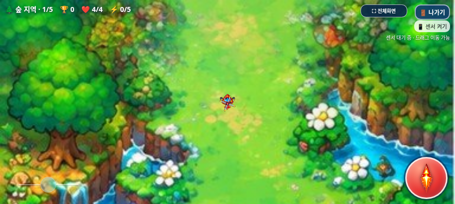
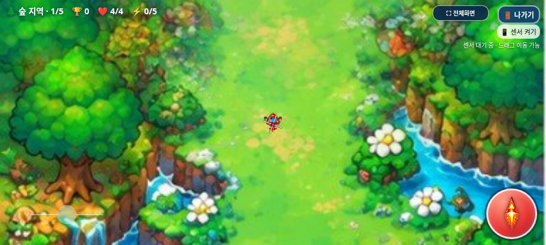
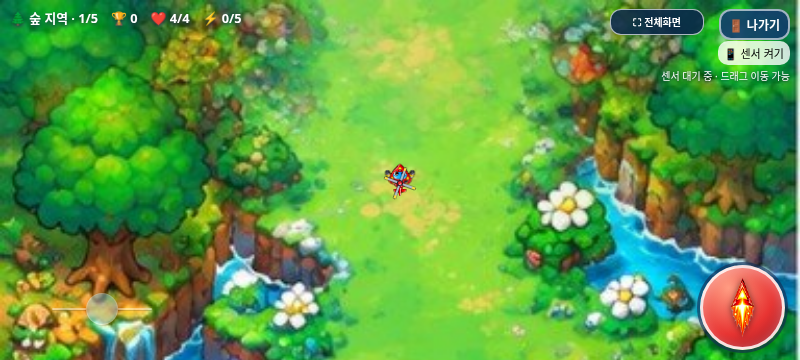
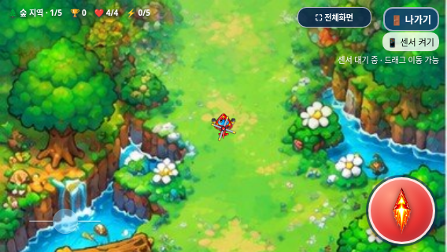

# 회전 조이스틱 위치만 변경한 검증 기록

2026-11-03(KST) · `feature/joystick-position`

기준은 원격 최신 `feature/minimal-rotation-joystick`의 `cb59d8e99dbc209045de2b9b59a05fbfcaf18e3f`다. 작업 트리가 깨끗함을 확인하고 새 브랜치를 만들었다. main 병합·Pages 배포·월드 확장은 진행하지 않는다.

## 제품 변경: CSS 한 줄

기존 위치는 발사 버튼도 공유하는 `.controls`의 left15px·모바일 bottom10px에서 정해졌다. 공용 컨테이너는 수정하지 않고 `assets/controls/controls.css`에서 조이스틱 자체만 뷰포트에 고정했다.

```css
position: fixed; left: 30px; bottom: 22px;
```

이 위치 선언을 기존 `position:relative`로 되돌리면 controls.css 전체가 기준 커밋과 정확히 같다. index.html, 모든 JavaScript, 다른48개 자산 파일과 빌드 스크립트는 그대로다. 폭135~165/높이58px,32px 손잡이/44px 터치,40%/70% 투명도,8% 데드존·비례/최대 회전, 자이로 주 이동·75px 보조 드래그, 멀티터치·취소/복귀·메뉴 차단·전투/밸런스/아이템/점수/사운드도 유지했다.

## 좌표·겹침 검사

| 가로 화면 | 이전 좌상단 | 변경 좌상단 | 새 왼쪽/아래 여백 | 크기 |
| --- | --- | --- | --- | --- |
| 915×412 | (15,344) | (30,332) | 30px / 22px | 약164.69×58px 유지 |
| 800×360 | (15,292) | (30,280) | 30px / 22px | 144×58px 유지 |
| 568×320 | (15,252) | (30,240) | 30px / 22px | 135×58px 유지 |

원본 게임을 별도 페이지로 실행해 DOMRect를 직접 비교했다. 모든 크기에서 오른쪽15px·위12px 이동했고 발사/HUD/센서/나가기/전체화면의 좌표·크기는 전후 동일하다. 조이스틱과 이 UI 사이의 사각형 겹침도 없다. 투명 조작 영역/손잡이 판정과 끝점±1도 실제 터치로 확인했다.

**총114개 검사 그룹 통과.** [집계](test-summary.json), [원본·패키지 검증](package-verification.json).

- 위치/디자인/터치 범위 일반·오프라인5+5: [일반](browser/test-results.json), [오프라인](offline/test-results.json). 네 지역 배경에서도 표시했다.
- 기존 조작 일반·오프라인23+23: [일반](regression/controls.json), [오프라인](regression/controls-offline.json). 중앙/비례/최대·손을 뗀 뒤 각도 유지·44px 터치·cancel/lost capture·3중 터치·이전 센서36개 수치 일치를 확인했다.
- 선택15·나가기10·게임 오버7·전체화면7·갤럭시 단일 HTML19: [선택](regression/selection.json), [나가기](regression/exit-dialog.json), [사망](regression/game-over.json), [전체화면](regression/fullscreen.json), [HTML](../galaxy-test/test-results.json). 순위표 스크롤/버튼·음악 토글·종료/최종 복귀와 기존 게임 구성을 확인했다.

미처리 JavaScript 오류·실패한 자산 요청·오프라인 외부 요청은 없었다. 제품 결함은 발견하지 않았다. 실제 센서/권한을 측정한 검사는 아니며 이벤트·입력 조건을 통제한 Chromium 검사다.

## 수정 전후

같은 위치·각도·시계로 정지시킨 실제 Chromium 화면이다. PNG 편집·합성이나 물리 갤럭시 사진이 아니다.

| 해상도 | 이전15px/10px | 변경30px/22px |
| --- | --- | --- |
| 915×412 |  |  |
| 800×360 |  |  |
| 568×320 |  |  |

## 결과물·한계

수정 파일은 controls.css, CSS 해시, 기존 joystick_design.py의 기준/좌표·UI 비교 조건, DEVELOPMENT_LOG.md, 이 보고서/JSON/스크린샷과 최신 galaxy-test 안내·검증/캡처, dist HTML/ZIP이다. 입력 코드나 월드 구성은 수정하지 않았다.

[갤럭시 ZIP 다운로드·실행 안내](../galaxy-test/README.md). HTML은 **32,390,952바이트**, SHA-256 `131dd8fcd86bbbc0bf5a24b757c5a332ea40400c69889b7b3792bb8ff43f4bfd`. ZIP은 **23,462,199바이트**, SHA-256 `315ff5e42d8cfdfcc0b31226715f4d4883a324eb67c5b12972b70252d82d8729`다.

ZIP에 최신 HTML1개만 넣고 CRC·unzip-t·실제 별도 압축 해제 후 바이트 일치, CSS/기존7개 스크립트 내장·기존 이미지71개와 선택 PNG/아틀라스·WAV12개/선택 MP3를 확인했다. 직접 file://는 관리 정책으로 차단되어 우회하지 않고 동일 단일 HTML을 오프라인 문서에 주입했다.

실제 Galaxy Samsung Internet/Chrome의 터치 감각·주소창/전체화면·센서/권한·길게 누르기 메뉴·파일 열기·청취/성능은 미검증이다. 기존 기능 브랜치와 main은 변경하지 않고 새 기능 브랜치에만 커밋·푸시한다. GitHub Pages에 배포하지 않는다.
