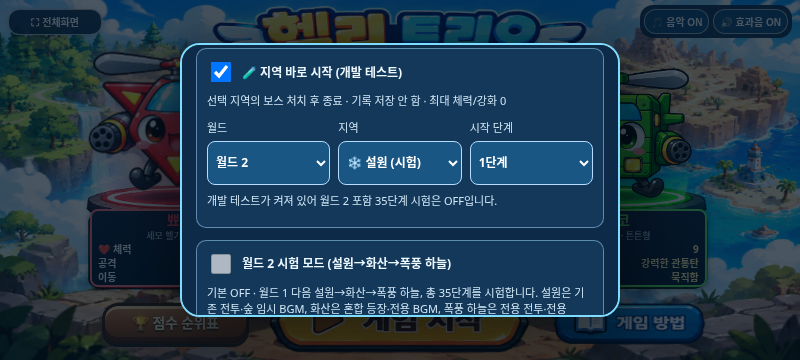
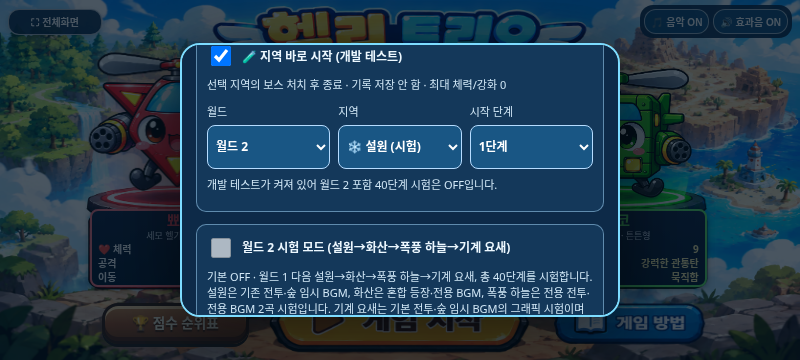
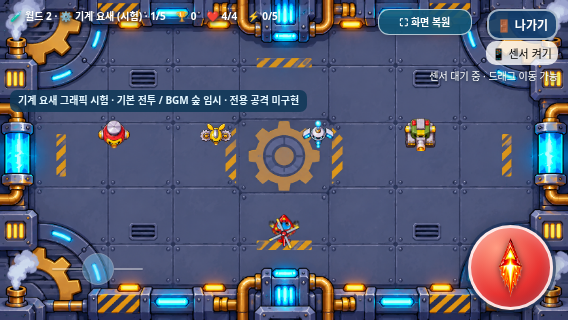
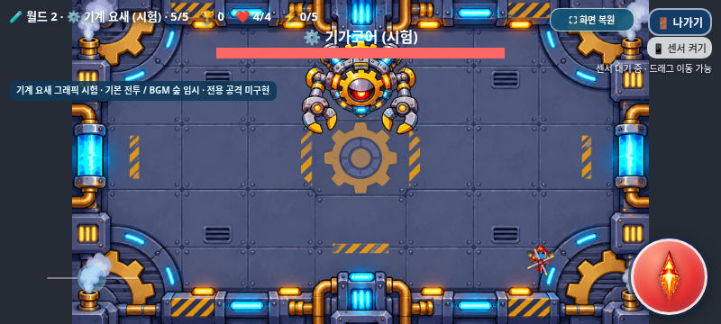
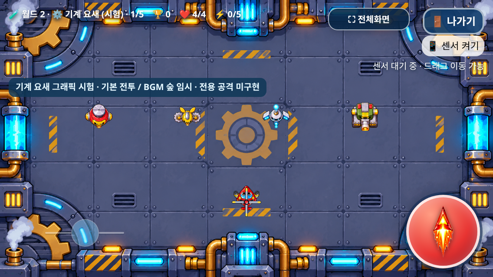
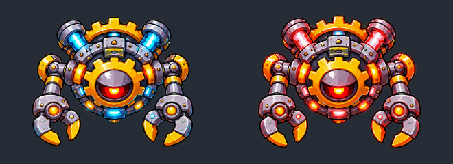

# 기계 요새 1차 그래픽 통합 — Issue #31

2026-11-07 KST. **기본 전투·숲 임시 BGM을 사용하는 그래픽 시험 버전**이다. 고유 AI나 보스 특수 공격을 구현한 버전이 아니다. [Issue #31](https://github.com/26aiera11-cpu/helicopter-game/issues/31)의 전체 본문과 [경량 ZIP 승인 댓글](https://github.com/26aiera11-cpu/helicopter-game/issues/31#issuecomment-6701578332)을 확인했다.

기준 main과 이미 생성된 작업 브랜치는 모두 `653ac838e32fbf8276853058b75041703af4f079`이었다. 원래 체크아웃을 보호하는 별도 작업 공간에서 `feature/machine-fortress-art-integration`을 추적해 작업했다. main 병합·Pages 설정 변경·배포·다른 브랜치 덮어쓰기는 하지 않는다.

## 이미지 출처와 무결성

첨부 `machine_fortress_game_assets_mobile.zip`은 **2,864,176바이트**, SHA256 `09dc158c1347860ab9f699aca531464681697398356655513560172abfded251`로 Issue 추가 댓글의 승인값과 같다. 원래 큰 ZIP에서 실행에 필요 없는 references 원화4장만 뺀 경량판이다. 부족한 원화를 임의로 생성하지 않았다.

ZIP 안 README·asset_manifest 및 게임용 PNG11개를 `assets/machine_fortress/`에 **원본 바이트 그대로** 설치했다. PNG를 다시 그리거나 크기·색상·알파·압축을 변경하지 않았다. [첨부 파일별 해시/바이트 일치](source-package.json), [기존 자산 보존](preservation.json)

| 리소스 | 원본 크기 | 적용 |
| --- | --- | --- |
| 금속 바닥·금색 톱니 배경 | 1672×941 RGB | 1~5단계 동일 이미지, contain·비율 유지·전체 표시 |
| 나사봇 | 168×153 RGBA | 32px 폭, 세로는 원본 비율 |
| 톱니벌 | 229×162 RGBA | 32px 폭, 세로는 원본 비율 |
| 레이저 드론 | 185×167 RGBA | 32px 폭, 세로는 원본 비율 |
| 장갑 포탑 | 168×173 RGBA | 32px 폭, 세로는 원본 비율 |
| 기가코어 일반 | 402×322 RGBA | 132px 폭, 중심 피벗, 기본 보스 전투 |
| 기가코어 폭주 | 394×322 RGBA | 로드·별도 그래픽 미리보기만, 자동 전환 없음 |
| 장벽·장벽 dim/motion·예고 | 원본4종 RGBA | 자산 보존·로드만, 실제 공격/이동/피해 연결 없음 |

배경 SHA256은 `89990eeac3ae96c8ed5c2d9af2d90a5f3d8e51e95ccecf3757db1f9e21f9f124`다. 1920×864로 간주하지 않았다. `Math.min(width/naturalWidth,height/naturalHeight)`로 중앙에 전체를 표시하며 남는 공간만 `#252c36`으로 채운다. 배경을 반복 타일·크롭·확대 재생성하지 않는다.

매니페스트의 `source_rect`는 원래 시트에서 분리했던 좌표다. 이미 분리된 개별 PNG에 그 좌표를 아틀라스 프레임처럼 적용하지 않는다. 실제 Canvas 호출은 `(0,0,naturalWidth,naturalHeight)` 전체 사각형을 사용하고 X/Y 축척을 같게 유지한다. 모든 이미지의 PNG 청크CRC·zlib 종료·IEND·엄격한 전체 디코딩·해시·알파 범위를 검사했다. PNG는 실루엣에 맞게 원래부터 잘려 있어 일부 알파 경계가 캔버스 끝에 닿지만, 임의 재자르기나 테두리 숨기기를 하지 않았다. 실제 표시에서 라벨/설명 카드/검정 사각형 잔여물은 관찰되지 않았다.

원본 README/manifest의 준비 전 status와 HP50%·장벽 후속 설계 문구는 원본 보존을 위해 그대로 두었다. **이번 통합의 실제 구현 상태는 이 보고서와 Issue #31을 따른다.** 첨부 문서의 후속 공격 설명을 이번 작업의 실행 지시로 적용하지 않았다.

## 등록과 게임 진행

`assets/worlds/worlds.js`에 ID7, `world-2:machine-fortress`, 월드2 localIndex3을 추가했다. 기존 ID0~6은 그대로다.

- 기본 월드1: 숲→바위→바다→사막, 20단계, 기존 기본 OFF 정책 유지.
- 월드2 시험 ON: 기존7지역 다음 기계 요새 추가, **8지역×5=40단계**.
- 일반1~4단계,5단계 일반6처치 후 기가코어 등장. 개발자 직접5단계는 즉시 보스.
- 개발자 목록은 기존 지역 등록 시스템에서 자동 생성한다. `게임 방법 → 🧪 지역 바로 시작 → 월드2 → 기계 요새 → 1~5단계`.
- 개발 테스트는 해당 지역 보스 처치 후 종료하고 TOP10/분석 기록을 저장하지 않는다.
- 정상 시험 경로는 폭풍 하늘→기계 요새→월드2 시험 완료로 연결한다. 기본 월드1 사막 클리어는 유지한다.
- 기존 지역당 점수 규칙을 그대로 적용하므로 아이템 처치 없는 기본 전체 점수는 월드1 28,000 / 월드2 시험 56,000이다. 지역당 아이템 몬스터3마리를 모두 잡는 검사에서는 60,800이다. 점수 공식·별도 보너스·저장 스키마/키를 바꾸지 않았다.

## 전투·애니메이션 범위

`assets/machine_fortress/machine_fortress.js`는 그래픽 전용이다. 체력·피해·속도·충돌 반경·적 생성·아이템 드롭·점수를 변경하지 않는다. 기계 요새는 **기본 숲 전투 프로필0**을 명시적으로 사용한다. 일반 적은 현재 기본 HP1·반경16, 추적/원거리 기본 이동과 단발 조준탄을 사용한다. 기본 이동38+(단계-1)×5, 탄속85+(단계-1)×8 및 기존 간격을 재사용한다. 보스는 기본20HP와 기존 강화 보정·이동·단발탄·보상이다.

기존 `warnEnemy()`가 개체별 kind를 무작위 선택하므로 일반4종은 모든 단계에서 기존 기본 생성 방식으로 등장한다. 새 가중 확률 테이블·생성 주기·동시 수량·종별 고유 능력은 추가하지 않았다. 이미지 ID와 원래 kind는 개체 생존 중 일정하며 새 난이도 수치로 해석하지 않는다.

원본은 일반4종 각1포즈, 보스2포즈다. **대기/이동/공격/피격/소멸은 축척·작은 흔들림·점멸·투명도의 표시용 변환**이며 손으로 새 프레임을 그렸다고 주장하지 않는다. 이동·발사·피격 이벤트를 연결하고, 사망 시 중복 없이0.65초 이미지 소멸을 표시한다. 보스 소멸 중 전환을 잠시 보류한 후 기존 nextPhase를 한 번 실행한다. 단계/지역 전환, 게임 오버, 나가기, 재시작에는 그래픽 상태/잔상을 초기화한다. 조작·음악·기존 지역 타이머에는 새 공격 타이머를 추가하지 않았다.

폭주 PNG는 `preview()`로만 확인했다. HP50%에 따른 외형/능력 전환은 연결하지 않았다. 장벽 이미지도 숨김 로드만 하며 경기장에는 생성하지 않는다.

### 후속 작업만 기록

이번에 구현하지 않은 항목: 4종 고유 AI, 회전 레이저, 추적 미사일, 전자기 장벽 공격/피해, HP50% 폭주 전투 강화, 전용 BGM. 향후 장벽 사양은 높이75%·위/아래 중 안전 공간25% 하나·좌/우 생성4조합·예고1.2초·이동3초 시험값이다. 안전 구간에 초록 표시를 넣지 않는 승인 조건을 문서로만 보존했다.

## 기존 기능 보호와 전후 비교

기존111개 자산 중 월드 레지스트리1개만9차분으로 바꾸고 나머지110개는 원본 바이트가 같다. index는 자산/스크립트 로드 및 그래픽 이벤트/렌더 연결16차분(4곳 공통 reset 포함)만 허용했다. 이 차분을 정확히 역변환하면 기준 main의 전체 index/기존 자산과 동일하다. 보호 계층에 신규 자산 해시와 정확한 역변환만 추가했으며 과거 해시를 일괄 새 값으로 바꾸지 않았다.

폭풍 하늘 승인 배경 SHA `96a86d2d0fd191d2b48904dc1a15f4a848d1937e044dc2b23900aaa6ad69817d`, contain, 기존111자산의 모든 음악/효과음/캐릭터/설원·화산·폭풍 전투/아이템/점수/조작 코드를 보호한다. 기계 요새 BGM은 `musicProfile:0`; 기존 월드1 0/1/2/3·설원0·화산4·폭풍5 및 미디어 객체 수17개는 유지한다. 신규 음악 프로필6이나 신규 곡을 만들지 않았다.

기준 main의 index/월드 레지스트리를 별도 URL로 제공한 실제 브라우저에서 개발자 메뉴 **기존3지역→4지역**을 비교했다. 같은 상태로 그린 폭풍 하늘 게임 Canvas PNG는 변경 전후 바이트가 같다. [비교 결과](comparison/comparison.json)








## 검사 방법과 한계

`tests/machine_fortress.py`는 실제 Chromium의 일반 HTTP `/helicopter-game/` 접두사 및 네트워크를 차단한 독립 HTML을 검사한다. 게임 상태·좌표·무적·진행 시간을 제어한 전투 검사이며 사람 플레이/실기기 인증이 아니다. 원본PNG/알파/매니페스트, contain 5단계,3가로 크기+DPR2,3캐릭터×4단계×4종48실전 생성/발사/피격/처치, 6처치 보스 등장, 보스 보상·소멸/개발 종료, 단계 잔상 초기화, 일반→기계 요새 전환/아이템 수명, 전체화면/나가기/게임오버를 검사한다.

```sh
python tests/machine_fortress.py --artifacts /tmp/machine-native
python tests/machine_fortress.py --standalone --artifacts /tmp/machine-offline
python tests/run_volcano_checks.py --artifacts /tmp/machine-regression --workers 1 --only worlds worlds-offline developer_start-native developer_start-offline storm_sky-native storm_sky-offline storm_sky_edges storm_sky_bgm-native storm_sky_bgm-offline volcano_mixed-native volcano_boss-native snowfield_combat-native snowfield_boss-native scoring mobile_controls galaxy_standalone
python scripts/build_galaxy_test.py
python scripts/package_galaxy_test.py
```

대용량 독립 HTML을 함께 검사할 때 환경 메모리 한도를 넘지 않도록 **순차 검사 권장**이다. 검사 스크립트 개발 중 경로 문자열 결합, 첫 프레임 배치 완료 전 좌표 읽기, 반복 조준 fixture의 이전 탱코 관통탄 잔존, 이미 전체화면인데 버튼을 다시 눌러 해제한 설정 오류를 수정했다. 개발자 기존 검사에는 새 지역ID7/40단계/120경로 기대값을 반영했다. 게임 기능을 변경하거나 기존 실패 검사를 제거하지 않았다. 최초 실패 로그도 별도 보존한다.

대용량 HTML 동시 로드 중 실제 `Page crashed`가 발생했다. 실행 환경의 memory.max는8GiB이고 OOM kill 기록이 존재했다. 실패 로그와 환경 계수를 보존하고 해당 검사는 동시성을 줄인 별도 실행으로 다시 확인한다. 이는 Galaxy 실물 성능 검증을 대신하지 않는다.

기존 설원 긴3점 멀티터치 후 나가기 click 간헐 누락은 **[Issue #30](https://github.com/26aiera11-cpu/helicopter-game/issues/30), 낮은 우선순위의 별도 미해결**로 유지한다. 이번 회차 통과만으로 해결됐다고 판단하지 않으며 입력 코드를 바꾸지 않았다. 실제 Galaxy Samsung Internet/Chrome의 파일 연결/센서/멀티터치/장시간 성능·화질·청취와 최종 그래픽 승인은 추가 확인이 필요하다.

## 갤럭시 결과물

[최신 갤럭시 ZIP 직접 다운로드](https://raw.githubusercontent.com/26aiera11-cpu/helicopter-game/refs/heads/feature/machine-fortress-art-integration/dist/heli_trio_galaxy_test.zip)

새 module/manifest와 PNG11개, 기존 모든 이미지·CSS·23스크립트·선택/스테이지/보스 음악을 포함한 단일 HTML이다. ZIP에는 최신 HTML 한 개만 포함한다. 새 BGM이나 추가 네트워크 의존성을 만들지 않았다. [빌드](build.json), [패키지](package.json)

**최종 관련18모음 중17통과·1기존 미해결 실패, 완료287그룹**이다. 새 지역 일반/오프라인 각13그룹(합계26)은 모두 통과했다. 전체 등록68모음 재실행은 아니다. 기존 worlds-offline은 재검사에서 설원 나가기 Issue #30으로16부분그룹 뒤 실패했으며 해당16그룹은 완료 합계에 포함하지 않았다. 일반 worlds의 이번 통과를 해결로 간주하지 않는다. [집계/명령/전체 시도 이력](test-summary.json)

[설원 나가기 최종 실패 로그](serial-recheck/worlds-offline/run.log) / [pointer 진단](serial-recheck/worlds-offline/exit-touch-failure.json) / [화면](serial-recheck/worlds-offline/exit-touch-failure.png). 최초 개발자 목록 기대값 실패와 Page crashed, 신규 검사 fixture 오류도 원본 로그와 JSON을 initial-attempts/regression에 보존했다. 순차 재검사의 새 지역/전체 경로 실행에서는 OOM 종료 계수가 증가하지 않았다.

공개 JSON의 중복 data URI만 길이·MIME·SHA 지문으로 치환했다. 실제 원본 바이트는 자산/독립HTML에 포함하고 성공/실패·수치·이벤트·진단은 유지한다. 로그는 원문을 유지했다. [원본/공개 보고서 해시·크기](report-artifact-manifest.json), [검사 환경 메모리 증거](browser-memory-diagnostic.json).

HTML **76,783,464바이트**, ZIP **56,137,935바이트(약53.54MiB)**. 실제 별도 압축해제 후 HTML과11PNG/모든음원/manifest/복구 Storm PNG 바이트를 확인했다. [내장 무결성](embedded-verification.json). **작업 브랜치 커밋·푸시만 수행하고 main 병합과 GitHub Pages 배포는 하지 않는다.**

## 최종 모음별 결과

| 모음 | 결과 | 완료 그룹 |
| --- | --- | ---: |
| worlds | 통과 | 20 |
| developer_start-native | 통과 | 18 |
| developer_start-offline | 통과 | 18 |
| storm_sky-native | 통과 | 19 |
| worlds-offline | 기존 Issue #30 실패 | 0 |
| storm_sky_edges | 통과 | 6 |
| storm_sky-offline | 통과 | 19 |
| storm_sky_bgm-native | 통과 | 19 |
| volcano_mixed-native | 통과 | 13 |
| volcano_boss-native | 통과 | 16 |
| snowfield_combat-native | 통과 | 16 |
| storm_sky_bgm-offline | 통과 | 19 |
| snowfield_boss-native | 통과 | 19 |
| scoring | 통과 | 17 |
| mobile_controls | 통과 | 23 |
| galaxy_standalone | 통과 | 19 |
| machine_fortress-offline | 통과 | 13 |
| machine_fortress-native | 통과 | 13 |
