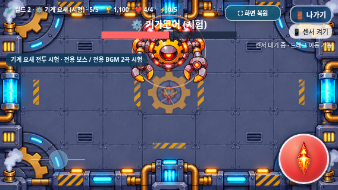

# 기계 요새 BGM 2곡 — Issue #37

**1차 청취 시안이며 사용자 승인 대기 상태다.** 실제 Galaxy 청취 승인 후 다음 단계를 결정한다. main 병합과 GitHub Pages 배포는 하지 않는다.

먼저 두 곡을 개별로 들을 수 있다.

- [기어 시티(가칭) — 일반 전투 WAV](https://raw.githubusercontent.com/26aiera11-cpu/helicopter-game/refs/heads/feature/machine-fortress-bgm/assets/audio/machine_fortress_stage.wav)
- [기가코어 경보(가칭) — 보스 WAV](https://raw.githubusercontent.com/26aiera11-cpu/helicopter-game/refs/heads/feature/machine-fortress-bgm/assets/audio/machine_fortress_boss.wav)
- [최신 갤럭시 테스트 ZIP](https://raw.githubusercontent.com/26aiera11-cpu/helicopter-game/refs/heads/feature/machine-fortress-bgm/dist/heli_trio_galaxy_test.zip)

[Issue #37 전체 명세](https://github.com/26aiera11-cpu/helicopter-game/issues/37), 기준 `2f29ced6cd53b7ebcb8279669c70c74fc1374ff1`, 작업 브랜치 `feature/machine-fortress-bgm`.

## 작곡과 소리 구성

| 가칭 | BPM / 조성 | 정확한 길이 | WAV 바이트 | Peak / RMS |
|---|---|---|---|---|
| 기어 시티 | 132 / A minor | 29.090930초 | 1,282,954 | 0.479248 / 0.074996 |
| 기가코어 경보 | 152 / E minor | 25.263175초 | 1,114,150 | 0.531006 / 0.095995 |

두 곡 모두4/4·16마디·22,050Hz·모노·16비트 PCM이다. 합계2,397,104바이트로3.5MB 이내다.64박의 길이를 샘플 단위로 반올림했으며 이론적 길이 오차는 한 샘플 미만이다.

‘기어 시티’는 A natural minor의 Am/C/F/G 문장과 Dm/Em 응답을 사용한다. 규칙적인4박 기계 킥, 짧은 베이스8분음표, 금속 플럭/clang/tick과 가벼운 신스 리드를 조합했다.1~4마디의 도입,5~8마디의 낮은 응답,9~12마디의 높은 문장,13~16마디의 회귀를 별도로 작곡했다.

‘기가코어 경보’는 E natural minor의 Em/C/Bm/D/Am/G 화성을 사용한다. 첫 마디부터 낮은 베이스 펄스와 킥을 넣고 짧은 E–B–G 계열 경보 리드로 긴박감을 준다.4마디마다 필인/문장을 바꾸고 후반8마디에는 금속 아르페지오 타격을 늘렸다. 일반곡과 템포·멜로디·진행·베이스 리듬을 다르게 만들었다.

기존 화산·폭풍 하늘 곡은 제작 방식만 참고했다. 새 생성기는 독립 악보·합성기·시드370132/370152를 갖고 있으며 기존 WAV/MP3·상용 샘플·외부 음악·이전 생성기를 입력으로 읽거나 호출하지 않는다. 가산 합성 리드·사인 기반 베이스·완만한 FM 금속음·고정 시드 잡음 드럼을 Python/NumPy로 합성한다. 순환 잔향/음표 릴리즈를 보존하고 파일 양 끝1.5ms만 처리하므로 긴 페이드아웃/삽입 무음이 없다.

```sh
PYTHONDONTWRITEBYTECODE=1 python scripts/generate_machine_fortress_bgm.py --output-dir /tmp/machine-music-reproduce
```

같은 환경에서 별도 폴더의 두 WAV를 원본과 비교해 전체 바이트 재현을 확인했다. 악보와 합성은 [생성 스크립트](../../../scripts/generate_machine_fortress_bgm.py), 음원 메타데이터는 [composition.json](composition.json)에 포함한다.

## 레벨과 반복 경계 검사

- `machine_fortress_stage.wav`: SHA `0755dafbc9ad87794868785abb881764f6a2c8cc7856b265116aceaba59fc908`, DC -0.00000149, 최소100ms RMS 0.009336, 경계200ms RMS 0.100862.
- `machine_fortress_boss.wav`: SHA `fde2bbc1cb53db61fa78bf47f6a6e69715ed2a1ad3e97c510513a0dc1e6d7fee`, DC -0.00000206, 최소100ms RMS 0.013840, 경계200ms RMS 0.128477.

클리핑0개, 경계 샘플 차0, DC 절댓값0.0001 미만,100ms 이상의 연속 무음 없음이다. 실제 Chromium WAV 플레이어에서도 파일 끝으로 이동한 후 반복·재생 시간 증가를 확인했다. 수치 검사가 실제 스피커의 루프 자연스러움/음색 승인까지 의미하지는 않는다.

화산/폭풍 하늘 일반곡 RMS는0.086996/0.084995, 보스곡은0.102996/0.098995다. 신규 RMS0.074996/0.095995는 둘보다 낮다. 일반곡 peak0.479248은 Storm0.481537보다 낮고 화산0.438354보다 약0.77dB 높다. 보스 peak0.531006은 기존 보스 두 곡보다 낮다. 기존 재생 볼륨 일반.42·보스.58·선택.34와 모든 SFX는 그대로다. SFX가 음악에 묻히는지는 실제 Galaxy 청취 승인 대상이다.

## 최소 게임 연결과 보호

실제 런타임 수정은 `index.html`의3차분(숨김 audio2개/기존 stageTracks와 bossTracks에 하나씩)과 `assets/worlds/worlds.js`의3차분(ID7의musicProfile0→6 및 기계 요새 시험 안내2곳)뿐이다. 기존 단일 음악 owner, pause/resume, 실제 사용자 gesture, 거부 후 다음 터치 재시도, ON/OFF, SFX, 게임오버3초 무음, 메뉴 MP3 전환을 재사용한다.

프로필은 기존 월드1 `0/1/2/3`, 설원0, 화산4, 폭풍 하늘5를 유지하며 기계 요새만6이다. combatProfile/assetProfile은0 그대로다. 일반1~4 및 정상5단계의6처치 전에는 일반곡, 기가코어 생성 및 개발자 직접5단계는 보스곡이다. **폭주 중 같은 보스 Audio 객체를 유지하며 currentTime이 이어지고 play/pause 이벤트가 추가되지 않았다.** 실제 무기 타격으로 HP50%와 빨간 PNG 전환까지 확인했다.

기존129자산 중 레지스트리1개를 제외한128개는 원본 전체 바이트가 같다. 승인된 PNG11개/manifest/Cover, 일반40px/기가코어132px/체력 보정/보상, 나사봇H×.4·톱니벌H×.7, 레이저·유도 미사일·장벽75/25·폭주, 다른7지역·플레이어·조작·아이템·점수/저장·기존 모든 오디오를 보존한다. 전투 모듈이나 효과음 파일은 변경하지 않았다.

## 실제 브라우저와 회귀 검사

[집계](test-summary.json)와 tests/에 명령·종료 상태·로그·재생 이벤트/시간을 보존한다. 신규 검사는 일반22/오프라인22그룹이다.3캐릭터×3가로 크기×일반/보스의18경로, 일반1~4, 정상5단계6처치→보스, 개발자 직접5, 모든 지역16음악 경로, 폭주 연속 재생, SFX 독립, OFF/ON, 나가기 취소/확정, 숨김 모의/복귀,3초게임오버, 실제 보스 처치/2000점/메뉴, 지역 전환,12회 반복, developer 기록 비저장, 최초거부 모의 후 다음 실제 터치 재시도를 검사했다. 미디어19개 중 반복 음악15개가 있어도 동시 BGM은 최대1개였다.

```sh
PYTHONDONTWRITEBYTECODE=1 TMPDIR=/tmp python tests/run_volcano_checks.py --workers 1 --only machine_fortress_bgm-native machine_fortress_bgm-offline --artifacts /tmp/machine-bgm-checks
```

기존 검사의 음악 관련 기대값만 갱신했다. 미디어17→19/반복13→15, 기계 요새 musicProfile6·첫 재생 대상과 음원 허용 해시를 추가했다. 과거 보호 검사는 위6개 정확한 차분만 역변환한 뒤 계속 수행한다. 실패 검사를 삭제하거나 입력/전투 수치를 바꾸어 통과시키지 않는다. 전체 등록 모음을 모두 재실행했다고 표현하지 않는다.

### 실제 게임 캡처

| 화면 크기 | 일반곡 | 보스곡 |
|---|---|---|
|915×412|[일반](screenshots/machine-bgm-phase1-915x412.png)|[보스](screenshots/machine-bgm-phase5-915x412.png)|
|800×360|[일반](screenshots/machine-bgm-phase1-800x360.png)|[보스](screenshots/machine-bgm-phase5-800x360.png)|
|568×320|[일반](screenshots/machine-bgm-phase1-568x320.png)|[보스](screenshots/machine-bgm-phase5-568x320.png)|



## 독립 HTML·ZIP

HTML **80,010,247바이트**, ZIP **58,468,627바이트/55.76MiB**다. ZIP SHA256 `c62cd61f15b52a38880ccaee477d3c71d3424b219cfc84122b7c7e8d2bc74925`, HTML SHA256 `9dddd98453455bdae2a5ebbeb7e6955ec24206975c557f4583a574618655a991`. ZIP에는 `heli_trio_galaxy_test.html` 하나만 들어 있다. CRC·별도 폴더 압축해제·HTML 바이트 일치, 신규2WAV/기존 외부5음원/PNG11개/27스크립트와 원본 manifest를 검사했다. 네트워크 차단 HTML에서 오디오·이미지·스크립트 외부 요청0이다. 빌드/패키지의 기존 리소스 확장 로직에 두 WAV의 원본 바이트 내장 검사를 추가했다. [build.json](build.json), [package.json](package.json), [standalone-integrity.json](standalone-integrity.json).

관리 환경의 file:// 탐색 제한을 우회하지 않고 동일 HTML을 네트워크 차단 상태로 실행했다. 실물 Galaxy Samsung Internet/Chrome의 오디오 정책·센서/멀티터치·장시간 성능·파일 연결·스피커 음색/루프/SFX 가림은 미검증이다. 브라우저 재생 상태와 사람이 듣는 평가를 구분한다.

기존 **Issue #30 설원 긴3점터치 후 나가기 click 누락**은 별도 미해결로 유지하고 조작 코드를 바꾸지 않는다. 이번 실행에서의 재현 여부와 최종 통과/실패 수는 집계와 개발 기록에 명시한다. 사용자 청취 승인 전 곡을 최종 승인 음악으로 취급하지 않는다.

변경 파일은 새 WAV2개·독립 생성기, 위 index/world 음악 연결, 빌드/패키지, 음악 검사·정확한 보존 연결·미디어 수/프로필 기대값, 개발 기록·시연 화면/검사 결과, dist HTML/ZIP이다. 원본 그래픽/음원·기존 전투/조작/저장 코드는 변경하지 않았다.


최종 검사 결과: 등록78모음 중 관련18개 실행, **18개 통과·0개 실패·완료291그룹**. 신규 음악44그룹과 기존 회귀247그룹이며 전체78모음 실행은 아니다. 이번worlds에서Issue #30은 재현되지 않았으나 별도 미해결로 유지한다. 순차 실행 중 새 OOM종료0.
