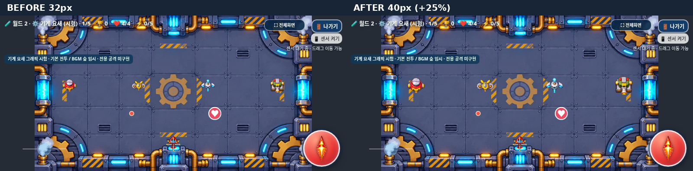

# 기계 요새 일반 몬스터 32→40px — Issue #32

2026-11-07 KST. [Issue #32](https://github.com/26aiera11-cpu/helicopter-game/issues/32)의 전체 본문(댓글0개)을 확인했다. 기준은 기계 요새 1차 통합 `ed3dc5561f569de62a9dd31a5eaf60f33722b6d1`이며, 이미 생성된 `fix/machine-fortress-enemy-scale`에서만 작업했다. main은 `653ac838e32fbf8276853058b75041703af4f079`이다. 실제 Galaxy 크기 승인 전 main 병합/Pages 배포를 하지 않는다.

## 변경

**게임 실행 코드 수정은 `assets/machine_fortress/machine_fortress.js`의 공통 `renderWidth:32` → `renderWidth:40` 한 값뿐이다.** 네 종류 모두 가로/세로1.25배다. paint·피벗·애니메이션 계산·경계/이동 좌표·원본PNG·manifest를 변경하지 않았다. 보스는132px 그대로다.

| 몬스터 | 변경 전 기본 표시 | 변경 후 기본 표시 |
| --- | --- | --- |
| 나사봇 | 32×29.143px | 40×36.429px |
| 톱니벌 | 32×22.638px | 40×28.297px |
| 레이저 드론 | 32×28.886px | 40×36.108px |
| 장갑 포탑 | 32×32.952px | 40×41.190px |

대기/이동/공격/피격/소멸의 기존 표시용 축척과 흔들림은 그대로다. 따라서 위 표는 기본 너비이며 애니메이션 프레임에서는 기존 배율이 함께 적용된다. DPR2에서도 CSS 좌표 기준40px이고 캔버스 물리 픽셀은2배로 표시한다. PNG를 확대 저장하거나 정사각형으로 변형하지 않았다.

기존125개 자산 중 그래픽 모듈1개만 위 값을 변경했고 나머지124개와 index는 바이트가 같다. 정확히40→32만 되돌려 기준 파일과 전체 바이트를 비교했다. 기존 보호 해시는 그대로 두고 이 한 차분만 정규화한다. [보존 결과](preservation.json)

## 전후 화면과 측정

기준 Git의 모듈만 `/before/`에서 제공하고 `/after/`는 현재 모듈을 제공했다. 나머지 소스·이미지는 기준과 동일하다. 같은 종류·좌표·캐릭터·프레임·배경·아이템/탄환을 사용했다.



[915×412 이전](comparison/before-915x412-dpr1.png) / [이후](comparison/after-915x412-dpr1.png), [568×320 이전](comparison/before-568x320-dpr1.png) / [이후](comparison/after-568x320-dpr1.png), [실제 DPR2 이전](comparison/before-568x320-dpr2.png) / [이후](comparison/after-568x320-dpr2.png).

실제 Chromium Canvas drawImage와 변환 행렬을 측정했다. **4종×3캐릭터×1~5단계×5시각상태×4화면/DPR×전후 =2,400측정**에서 너비·높이가 각각 정확히1.25배이며 같은 원본 전체 사각형·비율·중심 피벗을 사용한다. 보스132px/HP20/r48 및 일반HP1/r16/이동속도 등은 같다. [전체 수치](comparison/test-results.json), [실행 로그](comparison/run.log)

이미지는 새로 확대 생성하지 않고 기존 원본을 원래 해상도보다 작은 크기로 그린다. 실제 화면에서 외곽선/알파가 유지되고, 플레이어·일반 적탄·체력 아이템을 함께 표시했을 때 구분할 수 있었다. HUD·조이스틱·발사 버튼의 기존 크기와 위치는 바꾸지 않았다. 전체적인 크기 취향과 실기기 화질의 최종 판단은 사용자 확인 대상이다.

## 표시와 판정의 차이·남은 경계 현상

Issue의 확정 범위대로 **일반 몬스터의 시각적 기본 너비40px, 실제 충돌 반경16px(지름32px)**를 유지한다. 시각 영역의 좌우 약4px는 기존 원형 판정 범위 바깥에 있을 수 있다. 이는 난이도 변경을 피하려는 이번 요구사항의 의도된 차이다. 타격 판정 조정은 크기 승인 후 별도 밸런싱 작업이다.

추가 경계 측정에서 기존 중심 제한 x=17px인 장갑 포탑의 기본 프레임은 이전 왼쪽1px, 이후 왼쪽-3px였다. 즉 화면 가장자리에서 일부가 캔버스 밖으로 잘릴 수 있다. 기존 흔들림/소멸 배율에서는 양이 달라질 수 있다. 이번에는 paint·좌표·충돌/이동 제한을 유지하라는 명세에 따라 바꾸지 않았다. 원본 파일이나 소스 사각형이 잘린 것은 아니다. [이전 경계](comparison/before-edge-568x320.png), [이후 경계](comparison/after-edge-568x320.png). 필요하면 별도 승인을 받은 표시 경계 작업으로 다룬다.

## 검사

```sh
python tests/machine_enemy_scale.py --artifacts /tmp/scale-comparison
python tests/run_volcano_checks.py --artifacts /tmp/scale-regression --workers 1 --only machine_fortress-native machine_fortress-offline worlds developer_start-native storm_sky_bgm-native galaxy_standalone
python scripts/build_galaxy_test.py
python scripts/package_galaxy_test.py
```

기존 `tests/machine_fortress.py`에 네 종류40/보스132의 기대값과 실제 Canvas 표시 너비 검사를 추가하고 HP/r16 검사는 유지했다. 기존 보존 계층은 원본 해시를 덮어쓰지 않고 정확한 한 값의 차분만 허용한다.

첫 developer_start-native는120시작 경로 및8지역 실제 BGM 재생을 포함한17부분그룹 뒤, 사용하지 않던 화산/폭풍 WAV4개 requestfailed 기록 때문에 마지막 검사에서 실패했다. 파일과 게임 음악 코드는 기준과 같고 별도 음악 검사에서는 모두 실제 재생됐다. 기존 실패 수집기는 failure 코드를 남기지 않아 첫 요청 실패의 정확한 원인은 확정할 수 없다. 페이지를 여러 번 재탐색하는 fixture에서 음원 사전 로딩 완료를 확인하도록 대기를 추가하고 재검사했다. 오류 무시/필터링이나 음악 코드 변경은 하지 않았고 최초 로그를 보존한다. 최종 결과는 test-summary.json에 구분해 기록한다.

기존 설원 세 손가락→나가기 click 간헐 누락은 **Issue #30의 낮은 우선순위 미해결 이력**으로 유지한다. 이번 worlds 회차 통과만으로 해결됐다고 주장하지 않으며 입력 코드는 변경하지 않았다. 이전 실패 이력은 [기계 요새1차 보고서](../machine-fortress-art-integration/README.md)와 개발 기록에 보존한다.

제어된 실제 Chromium/모바일 viewport 검사이며 물리 Galaxy Samsung Internet/Chrome·센서·장시간 성능·최종 크기 승인은 미검증이다. 이 환경의 file:// 정책을 우회하지 않았고, 독립 HTML의 동일 바이트를 네트워크가 차단된 문서에서 실행했다. 기존68모음 전체 재실행은 하지 않았다.

## 갤럭시 파일·수정 파일

[갤럭시 ZIP 직접 다운로드](https://raw.githubusercontent.com/26aiera11-cpu/helicopter-game/refs/heads/fix/machine-fortress-enemy-scale/dist/heli_trio_galaxy_test.zip)

HTML76,783,464바이트, SHA256 `829043ece8a9daa98bd701d6160e67a7681229604407ec45cad76311948f18ed`. ZIP56,137,933바이트(약53.54MiB), SHA256 `caae37516dbccf4969053a169788d60cef66835f7b84c98d6846ce552732c80f`. ZIP은 최신 HTML 한 개만 포함한다. 별도 압축해제·CRC·HTML 전체 바이트 동일성·원본PNG11개와 최신40px 모듈 내장을 검사했다. [빌드](build.json), [패키지](package.json), [실제 내장 검사](embedded-verification.json).

주요 변경은 그래픽 모듈 한 값, 표시 크기/보존/개발자 로딩 검사, 신규 전후 비교 테스트, 개발 기록·비교 화면/테스트 보고서, dist HTML/ZIP이다. index·지역 registry·모든 PNG·AI·음악/조작/점수/아이템 코드 및 기존 빌드/패키지 스크립트는 그대로다. 미구현인 기계 요새 고유 AI·보스 특수 공격·장벽·폭주 강화·전용 BGM도 추가하지 않았다.

**fix/machine-fortress-enemy-scale에만 커밋·푸시하며 main 병합/Pages 배포는 하지 않는다.**

## 최종 결과

**관련7개 모음 모두 통과, 완료107검증그룹**이다. 새 전후 비교5그룹과 기존6개 관련 모음을 포함한다. 최초 developer_start의17부분그룹은 완료 합계에 중복 포함하지 않았다. [집계/명령/원래 시도](test-summary.json), [최초 실패 로그](regression/developer_start-native/run.log), [사전 로딩 대기 후 결과](media-recheck/developer_start-native/run.log).

| 모음 | 결과 | 완료 그룹 |
| --- | --- | ---: |
| machine_fortress-native | 통과 | 13 |
| machine_fortress-offline | 통과 | 13 |
| worlds | 통과 | 20 |
| developer_start-native | 통과 | 18 |
| storm_sky_bgm-native | 통과 | 19 |
| galaxy_standalone | 통과 | 19 |
| machine_enemy_scale-comparison | 통과 | 5 |

원본 로그는 그대로 보존했다. 공개 JSON에서 중복 data URI만 길이/MIME/SHA 지문으로 바꾸고 수치·성패·진단·이벤트는 유지했다. 실제 바이트는 원본 자산과 독립HTML에 있다. [원본/공개 보고서 해시](report-artifact-manifest.json).
