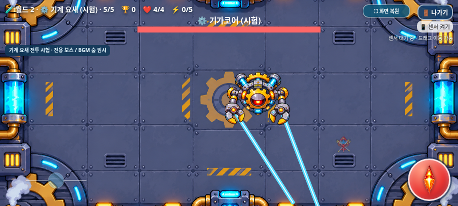
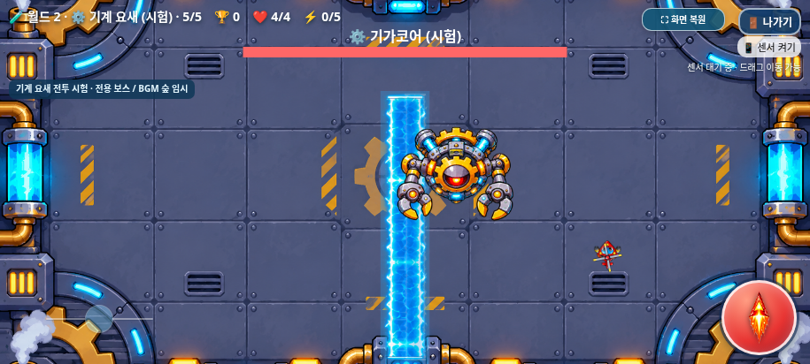
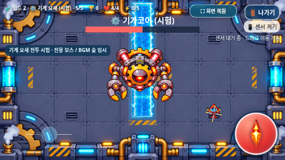

# 기가코어 전용 보스전 — Issue #36

[확정 명세](https://github.com/26aiera11-cpu/helicopter-game/issues/36)를 적용한 **Galaxy 승인 전 시험 버전**이다. 기준 `0ae1d974ab7a90058e7abb3abc7172dd2003711d`, 작업 브랜치 `feature/machine-fortress-gigacore-boss`. 월드2 기계 요새 ID7의 5단계에만 적용한다. main 병합과 Pages 배포는 하지 않는다.

## 구현한 공격

| 공격 | 예고 → 실제 공격 | 피해·제한 |
|---|---|---|
| 양팔 회전 레이저 | 0.9초 → 1.8초 동안 180° 등속 회전 | 폭8px, 길이 min(H×.55,220px), 실제 선분과 원형 플레이어 판정. 두 팔 중복·매 프레임 중복 피해 방지 |
| 유도 미사일 | 0.7초 → 기본2개/폭주3개 | 80/88px/s, 반경6px, 수명3.4초, 최대1.6rad/s 조향, 동시12개. 기존 탱코 차단·무적·hurt() 재사용 |
| 전자기 장벽 | 1.2초 → 3초 등속 횡단 | 폭56px, 위험 높이H×75%, 위/아래 한쪽 안전H×25%. 경고 중 피해0, 통과 중 피해1 한 번 |

레이저는 PNG의 주황색 양팔 발사구를 직접 확인해 원본 좌표를 고정했다. 정상402×322의 `(55,230)/(342,230)`, 폭주394×322의 `(53,230)/(338,230)`를 132px 표시·피벗·회전·피격 흔들림과 동일한 변환으로 연결한다. Canvas 행렬 오차 0.0001px 이내를 검사했다. 시작 조준각을 고정하고 플레이어를 재추적하지 않는다. HUD와 조작 UI 직전에서 표시 선분과 피해 선분을 함께 끝낸다.

미사일은 몸체에 가리지 않도록 아래쪽으로 벌어져 출발한 뒤 제한된 각속도로 추적한다. 공용 enemyBullets 루프에서 소유 미사일만 전용 이동을 한 번 실행한다. 신규 발사 시 남은 프레임 시간만 적분하고 움직이는 목표를 보간해 60/120/300Hz에서 중복 이동을 막았다. 추가 폭발 피해는 없다.

장벽의 네 조합은 `0:좌→우/상단 안전`, `1:좌→우/하단 안전`, `2:우→좌/상단 안전`, `3:우→좌/하단 안전`이다. 벽 중심이 `-56 ↔ W+56`을 이동한다. PNG를 같은 비율로 확대하고 끝부분과 중앙의 반전 반복을 분리해 찌그러짐과 반복 경계를 줄였다. 네 원본 효과 PNG를 그대로 사용한다. 경고와 실제 공격은 같은 y 범위이며 안전 구간의 픽셀은 원래 Cover와 완전히 같다. 안전 구간에 색·녹색 안내·화살표를 추가하지 않았다. 위험 사각형을 UI 모양으로 깎지 않는다.

패턴은 전용 시드 RNG로 선택하며 바로 이전 공격을 반복하지 않는다. 장벽 시작과 폭주 전환 전에 잔여 미사일을 제거한다. 동시에 장벽 하나만 생성하고 숲 임시 기본 탄환은 중단한다. 모든 공격은 game dt로 진행하며 공격용 setTimeout이 없다. 숨김/나가기 모달/화면 크기·전체화면 변화에서 위험을 취소하고 안전한 휴식으로 돌아간다. 사망·보스 처치·복귀·재시작·단계 전환에서 소유 상태와 미사일을 정리한다.

## 폭주와 보존한 기능

기본 체력20, 몸체 충돌 반경48, 표시 폭132px, 처치2000점·보상은 그대로다. **기존 무기 강화별 보스 체력 보정도 유지**하여 0~5강 실제 maxHP는 `20/22/28/32/38/44`다. 각 실제 최대 체력의 절반 이하에서 최초 한 번 폭주하므로 0강에서는 HP10이다. 0.8초 동안 공격을 정리하고 기존 빨간 PNG로 전환한다. 회복해도 폭주가 유지되고 새 보스는 정상 PNG로 시작한다. 폭주한 채 처치하면 빨간 이미지로 기존 소멸 연출을 한다.

휴식은 2.8→2.1초(최소1.2초), 레이저 각속도×1.25로 같은180°를1.44초에 회전한다. 미사일은2→3개/속도×1.1이며 장벽의75/25%, 예고1.2초·이동3초는 같다.

승인된 단일 Cover 함수는 바이트 단위로 동일하다. 기존128자산 중126개는 원본 전체와 동일하고, 그래픽 어댑터와 시험 안내의 변경 부분 및 index의10개 연결 차분은 별도 보존 검사로 한정했다. PNG11개·manifest·모든 기존 음원, 일반40px·나사봇40%/100px/s·톱니벌70%/145px/s, 일반4종 AI, 다른7지역·플레이어·조작·아이템·점수 코드는 보존한다. **기계 요새 전용 BGM은 미구현이며 기존 숲 임시 음악을 유지한다.**

## 실제 Chromium 화면

915×412에서 실제 게임 Canvas를 캡처했다. 공격 상태/시드/시간은 테스트에서 고정했으며 게임 이미지 자체는 수정하지 않았다.

| 패턴 | 예고 | 공격 |
|---|---|---|
| 레이저 | [예고](screenshots/laser-warning.png) | [양팔 레이저](screenshots/laser-active.png) |
| 미사일 | [예고](screenshots/missiles-warning.png) | [유도 미사일](screenshots/missiles-active.png) |
| 좌→우/상단 안전 | [예고](screenshots/wall-0-warning.png) | [이동](screenshots/wall-0-active.png) |
| 좌→우/하단 안전 | [예고](screenshots/wall-1-warning.png) | [이동](screenshots/wall-1-active.png) |
| 우→좌/상단 안전 | [예고](screenshots/wall-2-warning.png) | [이동](screenshots/wall-2-active.png) |
| 우→좌/하단 안전 | [예고](screenshots/wall-3-warning.png) | [이동](screenshots/wall-3-active.png) |
| 폭주 | [0.8초 전환](screenshots/overdrive-awakening.png) | [빨간 기가코어](screenshots/overdrive-laser.png) |







추가 화면: [800×360](screenshots/boss-800x360.png), [915×412](screenshots/boss-915x412.png), [568×320 DPR2](screenshots/boss-568x320-dpr2.png).

## 테스트와 검사 중 발견 사항

최종 집계는 [test-summary.json](test-summary.json), 원본 로그·상태는 tests/, 초기 실패는 attempts/, 무결성은 [standalone-integrity.json](standalone-integrity.json)에 보존한다. 신규 검사는 일반 실행26/네트워크 차단 독립 HTML26그룹이다. 검사 코드 `tests/machine_boss.py`와 기존 모음 실행기에서 재현할 수 있다. 전체 등록 모음을 모두 재실행했다고 표현하지 않는다.

```sh
PYTHONDONTWRITEBYTECODE=1 TMPDIR=/tmp python tests/run_volcano_checks.py --workers 1 --only machine_boss-native machine_boss-offline --artifacts /tmp/gigacore-checks
```

신규 검사는 원본 PNG 앵커·선분/사각형 독립 충돌 oracle, 무피해 예고·무적·중복피해, 미사일 조향·공유 차단·수명·상한, 24장벽 사례(3크기×4조합×정상/폭주), 실제 PNG 전환·3캐릭터 보스 진입/처치/2000점·보상1회, 재시작·전체화면·3초 게임오버를 포함한다. 정지/이동 목표의60/120/300Hz 결과 차이는0.00001px 이내이며 .04초 및 큰 dt 제한도 검사했다.

- 최초 앵커 검사 허용오차1e-6은 Canvas float32 행렬의 약0.00000153px 반올림 차이로 실패했다. 실제 행렬과 원본 좌표를 보존하고 허용오차를0.0001px로 명시했다. 원본·앵커를 맞춤 변경하지 않았다.
- 초기 UI 진단이 반경16px/성긴 격자로 실제 존재하는 통로를 제외했다. 실제 충돌 반경12px에1px 여유와 더 촘촘한 격자를 쓰는 **검사용 안전 중심 계산**만 고쳤다. 위험 크기와 플레이어 판정은 바꾸지 않았다.
- 초기 자이로 회피 제어가 안전 경계 가까이로 향하던 탱코 우→좌/상단 사례에서는 HP9→8이 발생했다. 실제 경계 접촉 자료를 보존했다. 구간 안쪽으로 들어가는 경로로는 0.2초 반응 후3캐릭터×4조합 모두 피해0을 확인했다. 테스트 경로가 보스 몸체도 피하도록 했으며 자이로 감도/최대속도/장벽 수치를 변경하지 않았다.
- 첫4000개 golden-multiple 시드에서 장벽 분포는 `[310,312,305,382]`, 마지막29.18%로 검사의25%±4% 범위를0.18%p 벗어났다. 런타임 RNG/확률은 바꾸지 않았다. 기존 표본을 보존하고 별도 fmix32 시드4000개를 추가한 총8000회 실제 첫 공격의 장벽 분포는 `[610,624,648,724]`(23.41/23.94/24.87/27.78%)였다. 동일 시드40공격 재현과 전역 Math.random 소비0도 확인했다. 이 표본이 무작위 독립성의 수학적 증명은 아니다.

## 독립 HTML·ZIP 및 실기기 한계

최신 `dist/heli_trio_galaxy_test.html`과 ZIP을 다시 만들었다. ZIP에는 HTML 하나만 포함한다. CRC·별도 폴더 압축해제·HTML 전체 바이트 일치·27개 스크립트/기계 요새5모듈·원본 PNG11개/외부 음원5개·신규 보스 코드 원문 내장 및 네트워크 차단 외부 요청0을 검사했다. 크기와 SHA는 [package.json](package.json) 및 무결성 보고서에 기록한다. 관리 브라우저의 file:// 탐색 제한을 우회하지 않고 동일 HTML을 네트워크 차단 상태로 실행했다.

실물 Galaxy Samsung Internet/Chrome의 자이로·멀티터치·성능·장시간 전투, 스피커 청취, 로컬 파일 연결, 사람의 회피 난이도는 미검증이다. 568×320 상단 안전 구간은80px이나 HUD 때문에 실제 통로가 좁다. 플레이어 중심이 경계에 걸치면 원형 판정만큼 위험 영역에 닿으므로 충분히 안쪽으로 이동해야 한다. 자동 회피 성공을 사용자 실기기 승인으로 간주하지 않는다.

기존 **Issue #30 설원 긴3점멀티터치 후 나가기 click 누락**은 별도 미해결로 유지한다. 이번 조작 코드는 바이트 단위로 보존하고 과거 실패 자료를 삭제하지 않았다. 이번 실행에서의 재현 여부와 최종 회귀 검사 결과는 집계 JSON 및 아래 개발 기록에 명시한다.


최종 결과: 등록76모음 중 관련29개 실행, **29개 통과·0개 실패·완료442그룹**. 신규 보스52그룹(일반26/오프라인26)과 기존 회귀390그룹이다. 초기 실패5회의 부분 통과는 합계에 넣지 않았다. 이번worlds에서Issue #30은 재현되지 않았으며 미해결 상태를 유지한다. 순차 실행 중 새 OOM종료0.
