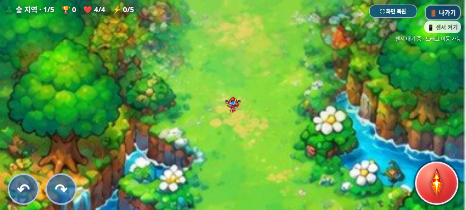
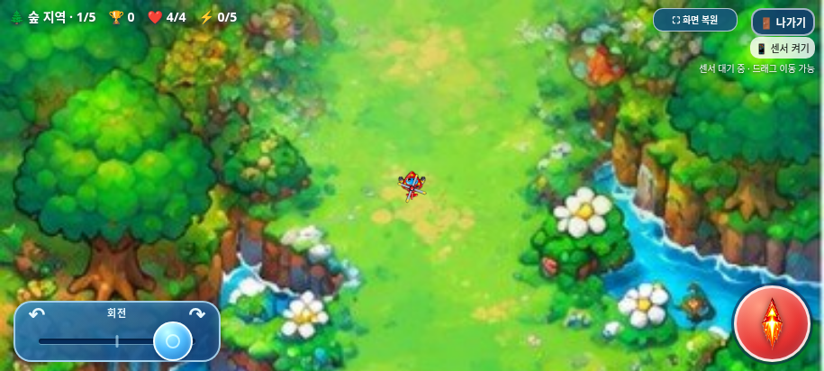
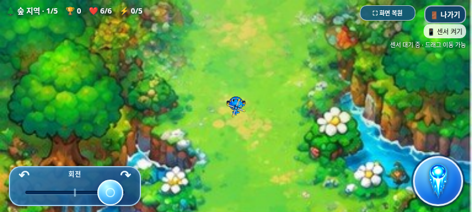
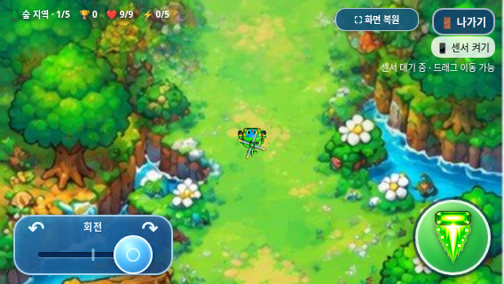

# 가로형 회전 조이스틱·게임 터치 처리 검증

2026-11-02(KST) · `feature/mobile-rotation-joystick`

작업 전 원격 `feature/independent-item-monsters`의 최신 커밋은 `da8c0e8f58b62bf1f6061d93db72ca29cf70ca60`이었다. 이전 `cf89005`의 아이템 개선과 그 뒤 월드 확장 예정 기록을 모두 포함한 상태에서 별도 작업 브랜치를 만들었다. 원격 main은 `17da293570f422035d455add578dbc8412e4f24b`였다. 기존 개발 기록·이미지·음원을 보존하며 main 병합과 Pages 배포는 하지 않는다.

## 구현 범위

- 기존 왼쪽 아래 회전 버튼2개를 파란 가로 트랙·원형44px 손잡이로 교체했다. 폭180~230px, 낮은 가로 화면에서는 높이68px이며 다른 조작 버튼과 겹치지 않는다.
- 입력은 -1~+1. `|x|≤0.08`이면0, 바깥에서는 `sign(x)×(|x|−0.08)/0.92`로 연속 증가한다. 중앙 데드존은 전체 이동폭의8%다. 손을 떼면 입력은 즉시0, 손잡이만120ms 동안 중앙으로 돌아오며 헬기 각도는 바꾸지 않는다.
- 기존 `dt × flightProfiles[type].turn`을 그대로 사용하고 입력항만 바꿨다. 끝에서 최대 속도는 아래 표와 같다. 비행 가속/감쇠·최대 이동속도·센서 감도17·화면 방향 계산·중앙 보정·중력 fallback·권한 요청 코드는 바꾸지 않았다.

| 캐릭터 | 기존 최대 회전 | 변경 후 최대 회전 |
| --- | ---: | ---: |
| 트리오 | 3.05rad/s | 3.05rad/s |
| 빙글 | 2.7rad/s | 2.7rad/s |
| 탱코 | 2.35rad/s | 2.35rad/s |

자이로센서가 주 이동 수단이며 기존 센서 버튼을 사용한다. 화면 드래그는 기존75px 정규화 방식의 보조 이동이다. 두 방식의 물리 계산을 교체하거나 새 속도를 만들지 않았다. 게임 방법 안내의 옛 회전 버튼 설명만 센서 이동·조이스틱 안내로 갱신했다. 선택화면의 이미지·애니메이션·버튼 배치·사운드 버튼은 그대로다.

## 입력 분리와 길게 누르기

`assets/controls/controls.js`가 회전·발사·캔버스 드래그의 pointerId를 별도로 소유한다. 각 조작에 두 번째 손가락이 와도 기존 소유권을 덮지 않는다. 다른 손가락을 놓아도 사용 중인 조작은 해제되지 않는다. pointer capture, pointerup/cancel, lost capture, 창 blur/비표시, 게임 오버/새 게임, 종료 확인/선택화면 복귀를 처리한다. 조이스틱 트랙 안에서는 끝값으로 제한하고, 조이스틱 영역 밖으로 나가면 해당 입력을 끝낸다.

게임 캔버스·조작 UI·게임 오버/종료 패널에만 user-select, -webkit-user-select, -webkit-touch-callout을 적용하고 조작 면의 touch-action을 제한했다. contextmenu/selectstart/dragstart도 이 영역에서만 취소한다. 실제 입력/편집 필드에는 예외를 두며 순위표는 이 차단 목록에 넣지 않는다. 순위표의 기존 pan-x/pan-y·내부 스크롤을 유지한다. 전역 브라우저 UI를 제어하거나 보안 제한을 우회하지 않는다.

실제 브라우저 검사 중 **최종 클리어로 메뉴가 나타난 뒤 누르던 손가락을 떼면 밑의 순위표가 열리는 클릭 전달**을 발견했다. 조작 소유권을 초기화할 때 capture가 풀리는 것이 원인이었다. 게임에서 시작된 포인터의 마지막 호환 클릭을 소비해 해결했다. 새 사용자 pointerdown은 이전 차단 상태를 지우므로 메뉴의 정상 터치·키보드 클릭을 막지 않는다. 이 회귀 사례도 자동 검사에 포함했다.

## 테스트 결과

**총304개 검사 그룹 통과.** [전체 집계](test-summary.json), [원본·패키지 보호](package-verification.json).

| 검사 | 그룹 | 결과 |
| --- | ---: | --- |
| 새 조작·센서 비교 / 오프라인 | 23 + 23 | [일반](browser/test-results.json), [오프라인](offline/test-results.json) |
| 아이템 등장 규칙 / 오프라인 | 19 + 19 | [일반](regression/item-rules.json), [오프라인](regression/item-rules-offline.json) |
| 독립 아이템몹 피격·드롭 / 오프라인 | 16 + 16 | [일반](regression/item-components.json), [오프라인](regression/item-components-offline.json) |
| 점수·TOP10 / 오프라인 | 17 + 17 | [일반](regression/scoring.json), [오프라인](regression/scoring-offline.json) |
| 선택 BGM / 오프라인, 게임 BGM | 14 + 14 + 9 | [선택](regression/selection-bgm.json), [오프라인](regression/selection-bgm-offline.json), [게임](regression/game-bgm.json) |
| 전체 진행, 선택, 나가기, 게임 오버 | 11 + 15 + 10 + 7 | [진행](regression/game-audit.json), [선택](regression/selection.json), [나가기](regression/exit-dialog.json), [사망](regression/game-over.json) |
| 일반 아이템, 보스 보상, 전체화면, 단일 HTML | 7 + 8 + 7 + 19 | [아이템](regression/items.json), [보상](regression/boss-reward.json), [전체화면](regression/fullscreen.json), [HTML](../galaxy-test/test-results.json) |
| 탱코 전투 / 오프라인, 연사 | 14 + 14 + 5 | [전투](regression/tanko.json), [오프라인](regression/tanko-offline.json), [연사](regression/cadence.json) |

핵심 검증:

- 실제 CDP 터치 좌표로 중앙/데드존·좌/우·33개 캐릭터/입력 조합·끝값·영역 이탈·손을 뗀 뒤 방향 유지·cancel/lost capture를 검사했다. 예전 게임 페이지를 따로 실행해 측정한 최대 회전 속도와 일치했다.
- 회전/발사에 각각 두 손가락을 대고 다른 손가락부터 떼어도 기존 입력이 유지됐다. 실제3중 터치로 드래그 이동+회전+발사를 수행하고 소유 pointerId3개가 다른 것을 확인했다. 조작별 해제도 서로의 이동/발사를 지우지 않았다.
- 예전 페이지와 이번 페이지에서 세 캐릭터×화면 방향4개×센서 표본3개의 **36개 방향/중력/이동속도 결과가 정확히 같았다**. 이는 제어한 이벤트와 실제 기존 이동 함수를 사용한 수치 비교이며 물리 센서 측정은 아니다.
- 센서 활성화 경로의 허용/거부를 모의 검사하고 API 미노출·신호 없음에서도 드래그를 확인했다. 센서 이동+회전+발사 동시 조작 후 조이스틱/발사를 놓아도 센서 tilt는 유지됐다. 기존 권한/초기화 로직은 수정하지 않았다.
- 게임/게임 오버의 contextmenu·selectstart 취소와 실제 우클릭/1.2초 터치 후 선택 문자열 없음, 무관한 입력 필드·순위표 이벤트 허용을 확인했다. 삼성 인터넷의 시스템 메뉴 표시 자체를 Chromium 검사로 검증했다고 표현하지 않는다.
- 종료창 취소·확정, 게임 오버3초, 최종 클리어 복귀에서 입력0·전체화면 유지·클릭 전달 차단을 확인했다. 순위표는 실제 터치 스와이프로 스크롤됐고 모달 버튼·선택/음악 토글이 동작했다.
- 기존 아이템80×64/반경20·지역당3단계/처치1~4·보스전 예고/잔여 수명·200점/드롭·전체20단계 통제 클리어30,400점 검사를 유지했다. 탱코 수치·공격/이동·보스·음악/효과음/TOP10 코드와 이미지·음원은 변경하지 않았다.

## 수정 파일과 보호 방법

- `assets/controls/controls.js`, `.css`: 전용 입력 소유권·조이스틱·게임 영역 선택 방지.
- `index.html`: 의존성2개, 회전 UI 교체, 옛 버튼/드래그 핸들러 이관, 회전 입력항, 게임 방법 문구의 정확한7개 치환. `assets/selection/selection.js`는 종료창 clearInput에서 reset 호출1줄만 추가.
- `scripts/build_galaxy_test.py`, `package_galaxy_test.py`: 새 CSS/JS 내장과 옛 버튼 미포함 검증.
- `tests/mobile_controls.py`, 정확한 변경 목록/역변환·새 자산 해시 및 기존 검사: 제거한 버튼을 새 조이스틱 좌표로 대체하고 이전 코드/이미지 보호 검사는 유지했다.
- `dist/heli_trio_galaxy_test.html`, `.zip`, 이 보고서/스크린샷/JSON, 최신 갤럭시 안내, DEVELOPMENT_LOG.md.

새 입력 변경7개와 종료 초기화1줄을 역변환하면 최신 원격 기준과 같다. 기존46개 자산 파일은 기준과 바이트 동일하며, 이미지·음원은 수정하지 않았다. 도움말 문구 외 게임/센서/공격 함수 전체를 다시 쓰지 않았다. 사용자 추가 월드 확장 예정 기록도 보존했다.

## 실제 브라우저 화면

같은 원본 게임을 Chromium에서 촬영했다. 위치·각도·게임 시계를 통제한 비교 장면이며 이미지 합성이나 실제 갤럭시 촬영이 아니다. 손잡이를 오른쪽으로 밀어 둔 모습이다.

| 이전 회전 버튼 | 새 조이스틱 |
| --- | --- |
|  |  |

## 갤럭시 패키지·한계

[최신 ZIP 다운로드·실행 안내](../galaxy-test/README.md). HTML **32,391,867바이트**, SHA-256 `f17202e3a69dad36ea4e2413b0f1430328af619ee823111c70923ac8dfc56766`. ZIP **23,462,415바이트**, SHA-256 `b37aa958db1636527fb8fd72931fa8963b7d2dd628061c307cf6f706bcf94ff9`.

ZIP 안에는 HTML1개뿐이다. CRC·unzip-t·실제 압축 해제 후 원본 HTML 바이트 일치, 최신7개 스크립트/CSS 내장, 원본 아틀라스·MP3·기존 이미지71개/WAV12개를 확인했다. 오프라인 실행 중 외부 자산 요청은 없다.

직접 file://는 환경의 Chromium 관리 정책으로 차단되어 우회하지 않았다. 오프라인 조작 검사는 일반 빈 localhost origin을 마련한 뒤 네트워크를 차단하고 동일 단일 HTML을 주입했다. 빈 about:blank에서는 보안 컨텍스트 차이로 센서 인터페이스가 노출되지 않아 이 검사 방법을 사용했다. 물리 갤럭시의 파일 실행 성공이나 센서 권한 허용을 대신하지 않는다.

**실제 Galaxy Samsung Internet/Chrome에서 남은 확인:** 게임/발사/조이스틱/게임 오버를 길게 눌렀을 때 복사·번역 메뉴가 사라지는지, 실제 기울기 이동과3중 조작 감각, 터치 가장자리/Android 제스처, 파일 연결/센서 보안 컨텍스트·권한·저장 지속, 전체화면 주소창·스피커·성능. 이번에는 실제 기기에 접근하지 못했다. 센서 감도·이동/회전 최대값·추가 밸런스를 임의 변경하지 않았다. main 병합과 Pages 배포는 하지 않는다.
