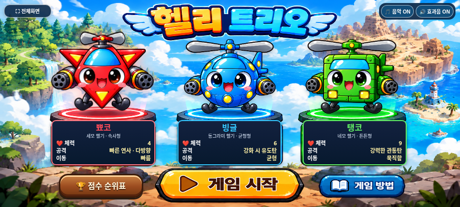

# 뾰코 이름 변경과 타이틀 ‘헬’ 교정

2026-11-04(KST) · `feature/ppyoko` · [Issue #13](https://github.com/26aiera11-cpu/helicopter-game/issues/13)

기준은 설원 난이도 조정 `48319030a0b15c2346a6ec99c3e4c8d84765178b`다. 기존 원격 브랜치를 추적 체크아웃했으며 재생성/초기화하지 않았다. main(`17da293570f422035d455add578dbc8412e4f24b`) 병합과 GitHub Pages 배포는 하지 않는다. `HELI_TRIO_SPEC.md`는 없어 사용자 확정 규칙과 Issue를 적용했다.

## 완료한 변경

- 빨간 세모 헬기 **트리오→뾰코**, ID는 그대로0이다. 선택 패널과 접근성 선택 버튼, 게임 오버, 정상/설원/개발 클리어, TOP10과 분석 API의 이름을 확인했다. 빙글·탱코/순서/색상/특성은 유지했다. 현재 HUD는 지역·점수·체력·강화만 표시하므로 새로운 이름 칸을 추가하지 않았다.
- 게임 제목 **헬리 트리오**는 팀 이름으로 유지했다. 옛 탭/숨김 제목 ‘귀염 헬기 슈팅’만 공식 제목에 맞췄고 시작/게임 오버 복귀의 제목도 일치시켰다. 결과 복귀 타이머3초와 점수/선택화면 처리 로직은 그대로다.
- 첫 ‘헬’의 **ㅔ**에서 왼쪽 세로획의 짧은 가로획을 왼쪽으로 두고 오른쪽ㅣ와 사이를 분리했다. 노랑/주황 입체감·남색 테두리·흰 하이라이트는 유지했다. 다음 ‘리 트리오’와 제목 위치/크기는 변경하지 않았다.

원본 `background-clean.png`는 바이트가 같다. 새 교정 PNG는 기존 사용자 배경을 참조해 이미지 생성 도구로 만들고, CSS에서 **모음 부분 x37~41.8%, y2.4~11.2%만** 표시한다. 나머지 생성 이미지 영역은 노출하지 않는다. 실제 브라우저의 배경 레이어 비교에서 이 범위 밖 픽셀 차이가 없었다. 마우스/터치 입력을 받지 않는 레이어이며 기존 패널/버튼/캐릭터 애니메이션은 그대로다. [자산 출처·해시·표시 범위](art-provenance.json).

## 과거 기록 호환

저장 키 `heliTrio.top10.v1`, `heliTrio.playHistory.v1`, `heliTrio.world2Trial.top10.v1`, `heliTrio.world2Trial.playHistory.v1`과 version1을 유지했다. 기존 `read()`는 이미 characterId로 표시 이름을 정규화하므로 `names[0]`만 바꾸면 과거 트리오 기록도 뾰코로 표시된다. 새 마이그레이션/삭제/점수 환산 코드를 추가하지 않았다.

일반/설원 TOP10·분석 각10개, 총40개 저장 엔트리(20개 고유ID)의 옛 ‘트리오’ 이름이 포함된 기록을 심었다. ID·점수·날짜·순서·지역/단계·처치/플레이시간/강화를 보존했고 동점 순위도 같았다. 읽기/순위표 열기/범위 전환/새로고침은 저장 원문을 단1바이트도 다시 쓰지 않았다. 이후 정상 플레이 결과 저장에서는 원래 직렬화 방식대로 현재 표시 이름을 쓸 수 있으나 ID/점수/기록은 유지한다. 새 게임 오버 결과3개와 정상/설원 최종 클리어가 뾰코/ID0을 저장하는 것도 확인했다. 개발 테스트6회는 네 저장 문자열 모두 동일했다.

## 검증 결과

**40개 모음 중39개 모음·546개 검사 그룹 통과**, 미완료1개: worlds-offline. [집계·초기 시도·실패 이력](test-summary.json), [신규 일반9그룹](native/test-results.json), [신규 오프라인9그룹](offline/test-results.json), [소스/패키지 검증](package-source-verification.json).

- 일반/오프라인에서3캐릭터×915×412/800×360/568×320 선택·이름/접근성·잘림을 검사했다. 각 화면의 원래 배경/교정 레이어를 별도로 렌더링해 첫 모음 밖 픽셀 변경0을 검증했다. 확대 화면에서 ㅔ 획을 직접 확인했으며 이는 자동 OCR 검사가 아니다.
- 세 캐릭터를 실제 시작 버튼으로 실행해HP4/6/9·ID를 확인하고 HP0에서 이름이 있는 게임 오버→실제3초→결과 없는 선택화면·공식 제목 복귀를 검사했다. 전체화면이 유지됐다.
- 세 캐릭터×사막/설원6개 개발 보스 처치를 실제 탄환 충돌로 실행해 이름·2,000점·기존 보상·비저장을 확인했다. 정상 사막/시험 설원 최종 클리어에도 뾰코 이름과 저장 결과가 일치했다. 이 이름 검사는 마지막 단계 상태를 주입했으며 전체20/25단계 진행은 기존 회귀 모음을 따른다.
- 기존38모음은 한 번 실행했다. 난이도 검사2개는 기존 보호 비교가JS만 처리하던 부분을 CSS에도 정확한 승인 차분을 역변환한 뒤 비교하도록 수정해 해당 두 모음만 재실행했다. 월드1/설원·개발 진입·체력/강화·보스/아이템·탱코/캐릭터 전투·점수/순위·음악·센서/조이스틱/멀티터치·선택 애니메이션/전체화면/종료창 범위를 조용히 생략하지 않았다. 통과하지 않은 모음의 앞부분 관측은 통과 그룹 수에 더하지 않았다.

초기 집중 도구는 결과 관찰자가 갱신되거나 기존 설원 소멸 연출의 active/pending이 해제되기 전에 다음 상태를 읽는 경우가 있었다. 현재는 원래 연출/결과 준비를 기다리고 상태 진단을 저장한다. 또 전체 메뉴의 픽셀 비교에는 무관한 동적 UI가 끼어들 수 있어 실제 계산된 배경 레이어만 분리해 같은 범위를 비교했다. 선택 UI는 별도 실제 화면9장으로 검증한다. **제품 코드/연출/입력/대기 제한을 바꿔 통과시킨 것이 아니며** 최초 로그와 재검사 결과를 보존한다. 중복 시도를 그룹 수에 더하지 않았다.

긴 멀티터치→나가기 자동화가 실패한 경우 로그·버튼 이벤트/화면을 남겼다. [이전 기준에서도 재현한 문제](../snowfield-mixed-spawns-balance/touch-input-diagnosis.json)와 같은 증상을 확인하되 원인을 확정하지 않는다. 이번 이름/타이틀 작업에서 조작 코드를 수정하거나 실패를 숨기지 않았다. 개별 결과는 집계의 해당 링크를 따른다.

## 변경 파일과 보호

제품은 `index.html`의 선택 이름2곳/공식 텍스트 제목4곳, `assets/score/score.js`의 표시 이름 배열1곳, `assets/selection/selection.css`의 모음 교정 규칙, 신규 `assets/selection/title/hel-corrected.png`다. 새 이름/타이틀 포함 확인을 ZIP 스크립트에 추가했다. 기존 게임 코드 전체 재작성이나 전역 문자열 치환은 하지 않았다.

모든 기존 PNG·WAV/MP3·매니페스트/115프레임·캐릭터 이미지/크기/색상/이동/공격/회전·점수 계산/저장ID·설원 난이도/혼합 확률·아이템/보스·조작/사운드는 기준과 같다. 정확한 허용 문자열/CSS만 되돌리면 원래 index·score.js·CSS가 바이트 단위로 같고 나머지 자산도 같다. 이미지 파일명 `trio_gameplay_final.png` 등은 호환을 위해 그대로 유지한다. 과거 개발 기록과 테스트의 옛 기록 표본 ‘트리오’도 전역 치환하지 않았다.

## 갤럭시 파일·실기기 확인

[최신 ZIP 다운로드](https://github.com/26aiera11-cpu/helicopter-game/raw/refs/heads/feature/ppyoko/dist/heli_trio_galaxy_test.zip?download=1) → 압축 해제 → HTML 실행. 원본 게임명에 맞춰 기존 파일명 `dist/heli_trio_galaxy_test.html`/`.zip`을 유지한다.

HTML **46,509,074바이트**/SHA-256 `f652262f62c82d8cde613eed26885515d20714ed95c669a0a37c8774d986351d`, ZIP **34,016,937바이트**/SHA-256 `db5ec25ec9789d1fb87dc02c356c4f6daa1b4f97d597496209fc799b1b34b2ab`다.13개 실행 스크립트와 교정 PNG를 포함한 이미지·CSS·음원/매니페스트를 모두 내장했다. 브라우저 검사본과 최종 HTML의 바이트 일치,ZIP의 HTML1개·CRC·unzip-t·실제 압축 해제 일치를 확인했다. [빌드](build-results.json), [ZIP](zip-results.json).

실제 갤럭시 삼성 인터넷/Chrome의 글자 가독성·다운로드/로컬 파일 열기·파일 origin별 저장 유지·물리 센서/권한·손가락 입력·스피커/성능/전체화면은 미검증이다. 순위는 같은 브라우저/실행 origin에서 유지되며 다른 기기/브라우저/파일 origin으로 자동 공유하지 않는다. file:// 관리자 정책은 우회하지 않고 빈 localhost origin에서 네트워크를 차단해 동일 HTML을 실행했다. 실제 폰에서의 글자 최종 가독성은 사용자 확인이 필요하다. main 병합/Pages 배포는 하지 않았다.
