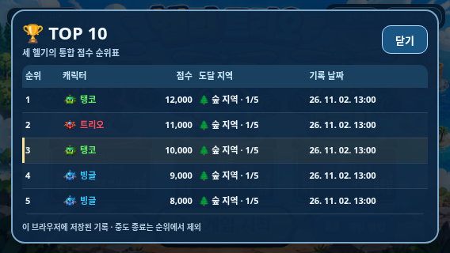
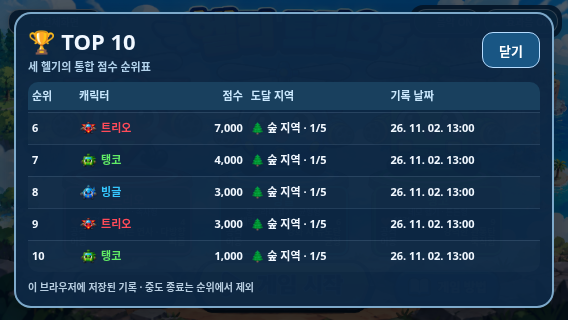

# 새 점수·로컬 통합 TOP 10 검증

2026-11-02(KST) · `feature/selection-screen-integration` · 기준 main `1279ec48a1b1f1f544245315d69200d94562b71a`

작업 전 기능 브랜치는 `81ea754`, 원격 main은 요청한 `1279ec4`였다. main이 기존 기능 커밋을 모두 포함하고 동일한 파일 트리를 사용하므로 기능 브랜치를 **fast-forward**로 동기화했다. 기존 커밋을 다시 쓰거나 버리지 않았고 main 브랜치를 수정하지 않았다. [시작 상태](before/baseline.json).

## 점수와 결과

| 발생 사건 | 기존 별 | 새 점수 |
| --- | ---: | ---: |
| 일반 몬스터 실제 처치 | 1 | 100 |
| 아이템몹 실제 처치 | 1 | 200 |
| 지역별 1~4단계 클리어 | 0 | 500 |
| 5단계 보스 처치 | 10 | 2,000 |
| 지역 이동 | 0 | 0 |

게임 점수는 `runScore` 하나로 관리하고 HUD에 `🏆 8,500`처럼 쉼표를 붙인다. 기존 별 수를 환산하거나 과거 저장값을 가져오지 않는다. 몬스터·보스는 플레이별 WeakSet, 일반 단계는 지역/단계 Set으로 중복 지급을 방지한다. 아이템몹의 시간 만료는 처치가 아니므로 점수·처치 수·아이템을 지급하지 않는다. 기존 `phaseKills`, `requiredKills=6`, 4지역×5단계와 보상/아이템 규칙은 유지했다.

실제 경고→몬스터 생성→탄환 충돌→단계 전환으로 20개 웨이브를 검사한 결과, 일반 몬스터 120마리·보스 4종·일반 단계 16개의 최종 점수는 **28,000점**이다. `120×100 + 4×2,000 + 16×500`으로 계산되며, 기존 160별을 임의 환산한 결과가 아니다. 최종 저장 기록도 같은 점수·처치 수·단계 수·클리어 결과였다.

게임 오버는 기존처럼 마지막 화면에서 진행/BGM을 즉시 멈추고 3초 뒤 선택화면에 복귀한다. 패널에 GAME OVER, 최종 점수, 캐릭터, 새로운 TOP 10 진입/미진입 여부를 표시한다. 최종 클리어도 점수와 캐릭터를 표시한다. `finish()`가 플레이마다 같은 결과를 반환해 중복 사망/결과 호출과 타이머 재진입으로 저장을 늘리지 않는다. 선택화면에는 게임 오버 문구가 남지 않는다.

## 순위표와 저장 규칙

기존 설정 버튼 영역 위에 **🏆 점수 순위표**라는 불투명한 DOM 버튼을 배치해 배경에 그려진 ‘설정’ 글자를 가렸다. 배경 PNG와 다른 그림은 원본 그대로다. 음악·효과음 버튼의 위치·토글은 유지하며 기존 설정 강조 동작은 제거했다.

순위표는 표준 `dialog.showModal()`로 열어 배경의 캐릭터/시작 버튼을 누르지 못하게 한다. 닫기·Escape로 복귀하며 선택 음악과 전체화면을 유지한다. 915×412, 800×360, 568×320에서 10개 행을 내부 스크롤로 확인했다. 행에는 순위·원래 캐릭터 PNG 아이콘/색상·점수·도달 지역/단계·날짜를 표시한다. 기록이 없으면 ‘아직 기록이 없습니다’, 방금 달성한 기록이 진입하면 해당 행을 은은하게 강조한다.

- TOP 10 키: `heliTrio.top10.v1`, 최대 **10개**, 세 캐릭터 통합. 한 캐릭터가 여러 행을 차지할 수 있다.
- 분석 기록 키: `heliTrio.playHistory.v1`, 최근 **100개**. 순위와 별개로 관리한다.
- 두 저장값 모두 `{version: 1, records: [...]}`다. 점수 내림차순, 동점은 달성 순서(`order`) 오름차순이다. 같은 밀리초의 기록도 먼저 달성한 기록을 유지한다. 시각 자체는 ISO 날짜/시간으로 별도 저장한다.
- 기록은 고유 ID, 점수, 캐릭터 ID/이름, 도달 지역 ID/이름과 단계, 기록 시각, 달성 순서를 포함한다. 분석에는 일반/아이템몹/보스 처치 수, 클리어한 일반 단계 수, 플레이 시간, 최종 강화, 종료 종류도 포함한다.
- `game_over`·`clear`만 TOP 10 후보가 된다. `abandoned`(중도 종료)는 분석에만 남는다. 플레이 시간은 게임이 실제 진행한 시간이며 나가기 확인 중 정지·게임 오버 3초는 제외한다.
- JSON/버전/필드 검증, ID 중복 제거와 저장 예외 처리를 한다. 손상된 데이터는 새 기록부터 복구하고 과거 별 기록은 읽거나 변환하지 않는다. 저장 불가/용량 초과 시 이번 실행의 메모리 기록으로 계속 플레이하며 저장 제한을 안내한다. 정상 저장이 복구되면 실패 안내도 해제한다.
- 온라인 서버·외부 DB·업로드는 없다. 브라우저/사이트 주소별 로컬 기록이며 다른 기기·브라우저·Pages와 로컬 HTML 사이에 자동 공유되지 않는다. 브라우저 데이터 삭제 시 기록도 삭제된다. `file://`의 저장 허용은 기기/브라우저 정책에 따라 달라질 수 있다.

## 실행한 검사

| 검사 | 통과 그룹 | 증거 |
| --- | ---: | --- |
| 점수/통합 순위/저장/결과 일반 Chromium | 17 | [결과](browser/test-results.json) |
| 같은 점수 기능 독립 HTML 오프라인 | 17 | [결과](offline/test-results.json) |
| 선택 음악 일반/오프라인 | 14 + 14 | [일반](regression/selection-bgm.json) / [오프라인](regression/selection-bgm-offline.json) |
| 스테이지/보스 음악 | 9 | [결과](regression/game-bgm.json) |
| 단일 HTML 전체 기능 | 19 | [결과](../galaxy-test/test-results.json) |
| 전체 20단계·전투·최종 기록 | 11 | [결과](regression/game-audit.json) |
| 선택 효과·터치 | 15 | [결과](regression/selection.json) |
| 나가기 확인창 | 10 | [결과](regression/exit-dialog.json) |
| 게임 오버 3초 | 7 | [결과](regression/game-over.json) |
| 아이템 유지·수명·효과 | 7 | [결과](regression/items.json) |
| 보스 보상·확률·상한·순서 | 8 | [결과](regression/boss-reward.json) |
| 탱코 전투 일반/오프라인 | 14 + 14 | [일반](regression/tanko.json) / [오프라인](regression/tanko-offline.json) |
| 연사·최초 발사 | 5 | [결과](regression/cadence.json) |
| 보스 체력·공격·288개 처치 비교 | 4 | [결과](regression/boss-balance.json) |

총 **185개 검사 그룹**. [최종 집계](test-summary.json), [소스/자산/패키지 무결성](package-verification.json).

새 점수 검사는 실제 몬스터/보스 탄환 충돌, 단계 완료, 치명타를 사용한다. 정렬 검사는 세 캐릭터의 점수 fixture 12개와 같은 기록 시각을 사용해 TOP 10 절삭·동점·다중 순위를 확인한다. 새로고침 후 네이티브 localStorage 복원, 낮은 점수의 순위 미진입, 115개 중도 종료 이후 최근 100개 유지, 실제 나가기 취소/확정도 검사했다. 저장 거부·용량 초과는 별도 문서에서 의도적으로 오류를 주입하고 손상 JSON/버전/필드도 검사했다. 실제 오디오 상태·재생 시간 증가를 확인했으며 스피커 청취 결과는 아니다.

초기 구현 검사에서 게임 오버의 기록 저장 상태 변수와 입력 복원 배열 이름이 충돌해 패널 표시가 중단되는 오류를 발견했다. `recordSaved`로 구분한 뒤 실제 치명타·3초 표시·중복 결과 저장·복귀 검사가 통과했다. 기존 자동 검사의 별 점수·변수·설정 버튼 동작 기대값도 새 사양으로 갱신했으며 과거 소스 보존용 문자열은 유지했다.

보스 체력 비교 검사의 과거 30초 중단 조건에서 **60Hz·제안식 HP 모델·탱코 1강·사막** 표본이 시간 초과했다. 검사에만 60초의 유한 제한을 적용해 끝까지 측정했다. 제품의 공격·보스 HP·탱코 수치를 바꿔 해결하지 않았다. 기존 탱코 정면 방어 및 강화 처치 시간 역전은 보류 상태로 유지한다.

## 실제 화면 비교

왼쪽은 기준 main의 파일과 자산을 별도 임시 서버에서 실행한 화면, 오른쪽은 수정 버전의 실제 Chromium 캡처다. HUD/결과의 8,500은 배치 비교용으로 입력한 fixture이며 과거 별 기록의 환산이 아니다. 휴대폰에서 촬영한 사진은 아니다.

| 변경 전 | 변경 후 |
| --- | --- |
|  |  |
|  |  |
|  |  |






## 빌드·한계·예정 작업

최신 HTML **30,077,605바이트**, SHA-256 `52ccf130aed3c10b76d6b6c7aa761c9f2beb89a70366da83548a1bc982ffae7f`.
ZIP **21,731,912바이트**, SHA-256 `faa6776a0cea3a81595cce27539212543336673ab1ceadf356a500471cd69bf2`.
ZIP에는 HTML 한 개만 있고 새 점수 CSS/JS·이미지·원본 선택 MP3·기존 WAV가 모두 내장된다. [다운로드·갤럭시 실행 안내](../galaxy-test/README.md).

직접 file:// 접근은 관리형 Chromium 정책으로 차단된다. 새 점수 오프라인 검사는 빈 로컬 HTTP 문서로 저장 가능한 origin만 미리 정한 다음 네트워크를 끄고 동일 HTML을 주입했다. 일반 단일 HTML 검사는 서버 없는 빈 문서에서도 실행해 저장 거부 시 계속 플레이됨을 확인했다. 이를 직접 Android 파일 열기 성공으로 기록하지 않는다. 실제 Galaxy Samsung Internet/Chrome의 파일 연결·로컬 저장 수명/권한·앱 복귀·센서·체감 음량·성능은 미검증이다. 보스 비교는 제어된 조준/시뮬레이션이며 사람의 난도 완주가 아니다.

이번 작업은 기능 브랜치만 커밋·푸시한다. **main 병합과 GitHub Pages 배포는 하지 않는다.** 다음 두 항목은 구현하지 않고 개발 기록에 예정으로 추가했다.

1. 온라인 통합 순위표(B안): 여러 사용자의 기록 공유 및 경쟁, 서버·데이터베이스·기록 검증 방식 검토
2. 아이템몹 생성 규칙 개선: 등장 빈도, 스테이지별 확률, 체력·무기 강화 상태에 따른 생성 규칙 검토

탱코 추가 성능 조정도 보류한다.

```sh
python scripts/build_galaxy_test.py
python scripts/package_galaxy_test.py
python tests/scoring.py --artifacts /tmp/heli-score-browser
python tests/scoring.py --standalone --artifacts /tmp/heli-score-offline
```
