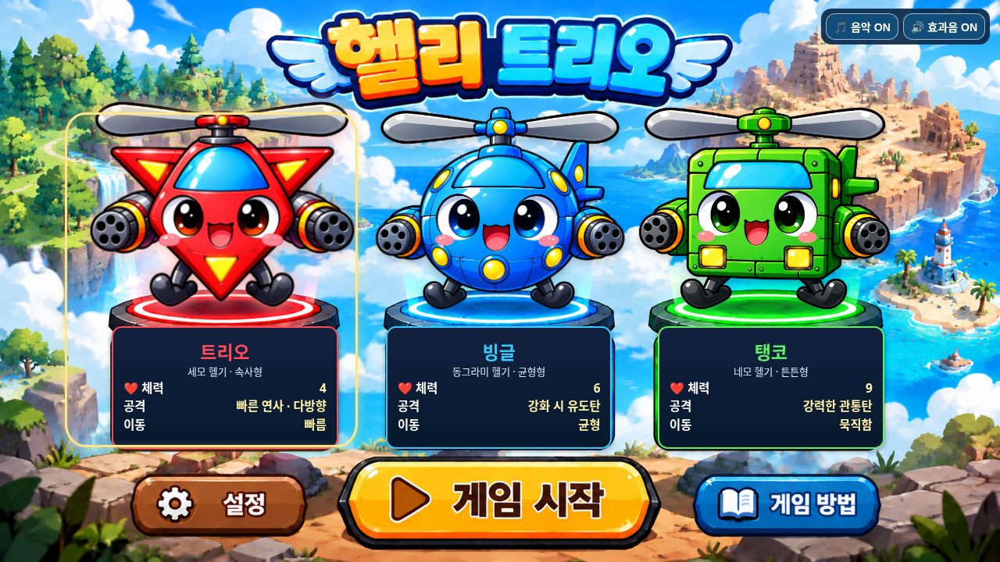
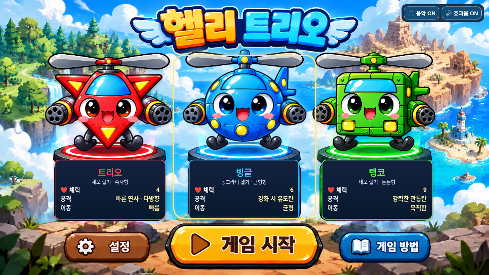
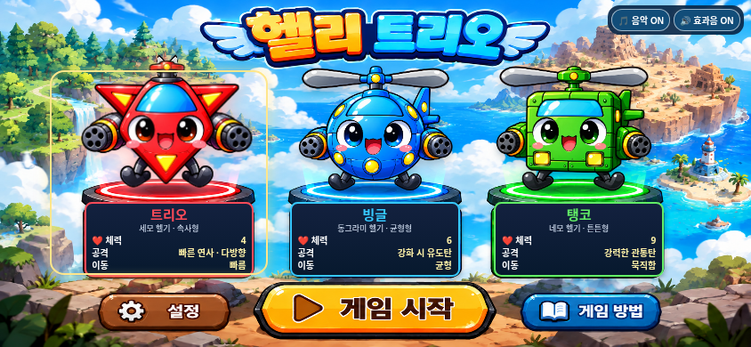
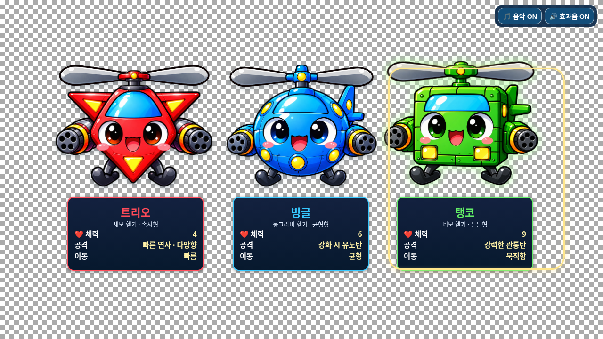
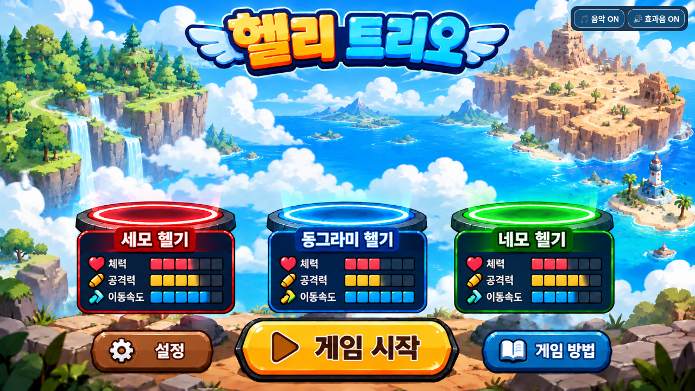

# 헬리 트리오 선택화면 최종 검증

2026-11-01 · 기준 커밋 `968621b746c13df37df6e385806912a1e1e88099` · 작업 브랜치 `feature/selection-screen-integration`

시작 시 로컬 HEAD와 원격 작업 브랜치는 모두 `968621b`였고 미커밋 변경은 없었습니다. `main`은 `173d550`이며 병합·배포는 진행하지 않았습니다.

## 확인 및 수정 결과

| 점검 항목 | 결과 |
| --- | --- |
| 빨간 트리오·파란 빙글·초록 탱코 | 세 캐릭터가 모두 표시되고 선택한 캐릭터로 게임 시작, 체력 4·6·9 유지 |
| 고정 헬기가 없는 배경 | 캐릭터 레이어를 숨긴 실제 브라우저 화면에서 빈 발판 확인 |
| PNG 투명도·외곽선 | 실제 알파 채널과 네 모서리의 완전 투명 확인, 체커보드 화면에서 배경 조각·사각 테두리·누락된 몸체 없음 |
| 위치·크기 | 발판 중심에 맞춰 배치 조정, 탱코 날개를 고정 축 중심에 정렬, 긴 날개의 인접 캐릭터 침범 방지 |
| 선택 시 부유·강조 | 작은 상승·확대·광원 효과를 유지하고 220ms 진입 전환 추가 |
| 정면 프로펠러 | 본체·축은 고정, 날개만 0.66초 주기로 가로 투영을 반복하며 좌우 왕복 |
| 선택 해제 | 날개 즉시 정지, 현재 위치에서 220ms 동안 발판으로 부드럽게 복귀 |
| 연속 선택 | 빠른 24회 전환 후에도 마지막 캐릭터만 부유·회전 |
| 작은 화면 | 568×320에서 넘치던 능력치 패널의 글자 크기·여백 조정 |
| 동작 줄이기 | 설정을 바꾸면 부유·진입·착지·날개 움직임 중지 |

`index.html`은 탱코 선택 레이어의 날개 높이(`--hub-y: 7% → 8.4%`)만 변경했습니다. 기존 전투·스테이지·보스·사운드를 포함한 스크립트 전체와 선택화면 원본 PNG 5개는 기준 커밋과 바이트 단위로 동일합니다. 기존 백업과 업로드된 비교용 HTML도 유지했습니다.

## 실제 브라우저 스크린샷

모두 Chromium에서 실제 페이지를 열어 촬영했습니다. 캐릭터별 비교 화면은 위치를 쉽게 비교하도록 선택한 헬기의 부유·날개를 시작 프레임에 잠시 고정해 촬영했으며, 이 고정 처리는 테스트 브라우저에만 적용했습니다. 실제 동작은 별도의 애니메이션 시간·변환값 검사로 확인했습니다.

### 트리오 선택 — 세 캐릭터 전체 표시



### 빙글 선택



### 탱코 선택


### 모바일 가로 화면



### 투명도·외곽선 점검

배경만 체커보드로 바꾼 검사 화면입니다. PNG 파일은 수정하지 않았습니다.



### 고정 헬기가 없는 배경

캐릭터·정보 패널·선택 테두리 레이어만 숨긴 검사 화면입니다.



## 테스트

실행 명령:

```sh
python tests/selection_smoke.py --artifacts /absolute/path/to/review
```

Playwright·Chromium·Pillow·Node.js가 필요합니다. 테스트는 임시 로컬 HTTP 서버를 사용하고 종료 후 닫습니다.

- 원본 백업, 게임·사운드 스크립트 동일성 및 JavaScript 문법 검사 통과.
- PNG 로딩, 알파 채널, 선택·상승·착지·날개 회전·반복 선택·동작 줄이기 검사 통과.
- 1280×720, 844×390, 568×320, 1024×768, 2560×1080에서 캐릭터/날개 배치와 패널 넘침 검사 통과.
- 캐릭터 3종의 게임 시작·회전·드래그 이동·발사·나가기, 기존 음악·효과음 설정 검사 통과.
- 적 생성, 4개 지역의 보스 구성 및 최종 클리어 복귀 회귀 검사 통과.
- 잡히지 않은 JavaScript 오류와 리소스 요청 실패 없음.

상세 결과와 원본 PNG 해시: [test-results.json](test-results.json).

## 남은 문제와 검증 한계

이번 선택화면 검증 범위에서 남아 있는 재현 문제는 없습니다. 실제 iOS/Safari 기기, 물리 센서와 스피커 청취는 검사하지 않았습니다. 보스/클리어 회귀 검사는 게임 상태를 설정해 진행했고, 전체 스테이지를 연속으로 완주한 테스트는 아닙니다. 기존 게임 시스템은 수정하지 않았으며, 이번 작업으로 기존 게임의 모든 문제를 해결했다는 의미는 아닙니다.
