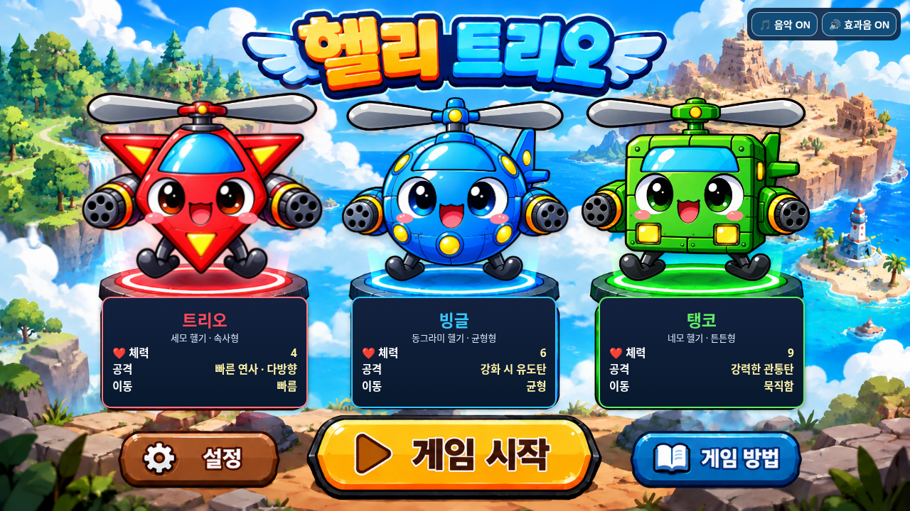
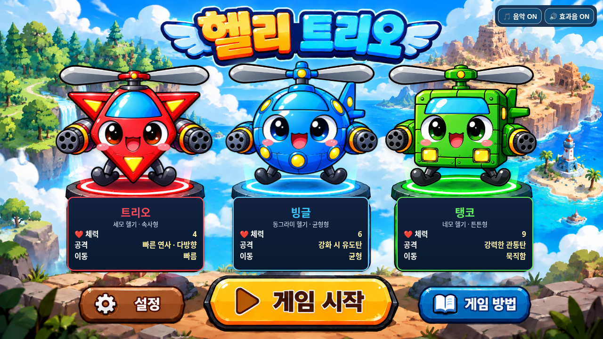
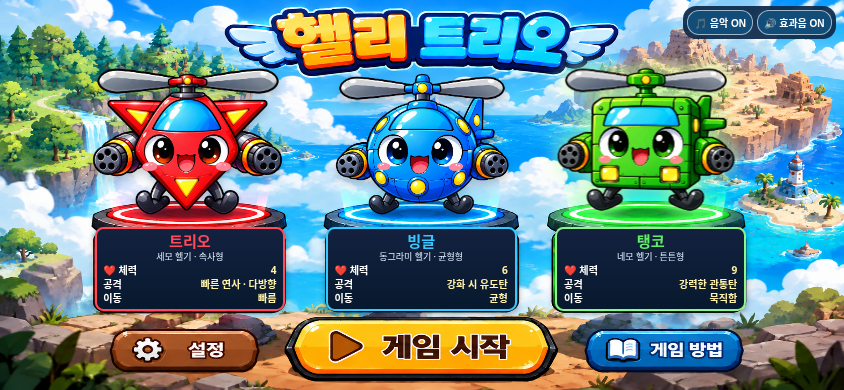
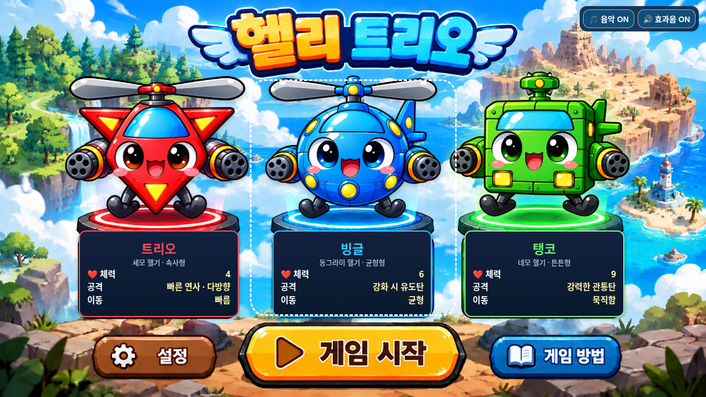

# 선택 강조 효과 수정 및 검증

2026-11-01(KST) · `feature/selection-screen-integration` · 시작 커밋 `457eb80`

캐릭터 선택의 노란 사각형을 제거하고, 발판의 원형 조명과 능력치 패널 테두리로 선택 상태를 표시했다. 구현 커밋은 `b8021cac3dda1f563d56ccc80050e7d24918539f`다.

최초에는 로컬에만 커밋했으며, 이후 사용자의 명시적인 GitHub 푸시 요청에 따라 같은 `feature/selection-screen-integration` 원격 브랜치에 게시했다. 원격 커밋 SHA 일치를 확인했고 `main`은 `173d550`으로 유지됐다. `main` 병합과 GitHub Pages 배포는 하지 않았다. 게시 확인 단계에서는 코드 변경 없이 저장된 브라우저 검증 결과를 대조하고 JavaScript 문법을 다시 확인했다.

## 변경 사항

- 투명 선택 버튼의 평상시 선택 테두리·그림자와 누르는 동안의 사각형 배경을 제거했다. 버튼의 위치·크기·클릭·터치 영역은 유지했다.
- 키보드로 이동할 때는 **흰색 점선 포커스**가 나타난다. 키보드 포커스와 실제 선택 캐릭터가 서로 달라도 구분할 수 있다.
- 트리오는 빨강, 빙글은 파랑, 탱코는 초록 계열의 발판 조명을 추가했다. 원형 발판을 원근에 맞춘 타원형 그라데이션으로 따라가며 가장자리로 자연스럽게 사라진다. 발판 조명은 떠오르는 헬기와 분리돼 위치가 고정된다.
- 선택·해제 시 추가 조명이 **240ms** 동안 밝아지거나 어두워진다. 배경에 원래 그려져 있던 발판 색상은 유지한다.
- 능력치 패널은 **테두리 색만** 조금 밝아진다. 패널의 위치·크기·배경·그림자·내용은 그대로다.
- 기존 헬기의 부유·확대·강조, 정면 날개 회전, 선택 해제 시 즉시 날개 정지 및 220ms 착지는 변경하지 않았다.
- `index.html`, 캐릭터 PNG, 게임 전투·스테이지·보스·사운드와 기존 테스트 파일도 변경하지 않았다.

## 브라우저 테스트

```sh
python tests/selection_highlight.py --artifacts /absolute/path/to/highlight-review
python tests/selection_smoke.py --artifacts /absolute/path/to/regression-review
```

Chromium·Playwright·Pillow·Node.js와 기준 커밋을 읽기 위한 Git이 필요하다. 임시 루프백 HTTP 서버를 통해 검사한다. 테스트는 원격 서비스에 게시하지 않는다.

### 선택 강조 검사 — 8개 그룹 통과

1. 이전 커밋의 CSS/JS로 표시한 기준 페이지와 새 페이지를 비교해 세 클릭 영역 및 패널의 크기·위치·배경·그림자·내용이 동일함을 확인했다. 1280×720, 844×390, 568×320, 1024×768, 2560×1080에서 검사했다.
2. 조명 페이드의 0/120/239ms 값을 검사했다. 선택한 빛은 연속적으로 증가하고 이전 빛은 감소하며 전체 전환 시간은 240ms였다.
3. 세 캐릭터의 조명·패널 테두리가 각각 선택에 맞게 바뀌고, 비선택 패널은 원래 테두리 색상으로 복귀함을 확인했다.
4. 30회 빠르게 변경한 뒤 마지막 조명·패널만 활성 상태로 남았다.
5. 마우스 선택에는 사각형 테두리가 없고, 키보드에서는 흰 점선 포커스 및 Enter 선택이 작동했다.
6. 검은 배경 위 조명의 실제 픽셀을 검사해 빨강·파랑·초록 색상과 타원 모서리의 투명을 확인했다. 직사각형 조명은 없었다.
7. 844×390 모바일 터치 에뮬레이션에서 세 캐릭터를 실제 `tap()`으로 선택했다.
8. 데스크톱·터치 검사에서 잡히지 않은 JavaScript 오류 및 자산 요청 실패가 없었다.

### 기존 기능 회귀 검사 — 15개 그룹 통과

기존 테스트에서 원본 스크립트·자산 보존, 부유·정면 날개 회전·즉시 회전 정지·220ms 착지, 빠른 재선택, 동작 줄이기 설정, 다섯 화면 크기 배치, 사운드 토글, 세 캐릭터의 체력 4/6/9·게임 시작·이동·회전·발사·나가기, 적 생성 및 네 지역 보스·클리어 복귀를 확인했다.

신규 테스트의 최초 실행은 기준 자료를 제공하는 테스트 콜백의 인수 처리 오류로 중단됐다. 이 테스트 도구 오류를 수정한 뒤 위 검사를 모두 실행해 통과했다. 앱 코드의 오류로 집계하지 않았다.

상세 자료: [선택 강조 결과·보존 검사](test-results.json), [기존 기능 회귀 결과](regression-results.json).

## 스크린샷

모두 실제 Chromium 페이지에서 촬영했다. 세 데스크톱 비교 화면은 기존 테스트 방식대로 헬기 동작을 시작 프레임에 잠시 고정했으며, 이 처리는 브라우저 검사에만 적용했다. 조명의 색·형태·불투명도는 실제 CSS 결과다.

### 트리오



### 빙글



### 탱코


### 모바일 가로 화면



### 키보드 포커스

흰 점선은 키보드 포커스이며 일반 선택 표시와 다르다. 아래 화면에서는 탱코가 선택된 상태로 빙글에 키보드 포커스를 옮겼다.



### 조명 형태 확인

다른 요소를 숨기고 검은 배경에서 추가 조명만 표시한 테스트 화면이다. 원형 발판의 원근에 맞는 타원형 빛이며 사각형 모서리가 없다. 이 검사 스타일은 제품 코드에 넣지 않았다.


## 남은 검증 범위

이번 요청 범위에서 미해결 재현 문제는 없다. iOS/Safari 실기기, 실제 센서와 스피커 청취는 확인하지 않았다. 보스·클리어 회귀 검사는 상태 설정을 이용했으며 전 스테이지 연속 완주 검사는 아니다. 기존 게임의 미대응 문제는 `DEVELOPMENT_LOG.md`에 별도로 유지한다.
