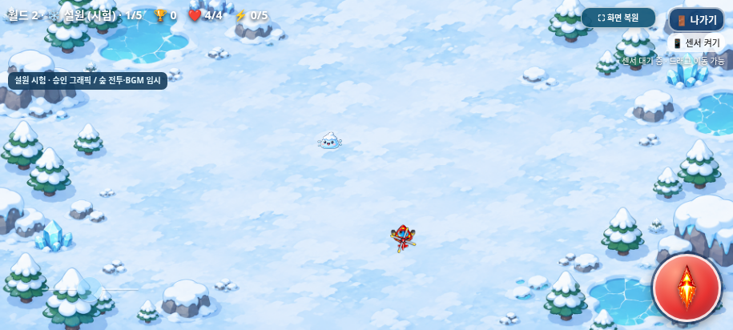
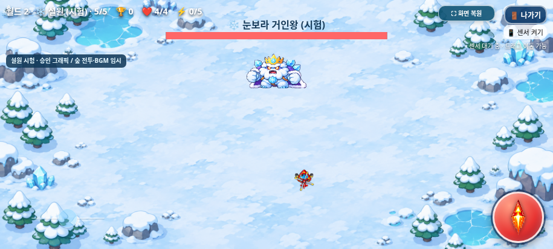

# 설원 승인 그래픽·아틀라스 통합

2026-11-03 KST · `feature/snowfield-art-integration` · [Issue #6](https://github.com/26aiera11-cpu/helicopter-game/issues/6)

기준은 최신 `feature/world2-snowfield`의 `0cbfe8205a761890a17b0cb9b77d161f2a283395`다. 시작 작업 트리는 깨끗했으며 원격 새 구현 브랜치도 같은 커밋이었다. 원격 월드2 브랜치를 명시적으로 fetch한 뒤 새 로컬 구현 브랜치를 만들었다. main `17da293570f422035d455add578dbc8412e4f24b`과 기존 기능 브랜치는 변경하지 않는다. `HELI_TRIO_SPEC.md`는 없으며 사용자 확정 규칙과 Issue #6의 보호 조건을 적용했다.

## 적용한 원본과 지역별 외형

실제로 첨부된 `heli_trio_snowfield_codex_integration_v1.zip`의14개 파일을 `assets/snowfield/`에 바이트 그대로 보존했다. 새 그림 생성·PNG 수정·재인코딩은 하지 않았다. ZIP에는 개별115프레임 대신5개 완성 아틀라스가 있으며 매니페스트 좌표로115프레임 모두를 사용한다. README가 언급하는 개별 프레임·preview/source는 ZIP에 없지만 런타임에 필요하지 않다. 사용하지 않는1280×576 배경도 원본 자료로 보존하고 실행 파일에는 승인1920×864만 넣는다.

**승인 배경 SHA-256:** `54e4463a5c9e44b30e8e736b6c9d980e5d2cf7f4f7f9a17d9c9578ac6cb32e0a`. Issue/매니페스트/실제 PNG가 모두 같다. 기존 월드1·선택화면·캐릭터·아이템·음원 파일은 그대로다.

| 설원 단계 | ID / 표시 이름 | 셀 | 표시 셀 크기 | 기존 충돌 반경 |
| --- | --- | --- | --- | --- |
| 일반1 | `snow_slime` / 눈슬라임 | 256×256 | 38×38px | 16 |
| 일반2 | `penguin_raider` / 펭귄 돌격병 | 256×256 | 42×42px | 16 |
| 일반3 | `ice_yeti` / 아이스 예티 | 320×256 | 54×43.2px | 16 |
| 일반4 | `frost_turtle` / 빙결 거북이 | 320×256 | 58×46.4px | 16 |
| 보스5 | `blizzard_king` / 눈보라 거인왕 | 448×320 | 132×94.286px | 48 |

표시 폭은 매니페스트의 제안 값을 사용하고 높이는 셀 원본 비율에서 계산한다. 투명 여백을 제거하거나 셀을 정사각형으로 변형하지 않는다. 화면 가장자리에서는 **그리기 위치만** 전체 셀이 들어오도록 제한하며 몬스터 좌표·반경·이동 계산은 바꾸지 않는다. 위 표의 크기는 투명 여백/이펙트까지 포함한 셀 크기이며 불투명 몸체나 원형 판정과 일치하는 사각형이라는 뜻이 아니다.

원래5단계도 보스 등장 전 일반 적6마리를 요구했다. 이 진행 규칙은 그대로 두며 이 구간의 일반 적은 빙결 거북이 외형으로 표시하고 보스 출현 시 거인왕으로 표시한다. 새 고유 AI·돌진·고체력·방어 효과는 부여하지 않았다. 매니페스트의 역할 이름은 외형 구분/향후 참고다. **현재 전투는 숲 시험 프로필**(일반HP1, 보스 기본HP20/기존 강화 보정·이동/공격/탄속·점수/보상) 그대로다.

## 배경 경계와 비율

승인 배경은 seamless 타일이 아니므로 설원에서는 기존 타일 가공/반복 함수에 넣지 않는다. **원본 한 장을 중앙 cover로 한 번만 그리며 설원 배경 스크롤을 사용하지 않는다.** `worldScroll`과 게임 시간/진행은 계속 기존대로 계산하고 월드1의 기존 타일 처리/스크롤은 유지한다. 승인 이미지에 픽셀 덧칠·미러 확장·블렌딩을 하지 않는다.

| 화면 | 배경 표시 크기 | 원본 대비 배율 | 좌우 crop |
| --- | --- | --- | --- |
| 915×412 | 915.56×412 | 0.47685 | 각0.28px |
| 800×360 | 800×360 | 0.41667 | 없음 |
| 568×320 | 711.11×320 | 0.37037 | 각71.56px |

세 화면 모두 원본보다 축소하며, 반복 경계/일방향 늘이기/과도한 확대가 없다. 폭이 좁은 화면의 양옆 일부만 자연스럽게 잘리고 중앙 전투 공간은 유지한다. 오프라인 HTML에는 원본 PNG 바이트를 그대로 데이터URL로 넣는다.

## 실제 이벤트와 애니메이션

`assets/snowfield/snowfield.js`가 매니페스트를 읽어 상태·프레임·그리기·시각 효과만 관리한다. 적 객체에 공격력·체력·이동·발사 타이머를 추가/덮어쓰기하지 않고 별도 WeakMap/시각 효과 배열을 쓴다. 새 난수 호출·오디오·입력 이벤트도 추가하지 않았다.

| 상태 | 프레임/간격 | 연결 |
| --- | --- | --- |
| 대기 idle | 4 / 140ms, 반복 | 새 개체/실제 위치 변화 없음 |
| 이동 move | 6 / 100ms, 반복 | 기존 이동 계산 후 위치 변화 관찰 |
| 공격 attack | 4 / 120ms, 1회 | 실제 `emitEnemyShot()` 호출 |
| 피격 hit | 3 / 110ms, 1회 | 실제 일반/보스 피해 감소 직후 |
| 소멸 defeat | 6 / 120ms, 1회 | 실제 체력0 이하, 중복 방지 |

피격은 공격/이동보다 우선하며 공격·피격을 무조건 반복하지 않는다. 일반 적HP1도 피격을 볼 수 있도록 사망 시 **충돌 제거·점수/진행은 즉시 완료**하고, 별도 시각 효과가 피격0.33초→소멸0.72초를 보여준다. 죽은 몬스터가 다시 공격하거나 점수/아이템을 반복 지급하지 않는다. 일반 단계가 바로 넘어가도 효과는 이전 종의 ID를 유지한다.

마지막 설원 보스도 동일한 실제 피해 이벤트에 연결했다. 보스 객체/공격은 즉시 제거하고 기존 보상·2,000점·클리어 기록은 그 시점에 한 번 저장한다. 그 뒤 **게임 시뮬레이션이 멈춘 상태에서 총1.05초의 그림 연출만** 보여주고 기존 시험 클리어 선택화면을 드러낸다. 기본 월드1의 마지막 사막 클리어에는 이 연출/지연을 적용하지 않는다. 순위/플레이 시간은 연출 때문에 늘어나지 않는다.

프레임 시간은 게임의 `dt`를 사용한다. 나가기 확인창·게임 오버·백그라운드 상태에서는 멈추며, 새 게임/선택화면 복귀 시 초기화한다. 연출은 `setTimeout`을 추가하지 않아 이전 종료 타이머가 새 게임을 덮지 않는다. 전체화면·게임 오버3초·나가기 확인창·선택 BGM은 기존 시스템을 유지한다.

## 검증과 결과

**총28개 검사 모음·391개 검사 그룹 통과**, 실패0. 기존 회귀353개+새 아트 네이티브19개/오프라인19개다.

[네이티브 아트 검사](native/test-results.json) · [오프라인 아트 검사](offline/test-results.json) · [집계](test-summary.json) · [원본/패키지 검증](package-source-verification.json)

- 새 아트 검사는 네이티브/오프라인 각각19개 그룹이다.115개 실제 프레임 선택/Canvas drawImage 원본 좌표/동일 X·Y 배율·투명 채널/빈 셀 미사용, 다섯 단계의 실제 생성·발사·이동·피격·사망·중복 방지·멈춤/복귀/재시작·단일 배경/세 화면을 확인했다.
- 기존 월드1의 네 지역 일반 전투/보스8개 장면은 기준 커밋과 **Canvas PNG 바이트가 정확히 같았다.** 기존 조작/전투/음원/기록·아이템 모듈과 기존 PNG도 바이트 보호 검사를 유지한다.
- 기존20단계 기본 클리어, 세 캐릭터의25단계 시험 진행,15개 아이템 몬스터 포함38,000점·수명/보상 승계, 시험 순위 분리, 탱코/강화·점수/음악/조작/전체화면/종료/3초 게임 오버 검사를 실행했다.
- 원본 이미지·매니페스트/좌표를 변경하거나 기존 보호 검사를 제거하지 않았다. 이전 검사는 이번의 정확한 아트 연결만 먼저 역변환하고 새 자산 해시를 확인한 뒤 기존 검증을 수행한다. 아트가 바뀐 설원 스프라이트 참조와9개 스크립트 기대값만 맞췄다.
- 자동 검사는 빠르고 재현 가능하도록 게임 상태·조준 위치·생성/시간·무적 등을 통제했다.115프레임 확인 중 일부 표적의HP를 검사용으로 높인 것은 비치명타 프레임 확인을 위한 fixture이며 제품HP는 그대로다. 수동 난이도 완주나 실제 갤럭시 센서 시험은 아니다.

검사 도구에서 부동소수점 탄속을 정확히 같은 수로 비교하던 부분은 허용 오차로 고쳤다. 짧은 소멸 연출은 캡처 지연 때문에 지나갈 수 있어, 그림 캡처에만 백그라운드 정지 상태를 모의하고 고정 프레임에서 촬영한 뒤 복구했다. 실제 종료·일시정지·프레임 시간/초기화는 별도 검사했다. 제품의 브라우저 정책·입력·전투를 우회한 것이 아니다.

## 실제 브라우저 화면





[눈슬라임](native/snow-phase-1-915x412.png) · [펭귄 돌격병](native/snow-phase-2-915x412.png) · [아이스 예티](native/snow-phase-3-915x412.png) · [빙결 거북이](native/snow-phase-4-915x412.png)

[800×360 일반](native/snow-phase-1-800x360.png) · [800×360 보스](native/snow-phase-5-800x360.png) · [568×320 일반](native/snow-phase-1-568x320.png) · [568×320 보스](native/snow-phase-5-568x320.png)

[실제 공격](native/boss-attack.png) · [실제 피격](native/boss-hit.png) · [치명타 피격](native/boss-fatal-hit.png) · [소멸 시작](native/boss-defeat.png) · [소멸 중간](native/boss-defeat-late.png) · [연출 후 클리어](native/snow-clear-after-defeat.png)

[이전 일반](native/before-phase-1-915x412.png) → [변경 일반](native/after-phase-1-915x412.png) · [이전 보스](native/before-phase-5-915x412.png) → [변경 보스](native/after-phase-5-915x412.png)

세 해상도 전후/모든 일반 단계/보스 화면을 저장했다. 실제 게임 Canvas/DOM 캡처이며 몬스터를 합성·확대 편집한 이미지나 갤럭시 기기 사진이 아니다.

## 변경 파일·패키지·남은 검증

- `assets/snowfield/`: 원본14파일과 새 아트 런타임1파일.
- `index.html`: 숨겨진 승인 이미지/원본 매니페스트/런타임 참조, 기존 생성/전투와 분리된 그리기/공격·피격 이벤트 관찰, 설원 몬스터 이름/보스 이름 가독성.
- `assets/worlds/worlds.js`, `worlds.css`: 설원 자산/안내와 마지막 보스 그림 연출만 연결. 월드1·시험 경로·숲 전투/음악 프로필은 유지.
- 빌드/ZIP 스크립트: 새 자산과 원본 매니페스트/런타임을 독립 HTML에 내장하고 승인 해시/원본 일치를 확인.
- 새 아트/원본 보호 검사와 기존 월드/패키지 기대값, `dist` HTML/ZIP, 이 보고서/검증 자료·갤럭시 안내·`DEVELOPMENT_LOG.md`.

원래 인라인3개와 월드/설원/아이템/조작/점수/선택6개=실행 스크립트9개를 그대로 내장한다. ZIP에는 최신 HTML1개뿐이다. 기존 선택MP3·12개WAV를 그대로 포함하며 새 음원은 없다. [갤럭시 다운로드/실행 안내](../galaxy-test/README.md).

```sh
python scripts/build_galaxy_test.py
python scripts/package_galaxy_test.py
PYTHONDONTWRITEBYTECODE=1 python tests/snowfield_art.py --artifacts /tmp/snow-art-native
PYTHONDONTWRITEBYTECODE=1 python tests/snowfield_art.py --standalone --artifacts /tmp/snow-art-offline
```

월드2는 계속 기본OFF 시험 모드다. 실제 갤럭시 Samsung Internet/Chrome에서의 파일 열기/저장·물리 자이로/권한·터치 체감/길게 누르기·전체화면 주소창·오디오 청취/새 아틀라스 성능은 미검증이다. 직접 file:// 이동 제한을 우회하지 않고 동일한 단일 HTML을 오프라인 문서에서 실행했다. 애니메이션은 제공된 프로토타입이며 신규 손그림 포즈/8방향 원화가 아니다. 설원 고유 전투/체력/공격·밸런스·드롭/이후 지역은 이번에 확정하거나 추가하지 않았다. main 병합·GitHub Pages 배포는 하지 않는다.

최신 패키지는 HTML **43,571,515바이트** / ZIP **31,829,714바이트**다. HTML SHA-256 `94b841e6293231ffa85fcebe3798ebbce844f9960099f61fa5ac261e70b153d0`, ZIP SHA-256 `214d3a0466421b68f2f984323205139b332422a4c3258e00f462a30d26a527d5`. 마지막 빌더 검증을 다시 실행해도 실제 브라우저에서 검사한 HTML 바이트가 그대로임을 확인했다. ZIP CRC·unzip-t·실제 별도 압축 해제 후 HTML 바이트 동일성,9개 스크립트/매니페스트·11개 사용 PNG의 원본 일치를 확인했다.
