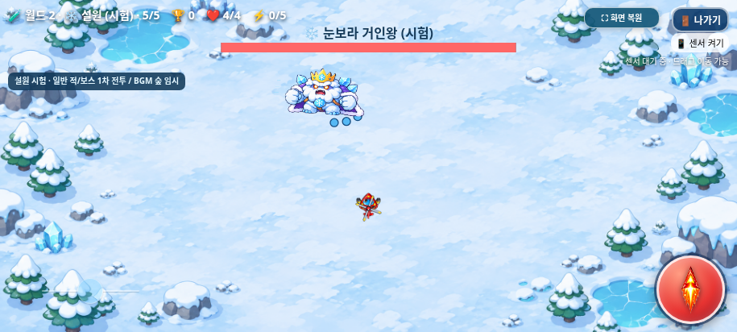
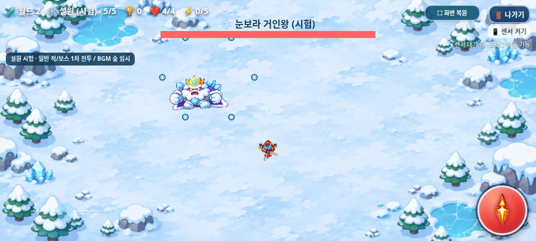
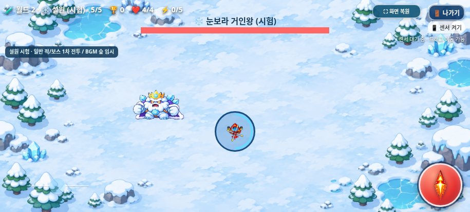
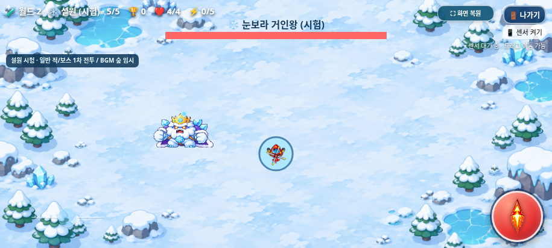

# 눈보라 거인왕 전용 공격 — Issue #9

2026-11-03(KST) · `feature/snowfield-boss-patterns`

[Issue #9](https://github.com/26aiera11-cpu/helicopter-game/issues/9)을 먼저 읽었다. 시작 로컬/원격 설원 일반 전투와 원격 보스 브랜치는 모두 `c5daee93966ea926a17c1501c5b3a2d07f0c3600`였다. 작업 트리는 깨끗했고 두 원격 ref를 명시적으로 fetch한 뒤 동명 로컬 보스 브랜치를 만들었다. main은 `17da293570f422035d455add578dbc8412e4f24b`이며 main·기준 브랜치와 Pages는 변경하지 않는다. `HELI_TRIO_SPEC.md`는 없으므로 이번 요청/Issue와 기존 확정 규칙을 따른다.

## 사용 방법과 1차 시험 수치

**게임 방법 → 🧪 지역 바로 시작 ON → 월드2 → 설원 → 5단계 → 닫기 → 캐릭터 선택 → 게임 시작**으로 직접 시험한다. 개발 결과는 기존 정상/설원 시험 TOP10·분석에 저장하지 않는다. 개발OFF의 월드1 20단계와 기존 설원25단계 시험 경로도 그대로다.

| 순서 | 공격 | 수치/처리 |
| --- | --- | --- |
| 1 | 부채꼴 얼음탄 | 발사 순간 플레이어 조준, 중심과±18°의3발,80px/초 |
| 2 | 회전 눈보라 | 보스 중심6발·60° 간격,65px/초,회차마다 시작 각도0→15→30° 회전 |
| 3 | 얼음 폭발 | 고정 원 반경38px·예고1.1초,중심 거리38px 이내 한 번 피해1,표시0.25초 |

모두 **1차 시험 수치**다. 첫 공격은 출현 후1.8초, 다음 공격은 처리 완료 뒤3.2초 휴식한다. 투사체 공격은 발사 완료가 기준이고, 폭발은 경고와0.25초 표시를 모두 마친 뒤 휴식한다. 기존 투사체 수명3.4초 때문에 앞 탄환과 다음 발사가 최대0.2초 공존할 수 있으나 **활성 보스 탄환은 최대9개**다. 프레임마다 발사하거나 무한 파티클을 만들지 않는다.

| 첫 순환의 게임 시간 | 동작 |
| --- | --- |
| 1.80초 | 부채꼴3발 |
| 5.00초 | 눈보라6발 |
| 8.20초 | 위치 기록·폭발 예고 시작 |
| 9.30초 | 한 번 폭발·기존 hurt() 호출 |
| 9.55초 | 표시 종료·휴식 시작 |
| 12.75초 | 다음 부채꼴 |

투사체는 기존 반경5·수명3.4초·피해1·플레이어 무적1.55초·화면 밖 제거·탱코 차단 경로를 사용한다. 부채꼴은 파랑/짙은 테두리, 눈보라는 실제 원형 판정 위의 작은 눈송이 표시로 구분한다. 장판 폭발은 투사체가 아니며 기존 hurt()를 한 번 호출한다. 플레이어 무적을 우회하거나 빙결/감속을 추가하지 않는다.

## 고정 위험 원·일시정지·종료

일반적인 위치에서는 예고 당시 플레이어 좌표를 중심으로 그대로 사용한다. 화면 끝이나 조이스틱·발사·센서·전체화면·나가기·HUD/보스 정보 영역과 겹칠 때만 가장 가까운 안전한 중심을 고른다. 원래 목표 좌표도 별도로 보존한다. 중심은 예고 시작 뒤 플레이어를 따라가지 않고, 실제 피해 범위도 표시한38px와 같다. 밝은 배경에서 보이는 짙은 테두리/파랑 음영/진행 고리를 표시한다. 전체 원이 보이도록 최소42px 여백을 사용한다.

예고 중 리사이즈/전체화면/가시성 변경으로 원이 안전하지 않게 되면 경고를 취소하고 휴식한다. 원을 플레이어 쪽으로 다시 옮겨 기습하지 않는다. 지원하는 세 가로 크기에는 안전한 위치가 있다. 안전한 원을 놓을 공간 자체가 없다면 해당 폭발을 건너뛰고 휴식한다.

나가기 확인창과 백그라운드는 게임 시간 갱신을 멈춘다. 설원 보스가 있는 동안의 백그라운드 정지는 이동/탄환/장판을 함께 멈추며 월드1의 기존 동작은 바꾸지 않는다. 취소 후 남은 시간을 이어가고, 종료 확정/게임 오버/지역 완료/새 게임에는 보스 상태·위험 원·보스 탄환을 초기화한다. 새로운 setTimeout이나 별도 피해 타이머를 만들지 않았다. 기존 게임 오버3초 타이머는 그대로다.

## 코드와 보호

- 신규 `assets/snowfield/boss_combat.js`에 설정·초 단위 상태 전환·유한 탄환 생성·위험 원/표시·초기화를 모았다. `world-2:snowfield` & phase5 & 현재 보스에서만 적용한다. 월드 프로필0을 바꾸지 않는다.
- `index.html`의 원래 보스 이동/HP/충돌/보상은 그대로이고 사격 분기만 전용 모듈이 처리한다. 설원 전용 처리가 참이면 기존 숲 보스 발사를 실행하지 않는다. 사망 시 즉시 반환해 같은 업데이트의 후속 전투가 재개되지 않게 한다.
- 기존 공통 `enemyBullets` 배열/충돌·차단을 사용한다. 피해는 독립 HP 감소 없이 기존 hurt()만 호출한다. 발사/실제 폭발 때 기존 `gameSnowfield.attack(boss,true)`를 한 번 호출하며, 경고 중에는 attack을 반복하지 않는다. hit/defeat의 원래 우선순위와 마지막1.05초 아트 연출도 유지한다.
- **`assets/snowfield/combat.js`와 `snowfield.js`는 수정하지 않았다.** 승인 배경/원본 PNG·아틀라스/매니페스트/115프레임, 모든 기존 음원·선택/조작/점수/아이템 자산도 바이트 그대로다. `worlds.js`는 ‘일반 적/보스1차 전투·BGM 숲 임시’ 안내2문장만 갱신했다.
- 기존 HP20·강화0~5 계수1/1.1/1.4/1.6/1.9/2.2·보스 이동/반경48·50:50 HP+2/강화+1 보상·보스2,000점을 유지한다. 분노/추가 소환·새 음원/원화·상태이상은 없다.
- 이전 보호 계층 앞에서 정확한 Issue9 변경만 역변환한다. 새 모듈을 별도 해시로 보호하며 기존 보호를 일괄 해제하지 않았다. 이전 설원 숲 보스1발117px/초 기대값만 실제1.8초 후3발80px/초로 바꾸고, 설원 보스 비교의 새 공격 필드를 분리해 기존 이동/HP/카운터 비교는 유지했다. 월드1의 전체 공격 비교는 그대로다.

## 실제 브라우저 검증

**34개 검사 모음·497개 검사 그룹**을 통과했다. 기존32개/459그룹과 새 일반·오프라인 각19그룹이다. [전체 집계](test-summary.json), [새 일반 결과](native/test-results.json), [새 오프라인 결과](offline/test-results.json), [소스/패키지 일치](package-source-verification.json).

| 검사 | 결과 |
| --- | --- |
| 세 캐릭터 직접5단계 UI 시작 | HP4/6/9·강화0·점수0·일반 적0·보스20HP/r48·전체화면 유지 |
| 60/120Hz 각각35초 | 같은 공격 순서/시각,부채꼴3발/눈보라6발·정확한 속도/각도·회차15°·활성 상한9개 |
| 기존 사격 중복 | 기존 emitEnemyShot(boss) 호출0·실제 발사/폭발에만 공격 아트 |
| 고정 원/회피 | 예고1.1초·반경38·위치 추적 없음,80px 이동 회피·38px 경계 피해/38.1px 밖 무피해 |
| 세 캐릭터 폭발 피해 | 기존 피해1/무적1.55초·표시 중 추가 피해0·기존 무적 중 피해0 |
| 투사체 | 부채꼴/눈보라 모두 기존 충돌,탱코와 양쪽 소멸·트리오/빙글 차단 추가 없음 |
| 확인창/숨김/새 게임 | 시간·위치·탄환/장판 정지,취소 이어가기,확정/재시작에 완전 초기화·전체화면 유지 |
| 치명적 폭발 | 즉시 진행/BGM 정지·모든 보스 위협 제거·기존3초 후 깨끗한 선택 복귀 |
| 세 캐릭터×보상2종 | 실제 발사/피격으로 경고 중 처치,HP+2/강화+1·2,000점·단일 보상/클리어·1.05초 소멸 |
| 강화0~5 | 세 캐릭터 모두20/22/28/32/38/44HP·등장 시 한 번 고정·기존 반경48 |
| 기록 보호 | 모든 개발 실행 후 기존 정상/설원 TOP10·분석 네 원문 동일·쓰기0회,기존 캐시도 회귀 보호 |
| 보호 전투 | 월드1 보스4종의4초 난수/입력 시계열에서 이동/HP/발사/탄환/카운터 완전 일치 |
| 전체 회귀 | 월드1 20단계·설원25단계/정식 점수/저장 분리·설원4종·개발75조건·아이템/보상/음악·조작/센서/멀티터치·게임 오버/전체화면 유지 |
| 세 가로 크기 | 915×412·800×360·568×320의 진입/세 공격·경고/폭발/클리어·UI 비겹침·화면 끝 안전 배치 |

폭발 게임 오버의 실제 반환 지연은 일반 **3003.4ms**, 오프라인 **3004.6ms**였다. 실제 오디오는 정지/재생 상태로 확인했고 스피커로 듣지는 않았다. 새 검사와 기존 회귀 모두 미처리 JS 오류·기본 브라우저 대화상자·실패 자산·독립 HTML 외부 요청은0이었다. 기존32개 회귀 모음은 첫 실행에서 모두 통과했으며 검사 조건/타임아웃을 완화하지 않았다.

새 검사 최초 실행에서는 새 게임 직후 숨겨진 조작 UI가 표시되기 전에 동기식으로 시간을 진행해 배치 기대값이 어긋났다. 실제 UI 표시/전체화면 버튼 위치 갱신을 기다린 뒤 같은 모서리·조작 영역의 겹침 조건을 검사했다. 제품 코드는 바꾸지 않았다. 눈보라 차단 검사도 앞 부채꼴 잔여 탄환이 아니라 해당 눈보라 탄환을 선택하도록 검사 대상을 명확히 했다.

실제 생성/공격/충돌/피해/보상/클리어 함수를 사용하되, 장시간 패턴 관측 때는 플레이어 사격과 좌표/무적/시간을 통제했다. 60/120Hz는 계산 간격이며 실제120Hz 하드웨어 시험이나 수동 난이도 완주가 아니다. 기존 HP/캐릭터 성능을 유지했으므로 최종 난이도는 실기기 플레이로 별도 판단해야 한다.

다른 검사가 끝난 뒤915×412·보스 게임시간6.8초에서1초 워밍업 후180개 RAF 간격을 추가 관측했다. 예고/폭발 구간의 기준/수정본 평균은 모두60.00FPS·중앙16.7ms,95백분위16.7/16.8ms였다. [격리된 프레임 관측](isolated-frame-observation.json)은 검사 수에 더하지 않았으며3초 표본으로 실기기/장시간 성능을 보장하지 않는다.

## 실제 화면

실제 Chromium 캡처이며 이미지 편집/합성이나 물리 갤럭시 사진이 아니다. 원본 아트와 전투 시간을 그대로 렌더링했다.

| 화면 | 일반 | 독립 HTML 오프라인 |
| --- | --- | --- |
| 915×412 | [진입](native/entry-915x412.png) / [부채꼴](native/fan-915x412.png) / [눈보라](native/radial-915x412.png) / [예고](native/warning-915x412.png) / [폭발](native/burst-915x412.png) / [클리어](native/clear-915x412.png) | [진입](offline/entry-915x412.png) / [부채꼴](offline/fan-915x412.png) / [눈보라](offline/radial-915x412.png) / [예고](offline/warning-915x412.png) / [폭발](offline/burst-915x412.png) / [클리어](offline/clear-915x412.png) |
| 800×360 | [진입](native/entry-800x360.png) / [부채꼴](native/fan-800x360.png) / [눈보라](native/radial-800x360.png) / [예고](native/warning-800x360.png) / [폭발](native/burst-800x360.png) / [클리어](native/clear-800x360.png) | [진입](offline/entry-800x360.png) / [부채꼴](offline/fan-800x360.png) / [눈보라](offline/radial-800x360.png) / [예고](offline/warning-800x360.png) / [폭발](offline/burst-800x360.png) / [클리어](offline/clear-800x360.png) |
| 568×320 | [진입](native/entry-568x320.png) / [부채꼴](native/fan-568x320.png) / [눈보라](native/radial-568x320.png) / [예고](native/warning-568x320.png) / [폭발](native/burst-568x320.png) / [클리어](native/clear-568x320.png) | [진입](offline/entry-568x320.png) / [부채꼴](offline/fan-568x320.png) / [눈보라](offline/radial-568x320.png) / [예고](offline/warning-568x320.png) / [폭발](offline/burst-568x320.png) / [클리어](offline/clear-568x320.png) |

## 결과물과 남은 확인

제품 변경은 신규 `assets/snowfield/boss_combat.js`, 기존 `index.html`의 사격/피해/생명주기/표시 연결, `worlds.js`의 안내2문장이다. 빌더/패키저·새 보스 검사/정확한 차분·해시 보호/기존 검사 연결, dist2개·검증/화면/갤럭시 안내·누적 DEVELOPMENT_LOG도 갱신했다. 기존 기록과 자산은 보존한다.

[최신 갤럭시 ZIP 다운로드](https://github.com/26aiera11-cpu/helicopter-game/raw/refs/heads/feature/snowfield-boss-patterns/dist/heli_trio_galaxy_test.zip?download=1) · [실행 안내](../galaxy-test/README.md) · [빌드](build-results.json) · [ZIP 검증](zip-results.json).

HTML은 **43,590,249바이트**, SHA-256 `869d63cf36510bcc60634cc8a2053cc0801f3607d559dbe4917fcaa2381a0f91`다. ZIP은 **31,834,541바이트**, SHA-256 `8ef68bfa6a26dfa4b5efe2cc88cf1735aa1df66a7c1349f5aaf49b0ec1c2aff4`다. 실행 스크립트11개·기존 CSS/PNG/MP3/WAV/아틀라스/매니페스트를 내장했다. 최종 재생성 HTML은 브라우저 검사본과 바이트가 같다. ZIP은 그 HTML1개·CRC·unzip-t·실제 별도 추출 후 일치를 확인했다.

실제 Galaxy Samsung Internet/Chrome의 다운로드/파일 열기·저장·물리 센서/권한·터치 감각·긴 터치 메뉴·주소창/전체화면·스피커 청취·FPS/발열/배터리·예고 시인성과 실제 난이도는 미검증이다. file:// 관리 정책을 우회하지 않고 저장 가능한 빈 localhost origin에서 네트워크를 차단해 같은 단일HTML을 검사했다.

재현되는 새 제품 결함은 발견하지 않았다. 수치는1차 시험이며 분노/추가 소환·상태이상·새 지역/음원/원화·캐릭터 밸런스 변경은 이번 범위가 아니다. main 병합과 GitHub Pages 배포도 하지 않는다.
