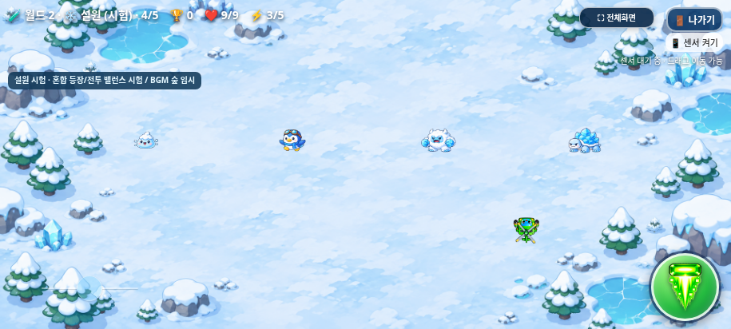
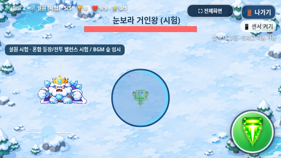

# 설원 난이도 1차 소폭 상향

2026-11-04(KST) · `feature/snowfield-difficulty-tuning` · [Issue #11](https://github.com/26aiera11-cpu/helicopter-game/issues/11)

원격에 이미 생성된 브랜치를 `0441a88f7c494719f2ccab99caaf100d35cd86ee`에서 체크아웃했다. main은 `17da293570f422035d455add578dbc8412e4f24b`이며 변경하지 않는다. 사용자 승인 없는 main 병합과 GitHub Pages 배포는 하지 않는다. `HELI_TRIO_SPEC.md`는 없어 사용자 확정 규칙과 Issue를 적용했다.

## 변경한 수치

`assets/worlds/difficulty.js`에 지역 키별 읽기 전용 설정을 추가했다. 설원의 추적속도1.06배·발사 간격0.95배·보스 휴식3.0초·혼합 확률만 한곳에서 조정한다. 기존 모듈은 이 값을 명시적으로 사용하며 월드1에는 기본 배율을 추가하지 않는다.

| 몬스터 | 추적속도(px/초) | 발사 간격(초) | 유지한 HP / 탄속(px/초) |
| --- | ---: | ---: | ---: |
| snow_slime | 32.300 → 34.238 | 5.1600 → 4.9020 | 1 / 85 |
| penguin_raider | 36.100 → 38.266 | 4.3000 → 4.0850 | 2 / 85 |
| ice_yeti | 28.500 → 30.210 | 6.0200 → 5.7190 | 2 / 76.5 |
| frost_turtle | 20.900 → 22.154 | 6.4500 → 6.1275 | 3 / 85 |

이동은 추적에만 적용한다. 펭귄 계획거리1.05H·예고0.8초·돌진1.2초·방향 고정·첫 경계 정지·도착 후4.5초 재예고 주기는 그대로다. 돌진 속도는 화면별360.5/315/280px/초를 유지하고 돌진 중 재조준/발사를 추가하지 않는다. 발사 간격−5%는 추적 중 연속 발사 기회가 약5.26% 늘어나는 값이며 피해/탄수/탄속/반경을 올리지 않는다.

| 단계 | 이전 슬라임/펭귄/예티/거북이 | 변경 | 평균 체력(참고) |
| --- | --- | --- | --- |
| 1 | 80/20/0/0 | 80/20/0/0 | 1.2 → 1.2 |
| 2 | 50/40/10/0 | 45/40/15/0 | 1.5 → 1.55 |
| 3 | 25/30/35/10 | 20/30/35/15 | 1.85 → 1.95 |
| 4 | 10/25/35/30 | 10/20/35/35 | 2.2 → 2.25 |
| 5 | 0/20/30/50 | 0/15/30/55 | 2.5 → 2.55 |

각 개체의 독립 추첨/불변ID/아트·피격·소멸 연결은 유지한다. 다종 출현을 강제하지 않고 직접5단계는 일반 적 없이 보스다. 1단계 확률은 그대로이며 후반 평균 체력 상승은2~5.4% 수준이다. 각 종의 실제 HP는 변경하지 않는다.

**기존 상한의 문서 차이:** 실제 설원 생성 공식은 단계별 `3/4/4/5/5`이며 ‘상한4’가 모든 단계에 적용되지는 않는다. 사막은 `6/7/7/7/7`이다. 이번에는 개체 수를 바꾸지 않고 기존 공식을 그대로 보존했다. 일반 처치 목표6·일반 생성 기회/간격·아이템몹 생성 규칙은 유지한다.

## 보스와 사막 비교

눈보라 거인왕의 휴식만3.2→3.0초다. 첫1.8초, 부채꼴3발±18°/80px·회전6발60°/65px/회차15°, 폭발 반경clamp(0.18H,56,74)/예고1.4초/피해1/고정 중심·무적1.55초·활성탄 상한9는 그대로다. 60/120Hz의35초 타임라인은 `1.8,4.8,9.2,12.45,15.45,19.85,23.1,26.1,30.5,33.75`초다. 발사7회가 모두3/6발로 생성되고 폭발3회와 합계10회 공격한다. 탄환 상한으로 누락되지 않아3.1초 대안을 적용하지 않았다. 기존은 같은35초에9회 공격이었다.

사막 일반 적의 HP2·기본 이동82~102·탄속155~187·생성 간격1.46~1.10초와 비교하면 설원은 HP1~3·추적22.154~38.266·탄속76.5~85·생성 간격2.00~1.64초다. 사막 이동에는 기존 곡선/거리 행동도 있어 단일 속도만으로 체감 난이도를 비교할 수 없다. 사막 반복 발사는 `2.7×(0.85+난수×0.55)/(1+0.07×(단계−1))`초이고 설원은 위 종별 간격을 사용한다. 사막 보스 기본HP65, 설원20과 기존 강화 배율은 그대로다.

같은 조준/정규화 이동 입력·시드·강화로 양 지역1~5단계×세 캐릭터를 비교했다. 보스는0/3강을 비교하여 총36조건의 변경 전/후72회 실행을 기록했다. 아이템 기회0·무적·즉시 자동 조준을 사용했고 초기 발사 대기0/진입 전 시드를 동일하게 맞췄다. 이는 전투 가능성/공격 경로 비교이며 사람의 생존율·수동 난이도 검사가 아니다. 사막18조건의 결과는 기준과 정확히 같고 세 캐릭터 모두 두 보스를 처치해2,000점을 받았으며 개발 기록은 저장하지 않았다.

| 캐릭터·강화 | 사막(전후 동일) | 설원 이전 | 설원 변경 |
| --- | ---: | ---: | ---: |
| 트리오 0강 | 7.733초 | 2.567초 | 2.567초 |
| 트리오 3강 | 4.033초 | 1.317초 | 1.317초 |
| 빙글 0강 | 11.933초 | 3.800초 | 3.800초 |
| 빙글 3강 | 5.367초 | 1.850초 | 1.850초 |
| 탱코 0강 | 19.933초 | 4.950초 | 4.950초 |
| 탱코 3강 | 12.183초 | 3.300초 | 3.300초 |

**체감10~15% 상향은 아직 검증하지 못했다.** 완벽한 제어 조준 조건에서는 설원 보스 처치 시간이 사막보다 짧고 고강화에서는 첫 공격 전 처치도 가능하다. 이 결과를 숨기거나 속도/간격 변화율을 더해 난이도 비율로 표현하지 않는다. 보호 조건에 따라 보스 HP·공격력·캐릭터 공격을 임의로 추가 조정하지 않았다. 설원은1차 보수적 조정이며 최종 체감 밸런스는 실제 플레이로 재평가해야 한다.

## 검사 결과와 남은 문제

**38개 모음 중36개 모음·508개 검사 그룹 통과**, 미완료2개: worlds, worlds-offline. [집계와 초기 실패/재실행](test-summary.json), [신규 일반 검사](native/test-results.json), [신규 오프라인 검사](offline/test-results.json), [소스·패키지 일치](package-source-verification.json).

처음에는 일반 전투16/보스19/신규9그룹을 집중 검사했다. 같은 제품 소스 해시를 유지한 채 나머지35모음을 한 번 실행해 전체38모음 범위를 확인했다. 이전 기대속도가 남아 있던 아트 검사2개와 시작 조건을 정리한 신규 비교2개만 재실행했다. 전체 회귀를 반복하지 않았다.150,000회 신규 추첨, 기존 혼합45만회×일반/오프라인, 개체별HP/행동/아트, 펭귄 경로, 실제 탱코 폭발 회피, 보스 충돌/보상/게임 오버, 기존 조작/음원/점수/아이템·월드 진행 검사를 포함한다. 통과하지 않은 모음의 앞부분 관측은 통과 그룹 수에 더하지 않는다.

긴 멀티터치→나가기 검사에서 버튼 pointerdown/up 후 click이 없는 기존 증상이 재현되면 실패 로그/이벤트/화면을 그대로 보존한다. 이번에는 입력 코드를 실험적으로 바꾸지 않았다. [이전 기준 버전에서도 재현한 진단](../snowfield-mixed-spawns-balance/touch-input-diagnosis.json)을 참고한다. 별도 나가기·전체화면·모바일 조작·새 일반/보스 모음의 결과는 집계의 개별 파일을 따른다. 이 미해결 입력 시퀀스와 실제 갤럭시 재검사는 남아 있다.

## 지역 설정 확장 방법

현재 등록한 키는 `world-2:snowfield` 하나다. 향후 지역은 같은 `regions` 테이블에 이름이 명확한 배율/확률/휴식을 추가하고 해당 지역의 전투 모듈에서 `gameRegionDifficulty.get(지역키)`를 명시적으로 사용한다. 미등록 지역은undefined이며 월드1에 숨은 기본 배율을 적용하지 않는다. 현재 설원 체력/탄속/돌진/폭발 설정은 기존 모듈에 보존했다. 월드1 전체 엔진·지역 레지스트리 리팩터링이나 가상 지역 추가는 하지 않았다.

## 갤럭시 파일과 화면

[최신 ZIP 다운로드](https://github.com/26aiera11-cpu/helicopter-game/raw/refs/heads/feature/snowfield-difficulty-tuning/dist/heli_trio_galaxy_test.zip?download=1) → 압축 해제 → HTML 실행. 게임 방법의 지역 바로 시작에서 월드2→설원→1~5단계를 선택한다. 개발 모드 기록은 TOP10/분석에 저장하지 않는다.

HTML **43,593,828바이트**/SHA-256 `f861ed24d4588c1b23b58c0ed37ea297cca19d71c7c256463f07e961c84b660e`, ZIP **31,835,556바이트**/SHA-256 `5a33937a33ae6b2ff6258926e05bf9ae480ef7b87750620198bea302ca17eafe`다. 현재13개 실행 스크립트·CSS·참조PNG/MP3·기존WAV/manifest를 포함한다. 브라우저 검사본과 최종 HTML의 바이트 일치·ZIP의 HTML1개/CRC/unzip-t/실제 압축 해제를 검증했다. [빌드](build-results.json), [ZIP](zip-results.json).

일반/오프라인 각각6장, 총12장의 실제 Chromium 화면이다.915×412/800×360/568×320의 `native/`와 `offline/`에서 확인한다. 합성 이미지나 물리 휴대폰 사진이 아니다.

실제 Galaxy Samsung Internet/Chrome의 다운로드/로컬 파일 열기·물리 센서/권한·손가락 입력/반응 체감·난이도 수동 완주·스피커 청취·성능/발열/주소창·전체화면은 미검증이다.60/120Hz는 시뮬레이션 단계다. 관리자file://정책을 우회하지 않고 빈 localhost origin에서 네트워크를 차단해 동일 HTML을 검사했다. 이번 변경만으로 체감 목표 달성을 확정하지 않는다.
