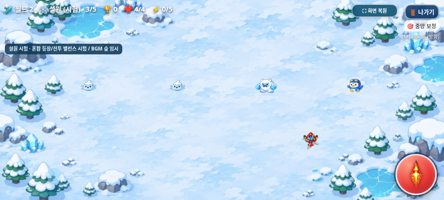
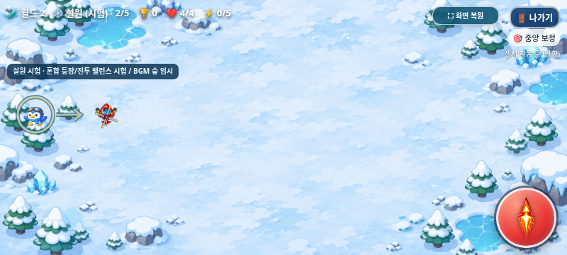
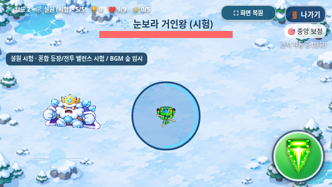

# 설원 혼합 등장·돌진·얼음 폭발 밸런스 검증

2026-11-03(KST) · `feature/snowfield-mixed-spawns-balance` · [Issue #10](https://github.com/26aiera11-cpu/helicopter-game/issues/10)

기준 커밋은 `922c271e1be5585ada0b34614f46436f9c2d6b61`이다. 기존 로컬 구현을 보존하고 검증·패키징을 마무리했다. main(`17da293570f422035d455add578dbc8412e4f24b`) 병합과 GitHub Pages 배포는 하지 않는다. `HELI_TRIO_SPEC.md`는 없으며 사용자 확정 규칙과 Issue #10을 적용했다.

## 완료한 기능

| 단계 | 눈슬라임 | 펭귄 돌격병 | 아이스 예티 | 빙결 거북이 |
| --- | ---: | ---: | ---: | ---: |
| 1 | 80% | 20% | 0% | 0% |
| 2 | 50% | 40% | 10% | 0% |
| 3 | 25% | 30% | 35% | 10% |
| 4 | 10% | 25% | 35% | 30% |
| 5의 보스 전 일반 전투 | 0% | 20% | 30% | 50% |

- `spawns.js`의 독립 난수로 **실제 생성 개체마다 한 번** 종류를 결정한다. `snowSpeciesId`는 불변이며 체력/속도/공격·아틀라스/피격/소멸이 같은 ID를 사용한다. 단계가 바뀌어도 남은 소멸 그림이 다른 몬스터로 변하지 않는다. 보스는 추첨 대상이 아니다.
- 기존 일반 몬스터 생성 간격·기회·상한4·목표6마리는 그대로다. 각 종류가 반드시 나온다는 보장은 없고 같은 종류가 반복될 수도 있다. 지역 바로 시작의 직접5단계는 즉시 보스, 정상 경로의5단계는 일반 적6마리 후 보스라는 기존 규칙을 유지한다.
- 펭귄은 첫4.5초 추적 후 **0.8초 정지 예고 → 고정 방향 최대1.2초 돌진**한다. 계획 거리는 화면 높이의1.05배다. 첫 경계(x17/W−17,y18/H−18)에서 즉시 멈추며 벽 미끄러짐·반사·재조준·순간이동이 없다. 도착 후0.8초 정지+3.7초 추적 뒤 다음0.8초 예고다. 예고/돌진/휴식 중 발사하지 않는다. 방향 고리와 화살표를 크게 하고 밝은 선/짙은 외곽선으로 표시한다.
- 얼음 폭발만 **반경 `clamp(0.18×H,56,74)` / 예고1.4초**로 변경했다. 예고 위치/반경은 고정되고 표시·피해 판정이 같은 반경을 쓴다. UI/경계와 겹치면 안전한 중심을 사용하고 안전 영역이 없으면 해당 공격을 건너뛴다. 화면 변경으로 원이 위험해지거나 필요한 반경이 달라지면 취소 후 휴식한다.
- 부채꼴3발±18°/80px·눈보라6발60°/65px/회차15°·최대9발·피해1/무적1.55초, 보스 HP/강화/이동/보상은 그대로다. 예고 증가로 첫 폭발 시각은9.3→9.6초다. 반복 순서/공격 후3.2초 휴식은 유지한다.

## 실제 측정에 사용한 수치

| 화면 | 펭귄 계획 거리 | 돌진 속도 | 폭발 반경 | 예고 |
| --- | ---: | ---: | ---: | ---: |
| 915×412 | 432.6px | 360.5px/초 | 74px | 1.4초 |
| 800×360 | 378px | 315px/초 | 64.8px | 1.4초 |
| 568×320 | 336px | 280px/초 | 57.6px | 1.4초 |

수평·대각선의 충분한 공간에서는 계획 거리를 완료했다. 수직 방향은 화면 높이보다 긴 계획을 담을 수 없으므로 경계에서 먼저 멈춘다. 실제36조건(3화면×60/120Hz×6방향) 위치/거리/정지 원인은 JSON에 보존했다. 경계에 붙어서 미끄러지며 전체 계획 거리를 채우도록 만들지 않았다.

탱코 원래 최고속도 제한은204px/초지만 가속473·감쇠4.25를 사용하는 **정규화 입력1의 한 축 정속은473/4.25=111.29px/초**다. 가상의 일정204px 속도로 회피 가능성을 계산하지 않았다. 기존 센서 이벤트(beta17°,가로방향90°)→입력1→실제 가속/감쇠→위치·hurt()를 사용했다. 정지 출발·화면 중앙/안전한 가장자리에서 다른 탄환/보스 접촉만 제거해 폭발을 분리했다.

| 반응 지연 | 탱코 이동60Hz | 탱코 이동120Hz | 74px 원 결과 |
| --- | ---: | ---: | --- |
| 0.20초 | 108.44px | 107.98px | 회피 |
| 0.50초 | 75.45px | 75.00px | 회피 |
| 0.55초 | 70.01px | 69.57px | 피해1 |
| 0.70초 | 53.93px | 53.49px | 피해1 |

세 화면 모두0.20초 반응은 회피,0.70초 반응은 피해1이었다. 트리오/빙글도0.20초 반응에 회피했다. 총132개 캐릭터/지연/위치/주사율 조건의 원본 측정이 있다. 실제 기울기 강도·기기/사람 반응·이동 중 관성에 따라 결과는 달라지므로 최종 체감 난이도를 확정하지 않는다.

## 테스트와 보존 검증

**36개 모음 중35개 모음·510개 검사 그룹 통과**: 기존33모음478그룹과 새 일반16/오프라인16그룹이다. 기존 worlds-offline 모음1개는 미완료이며, 실패 전에 관측한16그룹은510에 포함하지 않았다. [집계·재실행 이력](test-summary.json), [일반 실행](native/test-results.json), [오프라인 실행](offline/test-results.json), [소스·패키지 검증](package-source-verification.json).

- 모드별45만 회(5단계×3시드×3만 회) 추첨의 확률 오차는 최대0.457%p로 허용1%p 이내였다.0% 종류는 등장하지 않았고 양 끝 경계값·재현 시드·같은 종6회가 가능한 점도 확인했다.
- 허용된16개 단계/종류 조합 모두 실제 예고→생성→체력/이동/발사→피격/처치→100점/목표1·소멸 아틀라스를 검사했다. 아이템몹200점과 목표 제외는 원래 검사로 보호한다. 자동 생성에서도3종4개체의 동시 존재와 원래1.82초 생성 공식(120Hz 실제1.825초)을 확인했다.
- 새 추첨을2,000회 더 돌린 뒤에도 월드1 네 지역의 난수 호출수·일반 적/예고·생성 타이머·아이템 생성 계획이 기준 커밋과 같았다. `Math.random`을 사용하지 않는 것도 별도 검사했다.
- 실제 내부 종료창은 이동 중 돌진을 정지하고 취소 후 이어간다. 확정 종료/새 게임은 이전 개체를 움직이거나 피해를 남기지 않는다. 보스 예고/폭발의 일시정지·사망·중복 피해/보상·재시작도 기존 검사를 통과했다.
- 기존 월드1 20단계·설원25단계, 개발 직접 진입/비저장, 보스 체력/보상, 아이템 생성/단계 간 수명, 탱코 최신 밸런스/연사, 점수/TOP10, 선택/BGM/게임 오버3초, 전체화면/나가기, 센서 계산·조이스틱/드래그·멀티터치/텍스트 선택 차단·115프레임 아트까지 회귀 검사했다.
- `index.html`의 정확한3개 변경과 자산4개의 허용 차분을 역변환하면 기준과 바이트가 같다. PNG·MP3/WAV·매니페스트/아틀라스·플레이어 공격/물리·조작/아이템/점수 모듈은 수정하지 않았다. 별도의 신규 추첨 파일만 추가했다.

**worlds-offline**의 기존 단일 버튼 터치는 최초/단독 재실행에서 pointerdown/up만 있고 click이 없어 실패했다. **수정하지 않은 기준922c271의 전체 동일 검사에서도 같은 실패가 재현**됐다. 짧은 기준/현재×일반/오프라인×두 해제 방식8조건은 모두 통과했으며, 표준 Playwright 버튼 터치와 CDP 마지막 접촉 해제 방식도 시험했지만 긴 일반/오프라인 모음의 결과가 일관되게 통과하지 않았다. 실험한 터치 테스트 변경은 되돌렸고 제품 조작 코드는 변경하지 않았다. 원인은 미확정이다. [최초 실패](regression/worlds-offline/run.log),[단독 재현](input-diagnosis/worlds-offline-retry/run.log),[기준 재현](input-diagnosis/baseline-full/run.log),[모든 시도와8조건 진단](touch-input-diagnosis.json)을 보존했다. 이 긴 조작 시퀀스와 실제 삼성 인터넷 확인은 미완료다. 별도 나가기/전체화면/멀티터치 모음과 새 돌진 중 종료 검사는 통과했다.

기존 ‘단계별 한 종’ 테스트는 각 의도한 종이 양수 확률인 시드12345를 고정해 기존 공격/체력/아트 검사를 유지했다. 새 검사가 실제 혼합을 별도로 다룬다. 월드1 전후 비교는 기존 아이템 관리자 자체의 crypto 시드도 양쪽에서 동일하게 설정했으며 제품 난수 코드는 바꾸지 않았다. 테스트 과정의 초기 픽스처 오류를 해결한 내용이며 게임 수치를 바꿔 통과시키지 않았다. 완료된35개 모음에서는 미처리JS오류·브라우저 기본대화상자·실패 자산·오프라인 외부요청이 없었다. 실패 모음은 해당 최종 검사 구간까지 도달하지 못했다.

## 화면

일반/오프라인 각각12장,총24장의 실제 Chromium 캡처다. 좌표/시간을 통제한 게임 렌더링이며 합성 이미지·실제 갤럭시 사진은 아니다.

| 화면 | 혼합 등장 | 돌진 예고 | 돌진 중 | 탱코 폭발 예고 |
| --- | --- | --- | --- | --- |
| 915×412 | [보기](offline/mixed-915x412.png) | [보기](offline/penguin-warning-915x412.png) | [보기](offline/penguin-dash-915x412.png) | [보기](offline/tanko-aoe-915x412.png) |
| 800×360 | [보기](offline/mixed-800x360.png) | [보기](offline/penguin-warning-800x360.png) | [보기](offline/penguin-dash-800x360.png) | [보기](offline/tanko-aoe-800x360.png) |
| 568×320 | [보기](offline/mixed-568x320.png) | [보기](offline/penguin-warning-568x320.png) | [보기](offline/penguin-dash-568x320.png) | [보기](offline/tanko-aoe-568x320.png) |

## 갤럭시 파일·실행

[최신 ZIP 다운로드](https://github.com/26aiera11-cpu/helicopter-game/raw/refs/heads/feature/snowfield-mixed-spawns-balance/dist/heli_trio_galaxy_test.zip?download=1) → 압축 해제 → `heli_trio_galaxy_test.html` 실행. 게임 방법의 지역 바로 시작을 켜 월드2→설원→1~4단계 또는 보스5단계로 시험한다. 개발 실행은 순위/분석에 저장하지 않는다. 기본 정상 월드1/별도 설원25단계 시험은 유지한다.

HTML은 **43,593,134바이트**/SHA-256 `754c5e98a221897714f05896ccffe48434c4ba3a79156969b11b7028025f1111`,ZIP은 **31,835,350바이트**/SHA-256 `f0cddc43514a649d3576f2c11ca78638c1c8ea6bc674d012c6fceb23edff7471`다. 현재 실행 스크립트12개와 모든 참조 이미지·CSS·음원/원본 매니페스트를 내장한다. 최종 재생성 HTML은 브라우저 검사본과 바이트가 같다. ZIP은 HTML1개·CRC·`unzip -t`·실제 추출 파일 바이트 일치를 확인했다. [빌드 정보](build-results.json),[ZIP 정보](zip-results.json).

## 미완료·실기기 확인

요청한 코드 구현·신규 자동 검사·패키지·기록은 완료했다. 기존 worlds-offline의 긴 멀티터치→나가기 검사1개는 미완료다. **실제 갤럭시 삼성 인터넷/Chrome의 다운로드·직접 로컬 파일 실행·물리 센서/권한·손가락 조작/시인성·반응 체감·난이도 수동 완주·FPS/발열·주소창/전체화면·스피커 청취는 미검증**이다.60/120Hz는 시뮬레이션 단계이며 하드웨어 주사율 보장이 아니다. `file://` 관리자 정책은 우회하지 않고 빈 localhost origin을 준비한 뒤 네트워크를 차단해 동일 HTML을 실행했다. 새 그래픽·음원·분노/소환·빙결/감속·온라인 순위표·다른 캐릭터/월드1 밸런스는 이번 범위에 포함하지 않았다.
