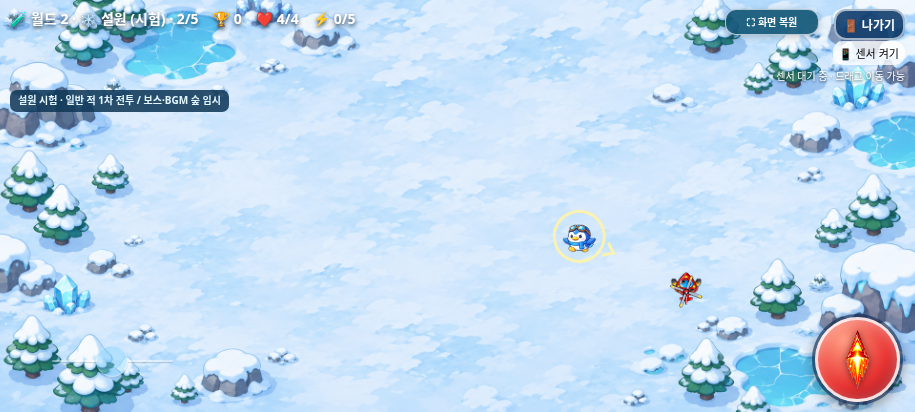
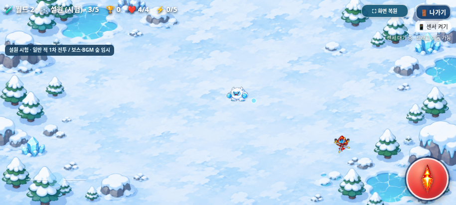
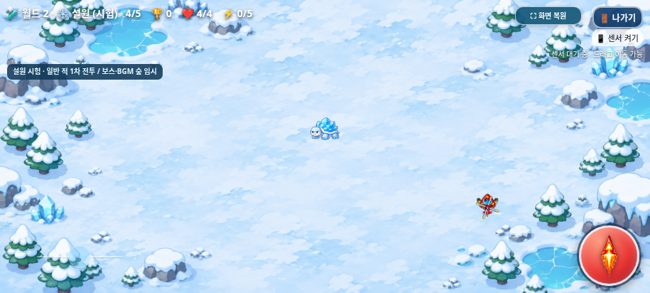

# 설원 일반 몬스터 고유 전투 — Issue #8

2026-11-03(KST) · `feature/snowfield-monster-combat`

[Issue #8](https://github.com/26aiera11-cpu/helicopter-game/issues/8)을 먼저 읽었다. 원격 개발자 진입 브랜치와 전투 브랜치는 모두 `615481239202eb773c494476368e8fa02cd46aea`였고, 명시적으로 fetch한 전투 브랜치에서 작업했다. 시작 작업 트리는 깨끗했다. main은 `17da293570f422035d455add578dbc8412e4f24b`이며 main·기준 브랜치를 변경하거나 Pages에 배포하지 않는다. `HELI_TRIO_SPEC.md`는 없으므로 이번 요청·Issue와 기존 확정 규칙을 따른다.

## 적용한 1차 시험 수치

숲 기본 `tactics[0]`의 **이동38px/초·탄속85px/초·발사 간격4.3초**를 1.0 기준으로 사용했다. 설원 일반 몬스터만 아래 고정 간격/배율을 사용하며 단계별 추가 가속이나 사격 간격 난수를 붙이지 않는다. 기존 일반 생성 빈도/1.4초 등장 예고·6마리 목표·피격 반경16은 유지한다. 아래 수치는 **첫 플레이 테스트용이며 최종 밸런스가 아니다.**

| 단계 | 종ID / 몬스터 | HP | 이동(px/초) | 발사 간격(초) | 탄속(px/초) | 행동 |
| --- | --- | --- | --- | --- | --- | --- |
| 1 | `snow_slime` 눈슬라임 | 1 | 32.3 (×0.85) | 5.16 (×1.2) | 85 | 기본 추적·한 발 조준 |
| 2 | `penguin_raider` 펭귄 돌격병 | 2 | 36.1 (×0.95) | 4.3 (×1.0) | 85 | 추적·예고·고정 방향 돌진·휴식 |
| 3 | `ice_yeti` 아이스 예티 | 2 | 28.5 (×0.75) | 6.02 (×1.4) | 76.5 (×0.9) | 느린 추적·한 발 조준 얼음탄 |
| 4 및 보스 전 일반5 | `frost_turtle` 빙결 거북이 | 3 | 20.9 (×0.55) | 6.45 (×1.5) | 85 | 가장 느린 추적·기본 탄환 |

펭귄은 등장 후3.75초 추적하고 **0.45초 정지 예고 → 0.4초 돌진 → 0.65초 정지 휴식 → 2.25초 추적**을 반복한다. 예고 시작 사이 간격은3.75초다. 예고 시작 때 플레이어 방향을 정하고 이후 예고/돌진 중 목표가 움직여도 그 벡터를 바꾸지 않는다. 돌진 속도는 숲 기본×1.8=68.4px/초, 경계에 닿지 않으면27.36px 이동한다. 예고에는 작은 고리/방향 표시가 나타난다. 예고·돌진·휴식 중에는 발사하지 않고 추적 상태에서만 사격하므로 실제 사격 간격은 상태에 따라4.3초보다 길 수 있다. 최초 사격도 기존 스폰 예고 후 쿨다운을 기다리며 즉시 돌진하지 않는다.

얼음탄은 하늘색 원형 표시만 다르고 **반경5·수명3.4초·피해1·플레이어 무적1.55초** 경로를 재사용한다. 빙결/감속·관통 방어·반사·새 효과음은 없다. 거북이는 HP3 외 별도 방어 능력이 없고 연속 탄환의 피해를 그대로 받는다.

## 코드와 보호 범위

- 신규 `assets/snowfield/combat.js`에 프로필/개체별 WeakMap 상태·이동·사격·펭귄 예고 표시를 모았다. **`world-2:snowfield` 지역 키와 일반 적 생성 경로**에서만 적용한다. `combatProfile=0`을 바꾸거나 다른 숲 프로필 지역에 적용하지 않는다.
- `index.html`은 기존 일반 적 생성 객체를 준비 함수에 통과시키고, 설원 개체 이동/사격만 전용 모듈로 보낸다. 원래 월드1 분기·피격/점수/접촉/탄환 차단 코드는 그대로다. `emitEnemyShot()`의 실제 발사/아트 훅을 호출하고 설원 탄속/얼음색만 지정한다. 새 탄환 종류/피해 판정기를 만들지 않았다.
- 시간은 초 단위dt로 계산하며 펭귄 상태/사격 경계에서 dt를 나눠60/120Hz 차이로 예고/돌진 시간이 늘어나지 않도록 했다. 경계는 기존 x17~W-17/y18~H-18 제한을 재사용한다. 주 이동 자이로·보조 드래그·조이스틱/화면 흔들림은 건드리지 않는다.
- 원본 설원 PNG/아틀라스/매니페스트와 **`snowfield.js` 자체도 바이트 그대로**다. 이동 시 move, 실제 발사 시 attack, 피격 시 hit, 사망 시 hit→defeat115프레임을 그대로 사용한다. 예고는 별도 표시이며 발사하지 않은 때 공격 애니메이션을 가짜로 시작하지 않는다.
- 보스 생성/HP20·강화 보정/공격/속도/보상·음악은 그대로다. 정상 진행의 보스 전6마리는 HP3 거북이이고, 개발 직접5단계는 여전히 일반 적 없이 즉시 보스다. 일반/단계/보스 점수100/500/2,000과 아이템 몬스터의 독립 생성·HP5·200점·드롭/수명·스테이지 간 유지도 그대로다.
- `worlds.js`는 안내 문장2곳만 ‘일반 적1차 전투, 보스/BGM 숲 임시’로 바로잡았다. 월드/경로/개발 시작/시험 기록 분리 코드는 바꾸지 않았다. 개발 결과는 TOP10/분석의 디스크·메모리 기록에 넣지 않는다.
- 새 정확한 차분 보호 도구를 기존 보호 계층 앞에 연결했다. 기존 이미지/음원/조작/점수 해시는 완화하지 않았다. 이전 설원 임시 HP1/속도38/탄속85+단계8 기대값만 이번 요구 수치로 바꾸었고115프레임·콜라이더·보스/전환/저장/화면 검사는 유지했다.

## 검증

전체 **32개 검사 모음·459개 검사 그룹**: 기존30모음427그룹과 신규 일반/오프라인 각16그룹이다. [집계와 초회/재검사 이력](test-summary.json), [신규 일반 검사](native/test-results.json), [신규 오프라인 검사](offline/test-results.json), [소스·패키지 확인](package-source-verification.json).

| 검사 | 결과 |
| --- | --- |
| 실제 게임 방법 → 설원1~4 직접 진입 | 각 단계의1.4초 경고·올바른 종/HP/속도·초기 쿨다운 확인 |
| 60/120Hz 이동/사격 | 정확한 속도·단발 탄속/조준·실제 발사 시각/횟수 일치 |
| 펭귄 | .45초 예고/.4초 고정 돌진/.65초 휴식/3.75초 재예고, 돌진27.36px·중간 목표 변경 무시·발사 금지 |
| 회피/경계 | 예고 중 수직 방향 이동 시 미피격, 모서리에서도 기존 경계·반경 유지 |
| 예티 | 한 발 조준·76.5px/초·얼음색, 피해1/무적1.55초·충돌 후 제거·감속/빙결 없음 |
| 기존 차단 | 탱코와 얼음탄 양쪽 소멸, 트리오/빙글에는 차단 추가 없음 |
| 세 캐릭터 × 네 몬스터 | 피해1/1/1.5·HP별 피격 횟수·처치100점/목표+1·중복 금지·hit/defeat/제거 확인 |
| 일반5단계 보스 조건 | 실제 HP3 거북이6마리·600점 후 기존HP20 보스 등장 |
| 보호 전투 전후 비교 | 같은 난수/입력으로 월드1 일반4·보스4/설원 보스1의 좌표/HP/탄환/카운터 시계열 완전 일치 |
| 월드 진행/저장 | 월드1 20단계·설원25단계/정식 기록 분리, 개발5지역×5단계×3캐릭터 각75조건 및 비저장 유지 |
| 세 가로 화면 | 915×412·800×360·568×320에서 각 몬스터·예고/얼음탄·기존 HUD/조작·원비율 표시 |
| 회귀 | 115프레임, 아이템/보상/수명, 탱코/연사, BGM/선택 음악,3초 게임 오버/나가기/전체화면, 센서 제어 이벤트·드래그/멀티터치 유지 |

자동 전투는 실제 생성/발사/피격/처치 함수를 사용하고 조준·좌표·시간·무적/생성 할당만 통제했다. 수동 난이도 완주는 아니다. 초기 수치의 실제 재미/회피 체감/최종 밸런스는 실기기 플레이 후 판단해야 한다.

첫 회귀에서 설원 아트/월드 일반·오프라인4모음은 옛 임시 수치/안내를 기대해 실패했다. 해당 기대값만 갱신한 뒤 재실행했다. 아이템 등장 오프라인 모음의 기존 게임 오버4초 대기도 병렬 실행1회 시간 초과하여 같은 검사 단독 재실행 결과와 초회 로그를 함께 보존한다. 제품3초 타이머·검사 제한시간을 바꾸지 않았고 자원 경합 여부는 확정하지 않는다. 월드 일반 모음의 멀티터치 후 나가기 탭에서는 원래/수정본 모두 pointerdown/up은 정상 도달하고 click만 생성되지 않는 현상을 재현했다. 버튼 비활성·inert·입력 차단·남은 조작 소유자는 없었다. **검사 도구의 마지막 접촉 해제를 빈 CDP touchEnd 목록으로 전송**하도록 고친 뒤 기준/수정본 일반·수정본 오프라인 전체가 통과했다. 부분 손가락 해제·실제 터치·멀티터치/모달 조건과 모든 제한시간은 그대로다. 게임 입력 코드는 바꾸지 않았다. [이벤트 진단](regression/worlds-diagnostic/exit-touch-failure.json), [기준 재현](regression/worlds-baseline-diagnostic/exit-touch-failure.json), [기준 해제 방식 확인](regression/baseline-touch-protocol-verification.json)을 보존한다.

새 검사 도구에서는 기존 무적1.55초 경계를 부동소수 잔여까지 정확히0으로 가정하던 부분을1.56초 대기로 고쳤다. 얼음탄 차단 검사의 두 탄환이 적 몸체와도 겹치던 조건은 몸체 밖에서 충돌시키도록 분리했다. 제품 무적/공격/충돌 코드를 바꾸어 해결하지 않았다.

119개 실제 RAF 간격의 중앙값/95백분위/평균FPS는 신규 JSON에 기록했다. 일반 검사에서는 다른 회귀 검사도 동작하므로 일부 프레임 지연을 포함한다. 이 측정은 해당 Chromium 환경 관측치이며 갤럭시 성능이나120Hz 렌더링 보장이 아니다. 다른 검사가 끝난 뒤915×412/설원4단계/일반 적5마리·각1발·1초 워밍업 후180개 RAF 간격을 별도로 관측했다. 변경 전 평균59.67FPS/중앙16.7ms/95백분위16.7ms, 변경 후60.00FPS/중앙16.7ms/95백분위16.8ms였다. [격리된 프레임 관측](isolated-frame-observation.json)은 검증 그룹 수에 추가하지 않았으며3초 표본으로 장시간 성능을 보장하지 않는다. 모든 이미지가 로드됐고 미처리 JS 오류·네이티브 대화상자·실패 자산·오프라인 외부 요청은0이었다.

## 실제 화면

실제 Chromium 캡처다. 위치/시간을 통제했으며 PNG 편집·합성이나 물리 갤럭시 촬영이 아니다.

| 화면 | 일반 | 오프라인 |
| --- | --- | --- |
| 915×412 | [1](native/snow-1-915x412.png) / [2](native/snow-2-915x412.png) / [3](native/snow-3-915x412.png) / [4](native/snow-4-915x412.png) | [1](offline/snow-1-915x412.png) / [2](offline/snow-2-915x412.png) / [3](offline/snow-3-915x412.png) / [4](offline/snow-4-915x412.png) |
| 800×360 | [1](native/snow-1-800x360.png) / [2](native/snow-2-800x360.png) / [3](native/snow-3-800x360.png) / [4](native/snow-4-800x360.png) | [1](offline/snow-1-800x360.png) / [2](offline/snow-2-800x360.png) / [3](offline/snow-3-800x360.png) / [4](offline/snow-4-800x360.png) |
| 568×320 | [1](native/snow-1-568x320.png) / [2](native/snow-2-568x320.png) / [3](native/snow-3-568x320.png) / [4](native/snow-4-568x320.png) | [1](offline/snow-1-568x320.png) / [2](offline/snow-2-568x320.png) / [3](offline/snow-3-568x320.png) / [4](offline/snow-4-568x320.png) |

## 파일·갤럭시 패키지·남은 확인

제품 변경은 신규 `assets/snowfield/combat.js`, 기존 `index.html` 연결/얼음색 표시, `assets/worlds/worlds.js` 안내2문장이다. 빌더/패키저, 신규 전투 검사/정확한 차분·해시 보호, 기존 아트/월드/개발 시작/독립 HTML 검사 연결, dist2개·검증 자료·갤럭시 안내·누적 DEVELOPMENT_LOG를 갱신했다. 기존 기록/검증 자료를 보존한다.

[최신 갤럭시 ZIP 다운로드](https://github.com/26aiera11-cpu/helicopter-game/raw/refs/heads/feature/snowfield-monster-combat/dist/heli_trio_galaxy_test.zip?download=1) · [실행 안내](../galaxy-test/README.md) · [빌드](build-results.json) · [ZIP 검증](zip-results.json).

HTML은 **43,583,069바이트**, SHA-256 `24544bbd197a5b8643f053926200cfbe9485d18d40fa421ac404e0593de0bc5e`다. ZIP은 **31,832,896바이트**, SHA-256 `d803866f47b4ded14215a5766c42616b336f0ec4bbca82497de78a71f63e54ab`다. 실행 스크립트10개·기존 PNG/MP3/WAV/아틀라스/매니페스트·CSS를 내장했다. 최종 재생성 HTML은 실제 브라우저 검사본과 바이트가 같고 ZIP에는 그 HTML1개만 있다. CRC·unzip-t·별도 추출 후 바이트 일치를 확인했다.

실제 Galaxy Samsung Internet/Chrome의 파일 다운로드/열기·저장·물리 자이로/권한·터치 감각/긴 터치 메뉴·주소창/전체화면·스피커 청취·모바일 FPS/발열/배터리·예고 가시성과 난이도는 미검증이다. 오디오는 상태/시간 증가를 검사했으며 직접 듣지 않았다. 직접 file:// 접근을 막는 관리 정책을 우회하지 않고 빈 localhost origin에서 네트워크를 차단해 정확히 같은 독립HTML을 실행했다.

재현되는 새 제품 결함은 발견하지 않았다. 수치는1차 시험이며 눈보라 거인왕 새 패턴·추가 월드/지역·기존 캐릭터 밸런스·온라인 순위표는 이번 작업에 포함하지 않는다. main 병합·GitHub Pages 배포도 하지 않는다.
