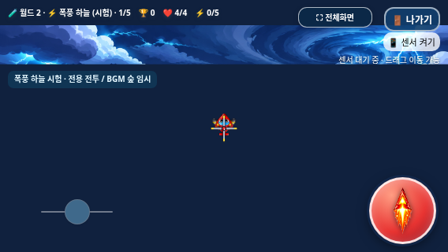

# 폭풍 하늘 배경 contain 수정 — Issue #27

> 후속 기록: [승인된 완전한 배경 PNG 복구](../storm-sky-background-restore/README.md). 아래는 복구 이전 커밋의 개발·검증 이력이며 현재 배경 상태는 후속 보고서를 기준으로 확인하세요.

작업일:2026-11-07 KST · 브랜치:`fix/storm-sky-background-fit` · 기준:`6c3446b7ad079822df80db5045c1f727051d47e4`

**표시 방식 수정은 완료했지만, 원본 PNG 손상으로 ‘완전한 원본 배경 그림 복구’는 미완료다. 손상 없는 `storm_sky_background_1920x864.png`가 필요하다.**

[Issue #27](https://github.com/26aiera11-cpu/helicopter-game/issues/27)을 읽고 최신 원격 Storm Sky/수정 브랜치가 같은 기준임을 확인했다. main은 `c2d03f8`이며 이번 작업에서 main/Pages 설정은 변경하지 않는다.

## 변경

실행 코드 변경은 `assets/storm_sky/storm_sky.js`의 배경 축척 한 곳뿐이다. `Math.max`(cover)를 `Math.min`(contain)으로 바꿔 원본 좌표 전체를 화면 안에 같은 배율로 배치한다. 중앙 정렬·기존 짙은 청색 바탕 `#10213e`·기존 Canvas/DPR 동작은 유지했다. 검은 여백/줄무늬/다른 이미지 확대 덧그리기는 추가하지 않았다.

Storm manifest, index의 내장 manifest, 준비 스크립트의 `render_mode`만 contain으로 맞췄다. 배경 PNG·몬스터/보스 그림·전투·캐릭터·HUD·조작·BGM·world registry는 변경하지 않았다. [기존109자산과 index의 정확한 차분/바이트 검증](preservation.json). 과거 테스트의 고정 해시를 새 해시로 덮어쓰지 않고, 허용한 배경 차분만 역변환하는 보호 계층을 추가했다.

1–5단계 모두 같은 이미지 객체를 사용하며, 분리한 배경 레이어는 단계별 SHA-256이 같다. 원본 파일의 비율·압축·픽셀을 수정하지 않았다.

## 새로 발견한 원본 손상 — 완료를 막는 문제

현재 PNG는393,317바이트다. 처음 제공된 ZIP의 해당 엔트리와 Git 기준 버전, 이번 파일이 모두 바이트 단위로 같다. ZIP CRC는 정상이나 **안에 들어 있던 PNG 자체가 미완성**이다. [출처 비교](source-provenance.json), [실제 디코딩 실패](source-integrity/test-results.json)

- PNG 헤더는1920×864 RGBA8을 선언한다.
- IDAT 이미지 스트림과 IEND가 끝까지 저장되지 않았다.
- 전체 래스터에6,636,384바이트가 필요하지만1,284,205바이트, 완전한 행으로167개만 디코딩된다.
- Pillow의 엄격한 전체 디코딩은 `image file is truncated`로 실패한다.
- Chromium은 일부를 조용히 그려 `complete/naturalWidth` 확인과 해시 비교만으로는 이 손상을 잡지 못했다. 이전 통합 검증에서 이 부분을 놓쳤다.

따라서 contain은 **전달된 이미지의 좌표 크롭**을 해결하지만, 파일에 없는 아래쪽 픽셀은 복구하지 못한다. 원본을 임의로 보완/재생성하거나 부분 디코딩을 정상 전체 이미지로 처리하지 않았다. 완전한 원본 PNG가 도착하기 전까지 수용 완료·배포 가능으로 보고하지 않는다.

## 수정 전후

다음은 실제 Chromium의 같은 게임 상태를 고정해 촬영했다. 이전 화면은 기준 커밋의 실제 cover 코드를 사용했다. **두 쪽 모두 같은 손상된 PNG이므로 아래쪽 그림이 복원된 예시는 아니다.**

| CSS 화면 | 이전 cover | 수정 contain |
|---|---|---|
|915×412|[이전](fit-native/before-915x412.png)|[수정](fit-native/after-915x412.png)|
|800×360|[이전](fit-native/before-800x360.png)|[수정](fit-native/after-800x360.png)|
|568×320|[이전](fit-native/before-568x320.png)|[수정](fit-native/after-568x320.png)|
|1080×360|[이전](fit-native/before-1080x360.png)|[수정](fit-native/after-1080x360.png)|

568×320의 이전 표시는 원본 좌표의 좌우20.125%를 잘랐다. 수정 후에는568×255.6, 위아래32.2px 여백으로 원본 좌표 전체가 들어온다. 1080×360에서는800×360, 좌우140px 여백이다. 800×360은 원본 비율과 같아 여백이 없다. 915×412의 여백은 위아래 약0.125px다.

## 자동 검사

**선택한15개 모음 중13개 통과·2개 실패, 완료190그룹.** 기존61개 전체를 다시 돌렸다고 주장하지 않는다. 배경과 관련된 기존12모음, 신규 contain 일반/오프라인2모음, 신규 PNG 무결성1모음을 실행했다. 실패 모음의 부분16그룹은 통과 합계에 넣지 않았다. [집계/실행 명령](test-summary.json)

- 신규 배경 일반/오프라인 각8그룹 통과.915×412/800×360/568×320/740×360/844×390/960×540/1080×360/1024×600 및 추가 세로360×800에서 실제 소스 좌표100%·원본 비율·중앙 정렬을 확인했다. 세로는 배경 기하 검증이며 세로 UI 지원을 주장하지 않는다.
- 568×320의 실제 DPR2 Canvas1136×640에서 한 번의 균일 배율 그리기와 기존 HUD/DPR 상한을 확인했다. PNG를 재압축하거나 비율을 변형하지 않았다.
- 실제 5개 단계의 배경 레이어 바이트 일치·원본 전체 사각형의 독립 래스터 오라클 일치·짙은 청색 여백·오프라인 외부요청0을 확인했다. 이는 현재 디코딩 가능한 데이터의 표시 검증이며 누락된 픽셀의 존재를 증명하지 않는다.
- 기존 Storm 일반/오프라인/경계44그룹, 기본20/시험35단계,7지역 개발자 시작·음악, 세 캐릭터/무기·아이템/점수·모바일 조작·설원/화산 보스·전체화면/게임오버·패키지 검사를 선택 실행했다.
- **새 실패:**원본 PNG의 전체 디코딩/내부 무결성 실패. 올바른 원본이 필요하다.
- **기존 실패 재현:**`worlds-offline`의 긴 멀티터치 후 설원5단계 나가기 click 누락. [로그](regression/worlds-offline/run.log)·진단·화면을 보존했다. 이번 입력 코드는 바꾸지 않았고, 실패를 없애려 반복 실행하지 않았다. 일반 worlds는 통과했다.

초기 DPR 검사 도구의 지역 변수 `draw`가 게임 함수 `draw()`를 가리는 오류를 고쳤다. 오래된 중복 오프라인 검사는 이 수정 후 중단하고 컨텍스트를 차례로 닫는 방식으로 검증해 메모리 압박을 줄였다. 초기 오류/중단 로그는 `initial-tests/`에 보존했고 제품 코드 문제를 고쳤다고 포장하지 않았다.

## 갤럭시 파일과 한계

수정 코드로 HTML/ZIP을 재빌드했다. [빌드](build.json), [ZIP CRC/바이트 검증](package.json). ZIP에는 최신 HTML 한 개만 있으며 CSS/스크립트/기존 이미지·음악을 모두 내장했다. 실제 추출·해시와 네트워크 차단 실행을 확인했다.

**이 ZIP은 contain 계산 확인용이며 손상된 원본 PNG를 그대로 포함한다.** ZIP CRC 통과는 내장 PNG의 그림 데이터 완전성을 뜻하지 않는다. 완전한 PNG를 받은 뒤 다시 검증·패키징해야 전체 배경 결과물로 승인할 수 있다.

실제 Galaxy Samsung Internet/Chrome의 화면·파일 연결·센서·터치·체감 화질은 미검증이다. 브라우저 정책을 우회하지 않았다. 원본을 받기 전까지 main 병합이나 Pages 배포를 진행하지 않는다.

[현재 수정본 ZIP 다운로드](https://raw.githubusercontent.com/26aiera11-cpu/helicopter-game/refs/heads/fix/storm-sky-background-fit/dist/heli_trio_galaxy_test.zip) · [변경 파일](changed-files.txt)
