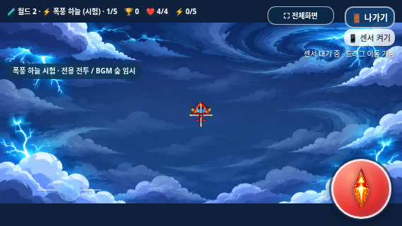

# 폭풍 하늘 승인 원본 배경 복구 — Issue #27

2026-11-07 KST · `fix/storm-sky-background-fit` · 기준 `4549b4993ba8ca19d1a8c5845c4774014a0caa24`

**완전한 승인 PNG로 복구했고 기존 contain 코드는 유지했다.** 기존 설원 나가기 버튼 문제는 별도 미해결 상태다. main 병합이나 GitHub Pages 배포는 진행하지 않는다.

## 적용한 원본

[사용자 확인 댓글](https://github.com/26aiera11-cpu/helicopter-game/issues/27#issuecomment-6698952897)과 `storm_background_fix.zip`을 확인했다. ZIP에는 배경 한 개만 있었고 CRC가 정상이다. [출처/파일 검증](source-package.json)

- 경로: `assets/storm_sky/storm_sky_background_1920x864.png`
- 1920×864 RGB, **1,558,621바이트**
- SHA-256: `96a86d2d0fd191d2b48904dc1a15f4a848d1937e044dc2b23900aaa6ad69817d`
- 첨부 PNG와 현재 파일의 바이트가 같다. 재생성·재압축·크기 변경·색상/디자인 수정은 하지 않았다.
- 엄격한 Pillow 전체 디코딩·각 PNG 청크 CRC·IDAT/zlib 종료·IEND 모두 정상이다. **864행·4,977,504바이트의 RGB8 래스터 전체**가 디코딩된다. [검사 결과](source-integrity/test-results.json)

이전 PNG(393,317바이트, SHA `e5a6c058…`)는 Git 이력에 남겨 두었다. 이전 손상 파일의 진단·실패 기록도 삭제하지 않았다. 새 파일과 혼동하지 않는다.

## 변경 범위와 보호

원본 PNG 한 개, manifest/내장 manifest의 해당 해시, 승인 배경 검증 핀을 갱신했다. **실제 배경 렌더러의 contain 계산·기존 짙은 청색 여백은 기준과 바이트가 같다.** 1–5단계에서 같은 이미지 객체를 사용하며 분리한 배경 레이어 SHA도 모두 같다.

기존109개 자산 중 이 PNG만 승인된 파일로 바꾸고, 나머지는 허용한 manifest/생성기 차분을 되돌리면 기준과 같다. 캐릭터·몬스터·보스 그림, 전투/패턴/수치, 이동/조작, world registry, 점수/아이템/사운드와 기존 BGM 파일은 변경하지 않았다. [보존 검증](preservation.json), [변경 파일](changed-files.txt)

기존 검증 해시는 배경 항목만 승인 값으로 갱신하고, 나머지 과거 보호 핀을 유지했다. 새 배경 복구 계층에서 새 PNG의 길이/해시와 정확한 허용 차분을 검사한다.

## 생성 스크립트

`prepare_assets.py`에 `--background <승인 PNG>` 옵션과 출력 전 엄격한 전체 디코딩/원본 크기 검사를 추가했다. 예전 자산 ZIP의 손상 PNG를 그대로 재출력하려 하면 **아무 자산도 쓰기 전에 실패**한다. 승인 PNG를 지정하면 현재 PNG·매니페스트가 바이트 단위로 재현된다. [양성/음성 검사](generator-verification.json)

```bash
python assets/storm_sky/prepare_assets.py \
  --source-zip <기존 전체 자산 ZIP> \
  --background <이번에 제공된 완전한 PNG> \
  --boss-sprite assets/storm_sky/storm_overlord.png \
  --output <별도 출력 폴더>
```

## 실제 화면 비교

같은 contain 배치에서 **기준 커밋의 손상 PNG**와 **승인된 완전한 PNG**를 실제 Chromium으로 표시했다. 이전 버전의 HTML/렌더러/PNG를 함께 제공해 before를 만들었다. 시드·게임 상태·시간을 고정한 캡처이며 실제 갤럭시 촬영본은 아니다.

| 화면 | 복구 전 | 복구 후 |
|---|---|---|
|915×412|[이전](fit-native/before-915x412.png)|[복구](fit-native/after-915x412.png)|
|800×360|[이전](fit-native/before-800x360.png)|[복구](fit-native/after-800x360.png)|
|568×320|[이전](fit-native/before-568x320.png)|[복구](fit-native/after-568x320.png)|
|1080×360|[이전](fit-native/before-1080x360.png)|[복구](fit-native/after-1080x360.png)|



이전에는 아래쪽이 바탕색만 나왔지만, 복구 후에는 검사한 모든 비율에서 아래쪽 구름/번개가 그려졌다. contain은 그대로여서 568×320은568×255.6/위아래32.2px,1080×360은800×360/좌우140px다. 비율을 늘리거나 가장자리를 자르지 않는다.

## 검사 결과

**선택 검사15개 모음 중14개 통과·1개 기존 미해결 실패, 완료192그룹.** 기존64개 전체를 재실행했다고 보고하지 않는다. PNG/배경 일반·오프라인은 각9그룹과 무결성1그룹, 총19그룹 모두 통과했다. [전체 집계/명령](test-summary.json)

- 915×412,800×360,568×320,740×360,844×390,960×540,1080×360,1024×600 및 추가 세로360×800의 전체 소스 좌표/원본 비율/중앙 정렬을 검사했다. 세로는 배경 기하 검증만 했다.
- 1–5단계 배경 레이어가 같고,9개 비율 모두 실제 하단 그림 영역이 채워진다. 전체 원본 사각형의 독립 래스터 오라클과 표시 결과가 바이트 단위로 일치했다.
- 실제 DPR2 Canvas1136×640에서568×320 CSS 배치를 검사했다. 원본 해상도와 기존 DPR 상한/보간 동작을 유지했다.
- Storm 일반/보스44그룹, 세 캐릭터/무기·일반 진행/35단계 시험·점수/아이템·7지역 직접 시작/음악·설원/화산 보스·모바일 조작/전체화면·패키지를 선택 회귀했다.
- **알려진 설원5 나가기 문제:**이번 `worlds` 일반 검사의 긴 멀티터치 후 종료창 click 누락이 재현됐다. [로그](regression/worlds/run.log)·진단·화면을 유지한다. 이 모음의 부분16그룹은 합계에서 제외했다. `worlds-offline`19그룹은 통과했지만 해결로 주장하지 않는다. 조작 코드는 수정하지 않았고 실패를 숨기려 반복 검사하지 않았다.

검사 JSON에 반복되는 대용량 data URI만 MIME/길이/SHA-256 참조로 요약했다. 원본 자원 바이트는 assets와 단일 HTML에 보존했고 결과 플래그·수치·좌표·실패 로그는 유지했다.

## 갤럭시 패키지

최신 HTML/ZIP을 재생성했다. 이미지·CSS·22스크립트·모든 기존 음악을 내장하고 외부 리소스가 필요 없다. ZIP에는 최신 HTML 한 개만 있다. [빌드](build.json), [크기/해시/CRC/추출 검증](package.json)

- 새로운 배경의 data URI 바이트가 승인 PNG와 같고, 내장 manifest 해시도 같다.
- 일반·네트워크 차단 오프라인 실행, ZIP CRC·실제 별도 추출·전체 바이트/해시를 확인했다.
- 실제 Galaxy Samsung Internet/Chrome의 파일 연결·손가락/센서 조작·체감 화질·장시간 성능은 실기기 추가 확인이 필요하다.

[최신 갤럭시 ZIP 다운로드](https://raw.githubusercontent.com/26aiera11-cpu/helicopter-game/refs/heads/fix/storm-sky-background-fit/dist/heli_trio_galaxy_test.zip)

이 보고서는 이전의 ‘완전한 원본 PNG 대기’ 상태를 대체한다. 과거 손상 원본/실패 기록은 이력으로 유지한다. **main 병합과 Pages 배포는 진행하지 않는다.**
