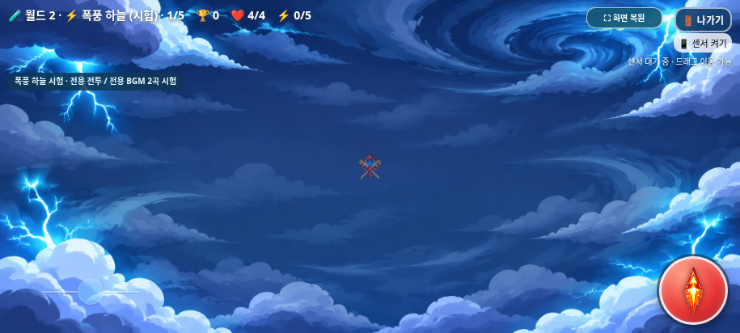
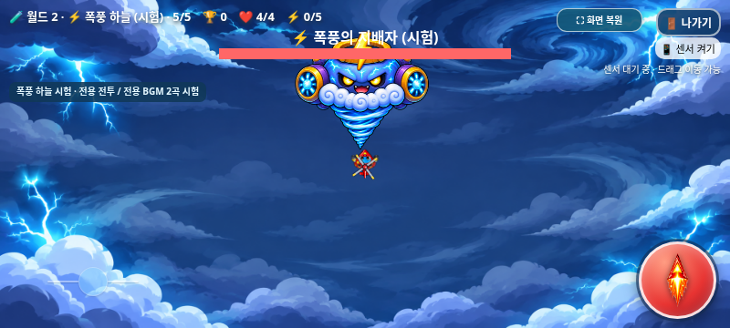
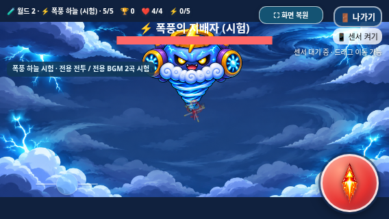

# 폭풍 하늘 전용 BGM — Issue #28 청취 시험판

2026-11-07 KST. **사용자 청취 승인 대기**이며 승인된 정식 음악으로 확정하지 않았다.
[Issue #28](https://github.com/26aiera11-cpu/helicopter-game/issues/28)의 전체 명세를 확인하고 기존 `feature/storm-sky-bgm`을 사용했다. 기준은 배경 복구 완료 브랜치 `fix/storm-sky-background-fit`의 `e18c53000ff7412bca352e5bdb3fa887619ed4c9`이다. main 병합 및 Pages 설정 변경·배포는 하지 않는다.

## 개별 청취 파일

| 파일 / 직접 다운로드 | 구성 | 길이 | WAV 크기 |
| --- | --- | ---: | ---: |
| [일반 전투 storm_sky_stage.wav](https://raw.githubusercontent.com/26aiera11-cpu/helicopter-game/refs/heads/feature/storm-sky-bgm/assets/audio/storm_sky_stage.wav) | 148 BPM · D minor · 4/4 · 16마디 | 25.945941초 | 1,144,260바이트 |
| [폭풍의 지배자 storm_sky_boss.wav](https://raw.githubusercontent.com/26aiera11-cpu/helicopter-game/refs/heads/feature/storm-sky-bgm/assets/audio/storm_sky_boss.wav) | 120 BPM · F minor · 4/4 · 16마디 | 32초 | 1,411,244바이트 |

둘 다 PCM16·22,050Hz·모노이다. 합계 2,555,504바이트로 3.5MB 제한 이내다. 브라우저에서 WAV 링크를 열면 직접 청취할 수 있으며 메뉴의 다운로드 기능으로 저장할 수 있다.

## 제작 및 재현

`scripts/generate_storm_sky_bgm.py`는 Python과 NumPy로 음표·화성·리듬·악기를 직접 합성한다. 고정 시드는 일반 280148, 보스 280120이다. 샘플이나 기존 WAV/MP3를 읽지 않으며 화산 생성기를 호출하거나 악보를 전조해 사용하지 않는다. 두 곡의 음표 배열·화성 진행·리듬 배치는 새로 작성했다. 화산 원곡 및 생성 스크립트는 변경하지 않았다.

일반곡은 Dm/Gm/Bb/A 계열 진행에 상승·하강하는 16분음표 유리 전자음과 짧은 리드를 배치했다. 4마디 단위로 응답 음역·쉼표·필인을 달리한다. 보스곡은 Fm/Db/Ab/C 계열 진행, 낮은 펄스 베이스, 전자 킥·스네어, 짧은 리드와 번개 응답음을 사용했다. 고음이 계속 쌓이지 않도록 응답 사이에 여백을 두었다. 긴장감과 질감은 청취 후 조정할 수 있는 시험값이다.

```sh
python scripts/generate_storm_sky_bgm.py --output-dir /tmp/storm-bgm-reproduction
python tests/storm_sky_bgm.py --artifacts /tmp/storm-bgm-native
python tests/storm_sky_bgm.py --standalone --artifacts /tmp/storm-bgm-offline
python scripts/build_galaxy_test.py
python scripts/package_galaxy_test.py
```

고정 시드로 만든 출력이 저장된 두 WAV와 바이트 단위로 재현된다. 음표/잔향 꼬리는 반복 경계를 순환하도록 합성하고 양끝에는 1.5ms 테이퍼를 적용했다. 피크는 일반 0.48154 / 보스 0.56445, RMS는 0.08499 / 0.09899, DC는 각각 약 -0.00000223 / -0.00000172다. 클리핑은 0개, 양끝 샘플 차이는 0이며 100ms 단위 무음 구간이 없다. 파일의 수치 검사와 네이티브 재생기 반복 통과를 확인한 것이며, 실제 이어폰·스피커에서 반복 연결과 음색이 자연스러운지는 사용자 청취가 필요하다. [음원 메타데이터](audio-metadata.json)

## 최소 적용 범위

- `index.html`: 숨겨진 WAV 플레이어 2개와 기존 stageTracks/bossTracks 끝의 Storm 항목만 추가했다. 기존 단일 음악 소유자, 자동재생 제한/다음 사용자 동작 재시도, 게임 오버·나가기·선택곡 전환 코드를 그대로 사용한다. 음악 버튼은 추가하지 않았다.
- `assets/worlds/worlds.js`: **폭풍 하늘 ID6만 musicProfile5**를 사용한다. 월드1 0/1/2/3, 설원0, 화산4는 유지한다. 일반 1~4단계 및 정상 진행 5단계 보스 전 일반전은 일반곡, 보스 생성 및 개발자 직접 5단계는 보스곡이다. 시험 안내의 Storm 숲 임시 BGM 문구만 전용 2곡 시험으로 바꿨다.
- 기존 미디어 볼륨은 일반 `.42`, 보스 `.58`, 선택곡 `.34`로 유지했다. 새 WAV RMS를 화산곡보다 약간 낮게 두어 효과음의 공간을 확보했다. 실제 청취 시 효과음 가림 여부는 아직 승인되지 않았다.
- 숨김/복귀, 음악 OFF/ON, 효과음 독립 설정, 게임 오버 3초 무음과 메뉴 MP3 복귀, 전체화면 및 내부 종료 확인창을 보호한다.
- `scripts/build_galaxy_test.py`, `scripts/package_galaxy_test.py`: 두 WAV의 원본 바이트가 단일 HTML에 들어가는지 명시적으로 검사한다.
- 새 검사는 기준의 기존 **109개 자산 중 월드 레지스트리 1개만 음악 프로필·안내 3차분을 변경**하고, 나머지108개는 원본 바이트를 유지한다. index도 숨김 플레이어·트랙 배열 3차분만 허용한다. 이 허용 차분을 정확히 되돌린 뒤109개 자산 및 index 전체를 기준과 비교한다. 과거 검사도 이 정확한 오디오 차분만 되돌린 뒤 기존 해시를 계속 검사한다. 15→17개 공유 미디어 수 및 Storm 전용 라우팅 기대값을 갱신했으며 테스트 실패를 무시하는 처리는 추가하지 않았다.

승인 배경 PNG의 SHA256은 `96a86d2d0fd191d2b48904dc1a15f4a848d1937e044dc2b23900aaa6ad69817d` 그대로다. contain 렌더러·다른 배경·플레이어 및 적 그래픽·모든 전투/아이템/점수/저장/센서/조이스틱 코드는 기준과 같다. [보존 결과](preservation.json)

## 브라우저 검증

실제 Chromium에서 오디오 `play/pause` 이벤트, `paused/ended/volume/readyState/duration/currentTime`와 프레임별 활성 곡을 관측했다. 자동재생을 허용하는 플래그를 사용하지 않았다. HTTP 검사는 `/helicopter-game/` 프로젝트 접두사에서 실행했고, 오프라인 검사는 빈 문서를 준비한 뒤 네트워크를 차단하고 최신 독립 HTML을 실행했다. 이 검사는 실제 GitHub Pages 배포가 아니다.

일반/오프라인 각각 새 BGM 19그룹을 통과했다. 세 캐릭터×3가로 화면(915×412,800×360,568×320)×일반/보스 18경로, 일반1~4단계, 보스 직접 시작, 5단계 일반 적 6처치 후 곡 전환, 기존 7지역 전 곡, 네이티브 WAV 반복, 음악/효과음 개별 OFF/ON, 게임 오버 3초 무음→메뉴, 나가기 취소/확정, 클리어 보상/메뉴 복귀, 숨김/복귀, 12회 반복 시작·복귀를 검사했다. 모든 재생 경로에서 시간이 증가했고 관측된 공유 미디어 17개 중 동시 BGM은 최대1개였다. 최초 미접촉 때는 재생 시도가 없고, 주입한 재생 거부는 오류 없이 처리한 후 다음 실제 터치에서만 재시도했다. 오프라인 음원 요청과 누락 리소스는 0개다.

재생 거부 및 문서 숨김 상태는 해당 분기만 의도적으로 모의했다. 전투 전환은 좌표·체력·무적·생성 대기를 제어했고 음원 재생 자체는 브라우저 네이티브 호출이다. 실제 갤럭시 Samsung Internet/Chrome, 스피커 청취, 센서 실물, 장시간 발열/배터리는 검증하지 않았다.

등록된66모음 중 관련21모음을 실행해 **19통과·2기존 미해결 실패, 완료297그룹**이다. 새 음악38그룹을 포함한다. 실패한 worlds 일반/오프라인의 부분16그룹씩32그룹은 완료 합계에서 제외했다. 66모음 전체를 재실행했다고 주장하지 않는다. [집계와 실행 명령](test-summary.json)

기존 음악 bgm_smoke의 최초 시도는 반복 플레이어 수11을 기대해 실패했다. 새 구성13개로 기대값을 갱신한 뒤9그룹을 통과했다. [최초 실패](prior-bgm-smoke-attempt/bgm_smoke/run.log), [수정 후](corrected-bgm-smoke/bgm_smoke/run.log)를 모두 보존한다.

원본 로그는 그대로 보존했다. JSON 보고서의 중복 data URI15개만 길이/MIME/SHA256 지문으로 바꿔 자산 중복 업로드를 줄였으며 성패·수치·이벤트·진단은 유지했다. [원본/공개 보고서 해시](report-artifact-manifest.json)에 양쪽 해시와 크기를 기록했고 실제 바이트는 원본 자산 및 독립 HTML에 포함되어 있다.

[설원 일반 실패 로그](regression/worlds/run.log) / [진단](regression/worlds/exit-touch-failure.json), [오프라인 실패 로그](regression/worlds-offline/run.log) / [진단](regression/worlds-offline/exit-touch-failure.json). **기존 설원5단계 긴 멀티터치 이후 나가기 버튼 click 누락은 별도 미해결**이다. 기존 실패 기록을 보존하며, 다른 회차 통과를 해결 근거로 삼지 않는다. 이번 작업에서 조작 코드는 변경하지 않았다.





## 갤럭시 패키지

[최신 갤럭시 ZIP 다운로드](https://raw.githubusercontent.com/26aiera11-cpu/helicopter-game/refs/heads/feature/storm-sky-bgm/dist/heli_trio_galaxy_test.zip)

ZIP은 **53,247,209바이트(약50.78MiB)**이며, 최신 `heli_trio_galaxy_test.html`(72,960,078바이트) 하나만 있다. 두 새 WAV, 기존 음악과 모든 이미지/CSS/JavaScript를 포함하고 외부 의존성은 0개다. CRC와 별도 디렉터리 압축해제·HTML 전체 바이트 동일성, WAV 두 개와 복구 PNG 원본 해시를 검사했다. [빌드](build.json), [ZIP](package.json), [실제 압축해제/내장 바이트](embedded-verification.json)

사용자가 두 곡을 직접 듣고 승인하면 후속 작업을 진행한다. main 병합·GitHub Pages 배포는 이번 작업에 포함하지 않는다.

## 회귀 검사별 결과

| 모음 | 결과 | 완료 그룹 |
| --- | --- | ---: |
| volcano_bgm-native | 통과 | 17 |
| volcano_bgm-offline | 통과 | 17 |
| selection_bgm | 통과 | 14 |
| storm_sky-native | 통과 | 19 |
| storm_sky-offline | 통과 | 19 |
| storm_sky_edges | 통과 | 6 |
| storm_background_integrity | 통과 | 1 |
| selection_bgm-offline | 통과 | 14 |
| developer_start-native | 통과 | 18 |
| worlds | 기존 설원 나가기 실패 | 0 |
| developer_start-offline | 통과 | 18 |
| volcano_mixed-native | 통과 | 13 |
| volcano_boss-native | 통과 | 16 |
| worlds-offline | 기존 설원 나가기 실패 | 0 |
| snowfield_boss-native | 통과 | 19 |
| mobile_controls | 통과 | 23 |
| scoring | 통과 | 17 |
| galaxy_standalone | 통과 | 19 |
| bgm_smoke | 통과 | 9 |
| storm_sky_bgm-native | 통과 | 19 |
| storm_sky_bgm-offline | 통과 | 19 |
