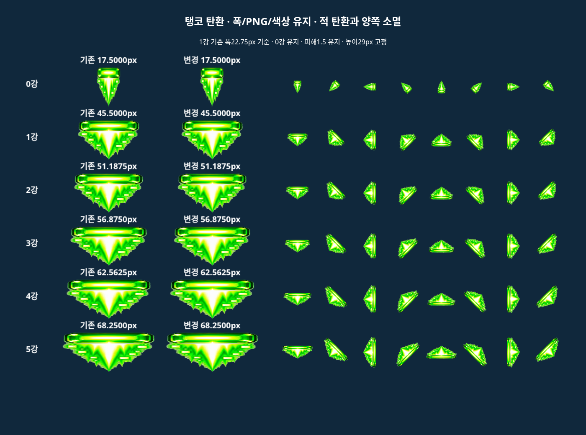
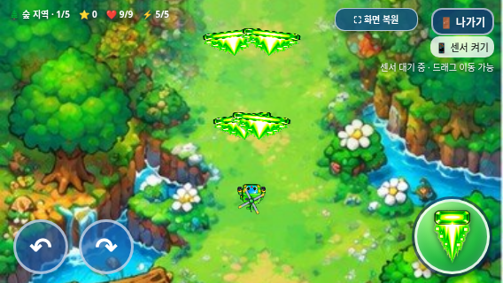

# 탱코 관통 조정·적 탄환과 양쪽 소멸

2026-11-02 KST · feature/selection-screen-integration · 기준287629fb7a1bc91d359375f253aef23ef376dcaf.

제품 수정은 index.html 두 곳뿐이다. 몬스터 관통 표를 바꾸고, 적 탄환 차단 시 관통1회 소비 대신 양쪽 life를0으로 만든다. 기존 hit 배열·소진 즉시 필터/그리기 생략을 그대로 재사용한다. 한 충돌에서 첫 번째 살아 있는 탱코 탄환1개만 선택하고 즉시 반환하므로 중복 소모를 막는다. 이미 소멸한 적 탄환은 다시 처리하지 않는다.

| 강화 | 이전 몬스터 관통 | 새 몬스터 관통 |
| --- | ---: | ---: |
| 0 | 2 | 2 |
| 1 | 3 | 3 |
| 2 | 3 | 3 |
| 3 | 5 | 4 |
| 4 | 6 | 4 |
| 5 | 7 | 5 |

몬스터/보스는 기존처럼1.5 피해/잔여 관통1회를 쓰며 같은 대상에는 한 탄환당1회만 피해를 준다. 잔여가 남으면 전진하고 소진하면 즉시 제거된다. 적 탄환에는 관통 잔량과 관계없이 서로 소멸하므로 한 탱코 탄환당 최대1개 차단이다. 트리오·빙글은 차단하지 않는다.

피해1.5, 폭17.5/45.5/51.1875/56.875/62.5625/68.25px, 높이29px, 탄속410px/s·연사/이동·체력·이미지/색상·실제 회전 판정, 보스 HP/패턴/보상,3초 게임 오버·일반 아이템 보존·선택 UI/음악·전체화면을 유지했다. 전체 소스를 이번 두 치환만 역변환하면 기준과 같고 assets/이미지URL71개/WAV12개도 바이트가 같다.

## 동일 조건의 실제 변경 전후 비교

[4지역×0~5강 처치 시간 및12초 차단/플레이어 도달 전체표](balance/boss-and-defense-comparison.md) · [원자료·동일 탄막 증명](balance/test-results.json).

두 실제 HTML을 각각 Chromium에 로드했다. 거리160px, 정지/무적 플레이어, 매 틱 중심 조준, 기존 등장 전환1.5초/초기 쿨다운0, 같은 HP 배율이다. 12초 방어 검사는 테스트에서만 보스 HP를1,000,000으로 해 생존시켰다. 적 탄환의 발사 프레임·좌표·속도·반경·수명 배열을 정확히 대조하고 SHA-256을 저장했다. 플레이어 발사 수/속도도 같았다. 아래는120Hz에서4지역의12초 표본을 합산한 값이며60Hz도 별도 교차 검사했다.

| 강화 | 적 발사 | 기존 차단 | 새 차단 | 기존 도달 | 새 도달 |
| --- | ---: | ---: | ---: | ---: | ---: |
| 0 | 121 | 77 | 72 | 0 | 0 |
| 1 | 121 | 115 | 95 | 0 | 0 |
| 2 | 121 | 120 | 118 | 0 | 0 |
| 3 | 121 | 121 | 118 | 0 | 0 |
| 4 | 121 | 121 | 118 | 0 | 0 |
| 5 | 121 | 121 | 118 | 0 | 0 |

발사 총726발 중 차단은 **675→639발**, 기존 차단 수 대비 **5.33% 감소**였다. 사막1강54→35발,5강60→57발이다. 플레이어 도달은 두 버전 모두0이었다. 도달은 무적 중에도 실제 적 탄환/플레이어 충돌을 세며, 빗나간 탄/비행 중인 탄과 구분한다.

탱코5강 처치 시간은 숲3.458→3.458초, 바위6.025→6.025초, 바다8.567→8.567초, 사막11.092→13.658초다. 사막1강은11.092→16.225초다. 트리오/빙글 처치 시간은 모든 표본에서 정확히 같다. 모든 비교 전투는 처치·보상이 완료됐다.

## 통과한 검사·남은 균형 문제

총 **138개 그룹 통과**. [요약 JSON](test-summary.json).

| 검사 | 통과 그룹 |
| --- | ---: |
| Tanko browser | 14 |
| Tanko offline | 14 |
| old/new balance | 3 |
| bgm | 9 |
| boss-reward | 8 |
| exit-dialog | 10 |
| game-audit | 11 |
| game-over | 7 |
| health-scaling | 4 |
| items | 7 |
| selection | 15 |
| tanko | 8 |
| trio | 9 |
| galaxy standalone | 19 |

일반 웹/독립 HTML 전용 검사는 각각14개 그룹이다. 모든 강화의 정확한 몬스터 관통 수/실제1.5 피해·보스 한 번 타격·몬스터 소진·양쪽 소멸·잔량 무관·동일 적 탄환에 여러 탱코 탄환 겹침·같은 프레임20발 중1발만 차단·트리오/빙글 차단 없음·48개 실제8방향 draw/판정·수명/3가로 화면·전체화면/종료를 검사했다. 기존20웨이브·4보스/보상·BGM/3초 게임 오버·아이템/선택/이미지 회귀도 통과했다.

남은 문제를 통과 수와 구분한다. 정면 조준/연사 표본의 실제 플레이어 도달은120Hz/60Hz 모두0이라, 이 변경만으로 정면 방어가 충분히 약해졌다고 할 수 없다. 사막1강은0강14.292초보다 느린16.225초였다. 적 탄환에 공격 탄환을 소모하면서 생긴 균형 결과다. 이전 HP 테스트의 “모든 탱코 강화가 무강화보다 빠름” 조건은 이 규칙에서 실패했다. HP값/등장 고정과 트리오·빙글의 강화 이점 검사는 유지하고, 탱코 예외는 balance finding으로 명시한다. 보호 대상 HP 배율/연사/탄속을 테스트 통과용으로 조정하지 않았다.

실제 갤럭시 Samsung Internet/Chrome·Android 주소창/파일 열기·센서·스피커·성능/발열은 미검증이다. 관리형 Chromium의 file:// 정책 차단 때문에 같은 HTML을 새 빈 문서에 주입하고 오프라인 검사했으며 직접 로컬 파일 성공으로 기록하지 않았다. 오디오 상태 검사는 실제 청취와 구분한다. 전투는 제어 조준/무적 비교로 사람의 실전 난이도/수동 완주가 아니다.

## 갤럭시 결과물

[최신 ZIP](https://github.com/26aiera11-cpu/helicopter-game/raw/refs/heads/feature/selection-screen-integration/dist/heli_trio_galaxy_test.zip?download=1) · [실행 안내](../galaxy-test/README.md) · [압축·최신 기능 확인](package-verification.json).

HTML/ZIP을 현재 소스로 다시 만들었다. ZIP에 HTML1개만 있고 CRC/unzip -t/실제 추출 바이트/해시 및 새 관통 표·양쪽 소멸·원문 스크립트 내장을 확인했다. main 병합·Pages 배포는 하지 않는다.

