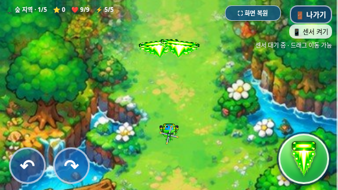

# 탱코 연사 속도20% 감소 검증

2026-11-02 KST · feature/selection-screen-integration · 기준f622f3f9c8e82f390b40883abd1abd8f6b9e7f71.

제품 수정은 index.html의 발사 후 fireCooldown 계산 끝에 **탱코만×1.25**를 붙인 한 곳이다. 0강0.28→0.35초,1~5강0.2296→0.287초. 기존 강화×0.82와 첫 발사 조건/시작 코드는 그대로다. 이상적인 초당 발사율은 기존의80%다. 트리오·빙글에는×1을 적용하며 원래 데이터가 정확히 같다.

피해1.5·폭/높이29·탄속410·관통[2,3,3,4,4,5]·적 탄환과 양쪽 소멸·일반/보스 타격·이미지·연사 외 이동/체력·보스 HP/보상·3초 게임 오버·아이템 보존·선택/음악/전체화면은 유지했다. 이 곱셈만 역변환하면 전체 index가 기준과 같고 모든 assets·이미지URL71개/WAV12개도 바이트가 같다.

## 정확한 간격과 실제 횟수

0~5강·세 캐릭터·120/60Hz·최초 쿨다운0/0.18초의144개 조합에서 정확한 배율, 첫 발사 시각/탄환 데이터, 트리오·빙글 전체 발사 기록 일치를 확인했다. 아래는12초의 실제 발사 동작 수다. 첫 발 포함과 기존 프레임 단위 처리가 있어서 이상적인80%와 다르며, 프레임 처리 로직을 추가 변경하지 않았다.3/5강은 동작당2발이므로 실제 생성 탄환도 비교표에 따로 기록했다.

| 조건 | 기존 발사 동작 | 새 발사 동작 | 기존 대비 |
| --- | ---: | ---: | ---: |
| 120Hz·0강 | 43 | 35 | 81.40% |
| 120Hz·1강 | 52 | 42 | 80.77% |
| 120Hz·3강 | 52 | 42 | 80.77% |
| 120Hz·5강 | 52 | 42 | 80.77% |
| 60Hz·0강 | 43 | 33 | 76.74% |
| 60Hz·1강 | 52 | 40 | 76.92% |
| 60Hz·3강 | 52 | 40 | 76.92% |
| 60Hz·5강 | 52 | 40 | 76.92% |

## 동일 보스 패턴·방어와 처치 시간

[120Hz/60Hz의4종 보스×0/1/3/5강 전체 비교표 및0~5강 정상 HP 처치 시간](balance/comparison.md) · [원자료/탄막 일치 증명](balance/test-results.json).

기존/새 실제 HTML을 별도 페이지에서 검사했다. 거리160px·정지·매 틱 중심 조준, 기존 등장 전환1.5초/초기 쿨다운0.12초 방어 검사에서만 보스 HP를1,000,000으로 해 생존시켰고 플레이어는 실제9HP/기본 피격 무적을 유지했다. 정상 HP 처치 시간은 별도 무적 플레이어 비교다. 적 탄환의 발사 프레임·좌표·속도·반경/수명 배열은 두 버전이 정확히 같다. 도달은 피격 무적 중에도 실제 적 탄환/플레이어 충돌을 세며, 통과는 차단·도달 없이 화면 밖/수명 종료로 사라진 탄이다.12초 끝에 비행 중인 탄은 별도로 기록해 합계 누락을 막았다.

아래 합계는 각 Hz의4지역×4강화 조건16개의12초 표본 합계다.

| Hz | 값 | 기존 | 새 버전 |
| --- | --- | ---: | ---: |
| 120 | 탱코 발사 동작 | 796 | 644 |
| 120 | 생성 탄환 | 1212 | 980 |
| 120 | 보스 발사 | 484 | 484 |
| 120 | 차단 | 403 | 391 |
| 120 | 플레이어 도달 | 0 | 0 |
| 120 | 통과/만료 | 48 | 54 |
| 120 | 비행 중 | 33 | 39 |
| 60 | 탱코 발사 동작 | 796 | 612 |
| 60 | 생성 탄환 | 1212 | 932 |
| 60 | 보스 발사 | 484 | 484 |
| 60 | 차단 | 403 | 393 |
| 60 | 플레이어 도달 | 0 | 0 |
| 60 | 통과/만료 | 49 | 55 |
| 60 | 비행 중 | 32 | 36 |

새 버전32개 조건 모두 **도달0회**였다. 일부 탄환이 더 통과하지만 실제로 플레이어를 때리는 정면 방어벽의 틈은 확인되지 않았다. 일부러 차단할 탄환 없이 적 탄환1개를 맞히는 교정 검사에서는 기준/새 버전 모두 도달1·피해1·HP9→8로 검출했다.0회라는 결과를 측정기의 무감지와 혼동하지 않는다.

120Hz 사막1강 정상 HP 처치16.225→25.792초,5강13.658→19.958초다. 모든288개 전투는 처치/보상 완료했고 트리오·빙글은 전투 통계까지 정확히 같았다. 바다·사막1강이0강보다 느린 역전은 남아 있다. 요청대로20% 외 추가 연사·탄속·폭·HP 등의 튜닝은 하지 않았다.

## 실제 검사

총 **123개 그룹 통과**. [요약 JSON](test-summary.json).

| 검사 | 통과 그룹 |
| --- | ---: |
| cadence/first shot | 5 |
| matched balance | 4 |
| Tanko browser | 14 |
| Tanko offline | 14 |
| bgm | 9 |
| boss-reward | 8 |
| exit-dialog | 10 |
| game-audit | 11 |
| game-over | 7 |
| items | 7 |
| selection | 15 |
| galaxy standalone | 19 |

탱코 관통/상호 소멸,1.5 피해/8방향 판정/실제 뒤·측면 피격, 트리오·빙글 공격/연사, 보스4종/보상,20웨이브·별160, 선택/3초 게임 오버, 아이템 보존, 음악/ON-OFF/재시작, 실제 표준 전체화면/종료창,915×412/800×360/568×320 터치를 검사했다. 브라우저 기본 대화상자·외부 요청/실패 자산·잡히지 않은 JS 오류는 없었다.

실제 Galaxy Samsung Internet/Chrome·Android 파일 열기/주소창/센서·스피커 청취·성능은 미검증이다. file://는 관리 브라우저 정책이 차단해 같은 HTML을 새 문서에 주입하고 오프라인 검사했다. 직접 로컬 파일 실행 성공으로 기록하지 않았고 정책을 우회하지 않았다. 전투는 제어 조준 비교이며 사람의 난이도/수동 완주는 아니다.

## 갤럭시 파일

[최신 ZIP 다운로드](https://github.com/26aiera11-cpu/helicopter-game/raw/refs/heads/feature/selection-screen-integration/dist/heli_trio_galaxy_test.zip?download=1) · [실행 안내](../galaxy-test/README.md) · [압축/최신 코드 확인](package-verification.json).

현재 HTML과 ZIP을 재생성했다. ZIP에 HTML1개만 있고 CRC/unzip -t/실제 압축 해제 후 바이트·해시 일치, 새 간격 배율과 현재 원문 JS3개+선택 JS 내장을 확인했다. main 병합·GitHub Pages 배포는 하지 않는다.

