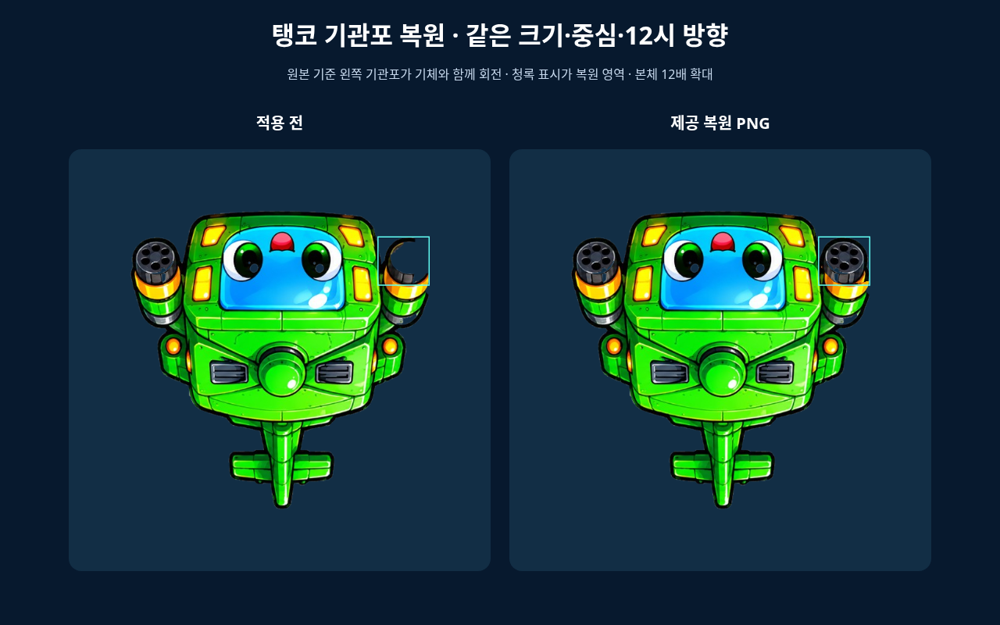
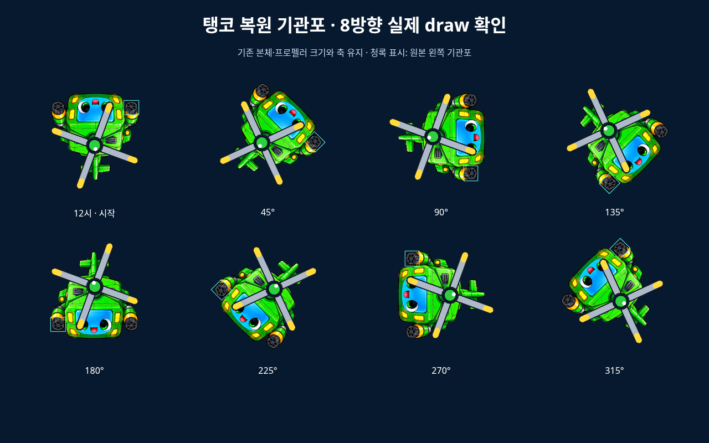
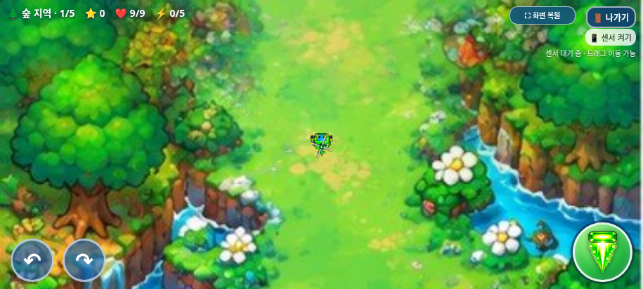

# 탱코 플레이용 왼쪽 기관포 복원 PNG 적용

2026-11-01(KST) · `feature/selection-screen-integration` · 시작 HEAD `08f3bd87cde0bccd09f6a9ad31c46c0bc1ad34df`

## 제공 파일과 적용 범위

사용자가 첨부한 `tanko_cannon_fix_for_codex.zip`의 **`tanko_gameplay_cannon_restored.png`만** 플레이용 이미지로 가져왔다. ZIP 안의 설명문과 비교 이미지는 참고자료로 확인했으며, 사용자 직접 요청이 작업 범위를 정한다. 설명문을 실행하거나 추가 작업의 권한으로 취급하지 않았다. 비교 이미지를 게임 자산으로 넣지도 않았다.

- 적용: [assets/gameplay/tanko_gameplay_cannon_restored.png](../../../assets/gameplay/tanko_gameplay_cannon_restored.png)
- **503×490, RGBA, 314,182바이트**, SHA-256 `77c71f6efe44020e6fcaa04888f0cc1758d49fbed3f315f47638ac591e413db2`.
- 변경 전 데이터: [백업](../../../backups/tanko-gameplay.before-cannon-restoration.png), SHA-256 `f541a1141d440e12e1812cb3bd782e751efe082071dce730a2cdeebc00870747`.
- 제공 ZIP에서 읽은 PNG와 적용 파일·내장 PNG는 바이트가 동일하다. 재생성·재그리기·자르기·리사이즈·재저장·알파 정리는 하지 않았다.
- 이전/복원 PNG의 크기와 알파 바깥 범위 **(6,6)–(497,484)**가 같다.
- 보이는 픽셀 차이는 원본 좌표 **x=6~89, y=365~441**의 기관포 영역에 한정된다. 제공본에는 완전 투명 픽셀의 숨겨진 RGB 차이도 99,983개 있으나 모두 알파 0이며 화면에 보이지 않는다. 이 역시 제공된 파일 그대로 유지했다.

실제 제품 수정은 **`gameplayHeliImages[2]`의 PNG 데이터 URL 한 곳**이다. 이 값을 이전 것으로 돌린 전체 `index.html`이 시작 커밋과 완전히 일치한다. 렌더링 코드는 바꾸지 않았다.

| 요소 | 유지한 값/상태 |
| --- | --- |
| 플레이 본체 | 기존 `(-16.33,-16.33,32.67,32.67)` 그리기 |
| 시작/회전 | 기존 `Math.PI`의 12시 시작, 기존 회전 코드 |
| 프로펠러 | 기존 38×38, 로컬 축 (0,-3.2), 이미지·회전 유지 |
| 탱코 능력 | 기존 체력 9, 속도 설정 204 |
| 기본 탄환 | 기존 전방 19px, 탄속 410, 피해 2·관통 2 |
| 이동·피격 | 기존 드래그/회전·가속·피격 반경 유지 |
| 다른 자산 | 선택화면 탱코·트리오·빙글·탄환·적·보스·음원 모두 동일 |
| 기존 기능 | BGM N1·보스 보상 N2·전체화면·종료 모달 유지 |

## 8방향·실제 브라우저 검증

실제 Chromium의 draw 호출과 변환 행렬을 관찰했다. 청록색 표시와 확대는 검증용 화면에만 있으며 게임 코드에는 추가하지 않았다. **왼쪽은 원본 PNG 기준**이므로 12시 방향으로 기체가 180° 돌아가면 화면 오른쪽에 보인다.







[실제 플레이 적용 전](tanko-gameplay-before.png) · [800×360](tanko-gameplay-800.png) · [568×320](tanko-gameplay-568.png).

- 0/45/90/135/180/225/270/315°에서 복원 기관포가 정상적으로 보이고 잘리지 않는지 확인했다. 실제 본체/프로펠러 그리기 크기·축·발사 벡터가 동일했다.
- 실제 전체화면에서 선택·시작했고 터치 회전·날개 애니메이션·위쪽 발사·드래그 이동·선택화면 복귀도 검사했다.
- 5px 적 탄환은 중심 거리 17.1px에서 안전, 16.9px에서 체력 9→8로 기존 12px 피격 판정을 유지했다.
- 실제 플레이 전후는 동일 위치·배경 스크롤·날개 각도를 고정해 캡처했다. ‘전’은 테스트 메모리에서 백업 PNG를 일시 사용했고 제품 파일은 되돌리지 않았다.
- 선택화면·다른 캐릭터·20개 웨이브·네 보스·무기/아이템·BGM·보스 자동 보상·전체화면·종료 확인창 회귀가 통과했다.

| 실행한 검사 | 통과 그룹 |
| --- | --- |
| `tests/tanko_cannon.py` | 8 |
| `tests/selection_smoke.py` | 15 |
| `tests/game_audit.py` | 11 |
| `tests/trio_body.py` / `tests/trio_final.py` | 9 |
| `tests/bgm_smoke.py` | 9 |
| `tests/boss_reward.py` | 8 |
| `tests/exit_dialog.py` | 10 |
| `tests/galaxy_standalone.py` | 18 |

총 **88개 검사 그룹 통과**. 원본 보호 검사는 이번 PNG 한 곳만 분리해 허용한다. `tests/tanko_preservation.py`에서 제공본과 백업의 고정 SHA-256도 검사한다.

```sh
python -B tests/tanko_cannon.py --artifacts /absolute/path/to/tanko-review
```

결과: [탱코](test-results.json), [선택](selection-regression.json), [전체 기능](game-audit.json), [트리오](trio-regression.json), [BGM](bgm-regression.json), [보스 보상](boss-regression.json), [종료창/전체화면](exit-regression.json), [단일 HTML](../galaxy-test/test-results.json).

## 갤럭시 파일과 한계

- HTML: **28,736,448바이트**, SHA-256 `d304864b844fbd133e6e6325a1e87a5c8c640b528be1c2370f807841f32b78e1`.
- ZIP: **20,758,716바이트**, SHA-256 `705aeee927c4cf057340e5a524e78c623d9e1de1fa58b6cc4936c21e1cab3bb5`.
- ZIP에 최신 HTML 1개만 있으며 CRC·`unzip -t`·실제 압축 해제 후 바이트 일치를 확인했다. 제공 PNG가 내장된 바이트도 동일하다.
- [실행·다운로드 안내](../galaxy-test/README.md) · [제공본/패키지 무결성](package-verification.json).

실제 Galaxy Samsung Internet/Chrome·센서·스피커·성능·Android UI는 미검증이다. 관리자 정책상 `file://` 직접 실행은 차단되어 같은 HTML을 새 문서에 주입하고 오프라인으로 검사했다. 정책을 우회하지 않았다. 전투·보스 경로는 상태·조준을 제어한 검사이며 실제 난도로 수동 완주한 것은 아니다. 새 진행 차단이나 자산 누락·잡히지 않은 JS 오류는 발견하지 못했다.

작업 브랜치에만 커밋·푸시하며 `main` 병합·GitHub Pages 배포는 하지 않는다.
