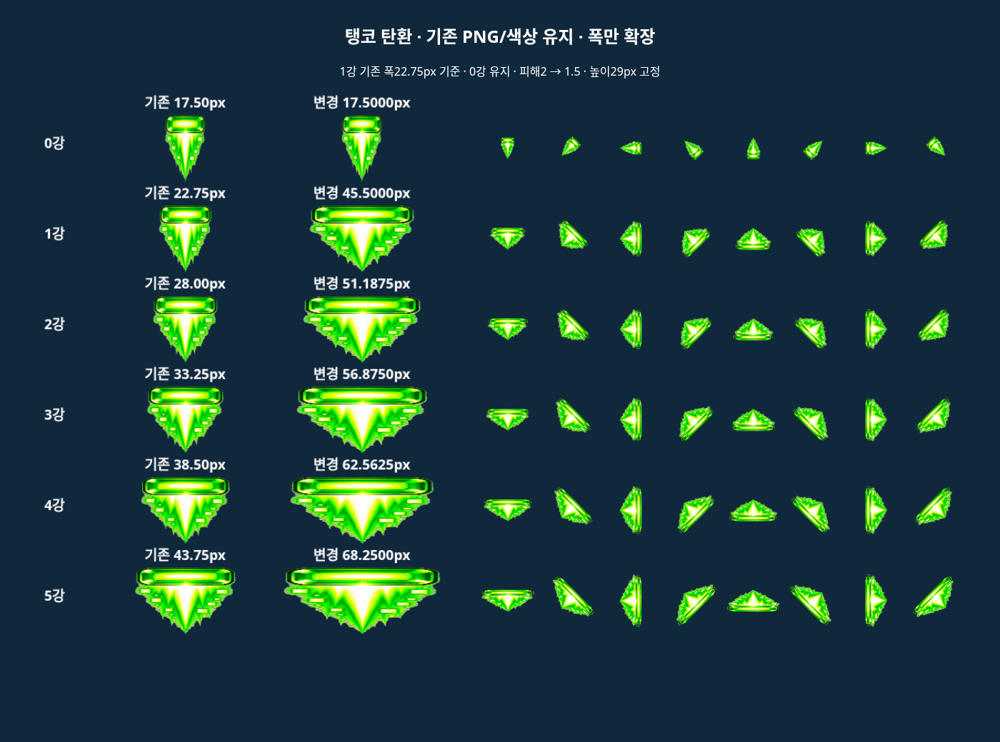
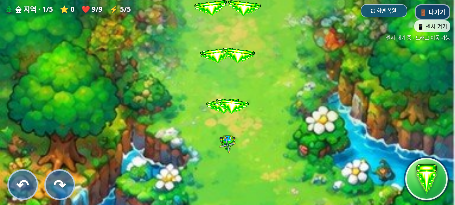
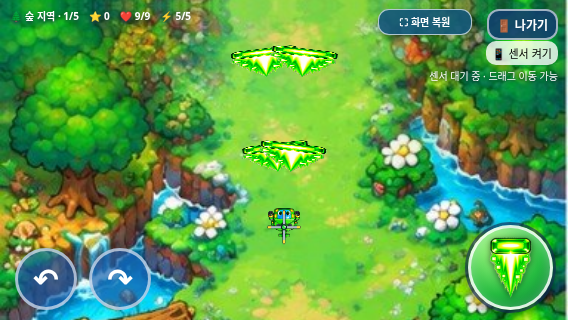

# 탱코 전투 시스템 개선

2026-11-02 KST · feature/selection-screen-integration · 기준71bce18.

피해 **2→1.5**. 기존 1강 폭22.75 CSS px를 기준으로 요청한1~5강 비율을 적용했다. 현재 HUD는0~5강이며, 별도 설명이 없는0강은 기존 폭을 보존한다는 가정을 사용자에게 미리 알렸다. 이미지/색상은 편집하지 않고 기존 PNG의 그리기 폭만 바꿨다. 높이는29px다.

| 강화 | 이전 폭 | 새 폭 | 이전 1강 대비 | 높이 |
| --- | ---: | ---: | ---: | ---: |
| 0 | 17.5 | 17.5 | 기본 폭 유지 | 29 |
| 1 | 22.75 | 45.5 | 200% | 29 |
| 2 | 28 | 51.1875 | 225% | 29 |
| 3 | 33.25 | 56.875 | 250% | 29 |
| 4 | 38.5 | 62.5625 | 275% | 29 |
| 5 | 43.75 | 68.25 | 300% | 29 |

## 충돌·관통·차단

- tankoBulletWidth()를 그리기와 회전 직사각형/원 충돌에 공통 사용한다. 진행 방향에 수직인 폭이며8방향을 포함한 모든 회전에 같은 계산을 쓴다. 기존 PNG의 발광/꼬리 모양은 유지한다.
- 일반 적 및 보스 HP에서1.5가 정확히 차감된다. 보스도 탄환당 한 번만 타격하고 관통1회를 소비한다.
- 일반 적/보스 탄환을 제거하면 같은 관통 예산1회를 쓴다. 기존 0~5강 예산2/3/3/5/6/7은 그대로이며, 다른 적 타격과 공유한다.
- 같은 대상 객체는 한 탄환에 한 번만 적용된다. 적 탄환 하나가 두 발과 겹쳐도 전체 차감은1회다. 잔여0이면 그 프레임에 제거하고 그리기도 생략한다.
- 원래 발사 수명1.9초를 충돌 때 초기화/연장하지 않는다. 이전 일반 적 관통 경로의 life=1 재할당을 탱코에만 제거했다. 트리오/빙글 경로는 보존한다.
- 트리오·빙글, 연사 간격/탄속/발사 위치·이동·강화 단계/발사 수·관통 수, 모든 이미지/WAV/선택 UI·보스 HP 배율/패턴/보상·전체화면/나가기·3초 게임 오버·아이템 보존은 그대로다.

## 검증

실제 Chromium/Playwright 및 Node 문법 검사, 총 **136개 그룹 통과**. [요약 JSON](test-summary.json).

| 검사 | 통과 그룹 |
| --- | ---: |
| Tanko browser | 13 |
| Tanko offline | 13 |
| balance/footprint | 3 |
| bgm | 9 |
| boss-reward | 8 |
| exit-dialog | 10 |
| game-audit | 11 |
| game-over | 7 |
| health-scaling | 4 |
| items | 7 |
| selection | 15 |
| tanko | 8 |
| trio | 9 |
| galaxy standalone | 19 |

- 새 전용 검사는 일반 웹/독립 HTML 각각13개 그룹이다. 48개 실제 draw(0~5강×8방향)와 옆/앞/모서리 판정 경계, 4→2.5/10→8.5 실제 체력 감소, 일반/사막 보스5발 탄막 차단, 중복 차감 방지·소진·공유 순서 양방향·실제 시간/만료·뒤/측면9→8 피격을 확인했다.
- 기존 무기/20웨이브·4보스/별160·일반 아이템·보스 보상·음원12개·ON/OFF/재시작/12회 음악 반복·선택 애니메이션·전체화면/게임 내부 종료창·3초 사망 복귀를 검사했다.
- [변경 전후 보스 처치 시간·12초 방어 표](balance/boss-and-defense-comparison.md): 실제 기준 HTML과 새 HTML의288회 비교(3캐릭터×6강화×4지역×2시간 간격×2버전)다. 트리오/빙글 시간은 정확히 같고 탱코5강 숲은2.525→3.458초, 사막8.308→11.092초다. 보스 HP 배율/보상은 그대로다. 별도 기존 HP 보정 회귀288회도 통과했다.
- 최대 폭을8방향·3가로 화면에서6초 연사했다. 실제 PNG 알파40초과 픽셀의 합집합 점유율 최고치는 **3.75%**다. 크기 변경 직후 이전 캔버스를 재는 테스트 문제를 발견해 resize 완료를 기다리도록 수정하고915×412/800×360/568×320 모두 다시 측정했다. 초기 잠정3.37%를 최종값으로 사용하지 않았다.

## 방어 밸런스 한계

각 탄환은 유한한 관통 횟수와1.9초 수명을 지키므로 한 발의 무제한 차단 오류는 없다. 그러나 연사는 새 탄환의 관통 예산을 계속 공급한다. 보스가12초 생존하도록 HP만 테스트에서 높이고 계속 중심 조준/연사한16개 새 버전 표본에서 피격 접촉은 모두0이었다. 사막1강은60발 중54발,3/5강은60발 모두 차단됐다. 원래 빗나가거나 아직 비행 중인 탄도 있으므로 피격0과 모든 발사 탄 제거는 구분한다. 뒤/측면 실제 피격은 정상이다.

요청한 폭/기존 관통 수·연사 속도를 유지하면 정면 방어가 매우 강하다. 사용자 요구 수치를 임의로 줄이거나 차단 전용 쿨다운/추가 비용을 넣지는 않았다. 추가 방어 균형 정책이 필요할 수 있는 **남은 검토 사항**으로 기록한다. 사람의 조준을 포함한 실전 완주나 물리 갤럭시 검증은 아니다.

## 결과물·한계

[갤럭시 ZIP 다운로드](https://github.com/26aiera11-cpu/helicopter-game/raw/refs/heads/feature/selection-screen-integration/dist/heli_trio_galaxy_test.zip?download=1) · [실행 안내](../galaxy-test/README.md) · [최신 기능/압축 무결성](package-verification.json).

ZIP에는 최신 HTML1개만 있으며 CRC/unzip -t/실제 추출 바이트·해시 일치를 확인했다. 원본 인라인 JS3개+선택 JS와 모든 리소스가 내장됐다. 실제 Galaxy Samsung Internet/Chrome, Android 파일 열기/주소창·센서·스피커·성능은 미검증이다. file://는 관리 정책으로 차단되어 동일 HTML을 새 빈 문서에 주입하고 오프라인 검사했다. 정책을 우회하지 않았다. main 병합·Pages 배포는 하지 않는다.

## 비교와 실제 화면

