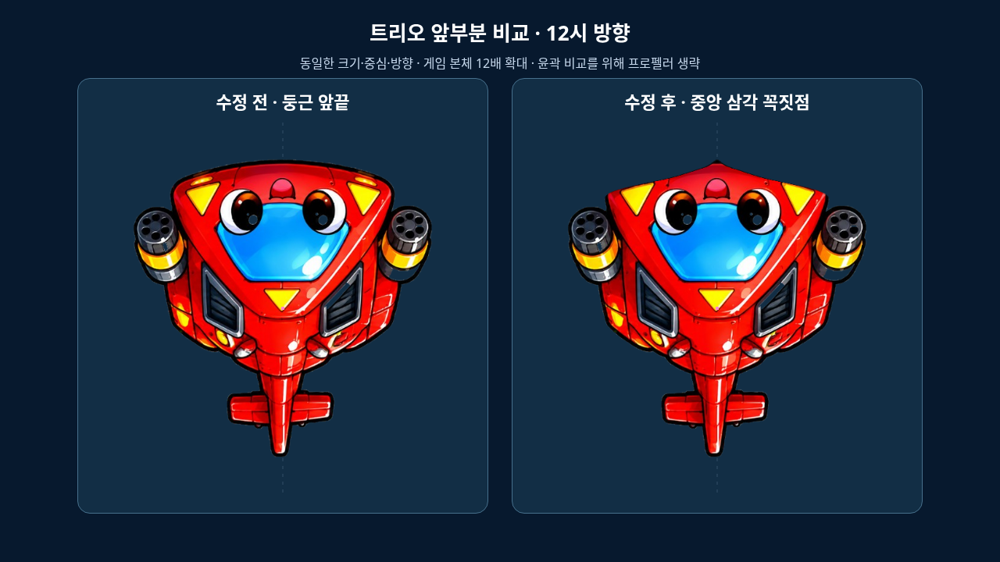
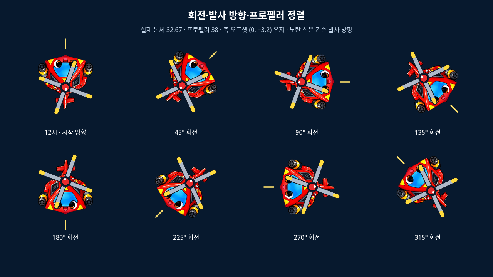
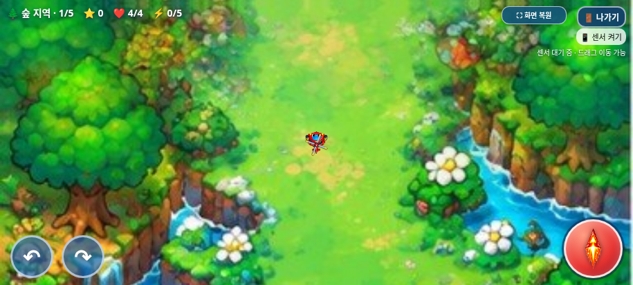

# 플레이 중 트리오의 앞부분 윤곽 수정

2026-11-01(KST) · `feature/selection-screen-integration` · 시작 커밋 `5d7c7a8721d7eec7dd257fb5ee46d8f50e060d40`

## 분석과 변경 범위

실제 플레이 본체는 `index.html`의 **`gameplayHeliImages[0]`**에 내장된 투명 PNG이며 로드 후 `sprites[0]`에 들어간다. 선택화면의 `assets/selection/heli-0-body.png`와는 다른 이미지다. 앞서 선언된 `spriteURLs`의 초기 이미지나 사용되지 않는 `rotorlessBodyURLs`를 수정하지 않았다.

기존 렌더러는 플레이어 중심으로 이동한 뒤 `player.a`만큼 회전하고 본체를 `(-16.33, -16.33, 32.67, 32.67)`에 그린다. 원본 PNG의 앞부분은 이미지 아래쪽이며, 시작 각도 `Math.PI`가 이를 **12시 방향**으로 돌린다. 발사 각도는 `player.a + Math.PI / 2`다. PNG를 위로 돌리거나 시작 각도를 바꾸면 기존 방향 기준이 어긋나므로 두 값을 그대로 유지했다.

- 원본 PNG를 [수정 전 백업](../../../backups/trio-gameplay.before-pointed-nose.png)에 바이트 그대로 보존했다.
- 이미지 편집으로 만든 윤곽 시안을 기존 캔버스에 맞추고, 앞부분의 제한된 영역에만 반영했다. 넓고 둥근 앞끝을 짧은 중앙 삼각 꼭짓점으로 다듬고 양쪽 앞어깨를 좁혔다.
- 새 원본은 [trio-body-pointed.png](../../../assets/gameplay/trio-body-pointed.png)다. 이미지 크기 **506×484**, 알파 외곽 범위 **(6, 6)–(500, 478)**, 캔버스 중심·방향·최대 길이를 유지했다. 바늘처럼 연장하지 않았다.
- 얼굴과 앞끝 외부의 불투명 픽셀은 원본과 동일하다. 원본 붉은색·표정·무장·꼬리를 유지했다. 반투명/완전 투명 픽셀의 PNG 정규화는 있으며, 투명 배경을 유지한다.
- 실제 제품 코드 변경은 **PNG 데이터 URL 한 곳의 교체뿐**이다. 시작 커밋에서 이 문자열 하나만 바꾼 전체 `index.html`과 현재 파일이 완전히 일치한다.
- 본체 크기·중심·초기 방향, 발사 위치·방향·탄환 PNG, 프로펠러 PNG·회전 코드·축, 공격·이동·체력·충돌·피격 범위, 빙글·탱코, 선택 PNG 5개와 선택 JS/CSS, 스테이지·보스·아이템·음원·전체화면·종료창 코드는 변경하지 않았다.

## 실제 브라우저 검증

| 검사 | 통과 그룹 |
| --- | --- |
| `tests/trio_body.py`: 단일 PNG 교체·픽셀·8방향·발사·축·충돌·비교 화면 | 8 |
| `tests/selection_smoke.py`: 원본 보호·JavaScript 문법·선택·세 캐릭터 조작·이미지 | 15 |
| `tests/game_audit.py`: 무기·피격·아이템·20개 웨이브·보스 4종 | 11 |
| `tests/exit_dialog.py`: 종료 모달·전체화면 유지·반복 시작/종료 | 10 |
| `tests/fullscreen_smoke.py`: 실제 전체화면·터치·비율·거부/미지원 | 7 |
| `tests/galaxy_standalone.py`: 최신 HTML 오프라인·이미지·터치·음원·전체화면 | 14 |

총 **65개 검사 그룹**을 통과했다. Chromium/Playwright에서 수행했으며 실제 Galaxy 휴대폰은 아니다.

- 시작 시 `player.a === Math.PI`, 체력 4, 트리오 속도 설정 265를 확인했다.
- 8개 각도에서 본체 전방 벡터와 발사 벡터가 일치했다. 원래 중심으로부터 19px인 발사 위치와 탄속 535도 유지됐다.
- 실제 `draw()`의 호출을 관찰해 본체 32.67×32.67, 날개 38×38, 축의 로컬 오프셋 `(0, -3.2)`가 같은지 검사했다.
- 적 탄환 반지름 5에 대해 중심 거리 17.1에서는 체력 4, 16.9에서는 체력 3이었다. 기존 플레이어 피격 반지름 12와 경계가 유지됐다. 나머지 적·보스 충돌 코드는 전체 소스 대조와 기능 회귀에서 확인했다.
- 트리오의 새 앞끝, 8방향 회전·프로펠러 정렬, 915×412 플레이 화면, 빙글·탱코 화면을 캡처했다. 독립 HTML에서는 800×360도 검사했다.
- 20개 웨이브·보스 4종과 점수 160까지 상태를 제어해 진행했다. 사람이 실제 난도로 연속 완주한 검사는 아니다.
- 종료 확인과 전체화면 진입·해제·복귀, 음악·효과음, 길게 누르는 회전·발사·드래그 이동이 정상 작동했다. 기본 confirm/alert와 잡히지 않은 JS 오류는 없었다.
- 초기 신규 테스트의 Canvas 변환 오차 기준은 실제 부동소수점 저장 오차를 고려해 0.0001px로 정정했다. 회전 비교용 캔버스에는 게임의 전역 canvas CSS가 적용되지 않게 명시적 표시 크기를 설정했다. 두 사항은 테스트 도구 수정이며 제품 렌더링 코드는 바꾸지 않았다.

결과 JSON: [새 본체](test-results.json), [기존 선택·게임 회귀](selection-regression.json), [전체 기능](game-audit.json), [종료창](exit-regression.json), [전체화면](fullscreen-regression.json), [독립 HTML](../galaxy-test/test-results.json).

```sh
python tests/trio_body.py --artifacts /absolute/path/to/trio-review
```

## 비교 이미지

첫 이미지는 실제 브라우저에서 같은 본체 그리기 좌표·크기·`Math.PI` 회전을 사용해 **12배 확대**한 비교 화면이다. 윤곽을 보기 위해 이 이미지에서만 프로펠러를 생략했다. 분홍 점은 공통 중심이다. 두 번째 이미지는 기존 날개를 포함한 8방향 정렬 화면이며 노란 선은 기존 발사 방향이다.





아래 두 이미지는 동일한 게임 상태·위치·크기·날개 각도로 실제 `draw()`를 실행한 915×412 화면이다. 수정 전 캡처는 테스트 메모리에서 백업 이미지를 일시적으로 사용했으며 제품 파일을 되돌리지 않았다.




[빙글 유지 확인](unchanged-bingle.png) · [탱코 유지 확인](unchanged-tanko.png).

## 최신 갤럭시 패키지와 미검증 항목

`dist/heli_trio_galaxy_test.html`과 ZIP을 다시 생성했다. ZIP에 HTML 한 개만 있으며, 압축을 실제로 풀어 최신 HTML과 바이트 일치를 확인했다. 새 트리오 PNG가 정확히 포함되고 이전 PNG가 빌드에서 빠졌는지도 확인했다. CRC·`unzip -t`를 통과했다.

- HTML: **28,098,756바이트**, SHA-256 `085177594be68f89039726a5afee18b6bdb3a1091d3c27f418189c7fd74b1c20`
- ZIP: **20,314,989바이트**, SHA-256 `4bfe76716f50f8a0adb4d10491ac0e3b8771fb5047f390e79a3f16e21c95da79`
- [패키지 검증 JSON](package-verification.json) · [다운로드·실행 안내](../galaxy-test/README.md)

실제 Galaxy/Samsung Internet/모바일 Chrome의 로컬 파일 연결·성능·화면 선명도·센서·스피커·Android 시스템 UI 재검사는 남아 있다. 이 환경의 `file://` 접근은 관리자 정책으로 차단되므로 동일 HTML을 새 문서에 주입하고 네트워크 없이 검사했다. 정책 우회는 하지 않았다.

기존 N1(게임 오버 음악 정지 누락), N2(단계 전환 시 보스 보상 소실)는 이번에도 비차단 문제로 재현됐으며 수정하지 않았다. 새 본체 관련 진행 차단 문제는 발견하지 못했다. 작업 브랜치에만 커밋·푸시하며 `main` 병합·GitHub Pages 배포는 하지 않는다.
