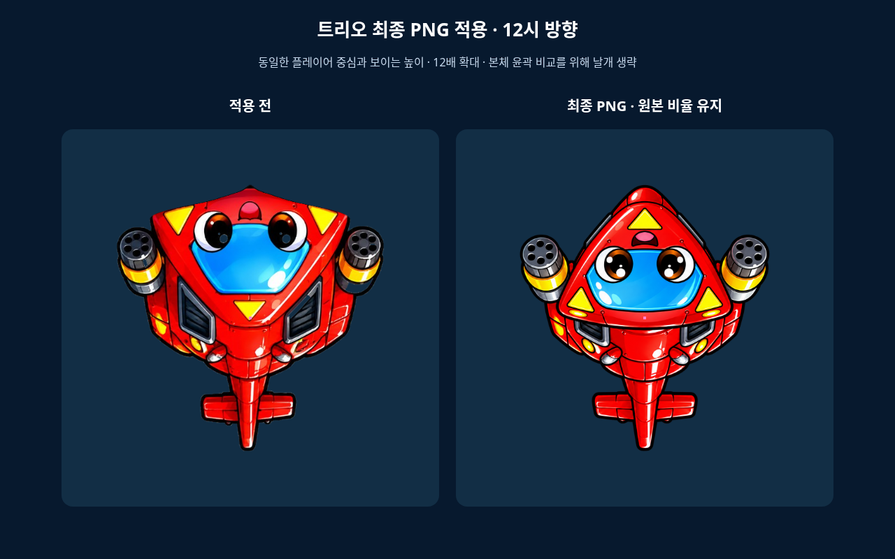
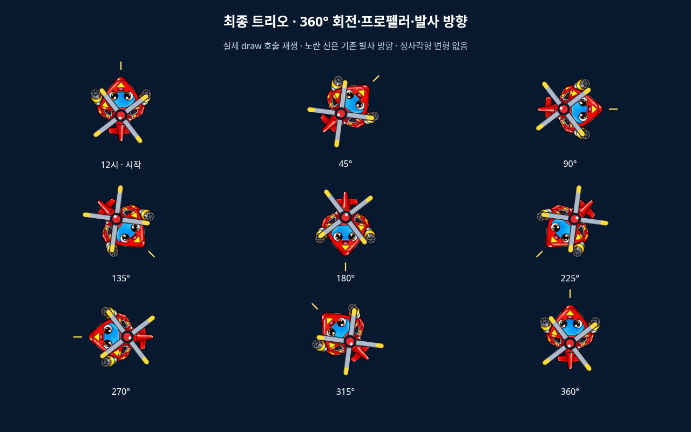
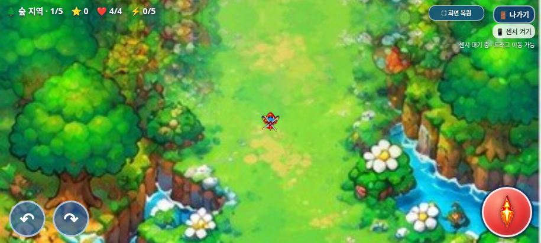

# 트리오 최종 PNG 원본 적용

2026-11-01(KST) · `feature/selection-screen-integration` · 시작 HEAD `e12666ee90cf7e905ffa4c41de13b1c337a37641`

## 최종 파일과 원본 보존

사용자는 `trio_gameplay_face_refined_v6.png`를 사용하지 않고 `trio_gameplay_final.png`를 최종본으로 지정했다. 처음에는 이 이름의 업로드 파일이 없어 확인을 요청했고, 이어 **‘트리오 외형 작업의 마지막 결과물’**이라고 명확히 지정했다. 따라서 마지막 얼굴 방향·비례·가로 폭 조정 결과 PNG를 그대로 사용했다.

- 적용 파일: [assets/gameplay/trio_gameplay_final.png](../../../assets/gameplay/trio_gameplay_final.png)
- **1402×1122, RGBA, 928,623바이트**, 원본 비율 약 **1.249554:1**.
- SHA-256: `b7bdc4d0a393e46436b214fda435e288c48f147c0272d85cc93658dd811f983e`.
- 이전 BGM 점검에서 기록한 마지막 시안 해시와도 동일하다. 새 파일을 생성하거나 다시 그린 것이 아니다.
- 원본과 적용 파일의 바이트가 같다. PNG를 자르거나 리사이즈·재저장·배경 제거·색상/윤곽 수정하지 않았다. 투명 여백과 미세한 반투명 픽셀도 그대로 유지했다.
- 변경 전 본체 [trio-body-pointed.png](../../../assets/gameplay/trio-body-pointed.png)와 원본 백업은 보존했다. v6 파일은 사용하지 않았다.

## 플레이 크기·중심·방향

`index.html`에서 `gameplayHeliImages[0]`의 내장 데이터만 최종 PNG로 교체하고, 트리오를 그리는 사각형에만 별도 분기를 적용했다. 원본 전체를 5인자 `drawImage(image,x,y,width,height)`로 그리며 잘라서 그리지 않는다.

| 항목 | 검증한 값 |
| --- | --- |
| 원본 파일 비율 | 1402/1122 ≈ 1.249554 |
| 전체 PNG 그리기 크기 | 약 42.17246×33.75 게임 px, 투명 여백 포함 |
| 가로·세로 배율 | 모두 0.0300802139, 원형 기관총을 가로로 누르지 않음 |
| 보이는 본체 높이 | 약 31.73463px, 이전 31.725px와 차이 약 0.00963px |
| 보이는 몸체 중심 | 기존 플레이어 위치에 일치 |
| 정렬 기준 | 알파 128 이상 윤곽의 중심 (701,547.5)을 측정해 배치에만 사용; 원본 픽셀은 유지 |
| 프로펠러 | 기존 38×38, 로컬 축 (0,-3.2), 회전 코드 유지 |
| 발사 | 기존 중심 앞 19px, 트리오 탄속 535, 기존 방향·탄환 유지 |

PNG의 앞끝은 원본 아래쪽이다. 기존 시작 각도 `Math.PI`가 전체 PNG를 12시 방향으로 돌리며, 눈·입을 포함한 그림 전체가 기체와 함께 회전한다. 이미지의 일부만 따로 뒤집거나 수정하지 않았다. 기존 360° 조작·이동·체력·충돌 반경은 그대로다.

빙글·탱코는 기존 `(-16.33,-16.33,32.67,32.67)` 그리기와 PNG를 유지한다. 선택화면 이미지·애니메이션, BGM N1 수정, 보스 자동 보상 N2 수정, 전체화면·종료창은 변경하지 않았다. 시작 커밋에서 PNG URL 한 곳과 트리오 그리기 블록만 바꾼 전체 파일이 현재 파일과 일치하는지 검사했다.

## 실제 브라우저 검증

| 실행한 검사 | 통과 그룹 |
| --- | --- |
| `tests/trio_final.py` (기존 `tests/trio_body.py` 진입점에서도 실행) | 9 |
| `tests/selection_smoke.py` | 15 |
| `tests/game_audit.py` | 11 |
| `tests/bgm_smoke.py` | 9 |
| `tests/boss_reward.py` | 8 |
| `tests/exit_dialog.py` | 10 |
| `tests/galaxy_standalone.py` | 17 |

총 **79개 검사 그룹 통과**. 실제 Chromium/Playwright에서 검사했다.

- 실제 `sprites[0]`가 최종 PNG로 로드되고 12시·체력 4·속도 설정 265로 시작했다.
- 실제 draw 호출에서 전체 PNG 비율·동일한 X/Y 배율·몸체 중심·기존 프로펠러 축을 확인했다.
- 22.5° 간격으로 0~360°의 17개 방향에서 발사 위치·방향과 균일 배율을 검사했다.
- 실제 터치를 길게 눌러 한 바퀴 이상 돌렸고 날개 회전이 이어졌다. 다시 12시로 발사했을 때 탄환이 위로 진행했다.
- 기존 12px 피격 반경의 안/밖, 빙글·탱코 그리기, 세 캐릭터 조작·전투·20개 웨이브·보스·아이템·강화·BGM·자동 보상·전체화면·종료 모달을 재검사했다.
- 915×412, 800×360, 568×320의 실제 플레이 화면을 캡처했다.
- 독립 HTML에서도 1402×1122 최종 PNG가 로드되고 가로·세로 같은 배율로 그려지는지 검사했다.
- 잡히지 않은 JS 오류·기본 대화상자·외부 자산 누락은 없었다.

기존 보호 검사는 승인된 최종 PNG와 해당 그리기 블록만 분리해 허용한다. `tests/final_trio_preservation.py`의 고정 해시로 새 파일도 원본 그대로인지 검사한다. 이전 `tests/trio_body.py` 명령은 새 검증으로 연결해 유지했다.

```sh
python -B tests/trio_body.py --artifacts /absolute/path/to/trio-final-review
```

결과: [최종 PNG](test-results.json), [선택](selection-regression.json), [전체 기능](game-audit.json), [BGM](bgm-regression.json), [보스 보상](boss-regression.json), [종료창·전체화면](exit-regression.json), [단일 HTML](../galaxy-test/test-results.json).

## 비교와 실제 플레이 화면

확대 화면은 실제 draw 좌표·변환을 재생한 비교다. 본체 윤곽 비교에서만 날개를 생략하며, 분홍 점은 플레이어 중심이다. 회전 표에는 기존 프로펠러와 발사 방향을 함께 표시했다.







[800×360 플레이](trio-final-gameplay-800.png) · [568×320 플레이](trio-final-gameplay-568.png) · [빙글 유지](unchanged-bingle.png) · [탱코 유지](unchanged-tanko.png).

## 갤럭시 패키지와 한계

최종 PNG를 원본 바이트로 내장한 최신 단일 HTML·ZIP을 재생성했다. 압축을 실제로 풀어 HTML 바이트 일치·CRC·`unzip -t`, 내장 PNG 해시 일치를 확인했다.

- HTML: **28,891,824바이트**, SHA-256 `eb890e8072d544b3ebec9b395ccc0ed917e3bffa99c2d4a2a1f2f20c9e0fa8be`.
- ZIP: **20,876,472바이트**, SHA-256 `427e5919d13e76cb76e42052f17fbef88345a723e0ce2142c462cabf1a11b687`.
- [다운로드 안내](../galaxy-test/README.md) · [원본·패키지 무결성](package-verification.json).

실제 Galaxy Samsung Internet/Chrome·센서·스피커·성능·Android UI는 미검증이다. 관리자 정책 때문에 `file://` 직접 열기는 차단되어 같은 HTML을 새 문서에 주입하고 오프라인으로 검사했다. 정책을 우회하지 않았다. 전투·보스 검사는 상태와 조준을 제어한 검사이며 실제 난도로 수동 완주한 것은 아니다.

작업 브랜치에만 반영하고 `main` 병합·GitHub Pages 배포는 하지 않는다.
