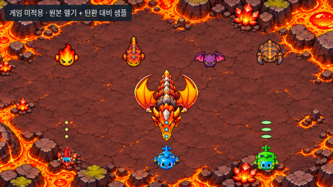

# 화산 그래픽 리소스 제작·검증

2026-11-04 KST, [Issue #14](https://github.com/26aiera11-cpu/helicopter-game/issues/14), `feature/volcano-art-assets`.

배경1종·일반 몬스터4종·상향 날개 보스1종과 총69프레임을 제작했다. **게임 코드에 연결하지 않은 검토 초안**이다. 기존 게임/전투·월드 등록·자산·배포HTML/ZIP은 변경하지 않았다.

## 기준과 제작

시작 시 main은 `17da293570f422035d455add578dbc8412e4f24b`, Ppyoko와 기존 원격 작업 브랜치는 모두 `b5eeb114452956786b831c5589428ceb777e052e`였다. 깨끗한 작업 트리에서 이미 있는 원격 작업 브랜치를 추적 체크아웃했다. 브랜치를 초기화하거나 다른 브랜치를 덮어쓰지 않았다. `HELI_TRIO_SPEC.md`는 없으므로 사용자 확정 규칙과 Issue를 기준으로 삼았다.

Issue의 과거 ZIP 명칭 대신 사용자가 이번에 제공한 **`heli_trio_volcano_design_reference_v2.zip`**의 실제3이미지/설명서를 확인했다. ZIP CRC·안전한 경로·원본 해시를 검사했다. 합성판을 그대로 쓰지 않고 이미지 생성 도구에 각 승인 시안을 참조해 분리 아트를 제작했다. 첨부 설명서의 공격 콘셉트를 전투 구현 지시로 확대하지 않았다. 참조 원본4개는 [references](references/)에 바이트 그대로 보존했다.

일반4종은 각각 대기1·이동4·공격1·피격2·소멸4, 보스는 대기4·이동6·공격4·피격3·소멸4다. 프로펠러가 없고 머리는 아래 방향이다. 마그마 드래곤은 몸통/머리를 뒤집지 않고 날개 끝이 위로 펼쳐진 모습을 유지했다. 배경은 조용한 검붉은 중앙 지형과 가장자리 용암·결정으로 구성했다.

배경 생성 출력1870×841은 원본으로 보존하고, 종횡비 유지 확대1921×864→중앙1열 제거로 요구 크기1920×864를 만들었다. 캐릭터PNG와 최종 아틀라스는 생성 출력과 바이트가 같다. 시트 간격이 완전 균등하지 않아 PNG를 재자르거나 늘리는 대신 개별 `rect_px`와 가상320×320셀/기준점/시간을 매니페스트에 명시했다. **단순 행·열 곱셈으로 읽으면 안 된다.** 상세는 [자산 사용 규약](../../../assets/volcano/README.md)과 [출처·생성물 해시](art-provenance.json)에 있다.

초기 박쥐 시트는 소멸 마지막에도 몸체가 남고 날개 여백이 좁아 채택하지 않았다. 이미지 생성 도구로 수정해 마지막3프레임을 폭발→연기→작은 잔불로 교체하고 날개 여백을 확보했다. 채택하지 않은 출력은 작업 환경에 보존하되 저장소에는 추가하지 않았다.

중심점 측정을 추가하니 갑충의 대기/이동 윤곽 중심이 가상 셀 안에서 가로20.5px·세로17.5px 범위로 흔들렸다. PNG를 바꾸지 않고 프레임별 매니페스트 기준점만 보정했으며, 윤곽 중점이160,160으로 일치하는 것을 재검사했다. 몸체 세부 랜드마크의 완전한 고정을 뜻하지 않으며 최종 미세 정렬은 시각 승인 대상이다. 보정 후 브라우저 모음과 그래픽ZIP만 갱신했다.

## 검사 결과

| 검사 | 결과 |
| --- | --- |
| PNG CRC·디코드/크기·해시 | 자산PNG12개 통과, 배경1920×864 일치 |
| 실제 투명도 | 기본5/시트5 모두RGBA, 완전 투명 픽셀 존재, 밝음/어둠/체크 미리보기 확인 |
| 매니페스트 | 5종·5상태·69프레임, 좌표 유효/비어 있지 않음/겹침·누락 없음 |
| 표시 윤곽 여백 | 알파8 이상 기준 모든 프레임 최소8px, 가상셀 바깥 표시 픽셀0 |
| 브라우저 렌더링 | 69프레임 각각Canvas에 그려 비어 있지 않음/셀 가장자리 침범0 확인 |
| 실제 시간 재생 | 200ms 대기 중 자동 재생 시간 증가 확인, 상태별 포즈 출력 확인 |
| 가로 화면 | 915×412·800×360·568×320 모두5종+배경 표시, 가로 넘침0/뷰어저장0 |
| 경로·문법 | PNG/JSON/JS 요청 오류0, 브라우저JS 오류0, `node --check` 통과 |
| 기존 게임 간단 확인 | 세 캐릭터 선택→시작→나가기 확인→메뉴 복귀 통과 |
| 기존 코드 보호 | 기준1372개 추적 파일 중 변경은 누적개발기록만 허용; 게임/기존자산/dist/기존검사 바이트 유지 |

[자산 검사10그룹](asset-validation.json), [브라우저 검사3그룹·69프레임 상세](browser-validation.json), [기존 파일 보호 증거](preservation-verification.json), [ZIP 검증](package-verification.json).

시각 확인에서는 라벨/패널이 배경에 남지 않고, 몬스터 구분·기본 팔레트·보스 상향 날개·투명 가장자리·5상태와 박쥐 소멸 수정을 확인했다. 이는 수동 시각 검토이며 자동 OCR/원화 일치 판정이라고 표현하지 않는다. 기존 게임 전체 회귀를 재실행하지 않았다. 새 리소스가 참조되지 않는 작업이므로 바이트 보호·리소스 검사·짧은 기존 게임 동작 확인에 집중했다.

브라우저 서버 첫 실행은 실행 환경의 네트워크 제한으로 localhost 소켓을 만들지 못했다. 허용된 네트워크 실행 프로필로 재실행한 결과 정상 완료했다. 게임 오류나 보안 정책 우회는 아니다. 후속69프레임 전수 Canvas 검사를 추가한 뒤 뷰어 모음만 재실행했다.

## 화면·리소스



- [915×412](screenshots/scene-915x412.png) / [800×360](screenshots/scene-800x360.png) / [568×320](screenshots/scene-568x320.png).
- [체크 배경 애니메이션 화면](screenshots/animation-gallery.png), [69프레임 전체](screenshots/all-69-frames.png).
- [흰 바탕](screenshots/alpha-ffffff.png), [어두운 바탕](screenshots/alpha-17212b.png), [기존 게임 확인](screenshots/original-game-unchanged.png).
- [자산 폴더](../../../assets/volcano/) / [매니페스트](../../../assets/volcano/asset_manifest.json) / [그래픽 검토 ZIP](volcano-art-assets-review-v1.zip).

위 장면은 **독립 아트 뷰어**다. 원래index의 게임용 헬기PNG3개를 읽기만 하고 탄환 대비 샘플 도형을 그린다. 화산이 게임 지역으로 추가됐거나 실제 전투·충돌이 검증됐다는 뜻이 아니다. 원본 배경PNG에는 그 헬기·탄환·안내문이 없다. 크기/시간은 아트 검토용이며 난이도 확정값이 아니다.

전체 저장소에서 정적 서버를 띄운 후 `docs/review/volcano-art-assets/preview.html`을 열면 상태 전환/정지·재생·투명 배경·전체 프레임을 볼 수 있다. `?view=scene`은 현재 브라우저 크기에 맞는 배경 대비 화면이다. 뷰어는 검사 편의를 위해 일회성 상태도 반복한다. 게임 스크립트는 실행/변경하지 않으며 저장소도 쓰지 않는다.

```sh
python docs/review/volcano-art-assets/tools/verify_assets.py
node --check docs/review/volcano-art-assets/preview.js
python docs/review/volcano-art-assets/tools/browser_review.py
python docs/review/volcano-art-assets/tools/package_assets.py
```

Python검사는 Pillow/numpy, 브라우저검사는 Playwright/Chromium과 localhost 서버 권한이 필요하다. ZIP은 자산/참조/설명만 담는 그래픽 팩이며 게임HTML이 아니다. 압축 해제 후 모든PNG/매니페스트 참조와 원본 해시를 검증했다. 뷰어의 원본 헬기 비교는 전체 저장소가 필요해 ZIP에 넣지 않았다.

그래픽ZIP은 **19개 파일·18,983,790바이트**, SHA-256 `0dab351c6480b4c7d962d0695edb76cbb27ba2ef09a368e53a122bc7a0f01c6b`다. 내용물 전체의 바이트 일치와 별도 실제 압축 해제를 확인했다.

## 한계·남은 작업

실제Galaxy Samsung Internet/Chrome, 손가락 조작·성능/발열·실전 탄막 가독성은 검사하지 않았다. 리소스가 게임에 연결되지 않아 물리 센서나 화산 전투는 이번 검증 대상이 아니다.

**생성 결과의 알파1~7 미세 잔여 픽셀**은 원본 보존 원칙에 따라 남겼다. 명목상 빈 셀에도 이 픽셀이 일부 있어 완전한 알파0 배경 정리가 끝났다고 주장하지 않는다. 좌표/여백 검사는 알파8 이상 표시 영역 기준이다. 밝음/어둠 실화면에서는 눈에 띄는 사각형이나 잔여 테두리를 발견하지 않았지만 극단적인 배율·필터링의 최종 검토는 남아 있다.

승인 시안과 새 분리PNG의 세부 선·포즈가 픽셀 단위로 같지는 않다. 전용 손그림 연속 원화/8방향 시트도 아니다. **새 리소스 최종 외형 승인 및 필요 시 선·알파·미세 정렬 보완**이 남아 있다. 승인 후 별도 작업에서만 지역 등록·애니메이션 소비·실제 크기/충돌/전투를 연결한다. 이번에는 화산AI·체력·공격 수치·드롭·음악·스테이지 흐름을 추가하지 않았다.

기존 worlds-offline의 긴멀티터치→나가기 미완료 검사는 과거기록 그대로며, 이번 간단 확인 통과로 해결됐다고 주장하지 않는다. 기존 갤럭시 게임HTML/ZIP도 재생성하지 않았다. main 병합·GitHub Pages 배포·Issue 상태/댓글 변경은 하지 않는다.
