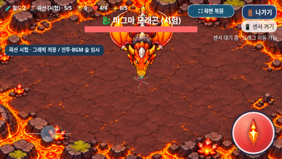

# 월드 2 화산 그래픽 실제 게임 연결

2026-11-04 KST · `feature/volcano-art-integration` · [Issue #15](https://github.com/26aiera11-cpu/helicopter-game/issues/15).

승인된 화산 배경·5종·69프레임을 실제 게임과 지역 바로 시작에 연결했다. **전투와 BGM은 숲 프로필의 임시 재사용**이다. 화산 전용 AI·보스 패턴·능력치·드롭·음악을 새로 만들지 않았다. main 병합과 GitHub Pages 배포는 하지 않는다.

## 기준과 진행 경로

원격main은 `17da293570f422035d455add578dbc8412e4f24b`, 아트 기준/이미 존재하던 통합 브랜치는 `7c99b909ce0d34cce3b8dcebd5042e9ee72ca7bb`였다. 깨끗한 작업 트리에서 기존 원격 통합 브랜치를 추적 체크아웃했으며 초기화·재생성·다른 브랜치 덮어쓰기를 하지 않았다. 개발 기록49절과 실제 월드/설원/점수/아트/빌드 코드를 읽었다. `HELI_TRIO_SPEC.md`는 없어 사용자 확정 규칙과 Issue를 적용했다.

Issue #15가 아트 결과 확인 및 다음 단계 승인을 명시하므로 그 승인 범위에서 연결했다. 기존 `assets/volcano/README.md`와 매니페스트의 제작 당시 검토 상태 필드는 원본 보존을 위해 그대로다. **현재 게임 연결 상태는 이번 모듈과 이 보고서로 확인**하며, 원본의 과거 `game_runtime_integration:false`를 현재 실행 상태로 해석하지 않는다.

| 모드 | 경로 | 기록 |
| --- | --- | --- |
| 기본, 시험OFF | 숲→바위→바다→사막,20단계 | 기존 일반TOP10/분석 |
| 월드2 시험ON | 위20단계→설원5→화산5,30단계 | 기존world2Trial 저장키, 일반과 분리 |
| 🧪 지역 바로 시작 | 선택한 한 지역의 선택 단계부터 보스까지 | TOP10/분석 모두 비저장 |

화산은ID5, key `world-2:volcano`, worldId1/localIndex1이다. 이전ID0~4와 저장키는 유지한다. 게임 방법→지역 바로 시작→월드2→화산→1~5단계를 제공한다. 직접5단계는 즉시 보스다. 정상 진행으로5단계에 들어가면 기존대로 일반6마리 처치 후 보스가 나온다. 매 지역은 일반1~4와 보스5의 구조를 유지한다.

기존35000점 설원 기록을 새 점수로 환산하거나 지우지 않는다. 기존 필터가 등록된regionId와 저장 범위를 검증하므로 설원4 기록을 그대로 읽고 화산5의 새 시험 기록도 허용한다. 시험 순위표/최종 클리어 문구는 월드2로 표현을 바꿨다.

## 그래픽·임시 전투

| 단계 | 실제 개체 아트 | 표시 폭 기준 | 임시HP/반경 |
| --- | --- | --- | --- |
| 1 | 불씨콩 | 38px | HP1/r16 |
| 2 | 용암 도마뱀 | 42px | HP1/r16 |
| 3 | 화산 박쥐 | 54px | HP1/r16 |
| 4·정상5단계 일반전 | 마그마 갑충 | 58px | HP1/r16 |
| 보스 | 마그마 드래곤 | 132px | 기본HP20/r48, 기존 강화 보정 |

폭은 **대기 윤곽의 실제 보이는 폭**을 기준으로 새 모듈에 명시했다. 시트 셀 폭이나 매니페스트의 아트 검토용 `preview_content_width_px`를 게임값으로 쓰지 않았다. 각 포즈의 비율·크기 변화는 원본 프레임을 따른다. 보스의 몸/머리는 아래를 향하고 날개 끝은 위로 펼쳐진다. 그림만 화면 경계 안으로 조정하며 개체 좌표/반경·공격 판정을 바꾸지 않는다.

`assets/volcano/volcano.js`에서 매니페스트의 `rect_px`, `sprite_source_rect_px`, `source_size_px`로 읽기 사각형과 가상셀 기준점을 적용한다. 균일 격자/행·열 곱셈으로 프레임을 계산하지 않는다. 개체별 `volcanoSpeciesId`를 보존하므로 등장 후 다른 단계로 바뀌어도 아트 ID가 섞이지 않는다. 이후 혼합 등장 설계는 이 ID 매핑을 확장할 수 있지만 이번에는 단계별 매핑만 적용했다.

배경은 승인1920×864 한 장을 중앙cover로 그린다. 스크롤 타일·이음새 변형·강제 종횡비 변형·용암 피해/장애물을 추가하지 않았다. PNG/원본 매니페스트는 바이트가 같다. 렌더링에 사용하는 메모리 프레임에서만 알파8 미만을0으로 정리한다. 캐시는 최대69개, 전체 프레임의RGBA 픽셀 버퍼 합계11,818,760바이트다. 이는 총 게임 메모리나 실기기 성능 측정값이 아니다. 픽셀 읽기가 제한되면 원본을 그리는 경로로 계속 실행한다.

아틀라스PNG를 못 읽으면 원본 기본PNG를 비율 보존해 사용한다. 모든 화산PNG가 실패하면 화산 배경색과 종별 임시 도형을 사용한다. 이 경우도 숲/설원 그림으로 잘못 대체하거나 게임을 중단하지 않는다. 별도 실패 검사는 **PNG 요청을 의도적으로 중단한 조건**이며 모든 종류의 JS/HTML 손상에 대한 복구 검사는 아니다.

전투 수치는 숲 프로필0 그대로다. 일반HP1, 단계별 이동38/43/48/53/58px/s, 기본탄속85에 단계당8을 더한다. 보스는 기존HP20과 강화별배수[1,1.1,1.4,1.6,1.9,2.2], 기존 이동·조준·단발 공격을 사용한다. 설원의 혼합 등장·돌진·예티탄/거북이와 눈보라 왕3패턴은 변경하지 않았다.

## 이벤트와 종료 흐름

대기/이동은 실제 위치 변화, 공격은 실제 발사, 피격/소멸은 실제HP 감소/처치 훅에 연결했다. 동일 개체의 사망 이펙트는 한 번만 생성한다. 일반4종은 각각12프레임, 보스21프레임으로 총69프레임이다. 나가기 창/숨김에서는 시계가 멈추며, 게임 오버의3초 정지 화면도 유지한다. 메뉴 복귀/새 게임에서는 새 아트 상태와 대기 중인 이동을 정리한다.

설원 보스의 기존 소멸 코드는 최종 종료를 전제로 했다. 다음 지역이 생긴 경우에는 설원 피격0.33초+소멸0.72초를 끝낸 후 화산1로 이동하고 이전snowfield-finale 상태를 정리한다. 설원 모듈/전투 자체는 수정하지 않았다. 설원만 직접 시험하는 개발 모드는 기존 종료 연출을 그대로 쓴다.

화산 보스는 피격0.30초+소멸0.64초 후 해당 모드의 클리어로 넘어간다. 이 동안 전투 갱신을 정지하고 남은 탄환/전투 이펙트를 정리한다. 보상과2000점은 실제 처치 시점에 한 번 지급한다. 지역 회복+2는 다음 지역으로 이동하는 시점에 적용하며 기존 최대치와 순서를 지킨다. 마지막 화산에는 다음 지역 회복을 추가하지 않는다.

전체 회귀에서 새 클리어 제목이 선택화면 결과 표시의 옛 정규식에 연결되지 않은 문제를 발견했다. 점수와30단계 진행은 맞았지만 결과 영역이 비어 있었다. `selection.js`의 결과 문구 목록에 월드2 완료만 추가하고, 게임 오버 결과 제거/제목 복원/선택 애니메이션 로직은 유지했다. 초기 실패를 보존하고 해당 검사만 다시 수행했다.

## 검사와 증거

최종 **45개 모음 중44개·574개 검사 그룹 통과**다. 미완료는 일반 브라우저`worlds`1개이며 실패 전16그룹 관측을 통과 합계에 넣지 않았다. [test-summary.json](test-summary.json)에 초기 전체 회귀와 후속 결과를 따로 보존했다.

이름 검사의 초기 일반 모음에서는 스크린샷을 찍은 뒤2.5초를 다시 기다려 실제 사망 시점의3초를 넘어가는 타이밍 실패가 있었다. 사망 시점부터의 절대2.5초를 확인하도록 대기만 수정하고3초 유지/복귀 검증은 유지했다. 새 클리어 정규식과 옛 도움말 기대값도 보완한 뒤 해당 모음·최종 단일HTML만 선택 재검사했다. 전체40모음을 두 번째로 돌리지 않았다. 전체 회귀 후 제품 차분은 결과 정규식1곳뿐이며 아트/전투/입력/음악 바이트는 같다([차분 증거](full-snapshot-vs-final.json)).

오프라인 월드 모음은19그룹을 모두 통과했다. 세 캐릭터가 각각 기본20단계28,000점과 시험30단계42,000점/6보스/일반180킬/일반단계보너스24회를 완료했다. 아이템 몬스터18마리를 포함한 별도30단계는45,600점이었다([전체 경로·저장/보상 결과](retest/worlds-offline/test-results.json)). 기존35000점 설원 기록과4저장키의 호환/비저장은 개발자·이름 모음에서 별도로 검증했다.

일반`worlds`의 긴3중 터치→나가기에서는568×320에서버튼의pointerdown/up만 있고click이 없어 대화상자가 열리지 않았다. 이전Ppyoko의오프라인800×360 실패도 같은 이벤트 형태였으며 버튼이 실제로hit되고 started=true/dialog=false인 점이 같다. **같은 관측 증상이며 근본 원인을 확정하거나 해결됐다고 주장하지 않는다**([비교JSON](incomplete-input-comparison.json),[현재 진단](retest/worlds/exit-touch-failure.json),[실패 화면](retest/worlds/exit-touch-failure.png)). 조작/센서/멀티터치 코드는 바꾸거나 추가 합성click으로 검사를 우회하지 않았다.

기존 회귀의 반복 화면은 전부 작업 환경에 보존했고, Git에는JSON/로그·선별한 진단 화면과 요청한 신규 화산 화면을 넣었다. 중복 기준 화면을 삭제하거나 검사를 생략한 것이 아니다. [로컬 보존 파일 목록/해시](archived-regression-screenshots.json)의 이미지는 저장소에 포함하지 않으며, `tests/run_volcano_checks.py --artifacts <경로> [--only 모음명 ...]`으로 재생성할 수 있다.

격리 실행 검사가 만든 중복HTML2개도 저장소 밖에 보존했다([해시와최신파일대조](archived-build-copies.json)). 현재 다운로드 대상은`dist/`의최신HTML/ZIP이며 이전검사복사본을함께배포하지않는다.

- [일반 집중 검사](native/test-results.json), [오프라인 집중 검사](offline/test-results.json): 각각3캐릭터×3해상도×5단계=45개 실제 진입. 실제 이동·발사·피격/100점·보스 즉시 등장·정상5단계 일반전·전체화면/나가기·개발 비저장·게임 오버를 확인했다.
- 각69프레임은 제어된 아트 상태를 실제 게임 렌더러에 넣어, 원본 사각형 픽셀·알파 정리·비율·가상셀 기준점·경계/충돌 불변을 검사했다. 45개 전투 훅 검사와 이러한 프레임 제어 검사는 구분한다. [138개 실제 그리기 좌표와 패키지 검사](package/test-results.json).
- [실패 요청 검사](fallback/test-results.json): 아틀라스5개 실패, 모든 화산PNG11개 실패에서 기본이미지/도형 경로로5단계 모두 실행했다. 의도된 실패 요청을 정상 실행의 요청 오류와 섞지 않았다.
- [소멸 중 종료/재시작3그룹](lifecycle/test-results.json): 실제 종료창 취소는 같은 연출을 재개하고, 종료 확정/방어적 새게임은 이전 전환 콜백을 취소한다. 이전 연출이 새 빙글/탱코 게임을 종료하지 않고 전체화면도 유지했다.
- 기존40개 모음은 한 번 실행했다. 기본20/시험30단계,6보스·점수/보상/아이템, 과거 기록·분리 저장, 기존 설원115프레임과4종/3패턴, 캐릭터/탱코/입력/사운드/선택화면을 검사한다. 바뀐 경로/제목/종료 시점의 기대값만 갱신하고 정확한 차분 역변환과 기존 자산 해시 검사는 유지했다.
- [보호/패키지 증거](package-source-verification.json)에서 원본 아트/음원·조작 코드의 보존과 최신HTML/ZIP 일치를 확인할 수 있다.



| 실제 게임 화면 | 915×412 | 800×360 | 568×320 |
| --- | --- | --- | --- |
| 불씨콩 | [화면](native/volcano-phase1-915x412.png) | [화면](native/volcano-phase1-800x360.png) | [화면](native/volcano-phase1-568x320.png) |
| 도마뱀 | [화면](native/volcano-phase2-915x412.png) | [화면](native/volcano-phase2-800x360.png) | [화면](native/volcano-phase2-568x320.png) |
| 박쥐 | [화면](native/volcano-phase3-915x412.png) | [화면](native/volcano-phase3-800x360.png) | [화면](native/volcano-phase3-568x320.png) |
| 갑충 | [화면](native/volcano-phase4-915x412.png) | [화면](native/volcano-phase4-800x360.png) | [화면](native/volcano-phase4-568x320.png) |
| 드래곤 | [화면](native/volcano-phase5-915x412.png) | [화면](native/volcano-phase5-800x360.png) | [화면](native/volcano-phase5-568x320.png) |

[개발자 경로](native/developer-volcano-help.png), [같은 단일HTML의 오프라인 보스](offline/volcano-phase5-568x320.png). 테스트에서는 등장/조준/무적을 제어했고 원본 게임Canvas를 그대로 캡처했다. 이미지를 편집하거나 별도 아트 뷰어를 실제 게임 화면으로 제시하지 않았다.

```sh
python tests/volcano_art.py --artifacts docs/review/volcano-art-integration/native
python tests/volcano_art.py --standalone --artifacts docs/review/volcano-art-integration/offline
python tests/volcano_fallback.py --artifacts docs/review/volcano-art-integration/fallback
python tests/volcano_lifecycle.py --artifacts docs/review/volcano-art-integration/lifecycle
python tests/volcano_package.py --artifacts docs/review/volcano-art-integration/package
```

## 갤럭시 파일·남은 작업

[최신 갤럭시 테스트 안내](../galaxy-test/README.md), [단일HTML](../../../dist/heli_trio_galaxy_test.html), [게임ZIP](../../../dist/heli_trio_galaxy_test.zip). ZIP은 최신HTML 하나만 담는다. 모든 화산PNG11개와 두 매니페스트/현재14스크립트·기존 이미지/CSS/음원을 내장한다. 외부 서버/파일 없이 구성했고, 실제 별도 압축 해제와 바이트/CRC/SHA를 검사했다. GitHub Pages에 배포한 파일이 아니다.

물리Galaxy Samsung Internet/Chrome, 실제 파일 다운로드/로컬 실행 정책·손가락/센서 권한/감도·스피커 청취·성능/발열은 미검증이다. 실제 브라우저 검사는 Linux Chromium의 모바일/터치 에뮬레이션이며 오디오 상태/시간 증가는 청취와 구분한다. 관리 환경의file:// 정책을 우회하지 않고 빈localhost origin에서 네트워크를 끈 동일HTML을 검사했다.

화산 전용AI/혼합 확률·HP/탄속/패턴·전용음악/드롭·최종 밸런스는 후속 작업이다. 현재의 일반HP1/숲 보스는 플레이 가능한 아트 시험값이며 완성된 화산 전투 난이도로 표현하지 않는다. 기존 worlds-offline의 긴멀티터치→나가기 미완료 사항은 재현 여부와 기준 비교를 최종 집계에 별도로 남긴다. 입력 코드를 임의로 고치거나 해당 실패를 숨기지 않는다.
