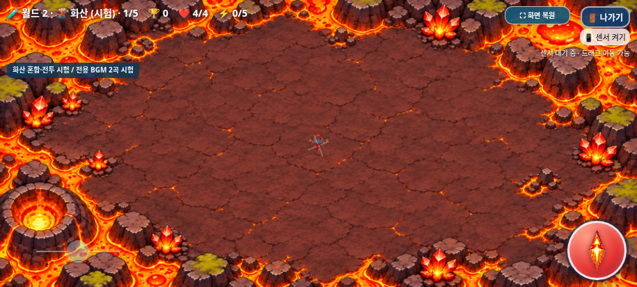
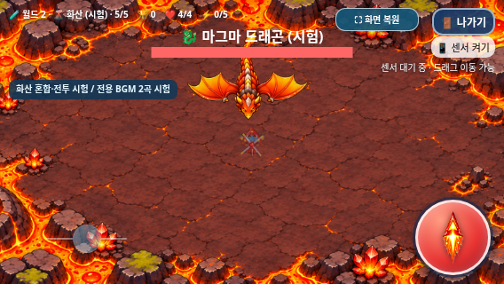

# 화산 전용 일반전·마그마 드래곤 BGM 2곡 — 1차 시험

2026-11-06 KST · [Issue #23](https://github.com/26aiera11-cpu/helicopter-game/issues/23) · `feature/volcano-bgm`

**두 곡은 사용자 청취 승인 전인 1차 시험용이다.** 기존 곡의 확정/출시나 청감 검증을 완료했다고 주장하지 않는다. 지정된 기존 원격 브랜치와 기준 `d9f538e7e335a72b8140aebc77f7e3bfb31b25cc`를 추적했다. main은 `17da293570f422035d455add578dbc8412e4f24b`였다. 22절의 게임 오버 BGM 정지 누락, 33절의 단일 음악 owner/선택 MP3/재생 거부와 56절의 혼합 등장 기록, 실제 하단 WAV controller·설원/화산 레지스트리·빌드를 확인했다. `HELI_TRIO_SPEC.md`는 없어 이번 요청/Issue의 확정 조건을 적용했다. main 병합과 Pages 배포는 하지 않는다.

## 먼저 들어볼 파일

- **[화산 일반 전투 WAV 직접 듣기/다운로드](https://github.com/26aiera11-cpu/helicopter-game/raw/refs/heads/feature/volcano-bgm/assets/audio/volcano_stage.wav?download=1)** — `assets/audio/volcano_stage.wav`
- **[마그마 드래곤 보스 WAV 직접 듣기/다운로드](https://github.com/26aiera11-cpu/helicopter-game/raw/refs/heads/feature/volcano-bgm/assets/audio/volcano_boss.wav?download=1)** — `assets/audio/volcano_boss.wav`
- **[최신 갤럭시 테스트 ZIP 다운로드](https://github.com/26aiera11-cpu/helicopter-game/raw/refs/heads/feature/volcano-bgm/dist/heli_trio_galaxy_test.zip?download=1)** — `dist/heli_trio_galaxy_test.zip`

브라우저에 따라 WAV를 바로 재생하거나 다운로드한다. 두 원본을 먼저 듣고, 게임에서 효과음과 함께 확인한 뒤 사용자 승인/피드백을 받는다. 다음 제작 단계와 main 병합/배포로 진행하지 않는다.

| 곡 | BPM | 조성 | 구조 | 실제 길이 | 파일 크기 |
|---|---:|---|---|---:|---:|
| 화산 일반 전투 | 136 | E minor | 16마디·4/4 | 28.235283초 | 1,245,220바이트 |
| 마그마 드래곤 보스 | 114 | C minor | 16마디·4/4 | 33.684218초 | 1,485,518바이트 |

두 파일 모두 **22,050Hz·모노·PCM 16bit WAV**이며 총 **2,730,738바이트**, 권장3.5MB 이하다. [생성 메타데이터](music-generation.json)

## 독창적 합성과 재생성

`python scripts/generate_volcano_bgm.py`로 두 배포 파일을 다시 만든다. Python3와 NumPy가 필요하며 검증 환경은 Python3.12.14 / NumPy2.3.5였다. 다른 출력 폴더에 재현하려면 `python scripts/generate_volcano_bgm.py --output-dir /tmp/volcano-bgm-repeat`를 사용한다. 일반 시드230136, 보스230137이다. 독립 임시 폴더에 재생성한 WAV는 배포 파일과 바이트가 같다.

멜로디·화음·베이스·타악을 스크립트에 직접 작곡하고 오실레이터와 진폭 엔벨로프로 합성했다. 기존 embeddedAudio의 멜로디/파형을 읽어 복제하거나 피치만 옮기지 않는다. 외부 음원·제3자 샘플·유명 게임 OST를 사용하지 않았다.

일반곡은 E단조 중심의 단3화음 진행과 반음계적인 B dominant 회귀, 짧은 펄스 리드·빠른 FM풍 아르페지오·맥동 베이스·절제된 킥/스네어/하이햇을 구성했다. 네 마디 단위 변화를 두고 세 번째 구간은 아르페지오/패드를 줄여 대비를 주었다. 보스곡은 C단조, 더 낮은 오스티나토와 넓은 패드·무거운 킥/톰·간격을 둔 경고형 리드로 구성했다. 낮은 음역의 긴장감과 효과음을 위한 여유를 의도했으며 실제 휴대폰 청감 평가는 남아 있다.

대역 제한 가산 펄스·사인/삼각형풍 저음·자체 시드 노이즈 타악을 사용한다. 지연/잔향은 루프 끝에서 처음으로 감싸며, 양끝1.5ms만 짧게 정리한다. 긴 페이드아웃/빈 아웃트로를 넣지 않았다. PCM 처음/끝 값이 모두0이고 100ms 단위 무음은 없다. 이 수치가 음악적 접점의 청취 승인을 대신하지 않는다.

| 파일 | RMS | 최대 절댓값 | DC 평균 | 끝→처음 값 차이 | 최소100ms RMS |
|---|---:|---:|---:|---:|---:|
| volcano_stage.wav | 0.086996 | 0.438354 | -0.00000113 | 0.0 | 0.035339 |
| volcano_boss.wav | 0.102996 | 0.569794 | -0.00000081 | 0.0 | 0.023873 |

샘플 클리핑0, peak≤0.95, DC 절댓값<0.0001을 검사했다. 기존 일반곡 RMS는 약0.081~0.092, 보스곡은0.115~0.119였으며 새 곡은0.087/0.103으로 맞췄다. 재생 볼륨은 기존 **일반0.42·보스0.58·선택0.34**를 그대로 사용한다. 기존 지역별 파일 음량을 재정규화하거나 효과음 gain을 바꾸지 않았다. [기존12WAV 정보/해시](legacy-audio.json)

## 적용과 원본 보호

화산은 음악 프로필만4로 분리한다. 레지스트리의 전투/그래픽 프로필0은 그대로다. 월드1 음악은0/1/2/3, 설원은 기존 숲 임시0을 유지한다. `index.html`에 숨김 `audio#volcanoStageBgm`/`#volcanoBossBgm`을 추가하고 기존 stageTracks/bossTracks의 다섯 번째 요소로 재사용한다. tick의0~3 상한은 배열 길이를 기준으로 확장했다. desiredMusic/resume/tick 모두 같은 프로필을 사용하며 기존 단일 owner에 두 곡을 포함했다. 기존 거대 WAV map과 WebAudio 효과음 코드는 수정하지 않았다. 원래 합성 스테이지 score는 계속 호출하지 않아 WAV 위에 겹치지 않는다.

- 화산1~4 및 정상5단계의 일반6마리 전투: `volcano_stage.wav` 반복.
- 마그마 드래곤 실제 등장: stage 정지 후 `volcano_boss.wav` 반복. 개발자5 직접 시작은 boss부터 시작한다.
- 게임 오버: 즉시 음악 정지 → 기존3초 GAME OVER 무음 → 선택 복귀 시 원본MP3. 나가기 취소는 게임곡 유지, 확정은 선택곡 복귀.
- 보스 처치의 기존0.94초 아트 소멸/보상·클리어·선택 복귀를 유지한다. 보스 객체가 사라진 소멸 시간의 음악 대상 선택 규칙도 기존 그대로이며, 두 곡을 동시에 재생하지 않는다.
- 음악 OFF/ON은 선택/일반/보스 전체에 적용하고 효과음 설정은 독립적이다. 문서 숨김과 재생 Promise 거부는 기존 owner가 처리한다. 최초 trusted gesture 전에는 재생을 요청하지 않고 브라우저 정책을 완화하는 플래그를 사용하지 않았다.

기존90개 자산 중 **89개가 바이트 그대로**이고 worlds.js는 음악 메타데이터와 안내2문장만 정확하게 변경했다. index의 허용4차분을 되돌리면 기준 전체 파일과 같다. 기존12WAV 데이터URI·선택MP3·모든 SFX·PNG/매니페스트, 화산 혼합 추첨/AI/수치·승인된 아래0.2초 선분사+3.8초360° 브레스·설원/월드1·캐릭터/아이템/점수/저장·자이로/조이스틱/전체화면/종료 코드가 보호된다. [바이트 보존 검증](preservation-verification.json)

## 테스트 결과

**58개 모음 중57개 통과·1개 실패.** 완료한 모음의 검사 그룹은724개이며 실패한 worlds 모음의 부분 통과16개는 합계에 넣지 않았다. [실행 명령·초기 실패·최종 집계](test-summary.json)

새 음악 일반/오프라인 각17그룹에서 PCM 형식/길이/재현·클리핑/DC/접점/기존 음원 해시·사용자 동작 전 무음, 실제 개발자 메뉴5단계,18개 조합(세 캐릭터×세 화면×일반/보스)·6지역 음악 전환·WAV 두 곡 native 루프·실제 혼합6킬→보스, 보스 효과음/발사 WebAudio와 기존 합성 BGM 미호출, OFF/ON·나가기 취소/확정·3초 게임 오버·클리어·설원→화산·숨김·12회 추가 재시작과 재생 거부 후 다음 터치를 확인했다. `play/pause/playing` 이벤트·동기 play 호출·프레임별 active 수와 currentTime 증가를 관찰했고, 15개 기본 미디어에서 동시 반복은 최대1·중복0이었다. 보스 피격 SFX의 기존 제한된 clone과 BGM 중복 생성은 구분한다.

[일반 음악 검사](focused/volcano_bgm-native/test-results.json) · [오프라인 음악 검사](focused/volcano_bgm-offline/test-results.json) · [집중8모음](focused/suite-results.json) · [나머지50모음](regression/suite-results.json)

초기 두 검사에서 각16그룹 통과 후 마지막 모의/재접속 fixture가 실패했다. 일반 검사는 한 번만 거부하는 모의가 한 터치의 pointer/click 경로에서 두 번째 요청을 허용해 버렸다. 첫 동작 전체를 거부하고 다음 실제 터치에서 허용하는 정책 모의로 고쳐, 프레임마다 재시도하지 않음도 확인했다. 오프라인 검사는 다음 테스트 문서를 열기 전 차단 상태를 잠시 복구하는 설정을 빠뜨렸다. 빈origin을 연 다음 정확한HTML의 네트워크를 차단하는 기존 방식으로 바로잡았다. 제품 owner/재생 정책을 검사를 위해 바꾸지 않았다. [최초 결과](initial/suite-results.json)와 원래 로그/JSON을 보존했다.

**미해결 회귀 항목:** `worlds` 일반 실행은 설원5단계의 긴3접촉 후 나가기 창이 열리지 않아 실패했고 코드 수정 없는 단독 재검사도 같은 지점에서 실패했다. 버튼에 pointerdown/up은 도달했지만 click이 없었고, 조작 pointer 소유자는 모두 해제됐으며 버튼도 enabled/inert아님 상태였다. 정확한 변경 전 `d9f538e`의 index/worlds.js를 응답한 같은 전체 흐름에서도 동일 실패가 재현됐다. 다른 참조 자산은 기준과 바이트가 같다. 별도 fresh-page 비교8건은 전후 버전/두 touchEnd 형태 모두 성공했으므로 해제 방법을 임의로 바꾸어 검사를 통과시키지 않았다. **새 BGM 이전에도 있는 증상이지만 정확한 원인은 확정하지 못했고 제품 입력 코드는 수정하지 않았다.**

[최초 실패 로그](regression/worlds/run.log)·[입력 진단](regression/worlds/exit-touch-failure.json)·[화면](regression/worlds/exit-touch-failure.png), [변경 없는 재검사](retest/suite-results.json), [변경 전 버전의 실패](baseline-worlds/run.log)·[비교/재현 정보](input-investigation.json)를 남겼다. 오프라인 worlds와 별도23그룹 일반/오프라인 조작, 내부 종료/전체화면·새 음악18개 조합/12회 추가 복귀는 통과했다. 모든 회귀 통과나 물리 기기의 입력 무결함을 주장하지 않는다. 이번 음악 한정 범위를 넘어 조작 수치를 변경하지 않고 별도 조사 대상으로 남긴다.

기존 검사는 화산 음악 프로필4·DOM 음원2개를 포함한15개 미디어·WAV 내장만 반영했다. 기존 숲/바위/바다/사막8곡과 설원0 기대를 유지했다. 과거 보호 가드는 정확한 새 오디오 차분만 역변환하고 새2WAV는 고정해시로 검증한다. 새 해시로 기존 파일을 허용하거나 검사를 제거하지 않았다. 기존 시각 비교의 before 응답은 당시 worlds.js도 함께 제공해, 당시 index에 존재하지 않는 새 곡을 참조하지 않도록 했다.

전체 월드1 20/시험30단계·화산 혼합/69프레임/일반4종·설원/보스·세 캐릭터/탱코 균형·아이템/점수/순위/저장·음악·조이스틱/제어 센서 계산/멀티터치·전체화면/나가기·3초 게임 오버를 회귀 검사했다. 통과한 집중 모음은 전체 검사에서 중복 실행하지 않았다. 과거 긴멀티터치→나가기 간헐 문제는 이번 결과만으로 근본 해결을 주장하지 않는다.

실제 Chromium 화면이며 좌표/진행/무적 등을 제어했다. 음악을 듣고 승인한 증거는 아니다. 중복 회귀/초기 화면과 같은HTML 복제 645파일은 저장소 밖에 보존하며 신규 음악 화면·모든JSON/로그를 남겼다. 기존 추적 역사 자료는 수정하지 않았다. [보존 목록/재현 방법](archived-regression-artifacts.json)

## 패키지·변경 파일·남은 확인

최신HTML **63,951,624바이트**, SHA256 `c67f2077e0a9dc87d203fb446b3e44b6472806b433b7bfcb553ce5dc424a184f`. ZIP **46,561,162바이트**, SHA256 `867c8c9de4d5d142492aeaedaa5fe883cf09118fbfe1481829cfc5554d887003`이며 HTML1개만 포함한다. 신규 WAV2개·선택MP3·기존12WAV·17스크립트·모든 필요 이미지/CSS/매니페스트를 내장했다. 양쪽 WAV와 원본 자산의 디코딩 바이트, 스크립트 순서, 외부HTML/CSS 의존성0, ZIP CRC/실제 별도 압축 해제/SHA 일치와 네트워크 차단 실제 미디어 재생을 검사했다. [패키지 검사](regression/volcano_package/test-results.json) · [갤럭시 실행 안내](../galaxy-test/README.md)

주요 변경은 `index.html`, `assets/worlds/worlds.js`, 신규 `assets/audio/volcano_stage.wav`/`volcano_boss.wav`, `scripts/generate_volcano_bgm.py`, 빌드/패키징2스크립트다. 새 음악 검사/정확차분·해시 가드, 기존 리소스/프로필 기대, 보고서/개발 기록과 dist2개도 갱신했다. [전체 변경 파일](changed-files.txt)

실제 Galaxy Samsung Internet/Chrome의 다운로드/파일 연결·로컬 HTML 정책·최초 터치/백그라운드/화면잠금 복귀·스피커 음색/저음/음량·효과음 마스킹·반복 접점·발열/성능은 미검증이다. file:// 보안 제한을 우회하지 않고 빈localhost origin에서 동일HTML의 네트워크를 끄고 검증했다. `/helicopter-game/` 프로젝트 경로도 로컬HTTP에서 확인했으며 실제 Pages 배포 검사는 하지 않았다. **두 음악의 청감과 실제 갤럭시 확인은 사용자 승인/피드백 대상으로 남긴다.**

작업 브랜치에만 커밋·푸시하고 원격ref와 직접 다운로드한 WAV2개/ZIP을 비교한다. main 병합과 GitHub Pages 배포는 하지 않는다.
