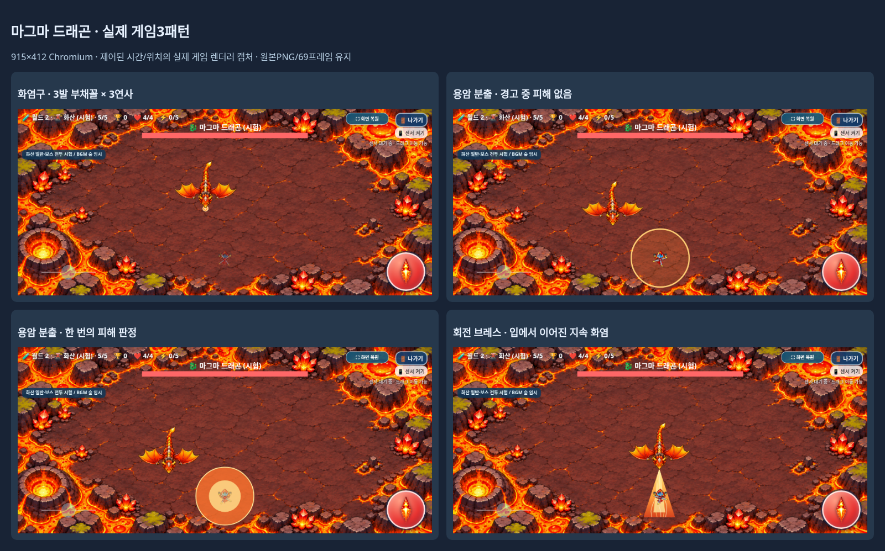
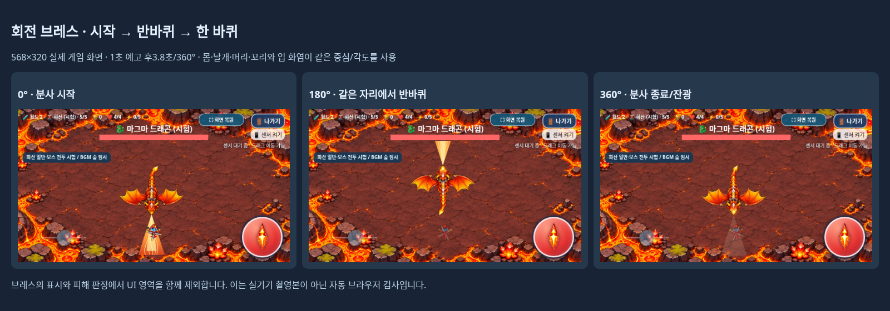
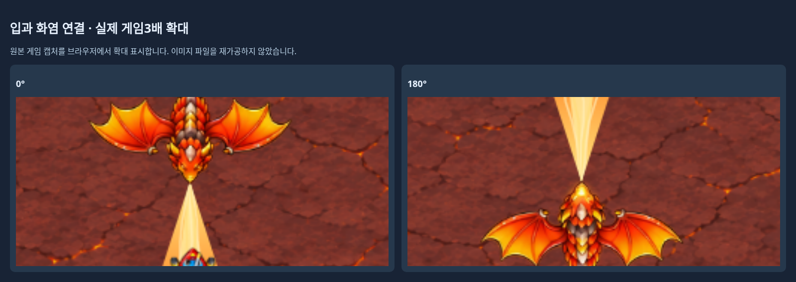

# 마그마 드래곤 고유 보스 전투

2026-11-05 KST · [Issue #19](https://github.com/26aiera11-cpu/helicopter-game/issues/19) · `feature/volcano-boss-combat`

기준은 `78148480330e48a64dd77191006ddb0f0c5e785b`다. 이미 생성된 원격 작업 브랜치가 일반 전투 완료 브랜치와 같음을 확인하고 그대로 추적 작업했다. 리셋/기존 커밋 재작성·main 병합·Pages 배포는 하지 않는다. 개발 기록52절, 실제 설원 보스/화산 일반 전투/아트·루프·빌드 코드를 확인했다. `HELI_TRIO_SPEC.md`는 없어 이번 요청과 Issue의 확정 규칙을 적용했다.

## 구현과 시험 수치

새 `assets/volcano/boss_combat.js`는 `world-2:volcano`의5단계에서 실제 `boss`와 같은 살아 있는 드래곤만 처리한다. 기존 숲 자동발사/이동 분기는 이 경우 실행하지 않아 공격이 중복되지 않는다. 화산 일반4종·설원·월드1은 기존 모듈/경로 그대로다. 아래 수치는 **1차 시험값**이며 월드 전체 난이도의 최종 확정값이 아니다.

| 항목 | 적용 값 |
|---|---|
| 순서 | 화염구 연사 → 용암 분출 → 회전 브레스 → 반복 |
| 첫 공격 대기 / 공격 후 휴식 | 1.8초 / 2.8초 |
| 화염구 | 0.4초 조준 뒤3발 부채꼴 ×3연사, 연사 간격0.32초 |
| 화염구 각도·탄속·반경·수명 | 중앙±12° /88px/s /5.5px /3.2초 |
| 보스 화염구 상한 | 살아 있는18발; 일반 화염탄28발 제한과 별도 |
| 용암 분출 | 1.25초 경고 →0.25초 분출, 시작 순간 피해1회 |
| 용암 반경 | `clamp(화면높이×0.16,48,64)` |
| 브레스 예고 / 분사 | 1초 /3.8초 동안 정확히360° 시계 방향 |
| 브레스 길이 / 각도 | `clamp(화면높이×0.26,85,115)` /전체36° |
| 브레스 잔광 | 0.18초, 피해 없음;2.8초 휴식에 포함 |

화염구는 기존 `emitEnemyShot`/`enemyBullets`/`hurt()`·무적·탱코 상쇄 경로를 사용한다. 조준한 방향으로 부채꼴3발을3번 쏘며, 회전 브레스 중 방사형 탄환이나 추가 화염탄은 만들지 않는다. 각도/속도/수명과 표식은 보스 전용으로 분리했다.

용암 경고 위치는 플레이어 속도의0.18초 예상 위치 근처에서 한 번 결정하고 따라가지 않는다. 조이스틱·발사·HUD·전체화면·나가기·센서·안내/보스HP 영역과 화면 경계를 피한다. 안전한 원이 없으면 건너뛴다. 경고 중에는 피해가 없으며 분출 시점에만 피해1을 한 번 판정한다. 배경 용암 전체에는 피해를 추가하지 않았다.

## 회전 브레스의 입·그림·판정

승인된 드래곤 PNG/21프레임·화산69프레임을 다시 그리거나 리인코딩하지 않았다. 매니페스트의 개별 사각형/가상320셀·기준점·132px 표시 폭을 그대로 사용한다.21프레임의 아래쪽 턱 안쪽 픽셀에서 입 시작점을 측정해 새 모듈의 메타데이터로만 보관했다. [21프레임 기준점](mouth-frames.png) · [측정/원본 해시](mouth-anchor-verification.json)

원래 그림의 머리 방향인 Canvas +Y에서 시작한다. 입의 로컬 좌표와 드래곤 전체 프레임을 같은 회전 중심/각도에 적용하므로 몸통·머리·날개·꼬리가 함께 돌아간다. 비율을 줄이거나 날개를 접는 변형은 없다. Canvas 변환은 매번 복원해 플레이어나 다른 몬스터에 남지 않는다.

브레스 전 휴식 중에는 기존 속도45px/s를 상한으로 안전한 회전 위치를 향해 움직인다. 필요하면 최대3초 추가 위치 조정을 한 뒤 멈추고1초 예고한다. 안전한 회전 공간을 확보할 수 없으면 공격을 건너뛴다. 위치를 순간이동시키지 않으며 예고/분사 동안 실제 보스 좌표와 시각적 회전 중심은 고정한다. 그 외에는 기존 숲 프로필의 접근/회전 이동 식을 사용한다.

붉은 입 빛, 점선 화염 방향과 시계 방향 화살표로 예고하며 이때 피해는 없다. 분사 중에는 입에서 연결된 하나의 원뿔형 화염을 그린다. 불꽃 줄기/밝은 중심은 같은 외곽 삼각형 안에만 그린다. **표시와 피해 판정은 동일한 삼각형과 동일한 UI 제외 영역**을 사용한다. 플레이어 중심이 그 영역에 들어왔을 때 기존 `hurt()`/1.55초 무적을 재사용한다. 같은 업데이트에서 위험 판정을 여러 번 만나도 피해 호출은 한 번뿐이다.

UI 사각형은 DOM CSS 좌표를 게임 Canvas 좌표로 바꾸어 사용한다. 겹치는 UI도 제외 영역이 취소되지 않도록 각 사각형을 순차적으로 잘라낸다. 범위/배치가 변경되면 위험 원/브레스를 취소해 보이지 않는 피해를 막는다. 보스 충돌 반경48과 플레이어의 기존 공격/피격 판정은 바꾸지 않았다.

위 화면은 실제 게임 렌더러를 제어된 시간·위치·무적으로 검사한 Chromium 캡처다. 갤럭시 수동 플레이 촬영본이나 사람의 반응속도 검사는 아니다.0°/180°/360° 원본은 [boss-native](boss-native)에 세 가로 크기로 보관했다.360° 화면은 분사 종료 후 피해 없는 짧은 잔광이다.

## 생명주기와 보호

보스 HP는 기존20과 무기 강화 배수 `[1,1.1,1.4,1.6,1.9,2.2]`, 보상과2000점도 그대로다. 정상5단계 갑충6킬/개발자5단계 즉시 등장·0.94초 소멸·시험 클리어/기록 분리를 유지한다.

보스가 죽으면 즉시 위험 원·브레스·회전을 중단하고 보스 표식 탄환을 정리한다. 사망 시 각도만 고정해 기존 hit/defeat가0.94초 재생되도록 아트 어댑터에 보스 소멸 전용 호출1개를 추가했다. 플레이어 게임오버에서도 공격을 정리하고 마지막 보스 방향만 정지 화면에 보존한다. 종료창/숨김 탭에서는 시계와 회전/피해가 멈추며 새게임·나가기·단계 전환·선택화면에서 상태를 초기화한다. 새 비동기 공격 타이머/이미지/음원은 없다.

기존 화산 일반 `combat.js`, 설원 모듈·공유 난이도·조작/캐릭터/아이템/점수/음악 코드는 바이트가 같다. 안내 문구만 ‘일반·보스 전투 시험 / BGM 숲 임시’로 바로잡았다. [자산/소스 보호 증거](preservation-verification.json)

## 검증

**최종 52개 모음·662개 검사 그룹 통과, 최종 실패0개다.**

- 실제 게임 방법→월드2→화산5 경로에서 세 캐릭터를 선택해 즉시 보스 진입/나가기를 확인했다.
- 각 모드3캐릭터×915×412/800×360/568×320의9개 실제 전체 공격 순환을 검사했다. 첫 대기·9발·중복 숲 발사 없음·안전한 고정 경고 원·제자리360°·휴식/재순환을 확인했다. 화면 크기는 Canvas W/H의 실제 변경까지 기다린 뒤 확인했다.
- 21개 원본 프레임의 입 픽셀을 검사하고 실제8방향 보스 그리기 행렬에서 입 픽셀과 화염 시작점이0.0001px 이내로 맞음을 확인했다. 스케일/행렬식과 원상 복원도 검사했다.
- 실제 화염 캔버스 픽셀·독립 삼각형 판정·게임 피해 함수가 안티앨리어싱 경계 밖 표본에서 일치했다. 별도 일반/오프라인 강제 중첩UI 검사에서는 원래 불꽃이 있는 지점이 두 UI가 겹친 뒤 픽셀/피해 모두 없어짐을 확인했다.
- 30/60/120Hz에서 세 연사 시간2.2/2.52/2.84초, 용암 경고1.25초와 브레스 예고1초가 일치하고 분사는3.8초/2π로 끝났다. 내부를 따라가는 제어 조건은 기존 무적으로3회 피해, 사거리+10px는0회였다.
- 탱코의 기존 가속/감속과 가로 기울기 입력을 실제 이동 함수에 적용했을 때 세 화면 모두 예고 중 약86px 옆으로 이동해 브레스 피해0을 확인했다. 센서 하드웨어/사용자 반응속도를 검증했다는 뜻은 아니다.
- 용암 경고 중 피해0/분출 한 번만 피해1, 안전한 원이 없으면 건너뜀,18발/일반28발 별도 상한·유한 수명, 세 캐릭터의 실제 탄환 처치/보상1회/0.94초 소멸, 숨김/종료창/게임오버3초/깨끗한 메뉴·개발 기록 비저장을 검사했다.

[보스 일반](boss-native/test-results.json) · [보스 오프라인](boss-offline/test-results.json) · [중첩UI](ui-mask-focus/test-results.json) · [전체 모음 결과](test-summary.json)

아트 집중 일반/오프라인 각10그룹은 각각45개 실제 진입과69프레임 원본 픽셀·알파·비율·기준점·경계/충돌 불변을 확인했다. 기존 보스 검사가 `shot=0`으로 숲 단발을 즉시 기대하던 부분은 실제 새 보스의 첫 연사를 기다리도록 수정했다. 내장 스크립트 기대값은16개다. 새 패턴의 수치를 검사에 맞춰 바꾸지 않았다.

초기 검사 도구의0.0000001px 좌표 허용치는 실제 Canvas 소수점 변환의 약0.000032px 오차로 실패해0.0001px로 조정했다. 제품 좌표는 바꾸지 않았다. 중첩UI의 첫 도구는 숨겨진 UI를 옮겨 실제 겹침이0인 잘못된 준비 상태였고, 별도 표시되는 두 테스트 박스로 바꾼 뒤 일반/오프라인을 다시 확인했다. 확대 프레임 뷰어는 매니페스트의 전역 프레임ID를 로컬 인덱스로 사용하던 부분을 ID 조회로 고쳤다. 초기 로그/진단은 [initial-tests](initial-tests)에 보존하고 최종 통과에 합산하지 않았다.

기존 전체 회귀는 화산 일반4종/갑충·설원4종/돌진/혼합/보스3패턴·월드1 20단계/시험30단계·아이템/점수/기록·캐릭터/음악/조작/전체화면/게임오버/나가기를 포함하며 한 차례 실행했다. 기존 긴멀티터치 후 나가기 간헐 증상은 한 번의 통과만으로 근본 해결을 주장하지 않는다. 입력 코드는 수정하지 않았다. 환경 재연결 뒤 결과 수집 연결이 끊겨 종료 코드가 보존된28개는 반복하지 않고, 확인하지 못한19개만 파일 로그로 재개했다. [재개 기록](environment-resume.json)을 남겼다.

중복 기존 화면/같은 독립HTML 복제본은 작업 공간 밖의 별도 보존 폴더로 옮기고 신규 요청 화면과 JSON/로그는 남긴다. 기존 추적 역사 자료는 그대로다. [보존 목록/재현](archived-regression-artifacts.json)

## 파일·갤럭시 결과물·남은 확인

제품 변경은 새 `assets/volcano/boss_combat.js`, index의 준비/갱신/표시/사망/정리 훅과 문구, 아트 어댑터 소멸 호출1개, worlds 안내2문자열이다. 빌드/ZIP2스크립트·dist2개·정확 차분/고정해시·새 보스/중첩UI 검사·기존 발사/내장순서 기대값·보고서/화면·최신 Galaxy 안내·`DEVELOPMENT_LOG.md`를 갱신했다.

**[최신 갤럭시 ZIP 다운로드](https://github.com/26aiera11-cpu/helicopter-game/raw/refs/heads/feature/volcano-boss-combat/dist/heli_trio_galaxy_test.zip?download=1)**

HTML **60,079,227바이트**, ZIP **43,718,282바이트**다. ZIP SHA-256 `3dd0242a10aef7f7dd760ebecfc8077bd6b8f962f1af0954d3b4c4c677505986`, HTML SHA-256 `7e37d917af13eb1331016964b2d739a28ab1ba452283b9770456ea673daa13e7`.

16스크립트·화산11PNG/69프레임·기존 게임 실행 이미지/CSS/음원을 단일 HTML에 포함했다. ZIP에는HTML1개만 있으며 외부 의존성0·원본 바이트/순서·CRC·별도 실제 압축 해제/전체 해시·오프라인 실행을 확인했다. [패키지 검증](package-source-verification.json) · [실행 안내](../galaxy-test/README.md)

실제 Galaxy Samsung Internet/Chrome의 센서 권한·손가락 조작/반응·파일 다운로드/연결·화염 가독성·실전 난이도/성능/발열과 스피커 청취는 미검증이다. file:// 보안 정책을 우회하지 않고 빈localhost origin에서 네트워크를 끈 동일HTML을 검사했다. 월드 전체 난이도 확정·화산 혼합 등장·전용BGM은 후속 작업이며 이번에는 구현하지 않았다.

작업 브랜치에만 커밋·푸시한다. **main 병합과 GitHub Pages 배포는 하지 않는다.**
