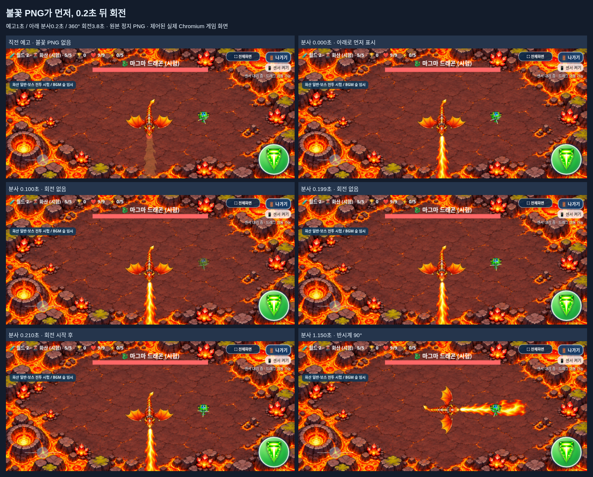
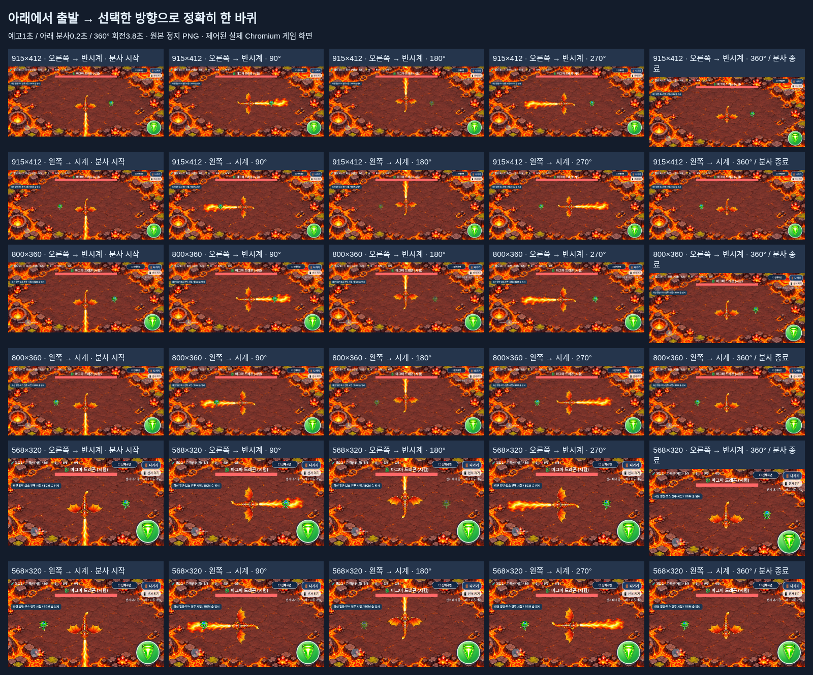

# 마그마 드래곤 · 아래로 먼저 분사한 뒤 360° 회전

2026-11-05 KST · [수정된 Issue #21](https://github.com/26aiera11-cpu/helicopter-game/issues/21) · `feature/volcano-breath-aimed-sweep`

기준 커밋은 `1602af12950ea722f7c22de2f4e39270a4f57357`이다. 이미 존재하는 원격 작업 브랜치가 이 커밋임을 확인하고 추적했다. 다른 브랜치·기존 커밋을 재설정하거나 강제 덮어쓰지 않았다. main은 `17da293570f422035d455add578dbc8412e4f24b`이며 병합·Pages 배포는 하지 않는다. 기존 개발 기록54절·실제 보스/아트/빌드/검사를 먼저 읽었다. `HELI_TRIO_SPEC.md`는 없어 이번 사용자와 Issue의 확정 조건을 적용했다.

## 의도 정정과 최종 동작

기준 버전의 ‘예고·분사 중 플레이어 추적’과 수정 전 Issue #21의 ‘플레이어를 먼저 조준한 뒤 분사’ 요구는 모두 폐기한다. **이번 동작은 처음부터 아래를 향하고, 불을 먼저 보여준 뒤 플레이어 쪽으로 한 바퀴 도는 것**이다.

| 분사 기준 시간 | 동작 | 피해 |
|---|---|---|
| -1.0~0초 | 아래(+Y) 자세로 예고, 플레이어 방향으로 돌지 않음 | 없음 |
| 0~0.2초 | 선명한 원본 정지 PNG를 아래로 먼저 분사, 회전0° | 기존 알파 판정 활성 |
| 0.2초 | 플레이어 위치를 딱 한 번 관측해 회전 부호 선택 | 유지 |
| 0.2~4.0초 | 선택한 방향으로3.8초 동안 정확히360° | 유지 |
| 4.0초 | 다시 아래를 향한 상태에서 즉시 분사 종료 | 종료 |
| 이후2.8초 | 기존 휴식 후 화염구 패턴 | 브레스 피해 없음 |

플레이어가 오른쪽이면 반시계(-), 왼쪽이면 시계(+)다. 위·아래처럼 x가 대칭이면 기본 시계 방향이다. **회전 중 위치가 바뀌어도 재추적·각도 목표 재계산·부호 반전이 없다.** 다음 브레스에서만 다시 관측한다. 이전70°/초 추적 제한은 폐기된 방식이며, 확정된360°/3.8초에 따라 약94.736842°/초의 일정한 회전을 사용한다. 몸통·머리·양 날개·꼬리·입과 화염이 같은 중심/각도로 함께 돈다.

`breath_warning` → 새 `breath_hold` → `breath` → 기존휴식으로 dt 경계를 나누어 처리한다. 비동기 공격 타이머는 추가하지 않았다. 최초 PNG를 그리는 상태로 넘어가는 같은 업데이트부터 기존 피해 함수를 적용한다. 종료 때 각도는 정확한±2π이며 기본 자세와 같으므로 별도의 추적 복귀 회전도 없다.

[54개 개별 캡처와 좌표·시각](capture-metadata.json) · [재현 도구](capture_review.py)

화면은 실제 게임 Canvas의 시간·위치·무적을 제어해 캡처했다. 실제 갤럭시 수동 촬영본은 아니다. 불 안에 있는 비교 화면은 무적이므로 체력이 줄지 않는다. 별도 자동 검사에서는 실제 피해/무적을 검증했다.

## 보존 범위

제품 실행 코드는 `assets/volcano/boss_combat.js` 하나만 변경했다. **index.html과 기존89개 자산 중88개가 바이트 그대로다.** 브레스 PNG SHA-256 `a9600ff8d4c827d8d5ac200c5c508ff636d008398ec985a5fb259c65913fa979`와 드래곤21프레임·화산69프레임/매니페스트·배경·음원은 변경하지 않았다. [소스/자산 보호 검증](preservation-verification.json)

입 앵커·원본 비율·알파96 메모리 마스크·동일한 UI clipping/피해 함수는 그대로다. PNG의 알파를 로드 때 한 번만 읽고 프레임마다 역변환해 메모리를 샘플링한다. 투명 구멍/약한 가장자리·UI 아래는 피해가 없다. 길이는 `clamp(H×.52,165,205)`로 유지해915×412/800×360/568×320에서205/187.2/166.4px다. 새 그림·추가 화염 애니메이션·재인코딩을 만들지 않았다.

화염구3×3연사와0.4초 조준/.32초 간격/88px/s/3.2초 수명/18발 상한, 용암1.25초 경고/.25초 분출/기존 반경, 3패턴 순서·첫 대기1.8초·휴식2.8초, 보스HP20/강화 보정/보상2000점/0.94초 소멸은 유지한다. 월드1·설원·화산 일반4종·세 캐릭터/조작·아이템·점수·BGM·메뉴·기록 저장 코드는 변경하지 않았다.

숨김 탭/실제 내부 종료창에서는 홀드/회전/피해가 멈추고, 계속 플레이하면 이어진다. 사망·게임오버·나가기·새게임·단계 전환에서 상태를 정리한다. PNG 로드 실패 시 보이지 않는 피해 없이 해당 브레스를 건너뛰며 다른 두 패턴은 계속한다.

## 검사 결과

**최종54개 모음·684개 검사 그룹 통과, 최종 실패0개.** [실행 명령·종료 코드·결과](test-summary.json)

- 보스 일반/오프라인 각16그룹: 실제 게임 방법→월드2→화산5, 세 캐릭터×세 가로 크기, 3패턴 반복·기존 화염구/용암·예고·홀드·정확한 회전·휴식, 사망/보상1회/기록 비저장, 숨김/내부 종료창/게임오버3초/재시작을 확인했다.
- 정지 아트/순서 일반·오프라인 각10그룹: 원본PNG 해시·알파1회 읽기,12개의 입/몸/화염 실제 Canvas 변환, 예고 중 피해0·최초 분사와 같은 업데이트의 피해1·무적 유지, 0/.199/.2초의 표시/회전 순서,90/180/270/360°, 부호 한 번 관측·중도 반전 금지,4초 종료/2.8초 휴식과 전체화면/UI를 검사했다.
- 실제 멈추지 않은 requestAnimationFrame 루프에서 양쪽 실행 모두 **아래 PNG가12프레임 먼저 표시**, 첫 움직임까지 게임 시간 약0.2초였다. 30/60/120Hz dt 시뮬레이션에서 시계·반시계 회전의 최대 각도 오차는 약2×10⁻¹⁴rad다. [원시 프레임/측정값](measurements.json)
- 원본PNG의 독립 역변환 오라클과 피해 함수는 각 모드356,448개 표본에서 불일치0이었다. 기존 알파/사거리·실제 화면 픽셀과 두 UI가 겹친 영역의 표시/판정 제거도 검사했다. 밝은 내부는 기존1.55초 무적으로3회, 화면 안의 먼 안전 지점은0회 피해였다.
- 탱코는 중심에서160px 떨어진 상태로 예고 시작부터 기존 기울기 입력을 적용하면1초에86.384px 이동해 세 화면 모두 전체 공격 동안 피해 없이 벗어났다. 센서 하드웨어나 사람의 반응속도 검사는 아니다.
- 기존 아트 일반/오프라인 각10그룹의45개 실제 진입/69프레임 픽셀·알파·비율·기준점 검사가 통과했다. 나머지47개 모음을 최종 제품 소스에서 한 번만 전체 회귀했다. 월드1 20단계·월드2 시험30단계, 설원·화산 일반/보스, 캐릭터/아이템/점수·순위·음악·조작·전체화면·나가기 결과를 확인했다. 중복 전체 재검사는 하지 않았고 실패한 worlds-offline 한 모음만 동일 조건으로 재확인했다.

[보스 일반](focused/volcano_boss-native/test-results.json) · [보스 오프라인](focused/volcano_boss-offline/test-results.json) · [순서/정지 아트 일반](focused/volcano_breath_art-native/test-results.json) · [순서/정지 아트 오프라인](focused/volcano_breath_art-offline/test-results.json) · [중첩UI](focused/volcano_boss_masks/test-results.json)

최종 실패·미완료 모음은 없지만, 최초 전체 회귀에서 `worlds-offline`1개가 긴3접촉 뒤 나가기 창의 숨김 상태로 실패했다. 설원5단계에서 버튼 pointerdown/up은 있었지만 click은 관측되지 않았고, 조작 소유자는 모두 해제된 상태였다. 이전 기록에도 있는 간헐 현상이며 동일한 검사를 수정 없이 선택 재실행해 통과했다. 제품/조작 코드는 변경하지 않았고 근본 해결로 주장하지 않는다. [최초 실패 로그](initial-tests/worlds-offline/run.log) · [입력 진단](initial-tests/worlds-offline/exit-touch-failure.json) · [실패 화면](initial-tests/worlds-offline/exit-touch-failure.png) · [동일 검사 재확인](retest/worlds-offline/test-results.json). 추가 보존 검증을 작성할 때 Python Path 결합 오타로 한 번 실행 오류가 났고 도구만 고친 뒤 검증이 통과했다. 제품이나 공격 수치를 검사를 위해 바꾸지 않았다. [검사 도구 기록](qa-note.json)

기존 PNG·알파 검사를 없애지 않고 추적 회전/기존3.8초 즉시 분사 기대만 새 확정 순서에 맞췄다. 역사 문서/이전 결과는 유지했다. 중복 기존 회귀/아트 화면과 같은 독립HTML 복제는 저장소 밖에 보존하고, 신규 브레스 화면·JSON·로그는 남겼다. [보존/재현 목록](archived-regression-artifacts.json)

## 파일과 갤럭시 패키지

주요 변경: `assets/volcano/boss_combat.js`, 패키지 포함 검사, 기존 보스/정지 아트/패키지 테스트와 새 정확 차분 보호, `dist` HTML·ZIP, 이 검토 폴더·갤럭시 안내/결과와 `DEVELOPMENT_LOG.md`다. 게임 원본 이미지/음원은 수정하지 않았다.

**[최신 갤럭시 ZIP 다운로드](https://github.com/26aiera11-cpu/helicopter-game/raw/refs/heads/feature/volcano-breath-aimed-sweep/dist/heli_trio_galaxy_test.zip?download=1)**

HTML **60,308,370바이트**, SHA-256 `d5f65e22cdabc1257fd60b146b5ae49e20f871ceef56a024a551f30dbd22ca41`. ZIP **43,891,713바이트**, SHA-256 `edc5e7024389cc25bd78c678e3656e0c5f5c95cf871e9889d53f20a8f8acd891`. ZIP에는 최신HTML1개만 있다.16스크립트·원본 브레스PNG를 포함한 화산12PNG/69프레임·매니페스트·기존 이미지/CSS/음원을 내장했다. 원본 자원 바이트/순서·외부HTML/CSS 의존성0·CRC·별도 실제 압축 해제·전체 해시·네트워크를 끈 오프라인 실행을 확인했다. [패키지 증거](regression/volcano_package/test-results.json) · [실행 안내](../galaxy-test/README.md)

실제 Galaxy Samsung Internet/Chrome의 파일 다운로드/연결·센서 권한/손가락 조작·실전 회피/가독성/프레임 저하/발열·스피커 청취는 미검증이다. file:// 보안 제한을 우회하지 않고 빈localhost origin에서 네트워크를 끈 동일HTML을 검사했다. 기존 긴 멀티터치 후 나가기의 간헐 현상은 이번 전체 회귀에서 한 번 재현됐다. 설원5단계의 입력 진단에서 버튼의 pointerdown/up은 있었으나 click은 관측되지 않았고 모든 조작 소유자는 비어 있었다. 동일 검사 재실행은 통과했지만 근본 해결을 주장하지 않는다. 조작 코드는 변경하지 않았으며 실기기에서 반복 확인이 필요하다. 월드 전체 난이도·화산 혼합 등장·전용BGM은 이번 범위 밖이다.

**지정 작업 브랜치에만 커밋·푸시한다. main 병합과 GitHub Pages 배포는 하지 않는다.**
