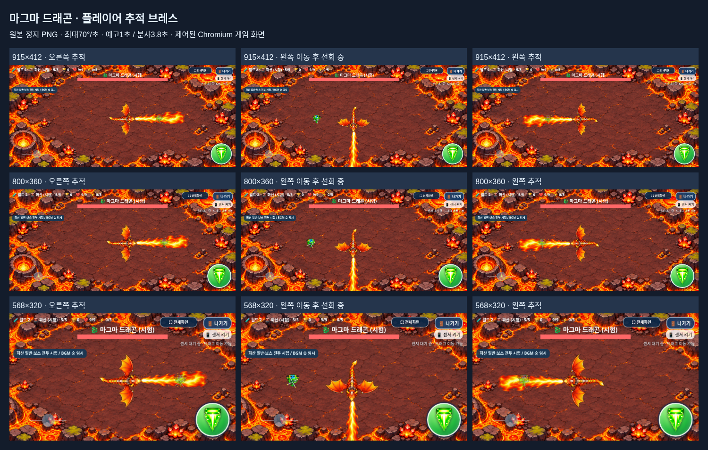

# 마그마 드래곤 추적 브레스 · 원본 정지 PNG

2026-11-05 KST · [Issue #20](https://github.com/26aiera11-cpu/helicopter-game/issues/20) · `feature/volcano-breath-tracking-art`

기준 커밋은 `54ce63653dcf632736bcb360b68f13e1946e97db`다. 이미 만들어진 원격 작업 브랜치가 같은 커밋임을 확인하고 추적 체크아웃했다. 기존 브랜치/커밋을 리셋·재생성하지 않았다. main은 `17da293570f422035d455add578dbc8412e4f24b`였으며 병합·Pages 배포는 하지 않는다. `DEVELOPMENT_LOG.md` 53절과 실제 보스·아트·빌드·보존 검사를 먼저 확인했다. `HELI_TRIO_SPEC.md`는 없으므로 이번 사용자 요청과 Issue #20의 확정 조건을 적용했다.

## 변경과 유지

| 항목 | 기존 | 변경 |
|---|---|---|
| 브레스 길이 | `clamp(H×.26,85,115)` | `clamp(H×.52,165,205)` |
| 915×412 / 800×360 / 568×320 | 107.12 /93.6 /85px | **205 /187.2 /166.4px** |
| 방향 | 3.8초에 시계 방향360° 완주 | 예고·분사 중 플레이어 쪽 최단 방향으로 추적 |
| 최대 선회 | 고정 약94.74°/초 | **70°/초**,0.5° 미세 떨림 데드존 |
| 화염 | Canvas 삼각형·내부 움직이는 선 | 제공된 **단일 정지 PNG**, 추가 화염 애니메이션 없음 |
| 피해 | 삼각형 | 원본 알파96 이상 영역의 메모리 마스크 |
| 시간 | 예고1초 /분사3.8초 /휴식2.8초 | 유지 |

화염구3발×3연사·탄속88/간격.32/수명3.2/상한18, 용암1.25초 경고·.25초 분출·기존 반경, 첫 대기1.8초, 공격 순서는 그대로다. 보스HP20/강화 보정/보상·2000점,0.94초 소멸도 유지한다. 회전 브레스용 탄환을 추가하지 않았다.

원본 드래곤 기본PNG·21프레임을 포함한 화산69프레임과 매니페스트·화산 일반4종/설원/월드1·캐릭터/점수/아이템/음악/설정/저장/입력 코드는 바이트가 같다. 제품 변경은 **브레스 모듈·숨긴 이미지 태그1개·PNG1개**뿐이다. 기존88자산 중87개가 바이트 그대로이며 나머지 보스 모듈도 기록한 브레스 차분을 되돌리면 기준과 정확히 같다. [보호 증거](preservation-verification.json)

## 첨부 파일·입과 판정

업로드 이름은 `breath_asset_retry.zip`이었다. ZIP 안에는 `magma_dragon_breath_static.png`와README가 있었고 CRC가 정상이다. PNG는 Issue가 지정한 실제 투명 RGBA 768×230 파일과 SHA-256 `a9600ff8d4c827d8d5ac200c5c508ff636d008398ec985a5fb259c65913fa979`까지 같다. 대체 그림/PNG 프레임을 만들거나 원본을 리인코딩하지 않았다.

새 경로는 `assets/volcano/effects/magma_dragon_breath_static.png`다. alpha>=8의 경계는 `[25,43,767,229)`이고96 경계는 `[26,44,752,225)`다. 원본의 좁은 시작점(35,158)을 기존21프레임별 실제 입 앵커에 맞췄다. 눈에 보이는 오른쪽 끝x766까지를 새 사거리로 계산하고 가로/세로를 같은 배율로 표시한다. +X 이미지와 +Y 드래곤 방향 차이90°를 같은 Canvas 회전으로 처리한다. 실제12회 그리기의 입 오차는 최대 약0.00002px이고 변환은 원상 복구된다.

이미지를 읽을 때만 getImageData를 한 번 호출해 알파>=96의 마스크를 만든다. 매 프레임에는 플레이어 중심을 이미지 좌표로 역변환해 메모리만 샘플링한다. 투명 구멍/바깥·희미한 발광/축소 보간 가장자리는 피해가 없다. 실제 PNG를 그대로 그리므로 약한 가장자리까지 전부 피해를 주는 방식은 아니다. 기존hurt()/1.55초 무적과 한 업데이트 한 번의 피해 규칙은 유지한다. 예고는 같은 마스크 실루엣으로 표시하며 피해가 없다. UI/화면 제외 영역은 이미지와 판정에 함께 적용하고 중첩 사각형도 안전하게 처리한다.

예고·분사 동안 몸통/머리/날개/꼬리/입과 화염이 같은 방향으로 돈다. 각도 차이를 atan2(sinΔ,cosΔ)로 감싸 매 dt에70°/초 이내로 이동한다. 플레이어가 반대편으로 이동해도 즉시 돌지 않고, 정지하면 그 방향에서 멈춘다. 공격 후 몸체도2.8초 휴식 안에서 같은 상한으로 원래 방향에 복귀해 마지막 각도에서 갑자기 튀지 않는다. 분사 종료 후 PNG의 페이드/깜빡임/길이 펄스는 없다. 기존.18초 몸체 정지 정리 구간만 유지한다.

파일 로드/규격/Canvas 알파 읽기가 실패하면 해당 브레스를 안전하게 건너뛴다. 보이지 않는 화염 피해를 만들지 않으며 다른 두 패턴은 계속된다. 숨김/종료 확인창/게임오버/보스 사망/재시작/단계 전환의 정지·정리와 마지막 사망 각도도 유지한다.

[오른쪽 → 선회 → 왼쪽 개별 화면/좌표](capture-metadata.json) · [캡처 재현 도구](capture_review.py)

위 화면은 실제 게임 렌더러의 시간·위치·무적을 제어한 Chromium 캡처다. 갤럭시 촬영본/사람의 반응속도 평가가 아니다. 의도적으로 불 안에 둔 비교 화면은 무적 상태이므로 체력이 감소하지 않는다.

## 검증 결과

**최종 54개 모음·680개 검사 그룹 통과, 최종 실패0개.** [명령·결과 집계](test-summary.json)

- 보스 일반/오프라인 각16그룹: 세 캐릭터×세 화면, 실제 게임 방법→화산5 진입/3패턴 순환, 기존 화염구·용암 타이밍, 정지/사망/보상/기록 비저장/게임오버3초/나가기를 확인했다.
- 브레스 아트 일반/오프라인 각8그룹: PNG 원본 해시,알파1회 읽기,12개 실제 이미지 행렬,1초 경고 중 피해0,분사 중 좌우/상하/반대편 추적과70° 상한,30/60/120Hz dt 시뮬레이션 일치,.5° 데드존,휴식 중 부드러운 복귀,3캐릭터×3크기 화면과 실제 깨진 이미지 로드의 안전 동작을 확인했다.
- 원본 PNG를 별도로 읽은 독립 역변환 오라클과 피해 함수가 각 모드356,448개 표본에서 불일치0이었다. 밝은 내부의 실제 화면 픽셀과 투명 내부/빈 구멍도 검사했다. 축소 보간으로 생긴 알파96 미만의 희미한 가장자리는 안전한 영역으로 구분했다.
- 별도 일반/오프라인 중첩UI2그룹은 같은 불꽃 지점에서 두 UI가 겹친 뒤 픽셀0/피해false임을 검사했다. 가려진 화염이 피해를 주지 않는다.
- 30/60/120Hz dt 시뮬레이션에서 화염구2.2/2.52/2.84초, 용암 경고1.25초,브레스1초/3.8초가 일치했다. 밝은 내부는 기존 무적으로3회, 화면 안에서 측정한 사거리+10px는0회 피해다.
- 탱코가 보스 중심에서160px 떨어진 상태로 예고 시작부터 옆으로 기울이면 기존 가속/감속으로1초에86.384px 이동하고 세 화면 모두9HP/피해0으로 벗어났다. 반면915×412에서100px 정면 거리로 뒤로만 물러난 조건은 경고 중 피해0,분사 중1회 피해를 관찰했다. **길어진 브레스의 지근거리 정면 후퇴는 안전을 보장하지 않는다.** 수치를 추가 조정하지 않았고 실기기 체감 검토가 필요하다. [측정값](measurements.json)
- 기존 아트 일반/오프라인 각10그룹은45개 실제 진입과69프레임 원본 픽셀·알파·비율·기준점·경계/충돌을 확인했다. 나머지47개 모음의 전체 회귀는 최종 소스에서 한 차례 실행했다. 기존 이미지 실패 검사의11PNG 기대값1건만 새12PNG로 고친 뒤 해당2그룹을 선택 재검사했다. 제품은 변경하지 않았고 전체 회귀를 다시 실행하지 않았다. 월드1 20단계/시험30단계,화산 일반4종,설원/보스,점수/순위/아이템,음악,자이로 계산/조이스틱/멀티터치/전체화면/나가기의 결과를 집계했다.

[보스 일반](boss-final/volcano_boss-native/test-results.json) · [보스 오프라인](boss-final/volcano_boss-offline/test-results.json) · [아트 추적 일반](focused/volcano_breath_art-native/test-results.json) · [아트 추적 오프라인](focused/volcano_breath_art-offline/test-results.json) · [중첩UI](focused/volcano_boss_masks/test-results.json)

초기/중간 테스트 결과도 [initial-tests](initial-tests)에 보존했다. 새 PNG 축소 보간의 희미한 가장자리를 ‘알파0’으로 기대하던 검사, PNG drawImage의(-35,-158) 표시 오프셋을 빼먹은 좌표 오라클, 브레스 진입을 기록하지 않은 시간 추적 필드, 몸체 안전 원 안에 임시 UI를 놓아 공격을 취소한 fixture, 사거리 밖 위치가 화면 경계로 강제 보정되어 실제 불 안으로 들어간 fixture를 각각 수정했다. 지근거리 후퇴의1피해는 실제 결과로 따로 남겼다. 이들 초기 부분 통과를 최종 수에 중복 합산하지 않았다. 전체 회귀에서 새 자원까지 차단되어12개가 된 실패 요청 수를 옛11개로 기대한 `volcano_fallback`1모음도 수정했다. 원래 실패 결과와 해당2그룹의 재검사 결과를 모두 보존했다. 제품의 공격 속도/시간/알파 수치를 검사를 위해 추가 변경하지 않았다.

중복 기존 회귀 PNG/동일HTML 복제·초기 캡처는 저장소 밖에 보존하고 JSON/로그·신규 추적 화면을 남겼다. 기존 추적 역사 자료는 건드리지 않았다. [보존 목록/재현](archived-regression-artifacts.json)

## 파일·패키지·남은 확인

주요 파일: `assets/volcano/boss_combat.js`,새효과PNG,`index.html` 이미지 태그,빌드/패키징2스크립트,갤럭시dist2개,새 아트/정확 차분 보호 검사와 기존 보스/UI/패키지 기대값,실행 목록·검토 문서/화면·갤럭시 안내·개발 기록이다. 모든 변경 파일은 최종 커밋에서 확인할 수 있다.

**[최신 갤럭시 ZIP 다운로드](https://github.com/26aiera11-cpu/helicopter-game/raw/refs/heads/feature/volcano-breath-tracking-art/dist/heli_trio_galaxy_test.zip?download=1)**

HTML **60,308,308바이트**, SHA-256 `c15ce559336a362c30f5d6fb44b3d324cddb737f3931a827c65f2243230b2a07`. ZIP **43,891,730바이트**, SHA-256 `7210ff5acfedea3b8aec37c06e137d66168cfa00759e6ea91de565e20c175d84`. ZIP에는HTML1개만 들어 있다.16개 스크립트/화산12PNG와 승인 매니페스트69프레임/기존 이미지/CSS/음원을 포함한다. 새PNG의 디코딩 바이트,스크립트 원본/순서,외부HTML/CSS 의존성0,CRC,실제 별도 압축 해제와 전체 해시,네트워크를 끈 오프라인 실행을 확인했다. [패키지 증거](regression/volcano_package/test-results.json) · [실행 안내](../galaxy-test/README.md)

실제 Galaxy Samsung Internet/Chrome의 파일 다운로드/연결·센서 권한/손가락 조작·회피 반응·프레임 저하/발열·화염 가독성과 체감 난이도·스피커 청취는 미검증이다. file:// 보안 정책을 우회하지 않고 빈localhost origin에서 네트워크를 끈 동일HTML을 검사했다. 기존 긴멀티터치 후 나가기의 간헐 현상도 이번 한 번의 통과만으로 근본 해결을 주장하지 않는다. 조작 코드는 변경하지 않았다. 월드 전체 난이도 확정·화산 혼합 등장/전용BGM은 이번 범위 밖이다.

**작업 브랜치에만 커밋·푸시한다. main 병합과 GitHub Pages 배포는 하지 않는다.**
