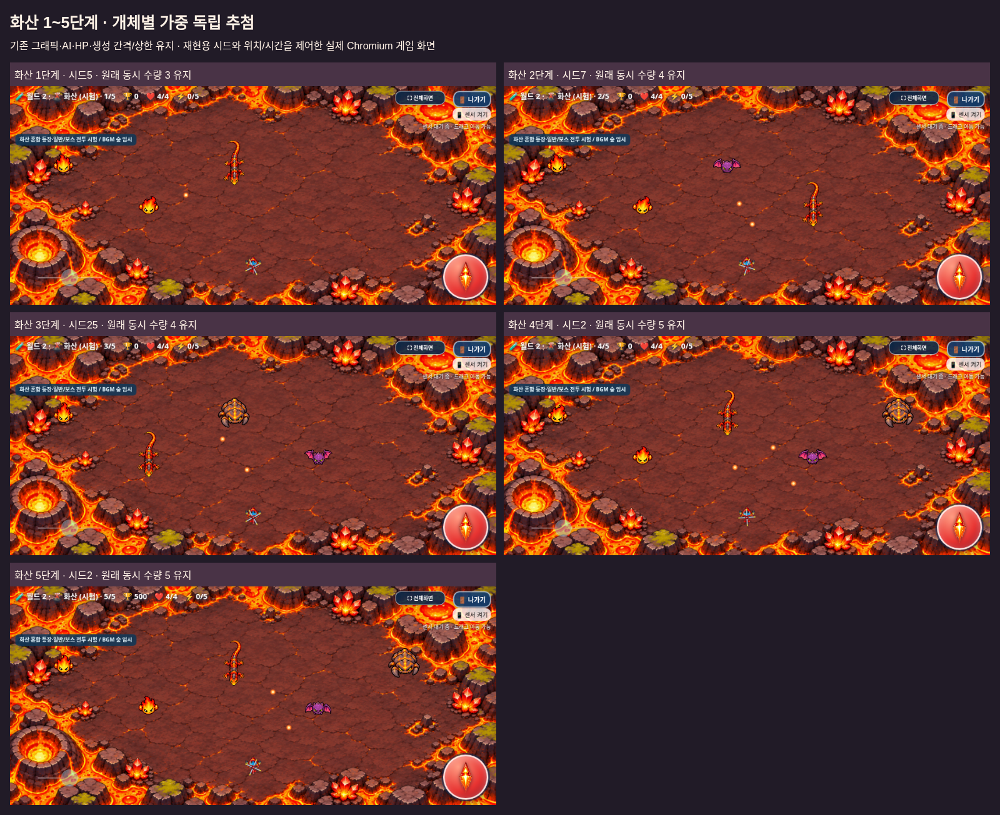
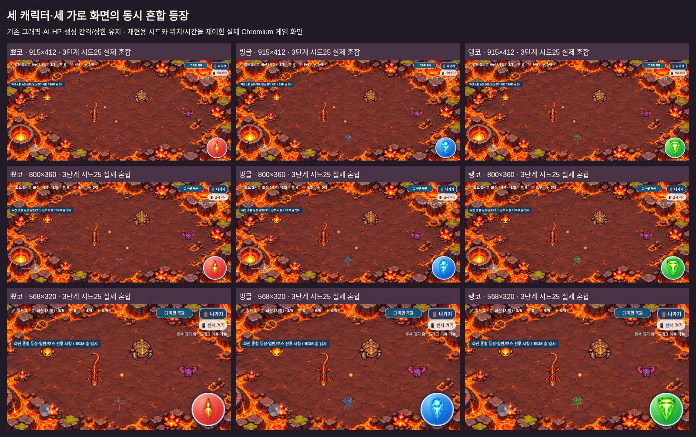

# 화산 일반 몬스터 · 단계별 혼합 등장

2026-11-05 KST · [Issue #22](https://github.com/26aiera11-cpu/helicopter-game/issues/22) · `feature/volcano-mixed-spawns`

이미 생성된 원격 작업 브랜치와 기준 `19c3f603870c602b508944275fb51a00dce0ec8d`를 확인해 추적 작업했다. main은 `17da293570f422035d455add578dbc8412e4f24b`이며 다른 브랜치/커밋을 초기화하거나 강제 덮어쓰지 않는다. 기존 개발 기록55절과 설원 spawns.js, 화산 생성/아트/전투·빌드를 읽었다. `HELI_TRIO_SPEC.md`는 없어 이번 요청/Issue의 확정 조건을 적용했다. main 병합과 Pages 배포는 하지 않는다.

## 확률과 독립 추첨

아래는 **Issue의 1차 시험값 → 3시드 합계90,000개/단계의 실제 관측값**이다. 일반·오프라인에서 같은 시드의 결과가 같다. 전체 지역 난이도 최종 확정은 후속 Issue #12 범위다.

| 단계 | 불씨콩 | 용암 도마뱀 | 화산 박쥐 | 마그마 갑충 |
|---|---|---|---|---|
| 1 | 80% → 79.898% | 20% → 20.102% | 0% → 0.000% | 0% → 0.000% |
| 2 | 45% → 44.836% | 40% → 40.124% | 15% → 15.040% | 0% → 0.000% |
| 3 | 20% → 19.903% | 35% → 34.960% | 35% → 35.083% | 10% → 10.053% |
| 4 | 10% → 9.898% | 25% → 24.967% | 35% → 35.073% | 30% → 30.062% |
| 5 | 5% → 4.870% | 15% → 15.033% | 35% → 34.960% | 45% → 45.137% |

시드1/12345/0xdeadbeef마다 단계당30,000회, 모드당 총450,000회를 검사했다. 개별 시드 기준 최대 오차 **0.457%포인트**, 허용값1%포인트 미만이며0% 칸은 모두0이었다. [시드별 원시 분포](distribution-summary.json)

새 `assets/volcano/spawns.js`의 독립 xorshift32가 개체마다 추첨한다. `ids,weights,reset(seed?),chooseForRoll,select,snapshot`을 제공한다. `Math.random`을 사용하지 않아 설원·아이템·공통 전투 난수 상태를 소비하지 않는다. Python의 독립 오라클과1,000회 결과가 같고, 같은 시드 재생이 일치했다. 시드1의1단계 첫6마리는 모두 불씨콩으로 실제 연속 등장이 허용됨을 확인했다. 다양성·특정 수량 분포를 강제로 맞추는 코드는 없다.

확률표는 `assets/worlds/difficulty.js`의 화산 전용 설정에 둔다. 설원 표/속도/발사/보스 설정은 바이트 그대로다. 새게임/재시작/개발자 바로 시작과 실제 설원→화산 진입에서 초기화하고, 같은 지역의 단계 전환에서는 PRNG 진행을 유지한다. 고정시드는 해당 화산 지역 진입 후 `reset(seed)`로 적용하는 검사 인터페이스이며, 일반 플레이는 별도 엔트로피로 시작한다.

일반 적의 경고가 끝나 실제 생성되는 순간, 아트 prepare 안에서 **한 번만** `volcanoSpeciesId`를 결정하고 그다음 기존 전투 prepare가 같은 ID의HP/AI를 설정한다. 이미 유효한 ID는 보존하고, 실제로 새로 할당된 ID는 변하지 않도록 고정한다. 렌더/피격/소멸은 개체의 그 ID를 계속 사용한다. 보스·아이템 몬스터·화산 외 지역은 추첨하지 않는다.

## 전투·진행 보호

| 종류 | HP | 이동속도(px/s) | 발사 간격(s) | 탄속(px/s) | 고유 행동 |
|---|---:|---:|---:|---:|---|
| 불씨콩 |1|45.6|3.44|85|빠른 추적·단발|
| 용암 도마뱀 |2|38|4.3|89.25|추적·좌우 횡이동·조준|
| 화산 박쥐 |2|41.04|4.945|95.2|지그재그·원거리|
| 마그마 갑충 |4|19|6.235|80.75|느린 이동·일시 방어1회|

표는 기존 값을 확인한 것이며 수치를 변경하지 않았다. 방어 중 발사 제한/개별 상태·탄환3.4초 수명·일반 전체28발/개체3발 상한도 그대로다. 혼합된 네 종에서 실제 방어 시점이 서로 독립적이고, 갑충만 한 번 차단한 뒤 다음 공격을 받으며, 각 발사자의3발 제한도 공유되지 않음을 확인했다.

기존 단계별 생성 간격은2.00/1.91/1.82/1.73/1.64초, 동시 상한은3/4/4/5/5이고 처치 목표는 계속6이다. 실제 자동 생성에서 같은 간격/상한과 종 순서를 검사했다. 실제 프레임에 따른120Hz 양자화 오차만 허용했다.

정상4→5단계는5단계 비율로 뽑은 일반6마리를 처치해600점을 얻고 보스가 나온다. 시드12345에서 갑충→박쥐→갑충→박쥐→도마뱀→갑충을 확인했다. 보스는 추첨을 소비하지 않으며HP20/강화 보정·보상2000점·0.94초 소멸이 같다. 개발자 메뉴의 화산5 직접 시작은 세 캐릭터 모두 일반 적/경고/추첨0회로 바로 보스다.

**승인된 `assets/volcano/boss_combat.js`와 `combat.js`는 바이트가 같다.** 아래1초 예고→아래0.2초 선분사→시작 순간 부호 선택→한 방향3.8초360°→아래에서 종료하는 브레스는 수정하지 않았다. 원본PNG·21보스/69화산 프레임·모든 매니페스트/음원·플레이어/월드1/설원/조작/점수/아이템/저장도 유지한다. [보호 증거](preservation-verification.json)

[캡처 시드·좌표·개별 상태](capture-metadata.json) · [캡처 도구](capture_review.py)

시각 확인용 시드는1~5단계에5/7/25/2/2를 사용했다. 해당 표에서 가능한 종이 잘 보이는 시드를 검사 도구에서 찾았을 뿐 실제 게임에 다양성을 강제하지 않는다. 이미지의 시간/위치/무적은 제어했으며 종류는 실제 경고→자동 생성 경로에서 정했다. 실제 갤럭시 촬영본/사람의 난이도 평가는 아니다.3단계 시드25는 불씨콩/도마뱀/갑충/박쥐가 함께 나오고, 캐릭터/화면을 바꿔도 같은 종 순서를 재현한다.

## 검증 결과와 초기 실패

**최종56개 모음·710개 검사 그룹 통과, 최종 실패0개.** [실행명령·모음별 결과/초기 실패](test-summary.json)

새 혼합 검사 일반/오프라인 각13그룹은45만 추첨·경계/0%/동일시드/난수분리·153개 실제 생성/공격/피격/소멸 조합(17개 허용 단계/종×3캐릭터×3화면), 자동 생성 간격/상한·네 종 동시 전투·6킬 보스/직접 시작·아이템200점/16초/이월·초기화·저장 분리를 확인했다. 개발자 게임은 기록을 추가하지 않았고, 초기화 검사의 두 의도적인 일반 시험 재시작은 기존 규칙대로 중도 종료 분석기록2개만 저장하며 순위표와 기본 저장소는 건드리지 않았다.

기존 아트/전투의 고정 종 검사는 제품을 고정하지 않고 테스트용 시드(`volcano_spawn_fixtures.py`)만 넣어 보존했다. 아트 일반/오프라인 각10그룹에서69프레임 원본 픽셀/비율/기준점/경계를, 전투 각14그룹에서 세 캐릭터·무기 단계·횡이동/지그재그/방어/관통/28·3발 상한을 계속 확인했다. 보스 각16·브레스 아트 각10그룹도 통과해 승인된 선분사/완전회전/피해·끝처리와 생명주기를 검증했다.

초기 집중 검사의 실패는 [initial-tests](initial-tests)에 남겼다. 자연 생성 시간이 서로 다른 갑충의 첫 방어가 이미 끝난 상태에서 차단을 기대한 fixture는 실제 다음 방어를 기다리도록 고쳤다. Playwright의 undefined→None 직렬화 기대를 수정했고, 의도적으로 일반 시험 재시작을 포함했는데 저장소 변화0으로 기대한 검사는 정상 분석기록2개와 개발자 비저장을 구분하도록 바로잡았다. 보스 검사도 위치 조정 직후 경고 시간을 지나친 조회/모바일 경계의 실제 이동 제한을 계산하도록 보완했다. 제품 보스/이동/방어/저장 코드를 바꾸어 검사에 맞추지 않았다.

나머지44모음의 전체 회귀를 한 번 실행했다. 이 중32개는 공통 보존 가드가 새 화산 확률 블록까지 기존 Snow-only 파일 해시와 비교해 브라우저 실행 전에 중단됐다. 등록을 빠뜨린 검사 도구를 고쳐 **새 블록만 정확히 역변환한 뒤 기존 해시를 그대로 검증**했다. Snow 표 보호를 축소하거나 해시를 새 값으로 교체하지 않았다. 통과한 모음은 반복하지 않고 중단된32개만 재개했다. 모든 원래 결과/로그와 재개 결과를 분리 보존했다. 실제 월드1 20/시험30 단계·캐릭터·아이템·점수/기록·음악·조이스틱/자이로 계산/멀티터치/전체화면/나가기 회귀를 확인했다.

[새 혼합 일반](mixed-final/volcano_mixed-native/test-results.json) · [새 혼합 오프라인](mixed-final/volcano_mixed-offline/test-results.json) · [원래 전체 시도](regression/suite-results.json) · [가드 중단 모음 재개](retest/suite-results.json)

중복 기존 회귀/초기 화면과 동일 독립HTML 복제는 저장소 밖에 보존하고 신규 혼합 화면·모든JSON/로그는 남겼다. 기존 추적 역사 자료는 변경하지 않았다. [목록/재현](archived-regression-artifacts.json)

## 결과물과 한계

주요 제품 변경은 새spawns.js, difficulty의 화산 블록, volcano.prepare, index의 새 스크립트·새게임/지역 진입 초기화 훅, worlds 안내2문자열이다. 빌드/ZIP2스크립트·17스크립트 기대/새 검사·기존 시드 fixture/정확차분 가드·검토 문서/화면·dist·개발 기록을 함께 갱신했다.

**[최신 갤럭시 ZIP 다운로드](https://github.com/26aiera11-cpu/helicopter-game/raw/refs/heads/feature/volcano-mixed-spawns/dist/heli_trio_galaxy_test.zip?download=1)**

HTML **60,310,334바이트**, SHA-256 `8dec17be11d2525fd5a9074830d22f28aa080a152891a371faeb2b0de77a18a6`. ZIP **43,892,237바이트**, SHA-256 `8ee214b6306a3659679deccd2a87fba6a6b172b1660eb2087cd51fd3f0931674`. ZIP은HTML1개만 포함한다. 신규 추첨 모듈을 포함한17개 스크립트·원본 화산12PNG/69프레임·두 매니페스트·기존 이미지/CSS/음원을 내장했다. 원본 바이트/스크립트 순서·외부의존성0·CRC·별도 실제 추출·SHA·네트워크 차단 실행을 검증했다. [패키지 검사](regression/volcano_package/test-results.json) · [실행 안내](../galaxy-test/README.md)

실제 Galaxy Samsung Internet/Chrome의 센서 권한·손가락 조작·다운로드/파일 연결·성능/발열/체감 난이도·스피커 청취는 미검증이다. file:// 보안 정책을 우회하지 않고 빈localhost origin에서 네트워크를 끈 동일HTML을 검사했다. 과거 긴멀티터치→나가기 간헐 현상은 별도 확인 대상으로 남으며 이번 결과만으로 근본 해결을 주장하지 않는다. 조작 코드는 변경하지 않았다. 전 지역 최종 밸런스(Issue #12)·화산 전용BGM은 이번 범위 밖이다.

**작업 브랜치에만 커밋·푸시한다. main 병합과 GitHub Pages 배포는 하지 않는다.**
