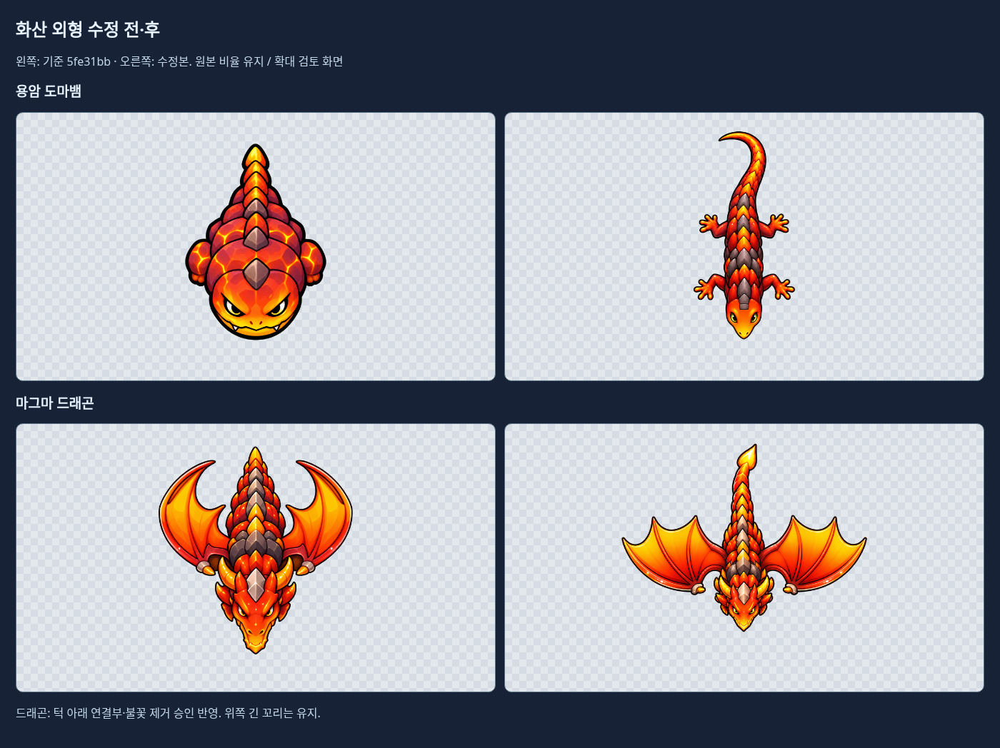
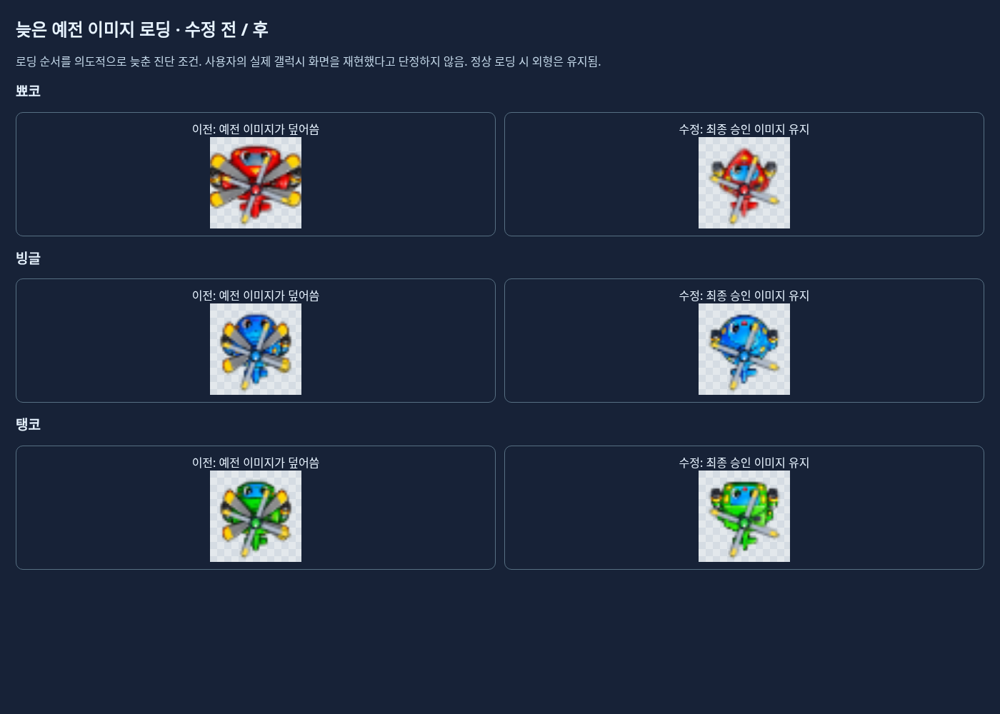
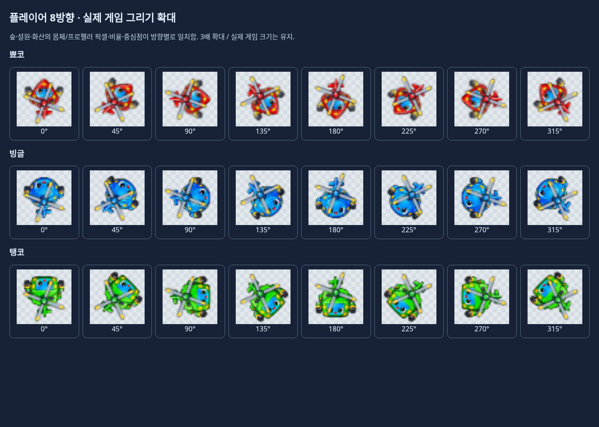
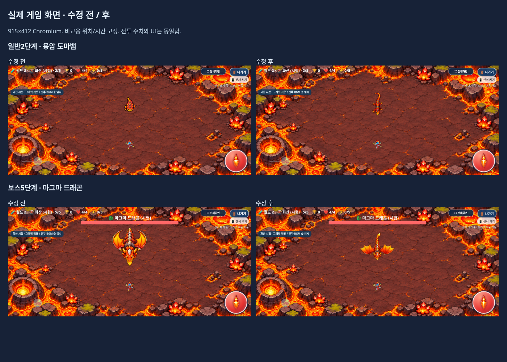

# 화산 외형·플레이어 이미지 수정

2026-11-04 KST · [Issue #17](https://github.com/26aiera11-cpu/helicopter-game/issues/17) · `feature/volcano-monster-player-visual-fix`

기준은 `5fe31bbbde7f9aa46d25aba03d64731485c2c70b`다. 기존 원격 작업 브랜치를 추적했고 리셋·main 병합·Pages 배포는 하지 않는다. `HELI_TRIO_SPEC.md`는 없어 이번 요청과 Issue의 확정 조건을 적용했다.

## 외형 변경과 승인

첨부 ZIP의 원본 3파일을 [references](references)에 그대로 보존했다. 01의 전체 윤곽과 02의 바깥으로 펼친 날개를 참고해 게임용 투명 PNG를 제작했다. 원본 참조를 잘라서 그대로 사용한 픽셀 복제본은 아니다.

- **용암 도마뱀:** 몸통과 머리를 좁히고 머리 외곽의 뿔을 제거했다. 네 다리·발가락과 긴 위쪽 꼬리를 표현했다. 기본 PNG와 대기1·이동4·공격1·피격2·소멸4, 총12프레임을 교체했다.
- **마그마 드래곤:** 작은 아래쪽 머리, 긴 위쪽 꼬리, 양옆으로 넓게 펼친 날개를 적용했다. 기본 PNG와 대기4·이동6·공격4·피격3·소멸4, 총21프레임을 교체했다.
- **파란 표시 부위:** 작업 전 사용자가 “이 방식으로 제거해 주세요”라고 승인했다. 턱 아래 연결부와 불꽃 돌출부 전체를 없애고 턱 끝 외곽선을 닫았다. 그 아래는 투명하며 실제 위쪽 꼬리는 남겼다. [사전 승인 기록](confirmed-removal.json)을 포함했다.

전체 화산 애니메이션은 **69프레임 그대로**다. 불씨콩·박쥐·갑충의 이미지와 매니페스트 항목, 배경·설원·플레이어/선택화면 자산은 바이트가 같다. 프레임 시간·반복 설정도 보존했다. 새 아틀라스의 실제 개별 좌표와 가상320×320셀의 기준점만 갱신했으며 행열 곱셈으로 자르지 않는다.

네 PNG는 이미지 생성 도구의 출력과 바이트가 같다. Python/Pillow/numpy는 픽셀 검사와 JSON 좌표 산출에만 사용했다. 원본 PNG에는 알파1~7의 미세 잔여 픽셀이 남아 있으며, 기존 렌더러가 그릴 때만 알파8 미만을 정리한다. 새 이미지에 맞춰 이를 추가 변경하지 않았다. [출처·해시·검토 한계](art-provenance.json)

[33프레임 전체 확대](frames-review.png) · [브라우저 프레임 뷰어](frames-review.html)

## 플레이어 이미지 원인 분석과 수정

월드에 따라 플레이어 이미지를 바꾸는 코드는 없었다. 기존 `sprites` 배열에 두 로더가 각각 `onload`에서 이미지를 대입했다.

1. 예전 `spriteURLs`의 로더
2. 최종 승인 `gameplayHeliImages`의 로더

예전 이미지 로드를1.4초 늦춘 제어 실험에서 최종 이미지가 세 캐릭터 모두 예전 이미지로 덮어써졌다. 이는 실제 재현한 로딩 경쟁이다. 사용자의 실제 갤럭시 세션에서 같은 순서가 발생했다는 것까지 확정하지 않는다. 정상 로딩의 수정 전 화면에서도 동일 페이지의 숲·설원·화산은 같은 최종 이미지를 사용했다.

수정은 **예전 로더의 `sprites` 쓰기를 제거**하고 최종 로더가 슬롯을 동기적으로 한 번 대입하도록 한 것이다. 예전 데이터 문자열은 보존했다. 각 이미지의 로딩 완료 콜백은 선택화면을 다시 그리는 작업만 한다. 이미지 파일과 인라인 PNG 데이터·그리기 크기·알파·회전 중심·프로펠러·충돌·전투 수치는 바꾸지 않았다.

| 캐릭터 | 최종 게임용 원본 크기 | 소스 |
|---|---:|---|
| 뾰코 | 1402×1122 | 기존 `trio_gameplay_final.png`와 동일 |
| 빙글 | 494×469 | 기존 승인 인라인 PNG와 동일 |
| 탱코 | 503×490 | 기존 `tanko_gameplay_cannon_restored.png`와 동일 |

뾰코는 기존 높이33.75와 원본 비율, 빙글/탱코는 기존32.67 표시 계산을 유지한다. 기존 월드1 표시 기준 자체를 재설계하지 않았다. 12시 시작 및360도 회전도 그대로다.

실제 게임의 몸체·프로펠러 그리기 호출을 투명 검사 캔버스에 옮겨 확대했다. 숲·설원·화산의3캐릭터×8방향에서 픽셀·표시 인자·알파·행렬이 일치했다. 정상 로딩의 수정 전/후도 일치했다. [이전 진단](diagnosis/player-before.json) · [수정 진단](diagnosis/player-after.json)

## 게임 화면과 검사

위 화면은915×412 Chromium의 실제 게임 렌더러다. 전후 비교를 위해 위치/시간과 피해 무적 상태 등을 제어했으며 수동 갤럭시 플레이 장면은 아니다. 새 아트의 크기를 키우기 위해 전투 반경을 바꾸지 않았다. 기존 일반 그림 폭42/보스132, 충돌 반경16/48을 유지했다.

- [검사 집계](test-summary.json)
- [일반 게임 집중 검사](native/test-results.json) · [오프라인 집중 검사](offline/test-results.json)
- [플레이어/보호 일반 검사](visual-native/test-results.json) · [오프라인 검사](visual-offline/test-results.json)
- [패키지·소스 일치](package-source-verification.json) · [기존 파일 보호](preservation-verification.json)

**최종 47개 모음 / 602개 검사 그룹이 모두 통과했다. 실패 모음은0개다.**

일반/오프라인 집중 검사는 각3캐릭터×3화면 크기×5단계의45개 실제 진입과 이동·발사·피격·처치 이벤트를 검사했다. 69프레임의 실제 소스 픽셀·비율·기준점·화면 가장자리·충돌 좌표 불변도 별도로 확인했다. 패키지 검사는11개 PNG/두 매니페스트/14스크립트, 실제 ZIP 추출과138개 그리기 기준점을 확인한다.

플레이어 전용 검사는 각 모드에서3캐릭터×3지역×8방향을 확인했다. 최초 검사 도구가4×4 행렬16개를2D `setTransform`에 전달해 빈 확대 캔버스를 만든 오류는 도구에서 수정했다. 2D 행렬6개를 사용하고 비어 있지 않은 픽셀 검사를 추가한 뒤 해당 모음만 재검사했다. 초기 잘못된 픽셀 비교는 최종 통과 결과에 포함하지 않았다. 제품의 회전·그리기 코드는 바꾸지 않았다.

기존 전체 회귀는 한 번 실행하고 그 뒤 제품 코드를 추가 수정하지 않았다. 기존 긴멀티터치→나가기 간헐 증상은 이번 모음의 통과 여부와 별개로 실기기 후속 검증 대상이다. 한 번의 통과를 근본 해결로 표현하지 않는다. 반복되는 기존 화면/독립 HTML 복제본은 저장소 밖에 보존하고 JSON/로그와 이번 요청 화면은 남겼다. [보존 목록](archived-regression-artifacts.json)

915×412·800×360·568×320의 실제 비교 화면은 [visual-native](visual-native), 최신 오프라인 게임 화면은 [offline](offline)에 있다. 이 저장소의 스크립트는 `tests/volcano_visual_fix.py`, `tests/volcano_art.py`, `tests/run_volcano_checks.py`, 이 폴더의 `capture_review.py`로 재현한다.

## 갤럭시 패키지와 남은 확인

**[최신 Galaxy ZIP 다운로드](https://github.com/26aiera11-cpu/helicopter-game/raw/refs/heads/feature/volcano-monster-player-visual-fix/dist/heli_trio_galaxy_test.zip?download=1)**

HTML **60,053,357바이트**, ZIP **43,713,541바이트**다. ZIP SHA-256은 `d342885fdb763434ad705a65fc1d02d8c2bbbbe9f452c104d2ab9ede6833e74f`이며 추출 HTML의 해시는 `88154f19bf1996bc6d9bb38fb17b443a3cbe866762aead40854e929e37efe289`다.

ZIP에는 HTML1개만 들어 있다. 새 외형과 플레이어 로더가 내장됐으며 외부 파일 없이 실행하는 동일 HTML을 네트워크 차단 상태에서 검사했다. 관리 환경의file:// 제한을 우회하지 않고 빈localhost origin을 이용했다. [다운로드/실행 안내](../galaxy-test/README.md)

물리 갤럭시 Samsung Internet/Chrome의 센서·권한·손가락 조작·다운로드/파일 연결·화면 선명도·프레임 속도/발열과 실제 스피커 청취는 미검증이다. 새 외형의 최종 선/비례는 사용자 시각 검토가 남아 있다. 화산 전투는 기존 숲 임시 프로필이며 새 AI·난이도·음악을 만들지 않았다. 이번 요청 밖의 긴멀티터치 입력 수정도 하지 않았다.

제품 변경은 `index.html`의 두 로더 처리, 화산 PNG4개와 매니페스트뿐이다. Galaxy 산출물2개·정확 차분 보호/패키지 검사·새 검사/보고서·최신 Galaxy 안내·개발 기록을 함께 갱신한다. 원본은 기준 커밋과 별도 작업 백업에 보존했다. 작업 브랜치에만 커밋·푸시하며 **main 병합과 GitHub Pages 배포는 하지 않는다.**
