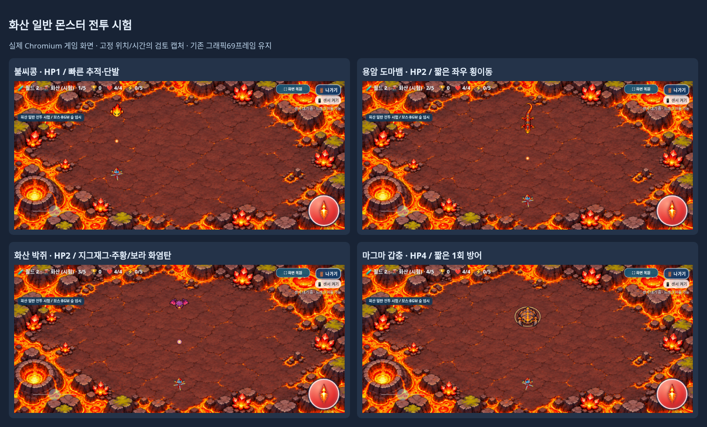
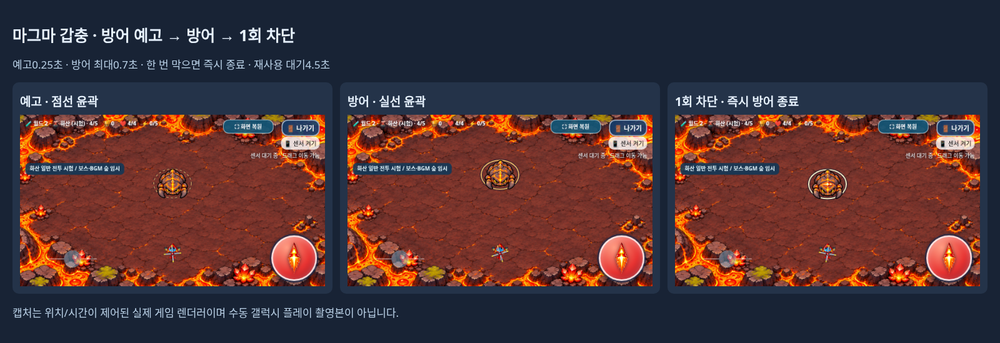

# 화산 일반 몬스터 고유 전투

2026-11-05 KST · [Issue #18](https://github.com/26aiera11-cpu/helicopter-game/issues/18) · `feature/volcano-normal-combat`

기준은 `4418d500e1dbcb087fa6cea44e706e21dbff2b7b`다. 기존 원격 작업 브랜치가 이 커밋과 일치함을 확인하고 그대로 작업했다. main은 `17da293570f422035d455add578dbc8412e4f24b`이며 병합·Pages 배포는 하지 않는다. 개발 기록51절과 실제 숲/설원/화산 코드를 확인했다. `HELI_TRIO_SPEC.md`는 없어 사용자 확정 규칙과 Issue를 적용했다.

## 구현한 행동과 시험 수치

새 `assets/volcano/combat.js`는 `world-2:volcano`의 일반 적만 관리한다. 기존 숲 `tactics[0]`의 이동38·발사 기준 간격4.3·탄속85에 종별 배수를 적용한다. 모두 **1차 플레이 시험값**이며 화산 전체 난이도의 최종 확정값은 아니다.

| 몬스터 | 기존 HP → 새 HP | 이동속도(px/s) | 발사 간격(s) | 탄속(px/s) | 행동 |
|---|---:|---:|---:|---:|---|
| 불씨콩 | 1 → 1 | 45.6 | 3.44 | 85 | 가장 빠른 직선 추적·단발 압박 |
| 용암 도마뱀 | 1 → 2 | 38 | 4.3 | 89.25 | 추적 중 짧은 좌우 횡이동·조준 단발 |
| 화산 박쥐 | 1 → 2 | 41.04 | 4.945 | 95.2 | 완만한 지그재그·주황/보라 단발 |
| 마그마 갑충 | 1 → 4 | 19 | 6.235 | 80.75 | 느린 추적·짧은1회 방어·간헐 단발 |

기존 화산은 숲 임시 프로필로1~4단계 이동38/43/48/53과 HP1을 사용했고, 재발사 간격은 `4.3×(.85+random×.55)/(1+(phase-1)×.07)`이었다. 새 일반 전투는 위 종별 고정 배수를 사용한다. 최초 발사 타이머는 기존 생성값과 해당 간격 중 작은 값을 사용한다. 스폰 간격·동시 적 수·일반6킬 목표·종별 단계 배치에는 손대지 않았다. 혼합 스폰은 구현하지 않았다.

도마뱀은 첫0.6초 뒤0.32초 횡이동/0.88초 추적을 반복하며 좌우를 번갈아 사용한다. 박쥐는0.55/0.8/0.65/1.0초 길이의 완만한 좌우 곡선을 순환하고 기존 개체의 무작위 초기값으로 시작 순서/방향을 분산한다. 매 프레임 새 난수를 뽑거나 순간이동하지 않는다. 종별 최고 이동속도를 넘지 않게 벡터를 정규화하고 기존 좌표 경계를 유지한다.

상태/발사 경계에서 시간을 나누고 최대1/120초 단위로 이동한다. `WeakMap`에 개체별 상태를 저장해 전역 단계 변경으로 종이 섞이지 않게 했다. `gameVolcano.prepare` 이후 전투 준비를 하므로 아트ID와 HP/행동이 일치한다. 정상5단계 보스 전 일반6마리도 같은 갑충 HP4/행동을 사용하며, 개발자5단계는 기존처럼 바로 드래곤이다.

## 갑충 방어와 탄환

갑충은 첫2.5초 접근 후 **0.25초 점선 예고 → 최대0.7초 실선 방어**를 사용한다. 방어 중 첫 피격 한 번만 막고 즉시 방어를 끝낸다. 이후4.5초 대기 후 다시 예고하며, 방어에 아무것도 맞지 않아도0.7초 뒤 종료한다. 예고/방어 중에는 이동을35%로 줄이고 사격을 잠시 보류한다. 장시간 무적이나 반사는 없다.

방어는 기존 일반 적의 HP 감소 직전에만 적용한다. 탄환의 접촉/소비 처리 뒤 방어 여부를 확인하므로 막힌 탄환도 정상적으로 소모된다. 탱코는 기존 잔여 관통1회를 쓰고 같은 갑충을 재타격하지 않는다. 남은 관통이 있으면 다른 적을 공격할 수 있다. 뾰코5강의 관통과 빙글 유도탄/다발도 기존 규칙대로 처리하며, 한 발을 막았다고 다른 탄환까지 차단하지 않는다. 보스·아이템 몬스터에는 방어가 적용되지 않는다. 보조 폭발 경로도 같은 단일 방어 훅을 사용하되 기존 피해/점수 코드를 재작성하지 않았다.

화염탄은 기존 `emitEnemyShot`과 `enemyBullets`를 사용한다. 주황 몸체·밝은 중심, 박쥐의 보라 외곽선만 새 캔버스 표시로 구분한다. 반경5/수명3.4초와 `hurt()`의 피해1·기존 무적/게임오버 경로를 재사용한다. 화산 일반 화염탄만 전체28발·개체당3발 상한을 두며 드래곤 탄환/월드1/설원 탄환에는 적용하지 않는다. 실제 기본 발사 간격에서는 이보다 적게 남는다.

새게임·단계 전환·보스 등장·나가기 확정·게임오버에서 일반 전투 상태를 정리한다. 게임오버의 남은 탄환은 기존3초 정지 화면에 남으며 갱신되지 않고, 새게임/단계/나가기의 기존 배열 초기화로 제거된다. 종료창은 상태/시계를 멈췄다가 취소 시 이어서 진행한다.

위 이미지는 실제 Chromium 게임 렌더러를 제어된 위치/시간으로 캡처한 것이다. 수동 갤럭시 촬영본이나 무적 없이 진행한 난이도 평가는 아니다. [915×412·800×360·568×320 개별 화면](combat-native)

## 보호 범위

- 승인된 화산 기본PNG/아틀라스/배경/매니페스트와69프레임은 모두 원본 해시 그대로다. 날씬한 도마뱀·펼친 드래곤·턱 아래 제거 결과를 다시 그리거나 리인코딩하지 않았다.
- `assets/volcano/volcano.js`와 설원 모듈·공유 난이도 설정은 바이트가 같다. 이동/발사는 기존 아트의 move/attack, 실제 HP 감소/처치는 hit/defeat 이벤트로 이어진다. 방어는 새 프레임 대신 작은 윤곽 표시만 사용한다.
- 드래곤의 HP/강화배수·이동·공격/탄속·보상·0.94초 소멸 흐름은 그대로다. 보스 생성에 추가한 훅은 사라지는 일반 적 상태 정리뿐이다.
- 뾰코·빙글·탱코 이미지/로딩 경쟁 수정·회전 중심·공격/이동·업그레이드/탱코 밸런스·아이템 몬스터·점수/기록·음악/효과음·센서/조이스틱/멀티터치·전체화면/나가기·3초 게임오버를 보호했다.
- 기존 안내가 모든 화산 전투를 숲 임시값으로 설명해, 작은 안내 문구만 ‘일반 전투 시험 / 보스·BGM 숲 임시’로 바로잡았다. 버튼 구성/위치는 바꾸지 않았다.

[원본 자산·코드 보호 증거](preservation-verification.json)

## 검사 결과

**최종 49개 모음·630개 검사 그룹이 통과했다. 최종 실패0개다.**

일반/오프라인 집중 검사13그룹을 먼저 통과한 후 접촉 경계·실제 전환/사망 정리를 보강했다. 마지막 전체 회귀는 한 번 실행했다. 기존HP1 가정은 HP1/2/2/4로, 죽이는 검사는 실제 남은HP만큼 발사하도록, 내장 스크립트 기대값은15개로 갱신했다. 전투 수치를 검사에 맞춰 바꾸지 않았다. 전체 회귀의 이미지 실패 대체 경로 모음1개에 남아 있던 ‘일반HP는 모두1’ 기대값을 발견해1/2/2/4로 수정하고 그2그룹만 재검사했다. 최초 실패 로그와 재검사 결과를 모두 남겼으며 전체 회귀를 반복하지 않았다. [전체 집계·모음별 명령/결과](test-summary.json)

새 일반 전투의 최종 검사는 다음을 포함한다.

- 각 모드에서3캐릭터×3화면×4종=36번의 실제 생성/이동/발사/피격/처치.100점과 처치 목표1회, 사망 애니메이션 확인.
- 30/60/120Hz에서4초 이동 결과 비교와 좌우 횡이동/지그재그의 양방향 속도, 최대 속도와 네 화면 경계 검사. [수치](regression/volcano_combat-native/test-results.json)
- 세 캐릭터0/2/3/5강의 한 번 방어·실제1/1.5 피해·동일 탄환 재타격 방지·다발 나머지 피해·탱코 관통 공유/소진/소멸.0.25/0.7/4.5초 상태 경계와 재사용, 죽은 적의 공격/방어 재개 금지.
- 첫 발을 즉시 발사하도록 맞춘12초 관찰에서 불씨콩/도마뱀/박쥐/갑충이4/3/3/2회 단발 발사. 강제 용량 조건에서28발/개체당3발 상한과 수명 종료 후 재발사 확인. 자연 첫 발의 무작위 지연과 구분한다.
- 실제 화염탄 피격/무적·탱코 상쇄와 기존29px 접촉 경계, 일반5단계 갑충6마리/600점·드래곤 정상 등장, 다른 지역/아이템 몬스터 비적용, 종료창 정지/재개·개발4기록키 비저장, 실제 단계/게임오버 정리.
- 기존 일반/오프라인 아트 집중 검사 각각45번 실제 진입과69프레임 소스 픽셀·알파·비율·기준점·가장자리/충돌 불변. 보스 보상1회·애니메이션 종료, 설원→화산 연결, 실패 자산 대체 경로도 재확인.

[일반 전투 최종 검사](regression/volcano_combat-native/test-results.json) · [오프라인 최종 검사](regression/volcano_combat-offline/test-results.json) · [아트 일반](native/test-results.json) · [아트 오프라인](offline/test-results.json)

전체 회귀는 기존 월드1 20단계/시험30단계·기록 분리, 설원4종/혼합/돌진/보스3패턴, 전투/탱코·아이템·점수/선택·BGM·센서 계산/조이스틱·멀티터치·전체화면/나가기/게임오버를 포함한다. 이전 긴멀티터치 후 나가기의 간헐 증상은 단일 실행 통과로 근본 해결을 주장하지 않는다. 기존 입력 코드는 수정하지 않았다.

중복되는 기존 회귀 화면/동일 독립HTML 복제본은 작업 공간의 별도 폴더에 보존하고 요청한 신규 화산 화면·JSON/로그는 커밋한다. 기존 추적 역사 보고서/화면은 그대로다. [보존 목록/재현](archived-regression-artifacts.json)

## 파일·갤럭시 패키지·남은 확인

제품 변경은 새 `assets/volcano/combat.js`, `index.html`의 준비/갱신/방어/표시/정리 훅, `assets/worlds/worlds.js` 안내2문자열이다. 빌드/ZIP 스크립트와 `dist`2개, 정확 차분 보호/새 전투 검사·기존HP/스크립트 기대값, 이 보고서/화면·최신 Galaxy 안내와 `DEVELOPMENT_LOG.md`를 갱신했다.

**[최신 갤럭시 ZIP 다운로드](https://github.com/26aiera11-cpu/helicopter-game/raw/refs/heads/feature/volcano-normal-combat/dist/heli_trio_galaxy_test.zip?download=1)**

HTML **60,060,497바이트**, ZIP **43,714,723바이트**다. ZIP SHA-256 `5e8807affdf73be5fdfdf469da9c54ce22d385e398f2b708004c42296ad83159`, HTML SHA-256 `2229828fbe4aafc3995856301420649603372177825112a360f9604df1683d7e`.

15개 스크립트·화산11PNG/69프레임 매니페스트·게임 실행에 필요한 기존 이미지/CSS/음원을 단일 HTML에 포함했다. ZIP에는 `heli_trio_galaxy_test.html` 하나만 있다. 실제 별도 압축 해제/CRC/전체 해시와 원본 소스/이미지 바이트 일치, 네트워크 차단 실행을 확인했다. [패키지 검증](package-source-verification.json) · [실행 안내](../galaxy-test/README.md)

실제 Galaxy Samsung Internet/Chrome의 센서 권한·손가락 조작·다운로드/로컬 파일 연결·지그재그/방어의 체감 가독성·실전 난이도·성능/발열 및 스피커 청취는 미검증이다. 관리 환경의file:// 정책을 우회하지 않고 빈localhost origin에서 네트워크를 차단한 동일 HTML을 검사했다. 화산 전체 난이도 확정·혼합 등장·드래곤 신규 패턴·전용BGM은 후속 작업이다. 이번에는 구현하지 않았다.

작업 브랜치에만 커밋·푸시하며 **main 병합과 GitHub Pages 배포는 하지 않는다.**
