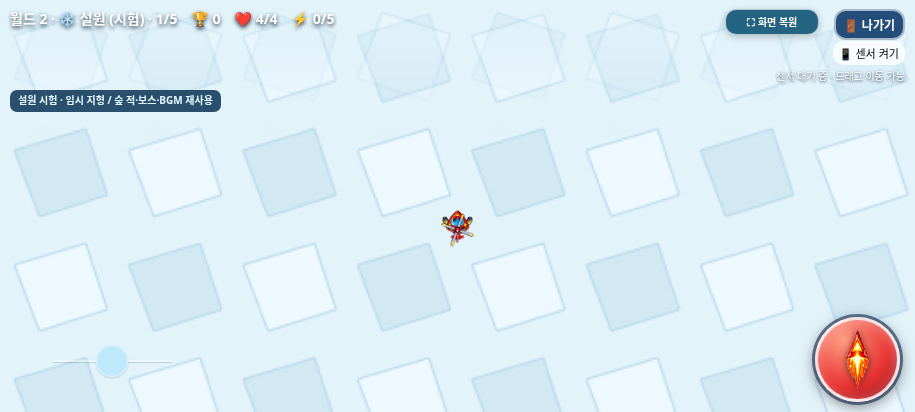

# 월드 2 설원 확장 기반 · 안전한 시험 모드

2026-11-03 KST · `feature/world2-snowfield` · [GitHub Issue #5](https://github.com/26aiera11-cpu/helicopter-game/issues/5)

기준은 최신 조이스틱 위치 커밋 `80aee3931b0425d314fafcb9b515f71ec5bac873`이다. 원격의 동명 브랜치도 같은 커밋이었으며 기존 작업을 보존해 이어서 개발했다. main은 `17da293570f422035d455add578dbc8412e4f24b`에서 변경하지 않는다. `HELI_TRIO_SPEC.md`는 작업 공간에 없으며 이번 사용자 요청과 Issue #5의 범위/보호 조건을 적용했다. Issue에 댓글을 쓰거나 상태를 변경하지 않았다.

## 실행 방법과 기본 동작 보호

기본은 기존 **월드 1: 숲→바위→바다→사막, 총20단계에서 클리어**다. 캐릭터 선택·게임 시작·게임 오버3초·최종 결과·TOP10은 기존 흐름을 유지한다.

**선택화면 → 게임 방법 → ‘월드 2 설원 시험 모드’ 체크 → 닫기 → 게임 시작**으로25단계 시험 경로를 켠다. 온라인 로컬 개발 주소에서는 명시적인 `?world2=1`도 가능하다. OFF가 기본이며 설정을 저장하지 않으므로 보통 주소로 다시 접속하면 기존 경로로 돌아온다. 이번 단일 HTML도 도움말 체크박스로 시험할 수 있다.

시험 경로는 **월드1의 사막 보스→월드2 설원1~4단계→설원5단계 보스→‘설원 시험 완료!’→선택화면**이다. 시작 시 경로를 확정하며 진행 중이나 게임 오버 대기 중에는 모드를 바꿀 수 없다. 화산/폭풍/요새 등 미구현 지역은 등록하거나 진입시키지 않는다.

## 구조와 임시 설원

`assets/worlds/worlds.js`에서 월드/지역 메타데이터와 경로를 관리한다. 기존 저장 기록과 아이템 예약의 지역ID **0~3**을 그대로 두고 설원을 **4**로 추가했다. 지역의 `key`는 `world-1:forest`, `world-2:snowfield`처럼 구분하며 `worldId`, `localIndex`, 전투/이미지/음악 프로필, 일반4/보스5단계 정보를 명시했다. 향후 새 지역은 메타데이터에 추가하고 전용 프로필·자산을 연결할 수 있다. 기존 엔진과 4개 지역을 대규모로 재작성하지 않았다.

| 구분 | 월드1 | 설원 시험 |
| --- | --- | --- |
| 지역ID | 숲0/바위1/바다2/사막3 유지 | 4 / 월드2의 지역0 |
| 구조 | 지역별 일반4+보스1 | 동일 |
| 일반 처치 목표 | 기존 단계별6 유지 | 동일 |
| 전투 | 기존 지역별 능력치·패턴 유지 | **숲 프로필0 임시 재사용** |
| 배경 | 기존 PNG 그대로 | 실행 시 생성한 단순 눈색 기하학 패턴 |
| 적/보스 | 기존 이미지 그대로 | 기존 숲 이미지 참조 재사용 |
| BGM | 기존 지역/보스/선택 MP3 그대로 | 기존 숲 일반/보스 곡 재사용 |
| 종료 | 사막에서 기존 클리어 | 설원 보스 후 안전 종료 |

설원 화면에 **‘설원 시험 · 임시 지형 / 숲 적·보스·BGM 재사용’**을 표시한다. 최종 그래픽·몬스터·보스·밸런스는 확정하지 않았다. 새 오디오·그래픽 파일이나 새로운 장애물/날씨/공격을 추가하지 않았다. 숲의 기본 보스HP20과 기존 강화 보정1/1.1/1.4/1.6/1.9/2.2배, 기존 일반/보스 이동·탄속·공격 패턴을 시험용으로 사용한다.

기존 코드는 지역ID를 체력/이동/공격/음악 배열 인덱스로 함께 사용했다. 신규ID4가 사막보다 자동으로 어려워지거나 없는 음악·스프라이트를 참조하지 않도록 **지역ID와 재사용 프로필을 분리**했다. 월드1의 프로필은 기존ID와 같아 계산 결과가 바뀌지 않는다.

## 승계와 보상 순서

사막 보스 치명타 → 기존50:50 체력+2/강화+1 보상(최대치 제한) → 보스2,000점 → 다음 지역 진입 → 기존 지역 체력+2 순서다. 보상 객체의 중복 방지와 최종 보스 보상도 유지한다. 기본 모드의 마지막 사막에서는 원래대로 지역 이동 회복이 없다. 시험 모드에서는 다음 지역인 설원이 있으므로 기존 지역 전환 규칙으로 회복한다.

플레이어 객체·강화 단계, 일반 드롭 아이템의 객체/종류/좌표/남은 수명, 살아 있는 아이템 몬스터와10초 중 남은 시간, 이미 발동한 등장 예고의 남은 시간을 그대로 넘긴다. 전환을 이유로 수명을 다시 채우지 않는다. 기존 적/적탄환/일반 생성 경고 정리와 새 게임 초기화는 유지한다.

아이템 몬스터는 지역당 서로 다른3개 일반 단계·일반1~4처치 조건, 단계별1회, HP5/80×64/반경20/10초/200점/보상 드롭을 그대로 사용한다. 보스전 신규 예약은 없고 이전 예약만 도착할 수 있다. 전역 지역ID와 `regionKey`를 함께 남겨 월드1 숲과 월드2 첫 지역의 예약/진행/점수가 충돌하지 않는다.

## 점수와 기록 보호

100/200/500/2,000점 규칙과 단계/처치 중복 방지를 변경하지 않았다. 설원 추가로 길어진 시험 기록은 일반 TOP10과 직접 비교하지 않는다.

| 데이터 | 기존 기본 모드 | 설원 시험 모드 |
| --- | --- | --- |
| TOP10 | `heliTrio.top10.v1` 유지 | `heliTrio.world2Trial.top10.v1` |
| 분석 최근100회 | `heliTrio.playHistory.v1` 유지 | `heliTrio.world2Trial.playHistory.v1` |
| 버전 | v1 유지 | v1 |
| 순위 UI | 기존 TOP10 | ‘설원 시험 TOP10’ 명시 |

두 모드 모두 세 캐릭터 통합·동점 선달성·중도 종료 분석만 저장하는 규칙을 유지한다. 기록에 월드·지역 키를 추가하며 이전 v1 기록은 기존ID로 월드1을 읽는다. 별 점수 환산이나 기존 저장 데이터 강제 변환/삭제를 하지 않는다. 저장 불가/손상 시 게임이 계속 실행되고 모드 전환 중 메모리 기록도 분리해 보존한다.

## 검증 자료

- [네이티브 월드 검사](native/test-results.json), [단일 HTML 오프라인 검사](offline/test-results.json), [전체 집계](test-summary.json).
- **총26개 모음·353개 그룹 통과**(기존314+월드 네이티브20+오프라인19). 기존 기능 회귀314개 그룹: 기본20단계 전체 진행, 세 캐릭터/강화0~5 공격, 탱코 관통/차단/연사, 보상/아이템 유지, 아이템 독립 시스템·크기/예약, 점수/순위·저장 오류, 선택/애니메이션, 음악, 전체화면, 게임 오버/종료창, 조작/센서 비교, 단일 HTML과 조이스틱 디자인.
- `tests/worlds.py`는 실제 Chromium에서 원래 생성 예고·적 생성·발사·피격·처치·전환 함수를 실행한다. 신속하고 결정적인 검증을 위해 조준 위치/시간·무적·생성 간격 등을 검사 코드에서 통제한다. 사용자가 직접 일반 난이도로 완주한 기록이나 물리 센서 검사는 아니다.
- 모든 기존 PNG/음원과 조작 자산을 바이트 단위로 비교했다. 새 월드 연결 부분을 정확히 되돌리면 index와 변경한 보조 모듈이 기준 커밋과 일치한다. 과거 검사도 이 제한된 변경을 먼저 역변환한 뒤 기존 보호 검사를 수행한다. 기존 보호 해시나 검증을 포괄적으로 해제하지 않았다.

| 실제 전투 경로 | 캐릭터 | 일반 처치 | 아이템 처치 | 보스 | 단계 수 | 점수 |
| --- | --- | --- | --- | --- | --- | --- |
| 기본 월드1 | 트리오/빙글/탱코 각각 | 120 | 0 | 4 | 20 | 각28,000 |
| 설원 시험 포함 | 트리오/빙글/탱코 각각 | 150 | 0 | 5 | 25 | 각35,000 |
| 아이템 생성까지 시험 | 트리오 | 150 | 15 | 5 | 25 | 38,000 |

아이템0마리 행은 진행/기본 점수를 구분하기 위해 전용 생성 할당을0으로 둔 검사다. 제품의 기본 지역당3회 설정은 그대로이며 마지막 행에서는5지역×3회 전체를 실제로 예약·생성·처치했다.

검사 도구의 탱코 잔여 탄환/오디오 관찰자 중복/캡처 후 타이머 대기 경합을 고쳤다. 터치 UI는 세션 간 입력 혼용으로 클릭이 누락되던 검사를 한CDP 세션의60ms 실제 접촉으로 통일하고 기존500ms 게임 클릭 보호가 종료된 후 검사했다. 제품의 조작/음악/관통 코드 수치는 수정하지 않았다. 최종 검사에서는 모두 통과했다.

### 실제 브라우저 화면



[800×360](native/snow-entry-clear-800x360.png) · [568×320](native/snow-entry-clear-568x320.png) · [임시 숲 보스 재사용](native/snow-boss-915x412.png) · [기본 월드1 클리어](native/world1-default-clear.png) · [설원 시험 클리어](native/snow-trial-clear.png) · [도움말 opt-in](native/trial-opt-in-help.png) · [시험 순위표](native/trial-leaderboard.png) · [설원 게임 오버](native/snow-game-over.png)

명료한 진입 캡처는 피격 무적 깜박임을 끄고 같은 게임 프레임을 고정해 촬영했다([캡처 조건](clear-capture-results.json)). 실행 중 game canvas와 DOM을 직접 캡처했다. 이미지 편집/합성이나 실제 갤럭시 기기 사진은 아니다.915×412·800×360·568×320에서 HUD/프로토타입 안내/보스 표시·조이스틱30px/22px·발사/전체화면/나가기 배치와 실제3포인터 이동·회전·발사·해제를 검사한다.

## 파일과 실행

제품 변경은 `assets/worlds/worlds.js`, `assets/worlds/worlds.css` 신규와 `index.html`의 지역/프로필 연결, `assets/item_monster/item_monster.js`의 키/프로필2곳, `assets/score/score.js`의 월드 필드/시험 저장소 분리, `assets/selection/selection.js`의 시험 클리어 결과 인식1곳이다. 빌더/ZIP 검증, 월드 전용 검사·기존 보호 검사, 이 보고서/개발 기록/최신 갤럭시 자료를 함께 갱신한다. 기존 controls.js/CSS, 캐릭터/적/보스/선택 이미지와 오디오 파일은 수정하지 않았다.

```sh
python scripts/build_galaxy_test.py
python scripts/package_galaxy_test.py
PYTHONDONTWRITEBYTECODE=1 python tests/worlds.py --artifacts /tmp/world2-native
PYTHONDONTWRITEBYTECODE=1 python tests/worlds.py --standalone --artifacts /tmp/world2-offline
```

[갤럭시 다운로드/실행 안내](../galaxy-test/README.md). ZIP 안에는 최신 `heli_trio_galaxy_test.html` 하나뿐이며 원래 인라인3개+월드/아이템/조작/점수/선택5개=스크립트8개와 이미지/음원을 모두 내장한다.

실제 갤럭시 Samsung Internet/Chrome의 파일 열기·센서 권한/감도·멀티터치 체감·길게 누르기 메뉴·주소창/전체화면·성능·스피커 청취는 미검증이다. 직접 file:// 이동을 막는 관리 정책을 우회하지 않고 정확히 같은 단일 HTML을 네트워크 없는 문서에서 실행했다. 설원 최종 아트/전용 적·보스/난이도, 월드2 이후 지역은 후속 결정 사항이다. main 병합과 GitHub Pages 배포는 하지 않는다.

패키지: HTML 32,399,479바이트 / ZIP 23,464,547바이트. [현재 소스/압축 검증](package-source-verification.json), [빌드](build-results.json), [ZIP](zip-results.json).
